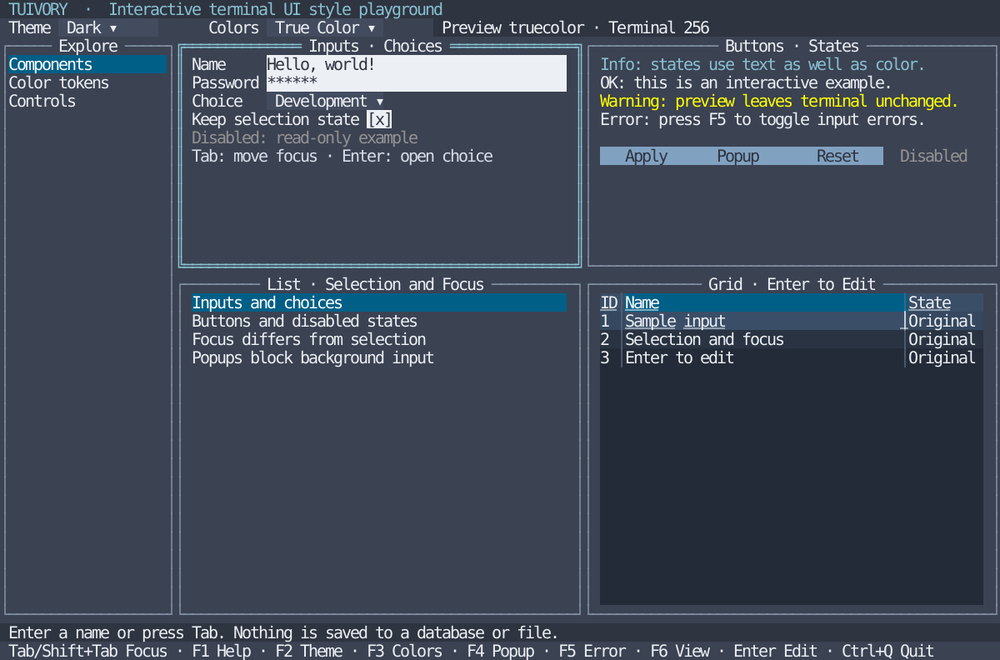

# Tuivory — TUI component library

[한국어 (default)](README.md) · **English**

**0.2.0**: shared components, static executables and overlay repairs. [Release guide](docs/release-0.2.0.en.md).

**Tuivory** (TUI + ivory) provides reusable TUI components and styles, with shared design rules and data for implementations in multiple languages. Korean is the primary documentation language; this English guide covers installation, usage, and the current scope.

Go and Rust provide shared component models, styles and tview/Ratatui renderers. Hosts compose screens and choose cross-component focus order, global keys, data and business actions. Tuivory provides internal control interaction and configurable presentation/layout tools. [Component/application boundary](docs/component-boundary.en.md) · [Current support audit](docs/component-audit.en.md).

Python and JavaScript currently provide token-reading examples; their UI packages are planned. Shell provides an ANSI reference example.

| Directory | Contents |
| --- | --- |
| [design/](design/README.en.md) | Shared specifications, themes, JSON tokens and schemas, CSV reference data |
| [go/](go/README.en.md) | Go module, shared component models/tview renderers, styles and examples |
| [rust/](rust/README.en.md) | Rust crate, shared component models/tokens, optional Ratatui renderers and bilingual examples |
| [python/](python/README.en.md) | Python token reading example |
| [javascript/](javascript/README.en.md) | Node.js token reading example |
| [shell/](shell/README.en.md) | ANSI reference output |
| [examples/](examples/README.en.md) | Example locations and shared static layouts |
| [docs/](docs/README.en.md) | Architecture, principles, support scope, and sources |

## Use from Go

Requires Go 1.24 or later. The module path is `github.com/leechis7/tuivory/go` and the package name is `tuivory`.

```sh
go get github.com/leechis7/tuivory/go@v0.2.0
```

Apply styles to widgets created by your application:

```go
import "github.com/leechis7/tuivory/go"

theme, err := tuivory.New("dark", "256")
if err != nil { return err }
theme.Form(form)
theme.Button(button)
```

Themes: `dark`, `light`, `blackwhite`. Color profiles: `8`, `16`, `256`, `truecolor`. The current release is **0.2.0**, tagged `go/v0.2.0` for Go and `rust/v0.2.0` for Rust Git dependencies. It includes shared UI, bilingual playgrounds and documentation. The [release](https://github.com/leechis7/tuivory/releases/tag/go/v0.2.0) provides static Linux ARM64/x86_64 playgrounds/catalogs and source packages.

See the [Go usage guide](docs/go-package.en.md) for a complete runnable example, roles, state handling, and theme changes. See [installation and usage](docs/installation.en.md) and the [documentation index](docs/README.en.md).

## Run the playground

From a repository checkout, run:

```sh
go -C go run ./cmd/tuivory --lang en
make build
./bin/go/tuivory-linux-arm64 --lang en
```

The playground uses synthetic data and needs no database or server. `make build` produces a single Linux ARM64 binary at `bin/go/tuivory-linux-arm64`. This binary supports both languages: `--lang en` selects English; `--lang ko` or no language flag selects Korean. `make run` uses the Korean default. The starter template runs with `go -C go run ./examples/starter` and has Korean example labels.

| Key | Action |
| --- | --- |
| Tab / Shift+Tab | Move focus |
| F1 | Open help |
| F2 | Cycle themes |
| F3 | Cycle color profiles |
| F4 | Preview current inputs in a popup |
| F5 | Toggle input error indicators |
| F6 | Switch between components, color tokens, and controls |
| Esc | Close the open dropdown or popup |
| Ctrl+Q | Quit |

Use a terminal of at least 80×24 cells. Color selection previews a token profile; it does not change the terminal's capabilities or palette. See the [full playground guide](docs/playground.en.md).



This reference image renders actual Go widgets in English through a simulated screen. It is not a capture from a physical terminal. Other views: [light](docs/images/playground-light-en.svg), [black and white](docs/images/playground-blackwhite-en.svg), [popup](docs/images/playground-popup-en.svg).

## Use Rust

The crate supports Rust 1.85+ through Git tag `rust/v0.2.0` or a local path dependency on `rust/`. See the [Rust guide](rust/README.en.md) for setup, API, and scope. It uses shared candidate tokens and is not a port of the full Go widget styler.

```sh
cargo run --manifest-path rust/Cargo.toml --locked --example tokens -- dark 256
make test-rust check-rust
make check-rust-consumers
python3 tools/check_rust_module.py
```

The optional Ratatui 0.30.2 adapter and Crossterm 0.29 interactive example require Rust 1.88+. Run `make run-rust ARGS="--lang en"`; `make build-rust` creates `bin/rust/tuivory-linux-arm64`. Default `make build` still produces only Go. See [Rust views and controls](docs/rust-playground.en.md).

## Shared Tree

Go/tview and Rust/Ratatui now provide stable-ID expansion/selection/scroll models and public Tree renderers with the same candidate palette and interaction rules. Included in `go/v0.2.0` and `rust/v0.2.0`. [Support audit](docs/component-audit.en.md) · [Tree API and bilingual examples](docs/tree.en.md)

```sh
make run-tree-go ARGS="--lang en"
make run-tree-rust ARGS="--lang en"
```

## Validation

```sh
make test
make check
make check-consumers
python3 tools/check_go_module.py
```

These checks cover Go style parity and state preservation, shared data, local documentation links, cross-language token reading, and standalone Go module use. Python and Node.js examples have no external dependencies; cross-language checks require Node.js 18 or later. Generated Go/Rust tokens are checked against the shared source data.

Actual terminal observations are recorded separately from simulated checks: [evidence template](evidence/README.en.md) and [initial migration evidence](evidence/initial-migration.en.md). These checks do not establish support for every terminal or user palette.

## Contributing and project information

Read the [contribution guide](CONTRIBUTING.en.md). Korean remains the default; English entry guides are maintained alongside the corresponding Korean documents.

Tuivory is independent of LazyOra, its first integration target. Application and database internals stay outside the shared core. Further details: [sources](docs/sources.en.md), [roadmap](docs/roadmap.en.md), [changelog](CHANGELOG.en.md).

Developer: **Chaekang Lee (이채강)** · leechis7@gmail.com

License: [AGPL-3.0-only](LICENSE). See [NOTICE](NOTICE.en.md) for the origins of the initial code and materials.

## Shared workspace components

The [tabs, panels, splitters, status, and breadcrumbs guide](docs/workspace.en.md) documents public Go/Rust APIs and shared control/color/state principles. Run database-free bilingual integrated examples with `make run-workspace-go ARGS="--lang en"` or `make run-workspace-rust ARGS="--lang en"` from the root. These APIs are included in `go/v0.2.0` and `rust/v0.2.0`; CI evidence and actual application integration are distinguished in [work tracking](https://leechis7.atlassian.net/browse/TVR-7).

## Static distribution and CentOS 7.4

Distributed executables for Go, Rust and future languages must require no separate runtime or shared libraries, and packages must allow static linking in host applications. Current source disables Go CGO and uses Rust musl. Select x86_64 explicitly with `make build-go-x86_64` or `make build-rust-x86_64`. See [builds, support scope and differences from the existing release](docs/static-build.en.md).

## Shared control states, focus and popups

[TVR-8 guide](docs/focus.en.md) covers disabled/read-only/busy composition, stable-ID navigation, nested popup routing/dismissal/restoration and bilingual Go/Rust hosts. These APIs are included in v0.2.0. Follow the [ordered backlog](docs/components-backlog.en.md), requesting commit/publication approval after each completed and validated stage.

[TVR-9: Inputs and forms](docs/forms.en.md): `Form / FormField / FormWidget`. Public Go/Rust APIs and localized hosts; included in 0.2.0.

[TVR-10: Lists, menus and search selection](docs/collections.en.md): `ListModel / SearchPicker / ListWidget / SearchPickerWidget`. Public Go/Rust APIs and localized hosts; included in 0.2.0.

[TVR-11: Tables and data grid](docs/grid.en.md): `Grid / GridSource / GridWidget`. Public Go/Rust APIs and localized hosts; included in 0.2.0.

[TVR-12: Notices, progress and data states](docs/feedback.en.md): `NoticeQueue / Progress / DataState`. Public Go/Rust APIs and localized hosts; included in 0.2.0.

[TVR-13: Layout, density and supporting components](docs/layout.en.md): `SpacingTokens / StackLayout / Badge / Chip / Help`. Public Go/Rust APIs and localized hosts; included in 0.2.0.

Go popup/shadow wide-glyph protection: [shared drawing API](docs/overlay-drawing.en.md).

[TVR-17 grid configuration](docs/grid.en.md): simple/data presets, ranges, column options, status and stale-response protection on the same Go/Rust grid. Unreleased source.

[Shared menus](docs/menus.en.md): Go/Rust hierarchy, bar/back navigation, shortcuts/disabled state, popup/caller-context requests and bilingual database-free hosts. Unreleased source, absent from v0.2.0 tags.
