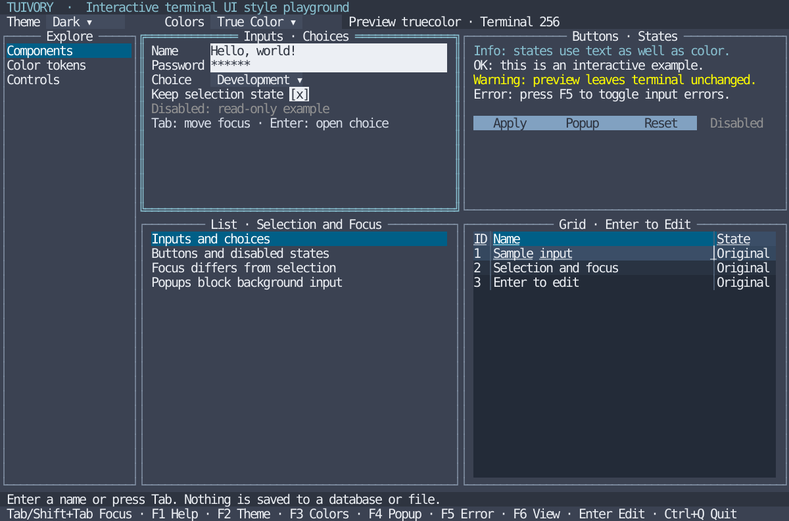

# Tuivory — TUI component library

**0.11.0:** grid editing, columns, paste and find. **Do not use 0.10.1** · [Withdrawal and upgrade](docs/withdrawn-versions.en.md).

TVR-7 in 0.11.0: [grid in-cell editing, column pinning/visibility/order, paste, find, view state and details](docs/grid-workspace.en.md). Available from 0.11.0.

**0.10.2 TVR-26:** [Windows Go facade](docs/ui-facade.en.md) no longer references Unix-only terminal APIs. Available in 0.10.2; do not use 0.10.1.

**0.10.2 TVR-29:** [Compact popup shadows](docs/popup-shadows.en.md) now use one cell right and half a row down with stronger dark-theme contrast. Available in 0.10.2.

[한국어 (default)](README.md) · **English**

0.10.0 TVR-18: [opt-in Go/Rust tab/tree drag and drop](docs/drag-drop.en.md), immutable host-approved movement requests, captured outside input, cancellation and keyboard alternatives. Available starting with 0.10.0.


**0.9.1 TVR-27:** [Unified example executables](docs/examples.en.md) provide one file per language, built only for the current Linux host architecture. Select examples with `--demo tree`, `--demo menu`, `--demo syntax`, etc.

**0.9.0 TVR-24:** [optional Oracle SQL/PLSQL analysis, common tokens and editor migration](docs/syntax.en.md). Go uses one root import; Rust opts in with syntax-sql.

**0.10.0:** compose Go UI through `github.com/leechis7/tuivory/go` alone. Existing `/ui` and `/terminal` paths remain compatible. [Single import and name mappings](docs/ui-facade.en.md).

Reusable TUI components for **Go/tview and Rust/Ratatui**. Hosts compose screens, supply data and execute actions. Python/JavaScript currently provide token-reading examples; reusable UI packages are planned.

**0.11.0** · [Release](docs/release-0.11.0.en.md) · [Documentation](docs/README.en.md) · [API](docs/api/README.en.md)

## Install

```sh
go get github.com/leechis7/tuivory/go@v0.11.0
```

```toml
[dependencies]
tuivory = { git = "https://github.com/leechis7/tuivory", tag = "rust/v0.11.0", features = ["ratatui"] }
```

Go 1.24+, Rust core 1.85+, Rust UI 1.88+. [Installation details](docs/installation.en.md)

## Try examples

```sh
make run
make run-menu-go ARGS="--shadow auto"
make run-menu-rust ARGS="--shadow auto"
```

Korean is the default UI; add `--lang en` for English.



## Documentation

- [Installation](docs/installation.en.md)
- [Component guides](docs/components.en.md)
- [API reference](docs/api/README.en.md)
- [Design guide](docs/design-guide.en.md)
- [Responsibilities](docs/component-boundary.en.md)
- [Development and history](docs/development.en.md)

[Attribution and license](NOTICE.en.md)

0.6.0 TVR-22–25 adds borderless Surface, standalone/secret controls, text editing/viewing and row/column/grid/layer containers. [Usage, source availability and examples](docs/controls.en.md).

0.7.0 TVR-26 adds SDK-only Go/Rust UI composition, shared input/byte-span conversion and terminal lifetime. [API mappings, examples and availability](docs/ui-facade.en.md).
