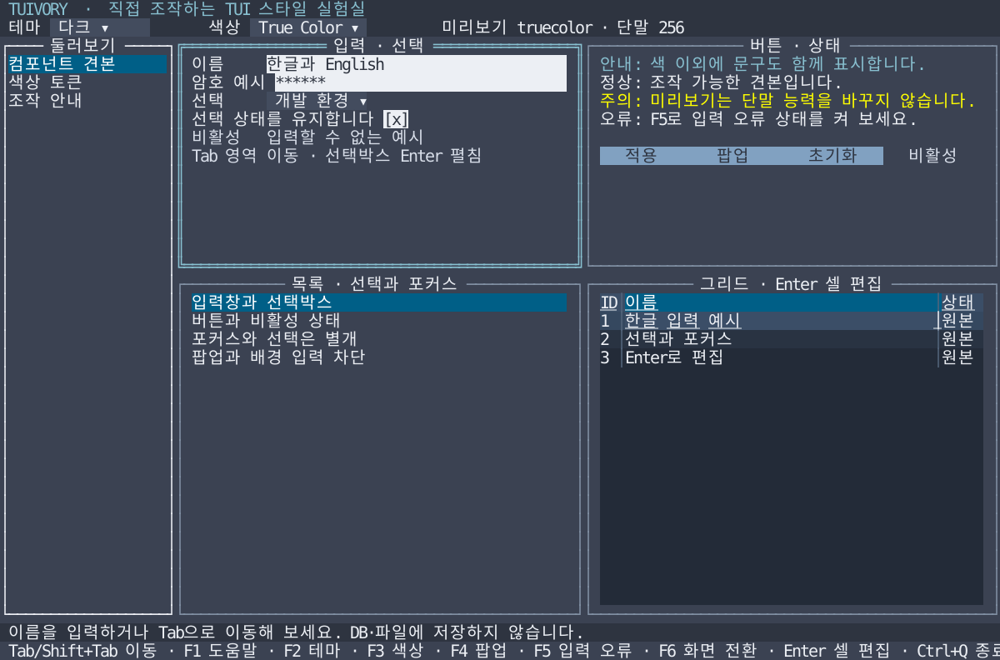

# Tuivory — 터미널 UI 스타일 패키지

**한국어 (기본)** · [English](README.en.md)

Tuivory (TUI + ivory) provides reusable terminal UI styles across languages. Shared design data lives in `design/`; each language implementation has its own directory and packaging.

**Tuivory(투이보리)**는 Go·Rust·Python·JavaScript·Shell에서 일관된 터미널 UI를 만들기 위한 스타일 패키지 프로젝트입니다. 저장소 루트는 특정 언어에 종속하지 않습니다. 공통 테마·색상 프로필·상태 규칙은 `design/`에서 관리하고 실제 적용 코드는 언어별로 구현합니다.

| 경로 | 역할 | 현재 제공 범위 |
| --- | --- | --- |
| [design/](design/README.md) | 언어 독립 규칙·토큰·테마 후보 | 공통 명세, JSON·스키마, CSV 참조 데이터 |
| [go/](go/README.md) | Go 모듈·스타일 구현·견본 | 실제 스타일 API, tview 적용, 상태 보존·원본 비교 검사 |
| [rust/](rust/README.md) | Rust crate·토큰·스타일 코어 | 프레임워크 독립 값·JSON 검증·선택적 Ratatui 어댑터·한영 대화형 견본 |
| [python/](python/README.md) | Python 구현 영역 | 공통 토큰 읽기 예제. UI 패키지 미구현 |
| [javascript/](javascript/README.md) | JavaScript 구현 영역 | Node.js 토큰 읽기 예제. UI 패키지 미구현 |
| [shell/](shell/README.md) | Shell 구현 영역 | ANSI 참조 출력. 재사용 스타일 함수 패키지 미구현 |
| [examples/](examples/README.md) | 예제 안내 | 언어별 코드 위치와 공통 정적 배치 |
| [docs/](docs/README.md) | 사용법·구조·검증 기준 | 설계 원칙·API·지원 범위·출처 |

## Go 사용

Go 모듈의 경로는 `github.com/leechis7/tuivory/go`이며 패키지 이름은 `tuivory`입니다. Tuivory 관련 import는 하나입니다.

```go
import "github.com/leechis7/tuivory/go"

theme, err := tuivory.New("dark", "256")
if err != nil { return err }
theme.Form(form)
theme.Button(button)
```

현재 배포 버전은 **0.1.0**입니다. Go 모듈 태그는 `go/v0.1.0`, Rust Git 태그는 `rust/v0.1.0`이며 공통 UI와 한영 견본·문서를 포함합니다. [릴리스](https://github.com/leechis7/tuivory/releases/tag/go/v0.1.0)에서 Linux ARM64 견본과 소스 패키지를 받습니다.

```sh
go get github.com/leechis7/tuivory/go@v0.1.0
```

[Go 사용법](docs/go-package.md) · [설치·사용 안내](docs/installation.md) · [문서 목록](docs/README.md)

저장소를 체크아웃한 뒤 루트에서 실행합니다. Go 1.24 이상이 필요하며 DB나 서버가 필요 없습니다.

```sh
make run
make build
```

`make build`는 Linux ARM64 바이너리 하나를 `bin/go/tuivory-linux-arm64`에 만듭니다. Go 시작 템플릿은 `go/` 디렉터리에서 `go run ./examples/starter`로 실행합니다.

견본 UI는 한국어가 기본입니다. 같은 바이너리에서 `./bin/go/tuivory-linux-arm64 --lang en`으로 영어를 선택할 수 있습니다. 소스로 실행할 때는 `go -C go run ./cmd/tuivory --lang en`을 사용합니다. `--lang ko`는 한국어를 명시합니다.

**F2 테마 · F3 색상 · F4 팝업 · F6 화면 전환 · Tab 이동 · Ctrl+Q 종료**



실제 Go 위젯을 모의 화면에 그린 참조 이미지입니다. [라이트](docs/images/playground-light.svg) · [흑백](docs/images/playground-blackwhite.svg) · [팝업](docs/images/playground-popup.svg) · [견본 사용법](docs/playground.md)

## Rust 사용

Rust 1.85 이상에서 `rust/v0.1.0` Git 태그 또는 로컬 `rust/` path 의존성으로 사용하는 crate를 제공합니다. [Rust 사용법](rust/README.md)에 설치·API·범위를 설명합니다. 공통 후보 토큰 기준이며 Go의 실제 위젯 스타일 전체를 이식한 것은 아닙니다.

```sh
cargo run --manifest-path rust/Cargo.toml --locked --example tokens -- dark 256
make test-rust check-rust
make check-rust-consumers
python3 tools/check_rust_module.py
```

선택적 Ratatui 0.30.2 어댑터와 Crossterm 0.29 대화형 예제는 Rust 1.88 이상입니다. `make run-rust ARGS="--lang ko"`로 실행하고 `make build-rust`로 `bin/rust/tuivory-linux-arm64`를 만듭니다. 기본 `make build`는 계속 Go 하나만 생성합니다. [Rust 화면·조작법](docs/rust-playground.md) · [영문 화면](docs/rust-playground.en.md)

## 공통 Tree

Go/tview와 Rust/Ratatui에서 사용할 안정 ID·펼침·선택·스크롤 모델과 공개 Tree 렌더러를 추가했습니다. 같은 후보 팔레트와 조작 계약을 사용합니다. Go `go/v0.1.0`과 Rust `rust/v0.1.0`에 포함합니다. [지원 범위 점검](docs/component-audit.md) · [Tree API·한영 예제](docs/tree.md)

```sh
make run-tree-go ARGS="--lang ko"
make run-tree-rust ARGS="--lang ko"
```

## 검증

```sh
make test
make check
make check-consumers
python3 tools/check_go_module.py
```

Go 원본 스타일 비교·상태 보존, 공통 데이터와 언어별 데이터 해석 결과, Go 모듈 단독 사용을 검사합니다. Python·Node.js 예제에는 외부 의존성이 없습니다. 생성된 Go·Rust 배포용 토큰은 공통 데이터와 일치하는지 검사하며 단말 사용자 팔레트·원격 환경 결과는 [별도 기록](evidence/README.md)과 [초기 이전 검증](evidence/initial-migration.md)으로 관리합니다.

LazyOra는 첫 적용 대상이며 앱·DB 내부 구현은 공통 코어에 넣지 않습니다. [출처](docs/sources.md) · [로드맵](docs/roadmap.md) · [기여 방법](CONTRIBUTING.md) · [변경 이력](CHANGELOG.md)

개발자: **이채강 (Chaekang Lee)** · leechis7@gmail.com

라이선스: [AGPL-3.0-only](LICENSE). 초기 자료·코드의 유래는 [NOTICE](NOTICE.md)에 기록합니다.

## 공통 워크스페이스 컴포넌트

[탭·패널·분할선·상태 표시줄·경로 사용법](docs/workspace.md)에서 Go/Rust 공개 API와 같은 조작·색상·상태 원칙을 설명합니다. DB 없는 한영 통합 예제는 루트에서 `make run-workspace-go ARGS="--lang ko"`, `make run-workspace-rust ARGS="--lang en"`으로 실행합니다. Go `go/v0.1.0`과 Rust `rust/v0.1.0`에 포함합니다. CI 결과와 실제 앱 적용은 [작업 기록](https://leechis7.atlassian.net/browse/TVR-7)에서 구분합니다.

## 정적 배포와 CentOS 7.4

Go·Rust와 향후 언어의 배포 실행파일은 별도 런타임·공유 라이브러리 없이 실행해야 하며, 적용 앱의 정적 링크도 지원합니다. 현재 소스의 Go는 CGO를 끄고 Rust는 musl을 사용합니다. x86_64 대상은 `make build-go-x86_64`, `make build-rust-x86_64`로 명시합니다. [빌드·지원 범위·기존 릴리스와의 차이](docs/static-build.md)를 확인하세요.
