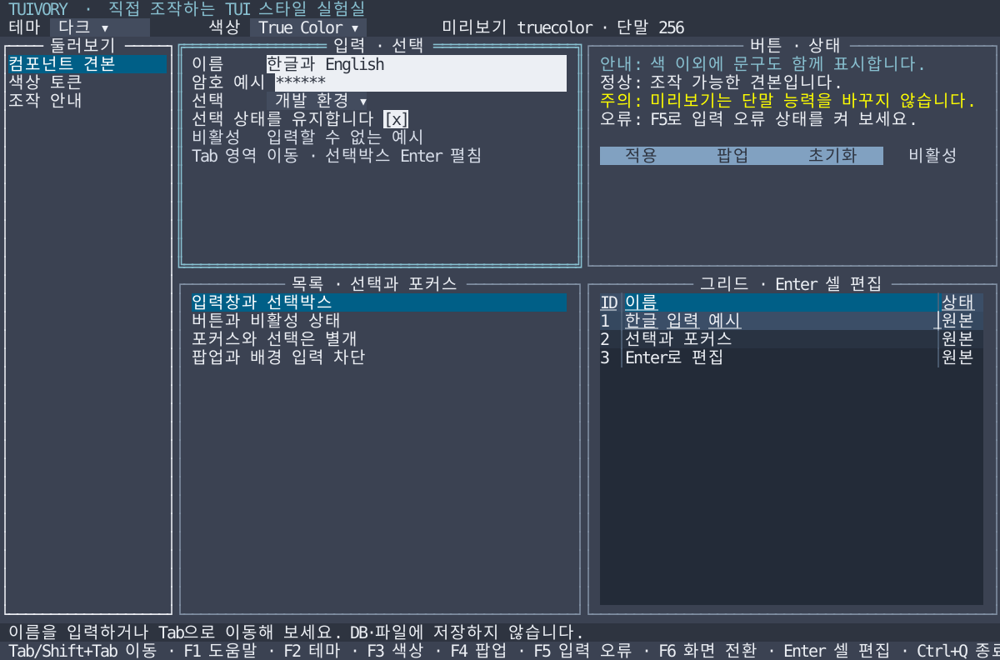

# Tuivory — TUI 컴포넌트 라이브러리

**0.11.1:** 그리드 실제 커서와 터미널 설정 보존을 보완합니다. **0.10.1 사용 금지** · [회수·업그레이드 안내](docs/withdrawn-versions.md).

0.11.0 TVR-7: [그리드 셀 내 편집·열 고정/숨김/순서·붙여넣기·찾기·보기 복원·상세 보기](docs/grid-workspace.md). 0.11.0부터 제공합니다.

**0.10.2 TVR-26:** [Windows Go 파사드](docs/ui-facade.md)가 Unix 전용 API를 참조하는 결함을 수정했습니다. 0.10.2에서 제공하며 0.10.1은 사용 금지입니다.

**0.10.2 TVR-29:** [팝업 그림자](docs/popup-shadows.md)를 오른쪽 1칸·아래 반 줄로 통일하고 다크 대비를 개선했습니다. 0.10.2에서 제공합니다.

**한국어 (기본)** · [English](README.en.md)

0.10.0 TVR-18: [Go/Rust 탭·트리 드래그 앤 드롭](docs/drag-drop.md)은 기본 끄기이며 앱 승인 후 불변 모델 적용, 영역 밖 캡처·취소·키보드 대안을 제공합니다. 0.10.0부터 제공합니다.

**0.9.1 TVR-27:** [통합 예제 실행파일](docs/examples.md)은 언어별 하나이며 현재 Linux 서버 아키텍처만 빌드합니다. `--demo tree`, `--demo menu`, `--demo syntax` 등으로 선택합니다.

**0.9.0 TVR-24:** [선택적 Oracle SQL/PLSQL 분석·공통 토큰·편집기 전환](docs/syntax.md)을 제공합니다. Go는 루트 한 번만 import하고 Rust는 syntax-sql 기능으로 선택합니다.

**0.10.0:** Go UI를 `github.com/leechis7/tuivory/go` 하나로 구성합니다. 기존 하위 경로는 호환용으로 유지합니다. [단일 import·이름 대응](docs/ui-facade.md).

**Go/tview와 Rust/Ratatui**를 위한 TUI 컴포넌트 라이브러리입니다. 앱이 화면 구성·데이터·업무 동작을 연결합니다. 새 언어 독립 UI 패키지는 미배포 구현 단계입니다.

**0.11.1** · [릴리스](docs/release-0.11.1.md) · [문서](docs/README.md) · [API](docs/api/README.md)

## 설치

```sh
go get github.com/leechis7/tuivory/go@v0.11.1
```

```toml
[dependencies]
tuivory = { git = "https://github.com/leechis7/tuivory", tag = "rust/v0.11.1", features = ["ratatui"] }
```

Go 1.24+, Rust core 1.85+, Rust UI 1.88+. [설치 상세](docs/installation.md)

## 예제 실행

```sh
make run
make run-menu-go ARGS="--shadow auto"
make run-menu-rust ARGS="--shadow auto"
```

기본 UI는 한글이며 `--lang en`으로 영어를 선택합니다.



## 문서 안내

- [설치·빠른 시작](docs/installation.md)
- [컴포넌트 가이드](docs/components.md)
- [API 명세](docs/api/README.md)
- [디자인 가이드](docs/design-guide.md)
- [앱과 라이브러리의 책임](docs/component-boundary.md)
- [개발·검증·이력](docs/development.md)

[출처·라이선스](NOTICE.md)

0.6.0 TVR-22~25는 테두리 없는 Surface, 독립/암호 컨트롤, 텍스트 편집·뷰어와 행·열·격자·레이어 컨테이너를 제공합니다. [사용법·제공 상태·예제](docs/controls.md).

0.7.0 TVR-26: Go·Rust에서 Tuivory 경로만 사용하는 UI 구성, 공통 입력·바이트 span 변환과 터미널 수명을 제공합니다. [API 대응·예제·현재 제공 상태](docs/ui-facade.md).

TVR-7 0.11.1: [실제 그리드 커서·backend 연결](docs/grid-workspace.md). 0.11.1에서 실제 커서를 사용하려면 Go NewCursorScreen/NewGridView, Rust GridWidget::render_frame을 사용합니다.

[Python·TypeScript/JavaScript·C·C++·Java 독립 지원](docs/languages.md): 미배포 컴포넌트 패키지, API 명세와 한영 실행 예제를 제공합니다. 구현과 런타임은 언어별로 독립적이며 기존 공개 0.11.1은 유지합니다.
