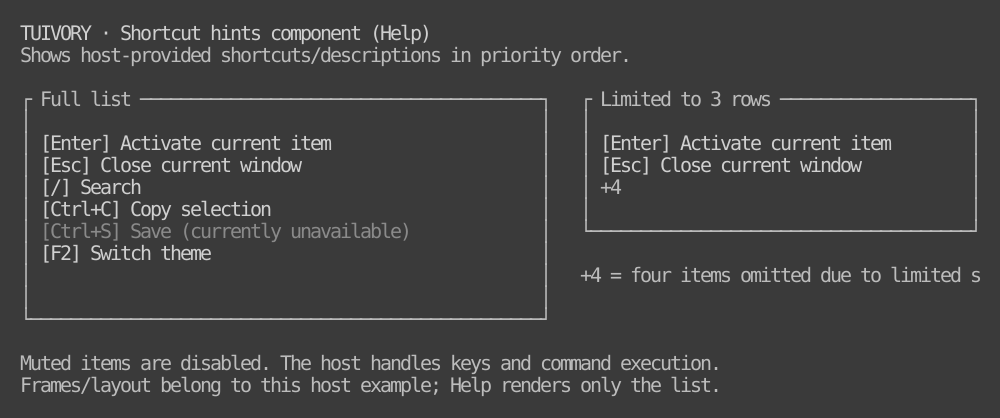

# Surface and text background rules

[한국어 (default)](surfaces.md) · **English**

Shared design rules following the TVR-7 audit, for 0.4.0. Existing tags/assets remain unchanged. [Audit](../docs/background-audit.en.md).

## Surface ownership

- Canvas/body, panel/surface, editor and field may differ. Do not globally make body.background equal surface.background.
- Each component defines the surface it fills. Generic Rows and breadcrumb/status Line default to surface. Hosts composing TextView/Paragraph content explicitly bind its actual surface.
- **Plain text** using body/hint/disabled/info/success/warning/error follows that surface. Glyphs must not revert to canvas BG or leave an unintended strip ending at the text length.
- Normal Badge/Chip labels follow the same plain-text rule. Opaque capsules/highlights require explicit host background/state or custom-role choice; the library does not invent selection/business state just to obtain a color.

## Explicit backgrounds to preserve

Preserve field, button/button.focus, selection, edited, header, editor, grid.* and custom-role backgrounds. Input/button/selection/edit/tab/current-row/stripe regions use distinct backgrounds intentionally. This fix does not change selection extent, highlight width, model state or focus order.

Keep simple Grid UseSurface=false and data surface/highlight options. Go NewGridView and Rust GridWidget preserve role backgrounds. Hosts composing model rows can explicitly use Go RowsView.PreserveBackgrounds or Rust RowsWidget.preserve_backgrounds(). Unknown custom roles are not guessed to be plain text and flattened.

Draw borders on their actual panel surface. Follow [panel rules](../docs/workspace.en.md): double active-area borders, single inactive borders, single menu borders. Surface styling does not own application-wide focus policy.

## Foreground contrast

Recheck foreground on the actual background. The nominal reference target is 4.5:1 for active text. Disabled text has a separate 2.0:1 floor to retain the muted appearance, instead of being promoted back to the active foreground. If the original foreground falls short and the surface foreground is better, use the latter while retaining semantic text/icons/markers. For example, light-16 success green on the gray panel is only about 2.82:1, so use its default black foreground.

Preserve ANSI indices rather than replacing them with RGB. Calculations use reference ANSI/xterm RGB and RGB values; they do not guarantee physical contrast on a customized terminal palette. A custom theme whose surface foreground is also inadequate still needs theme validation. Original tokens and raw-style APIs remain unchanged.

## APIs and composition

Go TextOnSurface(palette, role, surface) and Rust Styles::text_on_surface(role, surface) bind text to its actual surface. ControlStyleOnSurface / Styles::control_on_surface apply this rule to ordinary control text while preserving selected/edited backgrounds. Existing ControlStyle / Styles::control / Styles::role remain raw role APIs.

Direct Go Styler.DropDown/Choice binds the default panel box/label together; Apply rebinds labels to the host-provided surface. Field/open-list backgrounds remain explicit control regions. Hosts still own styling of external child widgets.

## Completion checks

Use physical Go Runes/Bytes/Styles after Show and Rust TestBackend across twelve palettes for plain/secondary/state text, fields, selection, edits and custom roles. Include breadcrumb/status, Badge/Chip, raw grid preservation, foreground correction and state-preserving theme reapplication. Refresh Korean/English host and documentation UI references together. [Implementation evidence](../evidence/background-fix.en.md).

## Live reference

Actual HelpWidget output. Both ordinary and disabled entries use the component surface. Frames/layout belong to the sample host; command execution is not a component responsibility.

## Disabled state

Do not automatically prefix ordinary disabled items with `[-]` or `-`. Keep checkbox, radio, and check-menu selection indicators. Disabled labels, values, buttons, and notice actions use the disabled role with muted foregrounds and no active background. Use gray at 16 colors or higher and `Dim` at 8 colors. Block pointer activation/focus and keyboard execution; clicking a disabled option must not move parent focus. [Twelve-palette comparison and limits](../docs/disabled-states.en.md).

Unreleased TVR-19 adds optional popup shadows, disabled by default: `off/auto/solid/dim`, placement including the full footprint, card-only hit testing and wide-glyph boundary protection. Hosts own backdrop redraws and opening/closing. [APIs, runnable examples and 12-palette views](../docs/popup-shadows.en.md).
