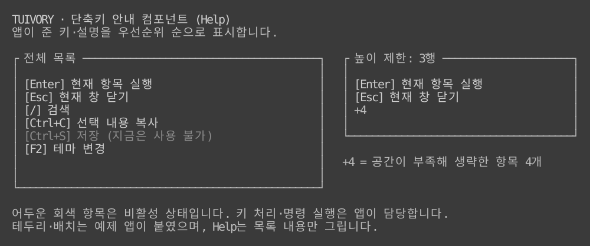

# 표면과 글자 배경 규칙

**한국어 (기본)** · [English](surfaces.en.md)

TVR-7 배경 조사 후 적용하는 공통 디자인 규칙입니다. 0.4.0 소스 기준이며 기존 태그·배포 자산은 바꾸지 않습니다. [조사 기록](../docs/background-audit.md).

## 바탕의 소유권

- canvas/body, panel/surface, editor, field는 서로 다른 표면일 수 있습니다. 토큰 원본의 body.background와 surface.background를 전역에서 같게 만들지 않습니다.
- 컴포넌트는 자신이 채우는 실제 바탕을 정합니다. 일반 Rows와 경로/상태 Line의 기본 바탕은 surface입니다. 앱이 자체 TextView/Paragraph를 조합할 때에는 해당 텍스트가 놓인 표면을 명시합니다.
- body/hint/disabled/info/success/warning/error의 **평문**은 실제 바탕을 따릅니다. 글자의 배경만 canvas로 되돌아가거나, 일반 문구 길이만큼 다른 색의 띠가 생겨서는 안 됩니다.
- 정상 상태의 Badge/Chip도 기본적으로 같은 평문 규칙을 사용합니다. 불투명 캡슐/강조가 필요하면 호스트가 명시적 배경/상태 또는 사용자 역할을 선택합니다. 별도 배경을 사용한다는 이유로 선택·업무 상태를 라이브러리가 만들지 않습니다.

## 유지할 별도 배경

field, button/button.focus, selection, edited, header, editor, grid.*와 사용자 정의 역할의 명시적 배경은 보존합니다. 입력 영역·버튼·선택·수정·탭 구간·그리드 현재 행/줄무늬는 바탕 차이 자체가 의미입니다. 이 수정으로 선택 범위·강조 너비·모델·포커스 순서를 바꾸지 않습니다.

그리드는 simple의 UseSurface=false와 data의 표면/강조 옵션을 유지합니다. Go NewGridView와 Rust GridWidget은 역할 배경 보존 경로를 사용합니다. 사용자가 모델 행을 직접 조합할 때에도 Go RowsView.PreserveBackgrounds 또는 Rust RowsWidget.preserve_backgrounds()로 명시적으로 선택할 수 있습니다. 알 수 없는 사용자 역할은 일반 평문으로 추정해 덮지 않습니다.

테두리는 실제 패널 바탕 위에 그립니다. 현재 조작 영역의 이중선·비활성 단일선, 메뉴 단일선 예외는 [패널 규칙](../docs/workspace.md)을 따릅니다. 테두리와 본문 색상 연결을 이유로 앱의 전역 포커스 정책을 바꾸지 않습니다.

## 전경 대비

평문 배경을 바꾸면 전경도 실제 바탕 위에서 검증합니다. 활성 평문의 기본 목표는 참조 RGB 기준 4.5:1입니다. 비활성 역할은 명암 차이를 위해 별도 2.0:1 하한을 사용하며 활성 전경으로 되돌리지 않습니다. 원래 전경의 대비가 부족하고 표면 전경이 더 좋으면 표면 전경으로 보정합니다. 같은 의미의 아이콘·문구·상태 표식은 유지합니다. 예를 들어 light-16 success의 녹색을 회색 panel에 그대로 올리면 약 2.82:1이므로 기본 검정 전경으로 보정합니다.

ANSI 인덱스를 RGB 색으로 치환하지 않습니다. 계산은 ANSI/xterm 참조 팔레트와 RGB 값을 사용하며 실제 사용자 터미널 팔레트의 물리 대비를 보장하지 않습니다. 사용자 테마의 표면 전경까지 대비가 부족하면 테마 자체를 검증해야 합니다. 배경 토큰과 raw API 형식은 유지하며, 비활성 전경 토큰은 후속 명암 보완을 반영합니다.

## API와 조합

Go TextOnSurface(palette, role, surface)와 Rust Styles::text_on_surface(role, surface)는 텍스트의 실제 바탕을 지정합니다. ControlStyleOnSurface / Styles::control_on_surface는 일반 상태 글자에 이 규칙을 적용하고 선택/수정 배경을 유지합니다. 기존 ControlStyle / Styles::control / Styles::role은 원래 역할의 배경을 반환하는 raw API로 보존합니다.

Go의 직접 Styler.DropDown/Choice는 기본 panel 바탕·라벨을 함께 지정하고, Apply는 호스트가 제공한 표면에 맞춰 라벨을 다시 연결합니다. 필드/열린 선택 목록의 배경은 명시적인 컨트롤 배경으로 유지합니다. 외부 자식 위젯의 스타일을 지정하는 것은 여전히 호스트 책임입니다.

## 완료 검사

Go Show 이후 실제 Runes/Bytes/Styles와 Rust TestBackend로 12팔레트의 평문·보조 설명·상태·입력·선택·수정·사용자 역할을 확인합니다. 경로/상태줄, Badge/Chip, 그리드 raw 보존, 대비 보정, 테마 재적용과 상태 보존을 포함합니다. 견본·문서 UI 이미지는 한국어/영어를 함께 갱신합니다. [구현 검증](../evidence/background-fix.md).

## 실제 표시 예

실제 HelpWidget 출력입니다. 일반 항목과 비활성 항목 모두 컴포넌트 바탕을 따릅니다. 테두리·배치는 샘플 앱이 제공하며 명령 실행은 컴포넌트 책임이 아닙니다.

## 비활성 상태

일반 항목에는 비활성 `[-]`·`-` 표식을 자동으로 붙이지 않습니다. 체크박스·라디오·체크 메뉴의 선택 표식은 유지합니다. 비활성 라벨·값·버튼·알림 액션은 `disabled` 역할로 그리며, 활성 배경을 제거하고 전경 명암을 낮춥니다. 16색 이상은 회색, 8색은 `Dim`을 사용합니다. 클릭·마우스 포커스·키보드 실행은 차단하며 비활성 옵션 클릭으로 부모 포커스도 이동하지 않습니다. [12팔레트 비교와 제약](../docs/disabled-states.md).

0.5.0 TVR-19는 기본 끄기의 공통 팝업 그림자를 제공합니다. `off/auto/solid/dim`, 카드와 그림자를 포함한 위치 계산, 그림자를 제외한 입력 판정과 두 칸 문자 경계 보호를 지원합니다. 앱이 배경 다시 그리기와 열기·닫기를 결정합니다. [API·실행 예제·12팔레트 화면](../docs/popup-shadows.md).

0.6.0 TVR-22~25는 테두리 없는 Surface, 독립/암호 컨트롤, 텍스트 편집·뷰어와 행·열·격자·레이어 컨테이너를 제공합니다. [사용법·제공 상태·예제](../docs/controls.md).
