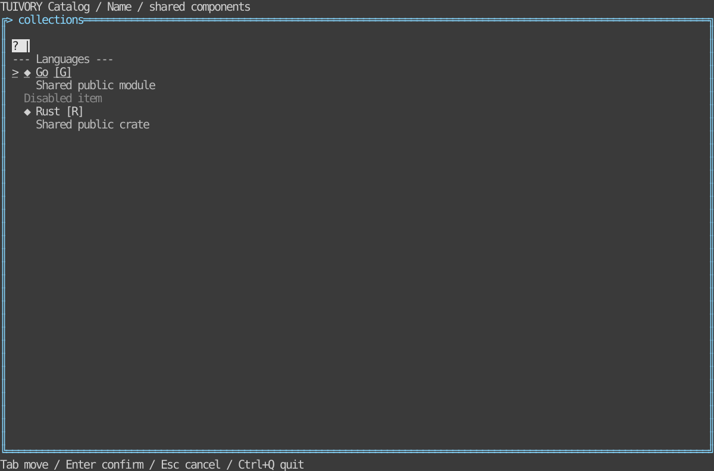

# Lists, menus and search selection — TVR-10

[한국어 (default)](collections.md) · **English**

Go APIs: `NewList`/`NewListView`, `NewSearchPicker`/`NewSearchPickerView`; Rust: `collections::{ListModel, SearchPicker}`, `ListWidget`/`SearchPickerWidget`. Lists and menus share the model; hosts connect commands and popup placement.

Items carry validated stable IDs, primary/secondary text, Unicode/ASCII icons, shortcut labels, disabled/separator states. Navigation skips non-actions, separates focus from select/activate, and supports Home/End/page keys, pointer input and clipped narrow viewports. Shortcut execution is host-owned.

Query requests include a local lowercase substring filter on labels/secondary text; remote search and replacement data remain host responsibilities. Filtering preserves committed selection and invalid replacements are atomic. No full-text indexing engine is included.

Search selection follows open → insert/backspace → navigation → activate confirmation/cancel. Pending focus and committed value remain distinct; cancellation keeps the previous value. Long queries retain grapheme-safe caret visibility. Hosts provide localized empty-result text.

## Run and boundaries

```sh
make run-catalog-go ARGS="--mode collections --lang ko"
make run-catalog-rust ARGS="--mode collections --lang en"
```

Hosts own data, business actions, clocks and terminal lifecycle. Public models emit requests and render literal cell-clipped rows. Existing v0.1.0 tags do not include these APIs; approved changes merge into dev only. Static linking, Unicode/ASCII and color-profile requirements remain.



[Light](images/collections-light-en.svg) · [Blackwhite](images/collections-blackwhite-en.svg)

Actual Rust TestBackend 120×36 reference, not a Go capture or physical/SSH terminal result. Generate six localized references with `tools/snapshot_catalog.py BINARY --mode collections`.

[Backlog](components-backlog.en.md) · [Static distribution](static-build.en.md)
