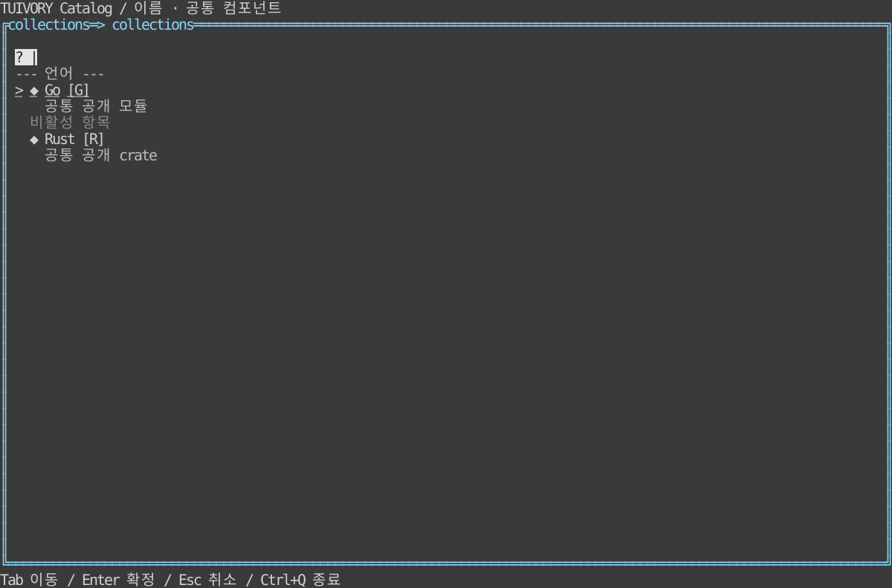

# 목록·메뉴·검색 선택 — TVR-10

**한국어 (기본)** · [English](collections.en.md)

Go `NewList`/`NewListView`, `NewSearchPicker`/`NewSearchPickerView`, Rust `collections::{ListModel, SearchPicker}`와 `ListWidget`/`SearchPickerWidget`을 제공합니다. 목록·메뉴는 같은 데이터/행 모델을 재사용하고 실제 명령 실행·팝업 배치는 앱이 연결합니다.

항목은 ID·주/보조 텍스트·아이콘/ASCII 대체·단축키·비활성·구분선입니다. ID를 검증하고 키보드 이동은 비활성/구분선을 제외합니다. 포커스는 이동만으로 확정하지 않으며 select와 activate 요청을 분리합니다. Home/End/PageUp/PageDown, 클릭과 긴 문자열·좁은 뷰포트를 지원합니다. 단축키는 표시 메타데이터이며 실행 키맵은 호스트가 연결합니다.

`SetQuery`/`set_query`는 로컬 주/보조 텍스트의 소문자 포함 검색과 query 요청을 제공합니다. 원격 검색은 앱이 이 요청을 받아 데이터를 교체합니다. 필터링 중 선택 ID를 유지하고 잘못된 데이터 교체는 원자적으로 거부합니다. 대규모 데이터의 전문 검색/인덱스 엔진은 포함하지 않습니다.

검색 선택은 open → insert/backspace → 방향키 → activate 확정, cancel 취소입니다. 임시 포커스와 확정 Value를 분리하고 취소는 기존 값을 유지합니다. 문자가 긴 질의도 grapheme 경계·커서를 보존합니다. 빈 결과의 문구는 앱이 지정합니다.

## 실행과 경계

```sh
make run-catalog-go ARGS="--mode collections --lang ko"
make run-catalog-rust ARGS="--mode collections --lang en"
```

호스트가 데이터·업무 동작·시간·단말 수명주기를 소유합니다. 공개 모델은 요청을 반환하고 실제 행은 셀 폭에 맞춰 문자 그대로 렌더링합니다. 0.2.0 태그에 포함합니다. 정적 링크·Unicode/ASCII·색상 프로필 조건을 유지합니다.



[Light](images/collections-light.svg) · [Blackwhite](images/collections-blackwhite.svg)

실제 Rust TestBackend 120×36 참조이며 Go 캡처나 실제 서버/SSH 단말 결과가 아닙니다. `tools/snapshot_catalog.py BINARY --mode collections`로 한영 6장을 생성합니다.

[Backlog](components-backlog.md) · [Static distribution](static-build.md)

v0.2.0의 메뉴는 ListModel 기반 평면 목록입니다. 새 [공통 메뉴](menus.md)는 미배포 소스에서 계층 그룹·뒤로가기·메뉴 바·팝업 배치·호출 패널 복귀 요청을 제공합니다. 기존 목록·검색 선택 API는 유지하고 메뉴 내용·원격 후보·업무 명령은 앱이 정합니다.

0.4.0의 평문은 실제 surface 바탕을 따르며 입력·선택·수정 배경은 보존합니다. [공통 표면·대비 디자인 규칙](../design/surfaces.md)과 [수정 검증](../evidence/background-fix.md)을 참고하세요.

## 비활성 상태

일반 항목에는 비활성 `[-]`·`-` 표식을 자동으로 붙이지 않습니다. 체크박스·라디오·체크 메뉴의 선택 표식은 유지합니다. 비활성 라벨·값·버튼·알림 액션은 `disabled` 역할로 그리며, 활성 배경을 제거하고 전경 명암을 낮춥니다. 16색 이상은 회색, 8색은 `Dim`을 사용합니다. 클릭·마우스 포커스·키보드 실행은 차단하며 비활성 옵션 클릭으로 부모 포커스도 이동하지 않습니다. [12팔레트 비교와 제약](disabled-states.md).
