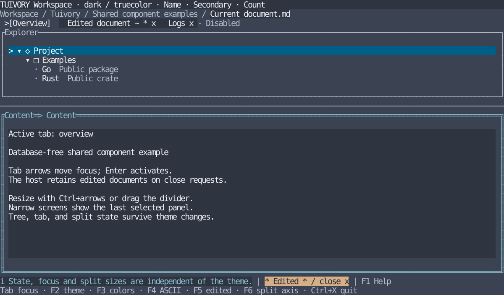

# Component library and application responsibilities

[한국어 (default)](component-boundary.md) · **English**

Tuivory is a **TUI component library**. It provides shared themes/styles, reusable controls and configurable layout tools. Hosts compose their screens and connect data/actions. Host screen-composition code is normal and does not by itself indicate an incomplete migration or defect. This guide reflects the 2026-10-29 boundary correction in [TVR-7](https://leechis7.atlassian.net/browse/TVR-7).

## Decision criteria

| Area | Tuivory | Host application |
| --- | --- | --- |
| Controls | Models, rendering and internal interaction for inputs/buttons/choices/lists/trees/tabs/grids | Actual connection/settings/help/workspace screens |
| Panels/splits/popups | Titles/borders/padding/minimum sizes, resizing within assigned areas, shared drawing | Screen-specific placement/order/initial sizes/visibility/responsive layout |
| Focus/keys | Navigation/selection/scroll inside controls or host-defined scopes; modal trapping/restoration tools | Cross-component order, scope contents, global keys/commands and event forwarding |
| Menus/tabs | Generic item rendering, active/focused state, overflow, close requests | Menu groups/labels/commands, SQL document/session ownership, close/save approval |
| Status/help | Semantic rendering/priority/omission/width for supplied items | Contextual shortcuts/messages, help contents/table of contents and screen arrangement |
| Data/actions | Stable IDs, presentation metadata, generic selection/edit/sort/copy requests | Queries/SQL, validation/storage/transactions, original-data mappings, real clipboard/files |
| Search/input | Editing/choice, local list filters and common rules such as required values | Oracle suggestions, remote search, business validation and authorization |
| Themes/characters | Semantic roles/presets/color profiles, Unicode/ASCII, cell width/overlap protection | Profile/option choice, actual terminal environment and connecting host-supplied state |

Extend the shared package when a generic capability is missing, then import it from the host. Do not mandate application-specific whole-screen templates. Example sizes, focus order and F keys are host choices; they are neither public component API names nor a required global keymap.

## Actual support

The current public release is v0.6.0 and includes TVR-22–25; the [support audit](component-audit.en.md) records earlier implementation stages.

- **Focus**: `FocusStack` navigates host-supplied orders/scopes. It does not determine the application's overall Tab order or replace tview/Ratatui event loops. [API](focus.en.md)
- **Tabs**: separate active/focused state, long titles/overflow, edited/closable indicators and requests already exist. This does not imply SQL/session ownership. [API](workspace.en.md)
- **Menus**: v0.2.0 uses flat `ListModel` items. The [Menu API] available since 0.3.0(menus.en.md) adds hierarchical groups/entry/return, a menu bar, single-popup geometry and original-context return requests. Hosts choose groups, eligibility and actual commands.
- **Help**: `Help` prioritizes supplied shortcut descriptions. Whole help screens/contents/global key registration belong to hosts. [API](layout.en.md)
- **Grid**: TVR-17 options/presets extend the same shared Grid. Hosts connect DB operations, transactions and actual exports. [Unreleased API](grid.en.md)

## Same components, different host policy

Reuse the existing [Go](../go/examples/workspace/main.go) and [Rust](../rust/examples/workspace/main.rs) workspace examples. Only host configuration changes; component APIs stay the same. Host options are available since 0.3.0, not in older v0.2.0-tagged demos.

```sh
# Default: column split, tabs → tree → content, Ctrl+Q to quit
make run-workspace-go ARGS="--lang en"
make run-workspace-rust ARGS="--lang en"

# Alternative: row split, content → tree → tabs, Ctrl+X to quit
make run-workspace-go ARGS="--lang en --layout rows --focus-order content,tree,tabs --quit-key ctrl-x"
make run-workspace-rust ARGS="--lang en --layout rows --focus-order content,tree,tabs --quit-key ctrl-x"
```

`--layout columns|rows` sets the initial split axis. `--focus-order` is a permutation containing tabs/tree/content exactly once. `--quit-key ctrl-q|ctrl-x` assigns the host quit shortcut. Initial focus goes to the first item. Invalid configuration is rejected before entering terminal mode. F6 axis switching, Shift+Tab reverse traversal, mouse selection and host approval for edited-tab closing remain available. Both configurations support `--lang ko`, themes/profiles and ASCII. Selecting Ctrl+X leaves Ctrl+Q unregistered as a quit command.

Go chooses policy through `tview.Flex`, the `focus` list and `Application.SetInputCapture`. Rust chooses it through its own `App`, `Layout`, focus order and Crossterm handler. Both retain the same `NewTabView/TabsWidget`, `NewTreeView/TreeWidget` and panel/split/status/path models. Hosts declare initial screen structure/global commands; SDK geometry and containers execute placement, drawing and common input routing.



English reference from Rust TestBackend at 120×32. This is not a Go/SSH capture or actual LazyOra integration result.

## Follow-up capabilities

A subsequent user request adds nested menus through [shared Menu](menus.en.md). This is available since 0.3.0, separate from the older flat-list support. App-specific automatic grouping, taxonomy, SQL/sessions and complete help screens remain host-owned. Adding generic capabilities does not require migrating entire application screens.

[Work/validation evidence](../evidence/component-boundary.en.md) · [Example usage](workspace.en.md)

## Layout execution and new controls

Current public release is 0.6.0. 0.6.0 TVR-22–25 [controls/containers](controls.en.md) let the SDK execute surfaces, controls, editing, row/column/grid/layer placement, rendering and common input forwarding. Hosts declare screen structure/slots/content/global keys and business approvals/actions. Earlier host-layout wording means declarative placement choices, not reimplementing a layout engine. The complete backend facade and zero-direct-backend-import goal belong to TVR-26 and are not claimed implemented. Historical version evidence above is not current installation guidance.
