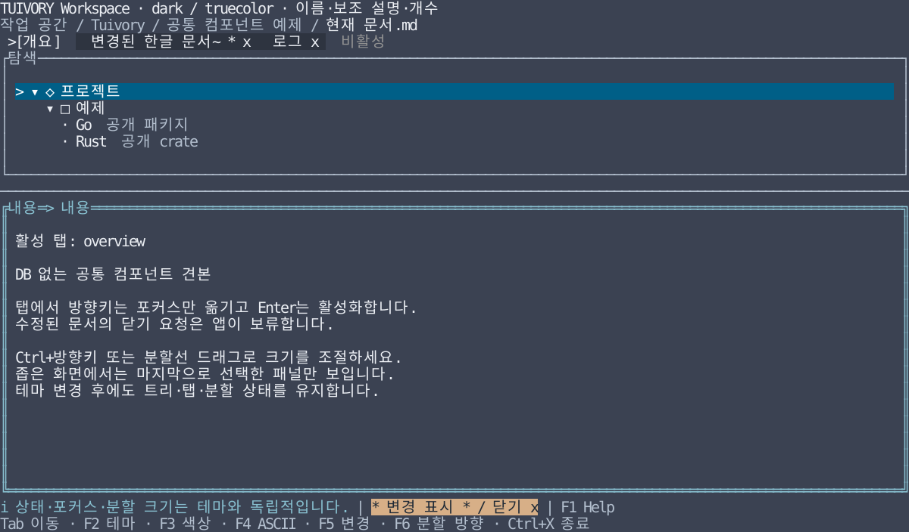

# 컴포넌트 라이브러리와 앱의 책임

**한국어 (기본)** · [English](component-boundary.en.md)

Tuivory는 **TUI 컴포넌트 라이브러리**입니다. 공통 테마·스타일과 재사용 가능한 컨트롤, 설정 가능한 배치 도구를 제공합니다. 적용 앱은 자신의 화면을 조합하고 데이터·기능을 연결합니다. 앱에 화면 조합 코드가 남아 있다는 이유로 미이관이나 결함으로 분류하지 않습니다. 이 문서는 [TVR-7](https://leechis7.atlassian.net/browse/TVR-7)의 2026-10-29 책임 범위 정정을 반영합니다.

## 판단 기준

| 영역 | Tuivory | 적용 앱 |
| --- | --- | --- |
| 컨트롤 | 입력·버튼·선택·목록·트리·탭·그리드 등의 모델·표시·내부 조작 | 접속·설정·도움말·작업공간 같은 실제 화면 조합 |
| 패널·분할·팝업 | 제목·테두리·여백·최소 크기·영역 내 크기 조절·공통 그리기 | 화면별 위치·순서·초기 크기·가시성·반응형 배치 선택 |
| 포커스·키 | 컴포넌트/호스트가 정의한 스코프 내부 탐색·선택·스크롤, 모달 차단·복귀 도구 | 컴포넌트 사이 순서·스코프 항목·전역 키·명령 배정·이벤트 전달 |
| 메뉴·탭 | 항목 표시·활성/포커스·넘침·닫기 요청 등 범용 기능 | 메뉴 분류·라벨·명령, SQL 문서·세션 소유권, 닫기 승인·저장 |
| 상태줄·도움말 | 받은 항목의 의미별 표현·우선순위·생략·폭 계산 | 현재 상황에 필요한 키/메시지·도움말 목차·설명 내용·화면 배치 |
| 데이터·동작 | 안정 ID·표시용 메타데이터·범용 선택/편집/정렬/복사 요청 | 실제 조회·SQL·검증·저장·트랜잭션·원본 매핑·클립보드/파일 I/O |
| 검색·입력 | 입력 편집·선택, 로컬 목록 필터·필수 값 같은 공통 규칙 | Oracle 자동완성 후보·원격 검색·업무상 검증·권한 판단 |
| 테마·문자 | 의미 역할·프리셋·색상 수·Unicode/ASCII·셀 폭·겹침 보호 | 프로필/옵션 선택·실제 단말 환경·앱이 공급한 상태 유지 연결 |

범용 기능이 부족하면 공통 패키지에 보완하고 앱에서 import합니다. 앱 고유 화면 전체를 라이브러리 템플릿으로 강제하지 않습니다. 예제의 크기·포커스 순서·F키는 참고용 앱 정책입니다. 공통 API 이름이나 필수 전역 키맵을 뜻하지 않습니다.

## 실제 제공 범위

현재 배포는 v0.2.0입니다. [지원 점검표](component-audit.md)는 기본 배포와 미배포 TVR-17을 구분합니다.

- **포커스**: `FocusStack`은 앱이 제공한 순서/스코프로 탐색합니다. 전체 앱의 Tab 순서를 정하거나 tview/Ratatui 이벤트 루프를 대신하지 않습니다. [API](focus.md)
- **탭**: 활성/포커스 분리, 긴 제목·넘침, 변경/닫기 표시와 요청은 이미 제공합니다. SQL/세션 관리 기능을 새로 요구할 근거가 아닙니다. [API](workspace.md)
- **메뉴**: 현재 `ListModel` 기반 평면 메뉴 항목·구분선·비활성·선택/실행 요청을 제공합니다. 중첩 메뉴의 열림 경로, 하위 진입/복귀, 계층 팝업 배치 전용 API는 미제공입니다. Tree가 있다는 이유로 중첩 메뉴까지 완료로 보지 않습니다. [범위](collections.md)
- **도움말**: `Help`는 앱이 준 단축키/설명의 우선순위 표시입니다. 완성 도움말 화면·목차·전역 키 등록기는 앱 책임입니다. [API](layout.md)
- **그리드**: TVR-17의 옵션/프리셋은 같은 공통 Grid에 속합니다. DB 동작·트랜잭션·실제 내보내기는 앱이 연결합니다. [미배포 API](grid.md)

## 같은 컴포넌트, 다른 앱 정책

기존 [Go](../go/examples/workspace/main.go)·[Rust](../rust/examples/workspace/main.rs) 워크스페이스 예제를 재사용합니다. 라이브러리 API를 바꾸지 않고 호스트 옵션만 바꿉니다. 새 호스트 옵션은 미배포 작업 소스에만 있으며 기존 v0.2.0 태그의 견본에는 없습니다.

```sh
# 기본: 열 분할, 탭 → 트리 → 내용, Ctrl+Q 종료
make run-workspace-go ARGS="--lang ko"
make run-workspace-rust ARGS="--lang ko"

# 다른 구성: 행 분할, 내용 → 트리 → 탭, Ctrl+X 종료
make run-workspace-go ARGS="--lang ko --layout rows --focus-order content,tree,tabs --quit-key ctrl-x"
make run-workspace-rust ARGS="--lang ko --layout rows --focus-order content,tree,tabs --quit-key ctrl-x"
```

`--layout columns|rows`는 초기 분할 방향, `--focus-order`는 tabs/tree/content를 정확히 한 번씩 나열한 순서, `--quit-key ctrl-q|ctrl-x`는 앱의 종료 키입니다. 첫 항목에 초기 포커스를 줍니다. 잘못된 구성은 단말 진입 전에 거부합니다. 기존 F6 방향 변경·Shift+Tab 역순·마우스 선택과 수정 탭 닫기 승인도 그대로 사용할 수 있습니다. `--lang en`과 테마/색상/ASCII 옵션은 두 구성 모두 지원합니다. Ctrl+X를 선택하면 Ctrl+Q는 종료 키로 등록하지 않습니다.

Go 호스트는 `tview.Flex`, `focus` 목록, `Application.SetInputCapture`에서 정책을 정합니다. Rust 호스트는 자신의 `App`, `Layout`, 포커스 순서와 Crossterm 처리에서 정합니다. 양쪽의 `NewTabView/TabsWidget`, `NewTreeView/TreeWidget`, 패널·분할·상태·경로 모델은 동일합니다. 초기/실제 배치와 전역 명령을 공통 코어에 넣지 않습니다.



Rust TestBackend 120×32의 한국어 참조입니다. Go 캡처·SSH 화면·실제 LazyOra 연결 검증이 아닙니다.

## 후속 기능 판단

중첩 메뉴는 재사용 가능한 기능의 **후속 후보**입니다. 현재 미제공 범위로 기록하고, 실제 요구를 확인한 뒤 별도 TVR 일감에서 공통 모델·입력/팝업 경계·Go/Rust 검증을 정의합니다. 이번 문서/예제 정정으로 구현 완료나 새 일감 등록을 주장하지 않습니다. 이미 제공하는 탭 넘침이나 도움말 항목 표시를 다시 만드는 작업도 포함하지 않습니다.

[작업/검증 기록](../evidence/component-boundary.md) · [예제 사용법](workspace.md)
