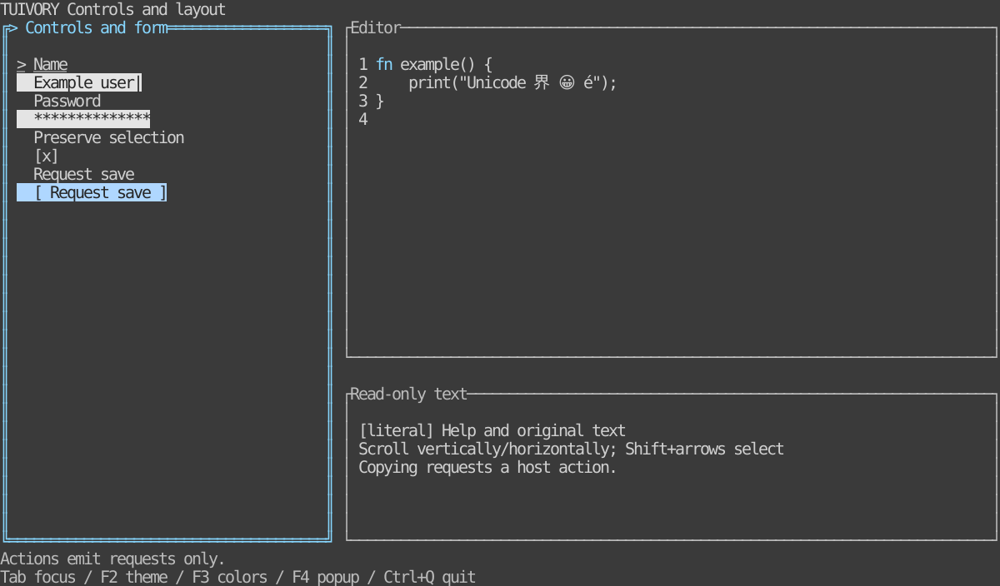

# Inputs, text editing, surfaces and layout containers

[Korean (default)](controls.md) · **English**

Version 0.6.0 provides TVR-22–25. See the [language-neutral specification](../design/controls.en.md) and [API reference](api/README.en.md). Existing forms, state, geometry, palettes and shadows are reused. The complete backend facade, TVR-26, remains separate.

## Run and inspect

Run `make run-controls-go` or `make run-controls-rust` from the repository root. Set `ARGS="--lang en --theme light --colors 16 --ascii"` for language/theme/profile. Requires Go 1.24+, Rust core 1.85+, Rust UI/examples 1.88+. No database/server is needed.

Tab/Shift+Tab traverse form fields and editor/viewer scopes. F2 theme, F3 colors, F4 modal toggle, Esc modal close and Ctrl+Q exit are **example-host policies**. Ctrl+A selects all; Shift+arrows extend selection; Ctrl+C/X request copy/cut; Ctrl+Z/Y undo/redo; PgUp/PgDn scroll pages; Alt+left/right scroll horizontally. Pointer press/drag/release selects original text. The Go host explicitly redirects tview's default Ctrl+C exit to copying.

[Light](images/controls-light-en.svg) · [Monochrome](images/controls-blackwhite-en.svg) · [ASCII](images/controls-ascii-en.svg) · [Borderless opaque modal/shadow](images/controls-popup-en.svg). Actual Rust TestBackend output, not remote terminal captures. Values are synthetic. Glyph width and Dim rendering depend on the terminal/font.

## TVR-22: Surface

Go `NewSurfaceView(child, palette)` fills an opaque surface before rendering its child. Defaults: no border or padding. Configure padding with `SetBorderPadding` and compose with ShadowView. `PanelView.SetBorder(false)` now actually suppresses its border; default panel borders remain.

Rust uses `SurfaceWidget::new(widget, &styles).padding(cells)`. Wrappers own surface/boundary drawing without recreating child values, selection, styles or focus. Go forwards key, paste and pointer capture to children. Update child palettes separately when changing themes.

## TVR-23: Forms and standalone controls

| Feature | Go | Rust |
| --- | --- | --- |
| Input | `NewInput(id, label, value, secret)` | `Control::input(id, label, value, secret)` |
| Button | `NewButton(id, label)` | `Control::button(id, label)` |
| Check | `NewCheck(id, label, checked)` | `Control::check(id, label, checked)` |
| Select | `NewSelect(id, label, options, choice)` | `Control::select(id, label, options, choice)` |
| Custom field | `NewControl(FormField)` | `Control::new(FormField)` |
| Renderer | `NewControlView` | `ControlWidget` |
| Existing form | `NewForm / NewFormView` | `Form::new / FormWidget` |

Controls reuse Form semantics. Existing NewChoice and Styler remain compatible. SetState/set_state updates eligibility; disabled/busy block activation and mutation. Read-only allows selection/copy but blocks edits. Button left/right navigation, Enter/Space activation requests, open-choice input interception/cancellation are supported. Callbacks receive requests; hosts decide execution/authentication/storage and use Busy/execution policies to prevent duplicate business actions from rapid clicks.

Use FormField kind `"password"`. Model-owned Fields/fields, layout and JSON/Debug diagnostics contain asterisks. Retrieve raw values **explicitly with Form.Value(id) / Form::value(id)**. Secret copy/cut requests contain no plaintext. Hosts own constructor arguments before model construction and values explicitly retrieved afterward. Authentication, encryption, persistent storage and memory lifetime are outside the control.

SelectText/select_text selects a field range. FormEvent.Text/text contains non-secret copy/cut requests; the host performs clipboard I/O. Raw values are not automatically attached to events. Ordinary field values remain unchanged; password field projections are masked.

## TVR-24: Editor and text viewer

Go NewEditor/NewTextView create TextDocument models, rendered by NewEditorView/NewTextViewView. Rust uses TextDocument::editor/viewer and TextWidget. Viewers default to read-only and reuse the editing model.

- TextBuffer.Text/text explicitly retrieves original content. SetText preserves source bytes and resets selection/history. Displayed control characters become safe spaces. Editing/paste normalizes CRLF/CR to LF and tabs to spaces; single-line inputs remove line breaks.
- Cursor, Anchor and SyntaxSpan offsets are extended grapheme indices in the entire logical document, with half-open ranges. Newlines count as graphemes; CRLF is one grapheme. CursorByte/cursor_byte returns the original UTF-8 byte position. These are not cell coordinates.
- Handle supports insert/paste/newline/backspace/delete, left/right/up/down/home/end, select_movement/select_all, copy/cut, undo/redo. Insertion replaces selection. Undo retains the last 128 edits in memory.
- Wrap/LineNumbers and ScrollX/Y control presentation. Horizontal offsets use cells; wide characters are never rendered as halves. Edits/selections reveal the caret; manual scroll persists until the next edit/selection. Point maps viewport cells to original text positions; extend=true continues captured drag selection.
- SetSyntax accepts host lexer grapheme spans with body/hint/info/success/warning/error/header/field/selection/button/disabled/edited roles. Invalid ranges/roles return errors without changing prior settings. No SQL lexer/executor is supplied.
- Ordinary text APIs display tags such as `[info]` literally. Only explicit ParseMarkup/set_markup APIs parse `[role]text[/]`; `[[` escapes `[`. Nested tags are supported. Unknown/unbalanced tags are errors. Parsed content/copy requests are logical plain text without tags; hosts retain the original markup string separately when needed.

TextEvent change/select reports state changes; copy/cut Text requests host clipboard handling. The model imposes no global key/file/database/clipboard policy. Secret TextBuffers mask display, Go JSON/formatting, Rust Debug and copy requests; original content and Undo history remain in memory.

Layout currently traverses the complete document. A 10,000-line regression checks scrolling, original copying and undo. Rope buffers and asynchronous lexing for large files are outside the current implementation.

## TVR-25: Layout containers

| Feature | Go | Rust |
| --- | --- | --- |
| Row/column | `NewRow / NewColumn` | ContainerOptions kind `"row"/"column"` |
| Layout grid | `NewLayoutGrid` | kind `"grid"` |
| Layers | `NewLayerStack` | kind `"layers"` |
| Shared calculation | `ComputeContainer` | `compute_container` |
| Focus/input scopes | `ContainerState` | `ContainerState` |
| Rendering | `ContainerView` | `ContainerWidget` |

Existing SplitView and geometry remain available. Layout Grid is distinct from data Grid. LayoutItem supplies stable ID, Track, row/column/spans, Hidden/Disabled, Modal and layer Area/Centered. Tracks use Min/Max/Fixed/Weight: Max=0 is unbounded; an all-zero track defaults to weight 1. Remaining space is distributed by weight after fixed/minimum sizes, redistributing capped allocations. Tiny screens remove gaps and shrink minimums in declaration order, safely supporting zero-size children. Default padding/gap is zero.

Go ContainerChild connects primitives. SetChildren rejects invalid updates while retaining surviving-ID state. SetOptions validates replacement configuration. StyleChildren supports palette traversal. Default Tab cycling respects nested form boundaries; CycleFocus=false and FocusID/MoveFocus allow explicit host policy. Existing child input captures are not overwritten.

Rust ContainerWidget's render_child chooses a widget **by the supplied ID**. The SDK computes rectangles, rendering order and clipping. Route input by ContainerState focus/move/hit/pointer IDs. Rust still uses Widget/Buffer and Go accepts Primitive; hiding the entire backend surface belongs to TVR-26.

Use LayoutItem Drawer/drawer = "left" or "right" for edge-attached layers, reusing DrawerLayout/drawer_layout. Centered and Drawer are mutually exclusive.

Layers render in declaration order. The last visible Modal excludes lower layers from key/paste/pointer routing. Captured drags continue outside the viewport and are released on close/removal. Closing a modal restores a surviving caller ID. VirtualWidth/Height and ScrollX/Y scroll virtual layouts; Rust pointer routing uses screen coordinates plus scroll against virtual rectangles. Renderers support at most 65,535 cells per axis and 1,000,000 virtual cells; long documents use independent text scrolling.

Hosts declare components/slots, global keys, close approval and business data/actions. The SDK owns layout execution, common input forwarding, drawing and state preservation. Invalid input must not recreate selection/Undo state.

## Validation and availability

[Shared scenarios](../design/controls-cases.json) compare editing events, original content, cursor positions and layout results across languages. Validate twelve palettes, Unicode/ASCII, Go post-Show output and Rust buffers, secrets, drag/modal behavior, tiny/zero layouts, original copying, external imports and static builds. See the [validation record](../evidence/controls-results.json) for actual results, separate from remote CI/publication. No CentOS validation.

Implemented languages are Go and Rust. Python, JavaScript/TypeScript, C/C++ and the complete per-language backend facade are not claimed implemented.
