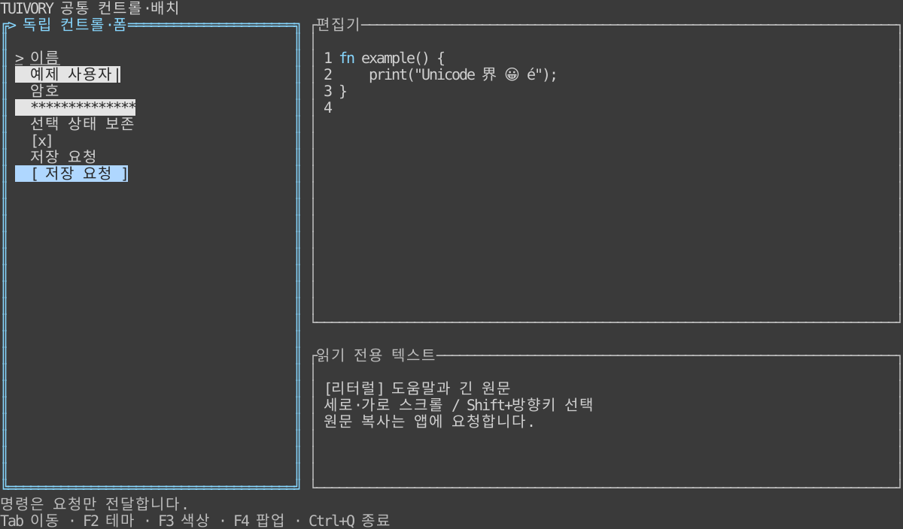

# 입력·편집·Surface·배치 컨테이너

**한국어 (기본)** · [English](controls.en.md)

0.6.0에 TVR-22~25 기능을 제공합니다. Go·Rust의 공통 규칙은 [언어 중립 명세](../design/controls.md), 전체 선언은 [API 명세](api/README.md)를 참고하세요. 기존 Form·상태·배치 계산·팔레트·그림자를 재사용합니다. 전체 backend 파사드 TVR-26은 포함하지 않습니다.

## 실행과 화면

저장소 루트에서 `make run-controls-go` 또는 `make run-controls-rust`를 실행합니다. `ARGS="--lang en --theme light --colors 16 --ascii"`로 언어·테마·프로필을 지정합니다. Go 1.24+, Rust 코어 1.85+, Rust UI/예제 1.88+입니다. DB와 서버는 필요 없습니다.

Tab/Shift+Tab은 폼 필드와 편집기·뷰어 사이를 이동합니다. F2 테마, F3 색상 수, F4 모달 열기/닫기, Esc 모달 닫기, Ctrl+Q 종료는 **이 예제 앱의 키**입니다. Ctrl+A 전체 선택, Shift+방향키 선택, Ctrl+C 복사 요청, Ctrl+X 잘라내기 요청, Ctrl+Z/Y 되돌리기/다시 실행, PgUp/PgDn 페이지 스크롤, Alt+좌우 가로 스크롤을 연결합니다. 마우스 누르기·끌기·놓기로 원문 범위를 선택합니다. Go 예제는 tview의 기본 Ctrl+C 종료 동작을 앱에서 복사로 재연결합니다.

[라이트](images/controls-light.svg) · [흑백](images/controls-blackwhite.svg) · [ASCII](images/controls-ascii.svg) · [테두리 없는 불투명 모달·그림자](images/controls-popup.svg). 실제 Rust TestBackend 출력이며 원격 단말 캡처가 아닙니다. 값은 합성 데이터입니다. 단말/폰트에 따라 글자 폭·Dim 표현이 달라질 수 있습니다.

## TVR-22: Surface

Go `NewSurfaceView(child, palette)`는 자식 전체를 덮는 불투명 배경을 채운 뒤 자식을 그립니다. 기본 테두리·여백은 0입니다. `SetBorderPadding`으로 여백을 지정할 수 있고 `ShadowView`의 자식으로 사용합니다. `PanelView.SetBorder(false)`도 실제 테두리를 끄도록 수정했습니다. 기본 패널의 기존 테두리는 유지합니다.

Rust는 `SurfaceWidget::new(widget, &styles).padding(cells)`입니다. 래퍼는 표면과 경계를 담당하며 자식의 값/선택·스타일/포커스 상태를 재생성하지 않습니다. Go 래퍼는 키·붙여넣기·마우스 캡처를 자식에 전달합니다. 테마 변경 시 자식의 팔레트도 별도로 갱신합니다.

## TVR-23: 폼과 독립 컨트롤

| 기능 | Go | Rust |
| --- | --- | --- |
| 독립 입력 | `NewInput(id, label, value, secret)` | `Control::input(id, label, value, secret)` |
| 독립 버튼 | `NewButton(id, label)` | `Control::button(id, label)` |
| 체크 | `NewCheck(id, label, checked)` | `Control::check(id, label, checked)` |
| 선택 | `NewSelect(id, label, options, choice)` | `Control::select(id, label, options, choice)` |
| 사용자 필드 | `NewControl(FormField)` | `Control::new(FormField)` |
| 렌더러 | `NewControlView` | `ControlWidget` |
| 기존 폼 조합 | `NewForm / NewFormView` | `Form::new / FormWidget` |

모든 컨트롤은 기존 Form 동작을 공유합니다. 기존 `NewChoice`와 Styler도 호환 경로로 유지합니다. 추가 상태는 `SetState/set_state`로 갱신하며 비활성·Busy는 실행/수정을 차단합니다. 읽기 전용은 선택·복사를 허용하고 수정을 막습니다. 버튼의 좌우 이동, Enter/Space 실행 요청, 열린 선택창의 입력 가로채기와 취소를 제공합니다. 실행 이벤트는 콜백에 요청으로만 전달합니다. 저장/인증은 앱이 결정합니다. 빠른 클릭에 따른 중복 업무 실행도 앱의 Busy/실행 정책으로 제어합니다.

암호 필드는 `FormField.Kind = "password"`입니다. 폼이 소유한 `Fields/fields`, Layout, JSON/Debug 출력은 별표를 사용합니다. 원문은 **`Form.Value(id)` / `Form::value(id)`를 명시적으로 호출**해 조회합니다. 암호 복사·잘라내기 이벤트에는 원문을 넣지 않습니다. 생성자에 전달하기 전 앱의 원본 인수와 명시적으로 꺼낸 원문은 앱이 관리합니다. 인증·암호화·영구 저장·메모리 수명은 이 컨트롤의 기능이 아닙니다.

`SelectText/select_text`로 필드 원문 범위를 선택합니다. 복사/잘라내기는 `FormEvent.Text/text`에 평문 요청을 반환하며 실제 클립보드 I/O는 앱이 수행합니다. 원문 조회는 이벤트에 자동 포함하지 않습니다. 기존 필드 조회에서 일반 값은 그대로이며 password 값만 마스킹됩니다.

## TVR-24: 편집기와 텍스트 뷰

Go는 `NewEditor(text)`, `NewTextView(text)`로 `TextDocument`를 만들고 `NewEditorView` 또는 `NewTextViewView`로 표시합니다. Rust는 `TextDocument::editor/viewer`와 `TextWidget`을 사용합니다. viewer는 기본 읽기 전용이며 같은 편집 모델을 재사용합니다.

- `TextBuffer.Text/text`는 명시적 원문 조회입니다. SetText는 원문 바이트를 보존하고 선택·Undo/Redo 이력을 새 문서로 초기화합니다. 화면에서는 제어 문자를 안전한 공백으로 표시합니다. 편집 입력/붙여넣기는 CRLF/CR을 LF로, 탭을 공백으로 정규화하고 단일행 입력은 줄바꿈을 제거합니다.
- Cursor와 Anchor, SyntaxSpan의 Start/End는 **전체 원문의 확장 grapheme 인덱스**입니다. 범위는 반열림이며 줄바꿈도 한 묶음으로 셉니다. CRLF는 한 grapheme입니다. `CursorByte/cursor_byte`는 원문 UTF-8 바이트 위치입니다. 셀 좌표와 혼용하지 않습니다.
- `Handle/handle`은 insert/paste/newline/backspace/delete, left/right/up/down/home/end, select_이동/select_all, copy/cut, undo/redo를 받습니다. 선택 범위는 삽입 시 교체됩니다. Undo 이력은 최근 128회 편집이며 파일에 저장하지 않습니다.
- Wrap/LineNumbers와 ScrollX/Y를 설정합니다. 가로 스크롤은 셀 단위이고 두 칸 문자를 반쪽으로 그리지 않습니다. 선택·편집 후 커서를 보이게 이동합니다. 수동 스크롤은 다음 편집/선택 전까지 유지합니다. `Point/point`는 내용 뷰포트의 셀 좌표를 원문 선택으로 변환하며 extend=true로 드래그 선택을 이어갑니다.
- `SetSyntax/set_syntax`는 호스트 렉서가 만든 grapheme 범위와 의미 역할을 받습니다. 지원 역할은 body/hint/info/success/warning/error/header/field/selection/button/disabled/edited입니다. 잘못된 범위·역할은 오류이며 이전 설정을 유지합니다. SQL 렉서나 실행기는 제공하지 않습니다.
- 일반 텍스트 API는 `[info]` 같은 문자열을 그대로 표시합니다. **명시적** `ParseMarkup/parse_markup`와 `SetMarkup/set_markup`만 `[role]내용[/]`을 해석합니다. `[[`는 `[` 이스케이프이며 중첩 태그를 지원합니다. 잘못된/닫히지 않은 태그는 오류입니다. 파싱 결과와 복사는 태그를 뺀 논리 평문이며 원본 마크업 문자열이 필요하면 앱이 별도로 보존합니다.

`TextEvent`의 change/select는 상태 변경 안내, copy/cut의 Text는 앱 클립보드 요청입니다. 키/파일/DB/클립보드 정책을 강제하지 않습니다. TextBuffer의 Secret을 켜면 화면·Go JSON/포맷·Rust Debug와 복사 요청에서 원문을 숨깁니다. 원문과 Undo 이력은 메모리에 유지합니다.

현재 Layout은 원문 전체를 순회합니다. 1만 줄 문서의 스크롤·원문 복사·되돌리기를 회귀 검사했습니다. 대용량 파일용 rope 버퍼와 비동기 렉서는 제공하지 않습니다.

## TVR-25: 배치 컨테이너

| 기능 | Go | Rust |
| --- | --- | --- |
| 행·열 | `NewRow / NewColumn` | `ContainerOptions.kind = "row"/"column"` |
| 격자 | `NewLayoutGrid` | kind = `"grid"` |
| 레이어 | `NewLayerStack` | kind = `"layers"` |
| 공통 계산 | `ComputeContainer` | `compute_container` |
| 상태/입력 범위 | `ContainerState` | `ContainerState` |
| 실제 렌더링 | `ContainerView` | `ContainerWidget` |

기존 SplitView와 배치 계산은 유지합니다. 배치용 Grid는 데이터 Grid와 다른 API입니다. LayoutItem은 안정 ID, Track, 행·열/span, Hidden/Disabled, Modal, 레이어 Area/Centered를 받습니다. Track은 Min/Max/Fixed/Weight이며 Max=0은 상한 없음, 전부 0인 트랙은 자동 가중치 1입니다. 고정 크기 뒤 남는 공간을 가중치로 배분하고 상한에 걸린 공간은 다른 트랙에 나눕니다. 좁으면 간격을 없애고 앞 항목부터 최소 크기를 줄여 0 크기도 안전하게 처리합니다. padding/gap의 기본값은 0입니다.

Go는 ContainerChild에 컴포넌트를 연결합니다. `SetChildren`은 잘못된 변경을 거부하고 살아 있는 ID의 상태를 유지합니다. `SetOptions`는 배치 설정을 검증해 교체합니다. `StyleChildren` 순회로 테마를 재적용할 수 있습니다. 기본 Tab 순환은 폼의 내부 경계를 존중합니다. CycleFocus=false와 FocusID/MoveFocus로 앱의 명시적 정책을 사용할 수 있습니다. 컨테이너가 자식의 기존 입력 캡처를 덮어쓰지 않습니다.

Rust `ContainerWidget`의 render_child는 **받은 ID로 위젯을 선택**합니다. SDK가 영역 계산·그리기 순서·자식 클리핑을 담당합니다. `ContainerState`의 focus/move/hit/pointer 결과 ID로 해당 모델에 입력을 전달합니다. 현재 Rust 어댑터는 Widget/Buffer를 사용하며 Go도 Primitive를 받습니다. 이 backend 표면 전체를 감추는 일은 TVR-26입니다.

가장자리에 붙는 레이어는 LayoutItem.Drawer/drawer를 "left" 또는 "right"로 지정하며 기존 DrawerLayout/drawer_layout을 재사용합니다. Centered와 Drawer는 함께 지정할 수 없습니다.

레이어는 선언 순서대로 그리며, 마지막 보이는 Modal 아래는 키·붙여넣기·포인터 대상에서 제외합니다. 드래그 캡처는 영역 밖에서도 유지하고 닫거나 제거하면 해제합니다. 모달 닫기 시 살아 있는 호출 ID로 포커스를 복귀합니다. 가상 영역은 VirtualWidth/Height, ScrollX/Y로 스크롤합니다. Rust 포인터는 가상 좌표 기준 rects에 화면 좌표+scroll을 전달합니다. 렌더러는 축 65,535셀·가상 영역 1,000,000셀 이내를 지원하고 원문 문서 자체는 별도의 텍스트 스크롤을 사용합니다.

앱은 어떤 컴포넌트를 어느 슬롯에 놓을지, 전역 키·닫기 승인·업무 데이터/동작을 결정합니다. SDK는 배치 실행·공통 입력 전달·그리기·상태 보존을 담당합니다. 오류 입력으로 화면 상태를 초기화하거나 선택/Undo 이력을 재생성하지 않습니다.

## 검증과 제공 범위

[공통 시나리오](../design/controls-cases.json)는 두 언어가 같은 편집 이벤트·원문·커서·배치 결과를 확인합니다. 12팔레트, Unicode/ASCII, Go Show 이후 출력과 Rust Buffer, 암호 비노출, 드래그·모달·작은/0크기·원문 복사·외부 import·정적 배포를 검증합니다. 실제 결과는 [검증 기록](../evidence/controls-results.json)에 기록하며 원격 CI·게시와 구분합니다. CentOS 검증은 수행하지 않습니다.

현재 구현은 Go·Rust입니다. Python·JavaScript/TypeScript·C·C++ 구현과 전체 언어별 backend 파사드는 제공 완료로 주장하지 않습니다.
