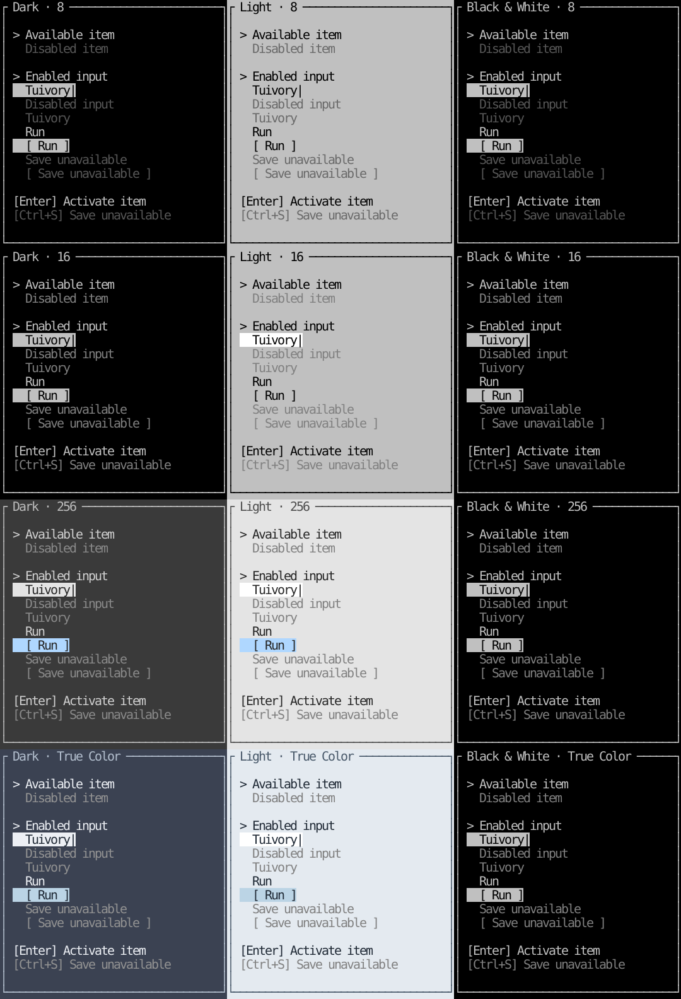

# Disabled-state comparison

[한국어 (default)](disabled-states.md) · **English**

Do not automatically prefix ordinary text, lists, tabs, menus, buttons, input values, or shortcut hints with a disabled marker. Keep selection indicators for checkboxes, radios, and check-menu items. This English reference renders the public ListWidget, FormWidget, and HelpWidget through a real Ratatui TestBackend, using identical components and data in each cell.



- 16 colors: gray index 8. Reference contrast against the light-16 surface is about 2.17:1.
- 256 colors: gray 245 for dark, 244 for light and monochrome.
- True Color: #929292 for dark, #808080 for light and monochrome.
- 8 colors: no additional gray is available, so retain the foreground and apply Dim. Images approximate Dim using 0.45 opacity. Actual brightness depends on terminal Dim support and the user's ANSI palette; a terminal ignoring Dim may show identical colors.

The internal reference contrast floor is 2.0:1 for disabled foregrounds and 4.5:1 for active plain text. Do not promote disabled text back to the active foreground and erase the distinction. These are design references, not accessibility certification or measurements of a physical terminal. Retain readable values and remove active field/button backgrounds. Individual disabled notice actions use separate spans with the same styling.

Go/Rust models exclude disabled items from focus navigation, selection, and activation. Clicking a disabled option changes neither its value nor parent focus. Go views block disabled row/span clicks before application focus/action callbacks. Rust renderers only draw; hosts should route input through the provided model click/handle methods. Help only displays hints, and the host decides whether its shortcut command is enabled. Global keys and business actions remain host responsibilities.

```sh
cargo run --manifest-path rust/Cargo.toml --features ratatui --example states -- --lang ko --snapshot docs/images/disabled-states.svg
cargo run --manifest-path rust/Cargo.toml --features ratatui --example states -- --lang en --snapshot docs/images/disabled-states-en.svg
```

The states example renders a comparison without a DB or interactive terminal. Use the existing catalog/menu examples for interactive forms, lists, and menus. [Surface design](../design/surfaces.en.md) · [validation record](../evidence/disabled-colors-results.json).

Validation: 948 Go/Rust renders have zero target plain-text/tail background mismatches. The minimum reference contrast is ~4.504:1 across 802 active plain runs and ~2.171:1 before Dim across 48 disabled runs. Separate checks verify the 8-color Dim attribute and active/disabled style distinction in all twelve palettes. Go race/vet, Rust all-feature/all-target checks, isolated package consumers, and 44 native ARM64 PTY cases passed. These are pre-release local results; see the [0.4.0 release](release-0.4.0.en.md) for remote CI/publication evidence. CentOS validation is not performed.
