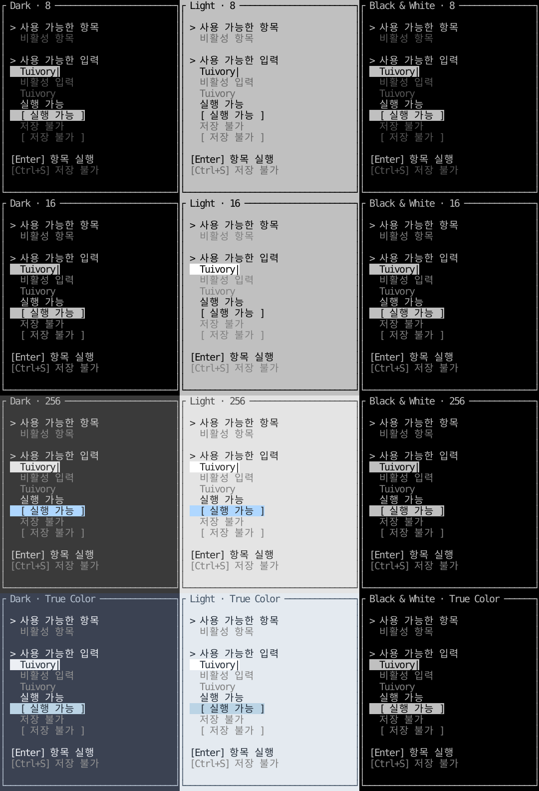

# 비활성 상태 비교

**한국어 (기본)** · [English](disabled-states.en.md)

일반 텍스트·목록·탭·메뉴·버튼·입력값·단축키 안내에는 비활성 접두사를 자동으로 붙이지 않습니다. 체크박스·라디오·체크 메뉴처럼 선택 상태가 있는 컨트롤의 표식은 유지합니다. 아래는 공개 ListWidget·FormWidget·HelpWidget을 실제 Ratatui TestBackend에 그린 한글 화면입니다. 각 칸은 동일한 컴포넌트와 데이터를 사용합니다.



- 16색: 인덱스 8 회색을 사용합니다. light-16 표면과의 참조 대비는 약 2.17:1입니다.
- 256색: 다크 245, 라이트·흑백 244 회색을 사용합니다.
- True Color: 다크 #929292, 라이트·흑백 #808080을 사용합니다.
- 8색: 별도 회색이 없어 기존 전경에 Dim 속성을 적용합니다. 이미지에서는 0.45 불투명도로 근사합니다. 터미널의 Dim 지원·사용자 ANSI 팔레트에 따라 실제 명암은 달라지며, Dim을 무시하면 색만으로 구분되지 않을 수 있습니다.

비활성 전경의 내부 참조 대비 하한은 2.0:1, 활성 평문은 4.5:1입니다. 활성 글자와 같은 색으로 보정해 비활성 차이를 지우지 않습니다. 이 수치는 접근성 인증이 아니며 실제 단말 결과와 구분합니다. 값은 읽을 수 있게 보존하고 비활성 입력/버튼의 활성 배경은 제거합니다. 알림의 개별 비활성 액션도 별도 스팬으로 같은 스타일을 사용합니다.

Go/Rust 모델은 비활성 항목을 포커스 이동·선택·실행에서 제외합니다. 비활성 옵션 클릭은 값·부모 포커스를 바꾸지 않습니다. Go 뷰는 비활성 행/스팬의 클릭을 앱 포커스·액션 콜백 전에 차단합니다. Rust 렌더러는 그리기만 담당하므로 적용 앱은 제공된 모델의 click/handle 경로를 사용해야 합니다. Help는 표시 전용이며 앱이 단축키 명령의 활성 여부를 판단합니다. 전역 키·업무 처리까지 라이브러리가 소유하지 않습니다.

```sh
cargo run --manifest-path rust/Cargo.toml --features ratatui --example states -- --lang ko --snapshot docs/images/disabled-states.svg
cargo run --manifest-path rust/Cargo.toml --features ratatui --example states -- --lang en --snapshot docs/images/disabled-states-en.svg
```

states는 DB·대화형 터미널 없이 비교 화면만 만드는 예제입니다. 실제 폼/목록/메뉴 조작은 기존 catalog/menu 견본을 사용합니다. [표면 디자인](../design/surfaces.md) · [검증 기록](../evidence/disabled-colors-results.json).

검증: Go/Rust 948회 렌더링에서 대상 평문의 글자/행 끝 배경 불일치 0. 활성 평문 802구간의 최소 참조 대비 약 4.504:1, 비활성 48구간의 Dim 적용 전 최소값 약 2.171:1입니다. 8색 Dim 속성과 12팔레트의 활성/비활성 스타일 차이를 별도 검사했습니다. 전체 Go race/vet·Rust 전체 대상/기능 및 독립 패키지 적용 검증, 실제 ARM64 PTY 44사례가 통과했습니다. 이는 릴리스 전 로컬 검증 기록이며 원격 CI·게시 결과는 [0.4.0 릴리스](release-0.4.0.md)에서 구분합니다. CentOS 검증은 수행하지 않습니다.
