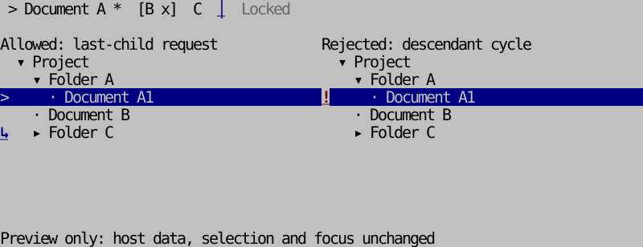
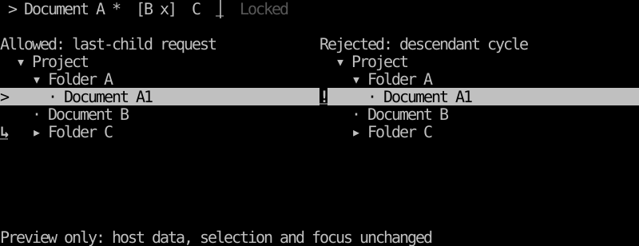
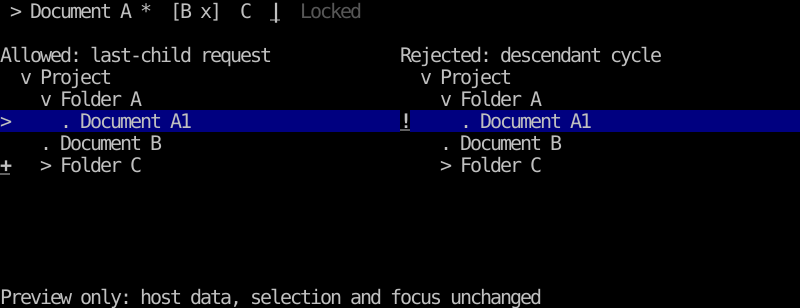

# Tab and tree drag and drop

[한국어 (default)](drag-drop.md) · **English**

TVR-18 is available starting with 0.10.0. Go and Rust share request semantics and state transitions. Dragging is opt-in and covers tab reordering and tree reorder/reparenting. Existing splitter resizing and grid range selection remain separate interactions.

## Requests and application

`DropRequest` contains source/target stable IDs, `before`/`after`/`inside`, and a model revision for change detection. `inside` appends a last child and requires a tree branch. Reject self/descendant moves, missing IDs, disabled tabs, locked source/targets, unchanged positions and stale requests.

Dragging never changes source data, selection, focus or real scroll/expansion. The library owns only pointer/preview state. Drop rechecks policy and returns a request. The host approves current permissions/business rules, then obtains a **new model** through `ApplyDrop`/`apply_drop`. Recheck host permissions after asynchronous approval; application helpers validate structure/revision and do not retain or execute business permissions. Validation callbacks should only decide eligibility.

```go
import ui "github.com/leechis7/tuivory/go"

view.Drag = &ui.DragState{} // TabView or TreeView
view.DragOptions = ui.DragOptions{AutoScroll: true, Locked: []string{"fixed"}}
view.CanDrop = func(request ui.DropRequest) bool { return canMove(request) }
view.OnDrop = func(request ui.DropRequest) {
    if !canMove(request) { return } // Final host approval
    updated, err := tabs.ApplyDrop(request)
    if err == nil {
        tabs = updated
        _ = view.SetTabs(tabs) // TreeView uses tree.ApplyDrop / SetTree
    }
}
```

```rust
use tuivory::drag::{DragOptions, DragState, DropPosition};

let options = DragOptions::default();
let mut drag = DragState::default();
// Keyboard/menu actions can issue the same request.
let request = tabs.request_drop("draft", "logs", DropPosition::After, &options, None)?;
// Replace only after final host approval.
tabs = tabs.apply_drop(&request)?;
// TabsWidget::with_drag(&mut drag, ascii)
// TreeWidget::with_drag(&mut drag)
```

Put disabled/immovable tree IDs in `DragOptions.Locked`/`locked`. Hosts validate parent/subtree business permissions through policy. Immutable replacement preserves metadata and complete subtrees. Retain selection/focus by stable ID. To keep moved content visible inside a collapsed parent, expand that parent **after approval**, as the example does.

## Pointer, cancellation and overflow

- `down → armed → dragging → up`; the default threshold is a maximum horizontal/vertical displacement of two cells. Configure `Threshold`/`threshold`. Ordinary clicks keep existing selection behavior.
- Go views return mouse capture; hosts/containers must forward outside move/up to that view. The standard `Application` handles this. Suppress synthetic clicks after dragging.
- Rust hosts route **signed inner-viewport cell coordinates** with `DragPointer` into `Tabs::drag`/`Tree::drag`. Forward outside move/up while `captured()` is true, and avoid processing release as a second ordinary click. See the [runnable host](../rust/examples/workspace/main.rs).
- Call `Cancel`/`cancel` for Esc, focus/capture loss, hiding or screen replacement. Go views/Rust widgets check `RenderKey` for geometry/palette changes; data and original-state changes also invalidate gestures. Hosts must explicitly cancel hidden components that stop rendering.
- Auto-scroll defaults off. When enabled, each edge move advances the preview by one item, without an owned timer. Hover expansion also defaults off; enabling it immediately expands only a permitted branch preview. Reject/cancel leaves real scroll/expansion unchanged.
- Tree indentation/disclosure cells mean `before`, branch body means `inside`, and the final two columns or leaf body mean `after`. Tab left/right halves choose before/after. `DragLayout`/`DragRows` use the same preview coordinates for rendering and hit testing.

`Phase`/`phase` is idle (including the empty initial value), armed or dragging. `Result`/`result` is drop/reject/cancel/stale; `Allowed`/`Reason` describe feedback. Hosts may explicitly cancel palette changes. Application data/state remains host-owned.

## Keyboard and appearance

Enabled Go views issue local Alt+Shift+Left/Right tab moves; tree Up/Down moves siblings, Right nests inside the previous sibling and Left moves after the parent. The Rust example routes the same keys into `keyboard_drop`. Hosts can bind `KeyboardDrop`/`keyboard_drop` or `RequestDrop`/`request_drop` to other keys/menus. No application-wide keys or cross-component focus order are imposed.

Allowed insertion uses tab `│`, tree `↑/↓/↳`; rejection uses `!`, with bold/underline cues. ASCII uses `|`, `^/v/+`, `!`. Bind info/error foregrounds to the actual surface across dark/light/monochrome × 8/16/256/True Color. Do not add ordinary disabled prefixes. Wide-glyph boundaries use common drawing rules.

```sh
make build build-rust
./bin/go/tuivory-linux-arm64 --demo workspace --drag --lang ko
./bin/rust/tuivory-linux-arm64 --demo workspace --drag --lang en --ascii
```

Build only the current Linux host architecture. Examples update in-memory models without DB/file/OS drag operations. F2/F3 changes theme/colors, F4 ASCII, Esc cancels, Ctrl+Q exits.






Images come from actual Rust SDK TestBackend output. Validate twelve-palette Unicode/ASCII feedback with Go post-Show buffers and Rust TestBackend, shared [request cases](../design/drag-cases.json), outside release/cancel/cycles/permission and data changes/overflow/preview state/keyboard, and real bilingual PTYs. Distinguish local checks from remote CI/publication and CentOS checks.

[Tree](tree.en.md) · [Tabs and workspace](workspace.en.md) · [API](api/README.en.md)

[Local validation record](evidence/tvr7-18-results.json): 216 Modal palette/language/size cases, Go/Rust shared drag and physical-buffer regressions, 58 bilingual PTY scenarios, isolated Go/packaged Rust consumers, core Rust 1.85.1 and native ARM64 static executables passed. This record preserves pre-publication local evidence. Final CI/public-tag/download checks are recorded in the [0.10.0 release](release-0.10.0.en.md) asset manifest.
