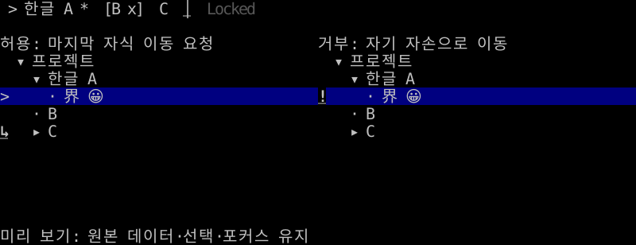
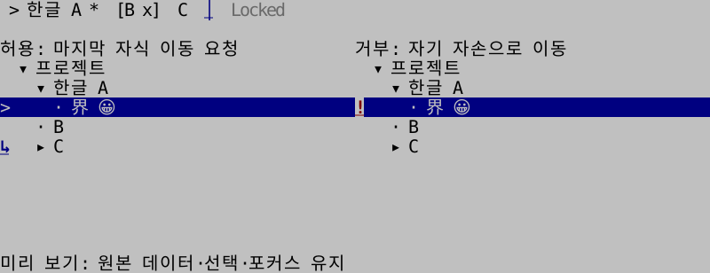
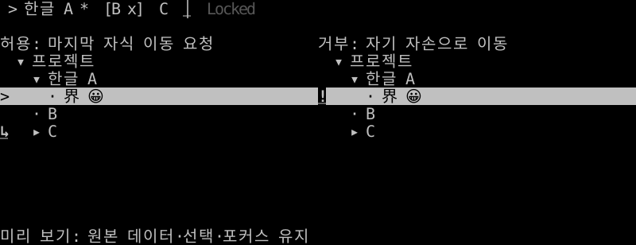

# 탭·트리 드래그 앤 드롭

**한국어 (기본)** · [English](drag-drop.en.md)

TVR-18로 0.10.0부터 제공합니다. Go·Rust는 같은 이동 요청과 상태 전이를 사용합니다. 드래그는 기본 끄기이며 탭 순서 변경, 트리 재정렬·부모 변경을 다룹니다. 분할선 크기 조절·그리드 범위 선택은 기존 별도 조작입니다.

## 요청과 적용

`DropRequest`에는 원본 ID, 대상 ID, `before`/`after`/`inside`, 모델 변경을 검사할 버전값이 있습니다. `inside`는 마지막 자식 위치이며 트리의 branch만 받습니다. 자기 자신·자손 아래/옆 이동, 없는 ID, 비활성 탭, 잠긴 원본/대상, 같은 위치로의 이동과 오래된 요청을 거부합니다.

라이브러리는 드래그 중 데이터·선택·포커스·실제 스크롤·펼침을 바꾸지 않습니다. 포인터와 미리 보기만 관리합니다. 드롭 시 정책을 다시 검사하고 요청을 반환합니다. 앱은 최신 권한·업무 조건을 승인한 뒤 `ApplyDrop`/`apply_drop`으로 **새 모델**을 받아 교체합니다. 비동기 승인 전에는 앱의 정책을 다시 확인하세요. 적용 함수는 구조·버전 검사를 수행하며 업무 권한을 저장하거나 실행하지 않습니다. 검사 콜백은 판정만 하도록 작성합니다.

```go
import ui "github.com/leechis7/tuivory/go"

view.Drag = &ui.DragState{} // TabView 또는 TreeView
view.DragOptions = ui.DragOptions{AutoScroll: true, Locked: []string{"fixed"}}
view.CanDrop = func(request ui.DropRequest) bool { return canMove(request) }
view.OnDrop = func(request ui.DropRequest) {
    if !canMove(request) { return } // 앱의 최종 승인
    updated, err := tabs.ApplyDrop(request)
    if err == nil {
        tabs = updated
        _ = view.SetTabs(tabs) // TreeView는 tree.ApplyDrop / SetTree
    }
}
```

```rust
use tuivory::drag::{DragOptions, DragState, DropPosition};

let options = DragOptions::default();
let mut drag = DragState::default();
// 키보드·메뉴에서도 같은 요청을 생성할 수 있습니다.
let request = tabs.request_drop("draft", "logs", DropPosition::After, &options, None)?;
// 앱의 최종 승인 후 교체합니다.
tabs = tabs.apply_drop(&request)?;
// TabsWidget::with_drag(&mut drag, ascii)
// TreeWidget::with_drag(&mut drag)
```

트리의 비활성/이동 금지 ID는 `DragOptions.Locked`/`locked`에 넣습니다. 앱의 부모별 권한·하위 항목 전체 권한은 정책 콜백에서 판단합니다. 원본 모델은 불변이며 메타데이터·노드 하위 트리는 함께 보존됩니다. 선택·포커스는 안정 ID로 유지합니다. 접힌 부모로 이동한 항목을 계속 보이게 하려면 **승인 후** 앱이 대상 부모를 펼칩니다. 실행 예제는 이 방식을 사용합니다.

## 포인터·취소·넘침

- `down → armed → dragging → up`이며 기본 임계값은 가로/세로 중 최대 2셀입니다. `Threshold`/`threshold`로 조정합니다. 클릭은 기존 선택 동작을 유지합니다.
- Go 뷰가 마우스 캡처를 반환하면 앱/컨테이너는 영역 밖 move/up도 해당 뷰로 전달해야 합니다. 일반 `Application`은 이를 처리합니다. 드래그 뒤 합성 클릭을 차단합니다.
- Rust 호스트는 `Tabs::drag`/`Tree::drag`에 **내부 영역 기준의 부호 있는 셀 좌표**와 `DragPointer`를 전달합니다. `captured()`가 참인 동안 영역 밖 move/up도 전달하고, release 후 일반 클릭을 중복 실행하지 않습니다. [실행 예제](../rust/examples/workspace/main.rs)의 호스트 연결을 참고하세요.
- Esc, 포커스/캡처 상실, 숨김·화면 교체 시 `Cancel`/`cancel`합니다. 크기·위치·팔레트 변경은 Go 뷰/Rust 렌더러의 `RenderKey` 검사로 취소하며, 데이터·원래 상태 변경도 버전 검사로 취소합니다. 렌더링을 생략하는 숨김 화면은 호스트가 직접 취소해야 합니다.
- `AutoScroll`은 기본 끄기입니다. 켜면 경계 move마다 한 항목씩 미리 보기만 스크롤하며 자체 타이머는 만들지 않습니다. `HoverExpand`도 기본 끄기이며 켜면 허용된 branch 자식 대상에 올렸을 때 미리 보기만 즉시 펼칩니다. 취소/거부 시 실제 스크롤·펼침은 그대로입니다.
- 트리 왼쪽 들여쓰기/화살표 영역은 `before`, branch 본문은 `inside`, 오른쪽 끝 2셀 또는 leaf 본문은 `after`입니다. 탭은 대상 왼쪽/오른쪽 절반으로 앞/뒤를 나눕니다. `DragLayout`/`DragRows`는 미리 보기 영역을 제공하며 포인터와 그리기가 같은 좌표를 사용합니다.

`Phase`/`phase`는 idle(빈 초기값 포함), armed, dragging입니다. `Result`/`result`는 drop/reject/cancel/stale이며, 드롭 가능 여부와 이유는 `Allowed`/`Reason`으로 확인합니다. 팔레트 변경 시 명시적으로 취소해도 됩니다. 데이터와 상태는 앱 소유입니다.

## 키보드와 표시

Go 뷰는 활성화했을 때 내부 포커스에서 Alt+Shift+좌/우(탭), 위/아래(트리 형제), 우(이전 형제 안으로), 좌(부모 뒤로) 이동 요청을 제공합니다. Rust 예제는 같은 키를 `keyboard_drop`에 연결합니다. 앱은 `KeyboardDrop`/`keyboard_drop` 또는 `RequestDrop`/`request_drop`을 다른 키·메뉴에 연결할 수 있습니다. 전역 키나 화면 간 포커스 순서는 정하지 않습니다.

허용된 삽입은 탭 `│`, 트리 `↑/↓/↳`, 거부는 `!`로 나타내고 굵기·밑줄을 더합니다. ASCII는 `|`, `^/v/+`, `!`입니다. 정보/오류 전경을 실제 표면에 결합해 다크·라이트·흑백 × 8/16/256/True Color에서 같은 의미를 유지합니다. 일반 비활성 접두사는 추가하지 않습니다. 두 칸 문자 경계는 공통 그리기 API를 따릅니다.

```sh
make build build-rust
./bin/go/tuivory-linux-arm64 --demo workspace --drag --lang ko
./bin/rust/tuivory-linux-arm64 --demo workspace --drag --lang en --ascii
```

실행파일은 현재 Linux 호스트 아키텍처 하나만 만듭니다. 예제는 메모리 모델만 바꾸며 DB·파일·OS 드롭을 수행하지 않습니다. F2/F3 테마·색상, F4 ASCII, Esc 드래그 취소, Ctrl+Q 종료.






이미지는 Rust SDK TestBackend에서 생성했습니다. Go 실제 Show 이후 버퍼와 Rust TestBackend에서 12팔레트·Unicode/ASCII 피드백을 검사하며 공통 [요청 사례](../design/drag-cases.json), 영역 밖 release·취소·순환·권한/데이터 변경·넘침·미리 보기 상태·키보드와 실제 한영 PTY를 검증합니다. 원격 CI·게시·CentOS 검증과 구분합니다.

[트리](tree.md) · [탭과 작업 공간](workspace.md) · [API](api/README.md)

[로컬 검증 기록](evidence/tvr7-18-results.json): Modal 216개 팔레트·언어·크기 사례, Go/Rust 공통 드래그·실제 버퍼 회귀, 한영 PTY 58개, 외부 Go/Rust 패키지·Rust core 1.85.1과 ARM64 정적 실행파일 검사를 통과했습니다. 이 기록은 게시 전 로컬 이력입니다. 최종 CI·공개 태그·다운로드 검증은 [0.10.0 릴리스](release-0.10.0.md)의 자산 명세에 기록합니다.
