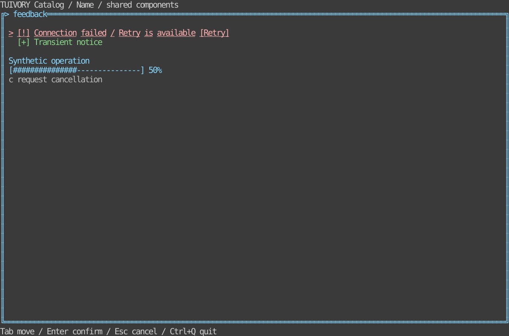

# Notices, progress and data states — TVR-12

[한국어 (default)](feedback.md) · **English**

Public Go types: `NoticeQueue`, `Progress`, `DataState` with corresponding views; Rust `feedback` models and Ratatui widgets provide the same contract.

Notices carry IDs, text/detail, info/success/warning/error severity, priority, absolute expiry and actions. Duplicate IDs explicitly update; invalid severity/action IDs fail. Sort by severity/priority, report omitted items and preserve the highest-priority notice in a one-line viewport. Error/persistent/actionable notices never auto-expire or get evicted for capacity. Hosts handle full-queue errors.

Visible/expire operations accept consistent host-supplied monotonic units; zero expiry means no deadline. Models own no timers/threads. Dismiss/action operations are requests; hosts explicitly remove notices or run retries. Use nonblocking messages for routine feedback and compose important decisions with popup scopes as appropriate.

Progress accepts loading/ready/empty/error/success/cancelled states, amounts/messages and cancellation policy. Unknown totals use a host-frame spinner; known totals clamp to 0–100%. Cancel requests never change the operation. DataState presents loading/empty/error/ready without fetching data.

Demo keys: Enter retry request, t host-clock advance/expiry, c cancellation request, Delete explicit dismissal. A synthetic host applies outcomes. ASCII severity markers supplement colors. Tests cover persistence, capacity, disabled actions, request immutability, progress/cancel bounds, narrow cells and localized PTYs.

## Run and boundaries

```sh
make run-catalog-go ARGS="--mode feedback --lang ko"
make run-catalog-rust ARGS="--mode feedback --lang en"
```

Hosts own data, business actions, clocks and terminal lifecycle. Public models emit requests and render literal cell-clipped rows. Existing v0.1.0 tags do not include these APIs; approved changes merge into dev only. Static linking, Unicode/ASCII and color-profile requirements remain.



[Light](images/feedback-light-en.svg) · [Blackwhite](images/feedback-blackwhite-en.svg)

Actual Rust TestBackend 120×36 reference, not a Go capture or physical/SSH terminal result. Generate six localized references with `tools/snapshot_catalog.py BINARY --mode feedback`.

[Backlog](components-backlog.en.md) · [Static distribution](static-build.en.md)
