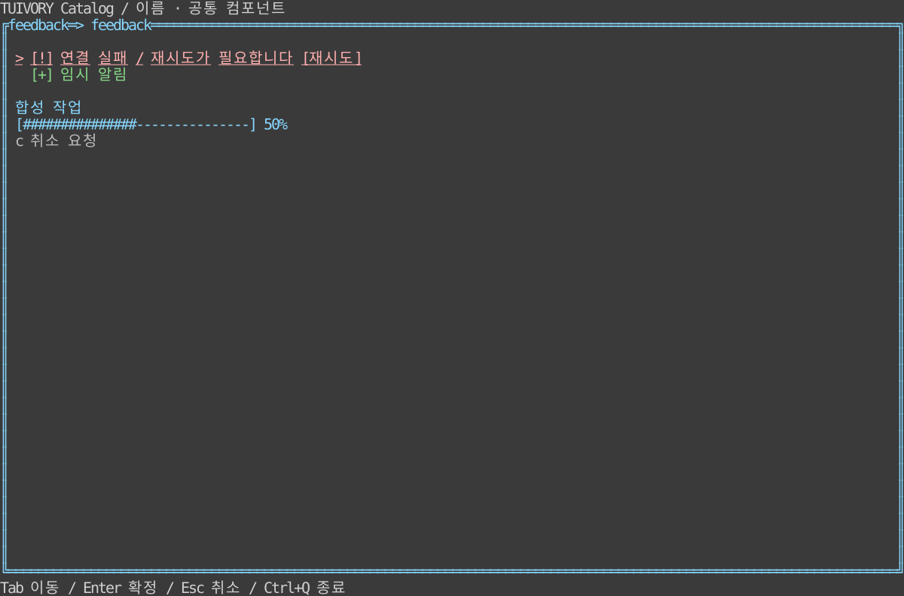

# 알림·진행·데이터 상태 — TVR-12

**한국어 (기본)** · [English](feedback.en.md)

Go `NoticeQueue`, `Progress`, `DataState`와 `NewNoticeView`/`NewProgressView`/`NewDataStateView`, Rust `feedback` 코어와 대응 Ratatui 위젯을 제공합니다.

알림은 ID·본문·상세·severity(info/success/warning/error)·우선순위·절대 만료 시각·액션을 받습니다. 중복 ID는 명시적 갱신이며 잘못된 severity/액션 ID는 거부합니다. severity와 우선순위 순으로 표시하고 공간이 부족하면 생략 개수를 표시합니다. 높이가 한 줄이면 가장 중요한 알림을 우선합니다. 오류·persistent·액션이 있는 알림은 자동 만료/용량 확보를 위해 제거하지 않습니다. 큐가 중요한 알림으로 가득 차면 Push/push 오류를 앱이 처리해야 합니다.

Visible/visible과 Expire/expire는 앱이 전달한 같은 단위의 단조 시각을 사용합니다. 만료 시각 0은 무기한입니다. 모델은 타이머나 스레드를 만들지 않습니다. dismiss/action 요청은 큐나 업무를 변경하지 않으며 앱이 Dismiss/dismiss나 실제 재시도를 처리합니다. 액션이 없는 단순 알림은 비차단 피드백으로 사용하고 중요한 확인/결정은 필요에 따라 공통 팝업에 연결합니다.

Progress는 loading/ready/empty/error/success/cancelled, 현재/전체 수량·메시지·취소 가능 여부를 받습니다. 전체 수량 0이면 앱의 프레임 번호로 회전 기호를 표시하고, 수량을 알면 0~100%로 제한합니다. RequestCancel/request_cancel은 요청만 반환합니다. DataState는 데이터 조회 없이 로딩·빈 결과·오류·준비 상태를 표시합니다.

예제 Enter는 재시도 요청, t는 호스트 시각을 앞으로 이동해 일반 알림 만료, c는 취소 요청, Delete는 명시적 닫기 요청입니다. 실제 처리 결과는 합성 호스트가 갱신합니다. 경고/성공/오류는 색뿐 아니라 [!]/[?]/[+]/[i] 표식으로 구분합니다. 검증은 중요 알림 유지·큐 포화·비활성 액션·요청 불변성·취소/진행률 경계·좁은 셀·한영 PTY를 포함합니다.

## 실행과 경계

```sh
make run-catalog-go ARGS="--mode feedback --lang ko"
make run-catalog-rust ARGS="--mode feedback --lang en"
```

호스트가 데이터·업무 동작·시간·단말 수명주기를 소유합니다. 공개 모델은 요청을 반환하고 실제 행은 셀 폭에 맞춰 문자 그대로 렌더링합니다. 0.2.0 태그에 포함합니다. 정적 링크·Unicode/ASCII·색상 프로필 조건을 유지합니다.



[Light](images/feedback-light.svg) · [Blackwhite](images/feedback-blackwhite.svg)

실제 Rust TestBackend 120×36 참조이며 Go 캡처나 실제 서버/SSH 단말 결과가 아닙니다. `tools/snapshot_catalog.py BINARY --mode feedback`로 한영 6장을 생성합니다.

[Backlog](components-backlog.md) · [Static distribution](static-build.md)
