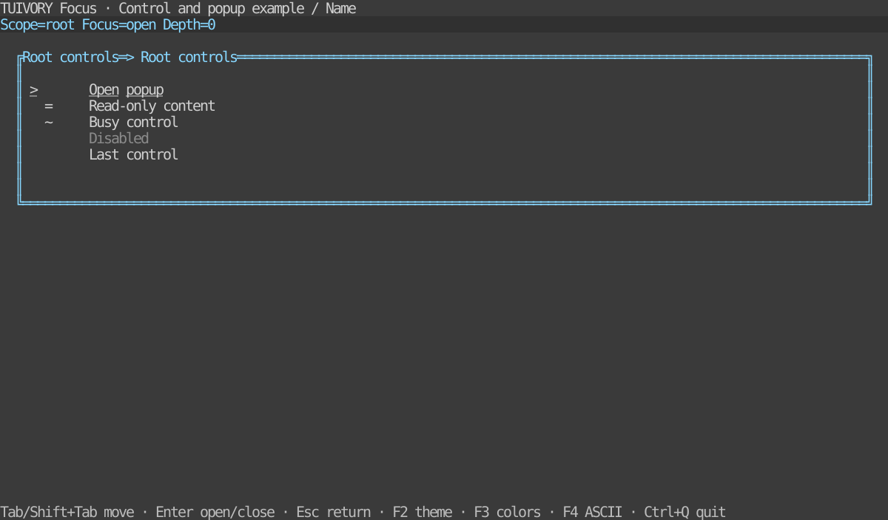

# Shared control states, focus and popup foundation — TVR-8

[한국어 (default)](focus.md) · **English**

Go `ControlState`, `ControlStyle`, `FocusStack` and Rust `interaction::{ControlState, FocusStack}`, `Styles::control` follow the same behavior rules. These APIs are included in v0.2.0. [Following stages](components-backlog.en.md)

## State composition

| State | Focus | Activate | Edit | Non-color marker |
| --- | --- | --- | --- | --- |
| Normal | Yes | Yes | Yes | None |
| disabled | No | No | No | `-` |
| read-only | Yes | Yes | No | `=` |
| busy | Yes | No | No | `~` |
| selected | Unchanged | Unchanged | Unchanged | `>` |
| edited | Unchanged | Unchanged | Unchanged | `*` |
| invalid | Unchanged | Unchanged | Unchanged | `!` |

Read-only prevents value changes, not inspection or selection. Invalid indicates an error; the host decides whether submission is allowed. Color precedence is `disabled → error → selection → edited → body`; all active markers remain in `- ! > * ~ =` order. Invalid+selected+edited uses error colors with `!>*`. Keep markers separate from actual/copied values. Focus is independent and adds underline to focusable controls. The host must check activation/edit permissions returned by `Visual`/`visual()` before performing actions.

## Focus and popups

Control IDs must be nonempty and unique within each scope; different scopes may reuse IDs. Navigation skips hidden/disabled controls and includes read-only/busy controls. Tab/Shift+Tab wraps within the active scope. Data updates preserve focus by ID; a missing/unavailable target falls back to the first eligible control.

Popup IDs are unique across the stack. `Open`/`open` saves the caller's focus ID. Only the top scope receives keyboard/pointer input. Empty popups still block background input. Up to 64 popup layers are allowed; invalid IDs, duplicates, initial focus or excess depth leave state unchanged.

`RequestClose`/`request_close` only returns an Escape dismissal request. The host applies policies such as unsaved-change confirmation, then calls `Close(id)`/`close(id)`. The exact top ID is required so stale callbacks cannot close another window. Closing restores the caller's focus; if removed/disabled, the parent's valid focus is used. `dismissible=false` suppresses Escape requests, but the host may explicitly close the popup after completing its work.

`Route("")`/`route("")` returns the active keyboard scope. Pointer input supplies the hit-tested scope ID; consume events when `Blocked`/`blocked` is true. Outside clicks do not auto-dismiss. Host-global shortcuts also need modal policy: forwarding events directly to background widgets defeats routing. Ctrl+Q in the examples is an explicit host exit shortcut.

## Go

```go
focus, err := tuivory.NewFocusStack("root", []tuivory.FocusTarget{{ID: "open"}})
if err != nil { panic(err) }
err = focus.Open("dialog", []tuivory.FocusTarget{{ID: "close"}}, "close", true)
if err != nil { panic(err) }
focus.Move(false) // Next target; true moves backward.
if request := focus.RequestClose(); request != nil {
    // After the host approves dismissal.
    err = focus.Close(request.ID)
}
```

`Focus(id)` only affects the active scope. `Update(scopeID, targets)` replaces data in any existing scope, including an inactive parent. `Targets()` returns a copy. Obtain the palette through `CandidateTokens` → `Palette` → `Resolve`, then use `ControlStyle(palette, state, focused)`. Draw `state.Visual().Markers` separately.

## Rust

```rust
use tuivory::interaction::{FocusStack, FocusTarget};
fn main() -> Result<(), tuivory::Error> {
let item = |id: &str| FocusTarget { id: id.into(), ..Default::default() };
let mut focus = FocusStack::new("root", vec![item("open")])?;
focus.open("dialog", vec![item("close")], "close", true)?;
focus.move_focus(false);
if let Some(request) = focus.request_close() {
    focus.close(&request.id)?; // After host approval.
}
Ok(())
}
```

`focus`/`update`/`targets` have the same semantics as Go. Core requires Rust 1.85+; optional Ratatui `Styles::control(state, focused)` and examples require 1.88+. Adapters use existing semantic roles without adding native dependencies.

## Database-free hosts

```sh
make run-focus-go ARGS="--lang ko"
make run-focus-rust ARGS="--lang en --ascii"
```

Both support `--lang ko|en`, `--theme dark|light|blackwhite`, `--colors 8|16|256|truecolor`, `--ascii`. Tab/Shift+Tab moves, Enter opens/explicitly closes, Escape requests dismissal, F2 changes theme, F3 colors, F4 ASCII, Ctrl+Q exits. Clicking only focuses a control in the top window. Rust `--popup`/`--nested` opens initial layers and `--snapshot PATH` writes TestBackend SVGs. Default product build outputs are unchanged.



[Light](images/focus-light-en.svg) · [Black and white](images/focus-blackwhite-en.svg) · [Popup](images/focus-popup-en.svg) · [Nested popup](images/focus-nested-en.svg) · [ASCII](images/focus-ascii-en.svg)

These are actual Rust example TestBackend references at 120×32, not Go captures or remote-terminal evidence. `tools/snapshot_focus.py` generates twelve localized images.

## Validation and boundaries

`design/interaction-cases.json` is mirrored into both modules' tests for matching state composition, navigation, nesting, empty popups, routing, restoration and invalid requests. Checks cover all twelve palettes, external imports/static hosts and bilingual PTY keys/clicks, theme changes, 40×16 resizing and normal exit. [Evidence](../evidence/focus.en.md)

This foundation does not provide an input editor, validation engine, complete Dialog widget, asynchronous operation or terminal event loop. The host connects actual widget focus, layer layout/clipping/visibility and business actions. Examples reuse public panels as host implementations; LazyOra/LazyBeaver integration remains separate. [Static distribution requirements](static-build.en.md)

Use [WideSafeScreen and DimRegion](overlay-drawing.en.md) for Go popup edges crossing CJK/emoji. These drawing APIs are separate from focus models.

Hosts define scope contents/order and cross-component traversal. FocusStack calculates navigation, blocking and restoration within supplied scopes; it does not own the global application Tab policy. [Boundary and alternative host composition](component-boundary.en.md).

In 0.4.0, plain text follows the actual surface while explicit field/selection/edit backgrounds remain. See [surface/contrast design rules](../design/surfaces.en.md) and [fix evidence](../evidence/background-fix.en.md).

The `-` in Visual().Markers is existing low-level state metadata. Default components and examples do not render it as an ordinary disabled prefix. Checkbox/radio selection indicators remain separate.
