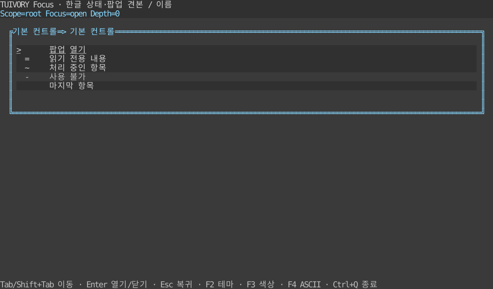

# 공통 상태·포커스·팝업 기반 — TVR-8

**한국어 (기본)** · [English](focus.en.md)

Go의 `ControlState`, `ControlStyle`, `FocusStack`과 Rust의 `interaction::{ControlState, FocusStack}`, `Styles::control`은 같은 동작 규칙을 따릅니다. 이 API는 0.2.0에 포함한 기능입니다. [후속 단계](components-backlog.md)

## 상태 합성

| 상태 | 포커스 | 실행 | 편집 | 비색상 표식 |
| --- | --- | --- | --- | --- |
| 일반 | 가능 | 가능 | 가능 | 없음 |
| disabled | 불가 | 불가 | 불가 | `-` |
| read-only | 가능 | 가능 | 불가 | `=` |
| busy | 가능 | 불가 | 불가 | `~` |
| selected | 유지 | 유지 | 유지 | `>` |
| edited | 유지 | 유지 | 유지 | `*` |
| invalid | 유지 | 유지 | 유지 | `!` |

read-only는 값 변경을 막으며 조회·선택 같은 동작까지 막지 않습니다. invalid는 오류 표시이며 제출을 허용할지는 앱이 판단합니다. 색상 역할 우선순위는 `disabled → error → selection → edited → body`이며 표식은 `- ! > * ~ =` 순서로 활성 상태를 모두 유지합니다. 예를 들어 invalid+selected+edited의 색상은 error, 표식은 `!>*`입니다. 실제 값·복사 데이터에 표식을 합치지 않습니다. 포커스는 독립 상태이며 사용 가능한 컨트롤에 밑줄을 더합니다. 호스트는 `Visual`/`visual()` 결과의 실행·편집 허용 여부를 실제 동작 전에 확인해야 합니다.

## 포커스와 팝업

각 스코프에서 컨트롤 ID는 비어 있지 않고 고유해야 합니다. 다른 스코프에서는 같은 ID를 쓸 수 있습니다. 숨김·disabled는 탐색에서 제외하고 read-only·busy는 포함합니다. Tab/Shift+Tab은 현재 스코프 안에서 순환합니다. 데이터 교체 시 같은 ID의 포커스를 보존하고 사라지거나 사용할 수 없으면 첫 사용 가능한 항목으로 이동합니다.

팝업 ID는 전체 스택에서 고유합니다. `Open`/`open`은 호출 지점 ID를 저장합니다. 최상위 팝업만 키보드·마우스 입력을 받습니다. 포커스 가능한 항목이 없는 팝업도 배경 입력을 막습니다. 최대 64개 팝업을 허용하며 잘못된 ID·중복·초기 포커스·깊이 초과 요청은 상태를 바꾸지 않습니다.

`RequestClose`/`request_close`는 Esc에 대한 닫기 요청만 반환합니다. 앱은 변경 내용 확인 등 정책을 적용한 뒤 `Close(id)`/`close(id)`를 호출합니다. 닫기는 최상위 ID가 정확히 일치해야 하므로 오래된 콜백이 다른 창을 닫지 않습니다. 닫은 후 호출 지점으로 복귀하며 해당 컨트롤이 제거·비활성화됐으면 부모 스코프의 유효 포커스를 사용합니다. `dismissible=false`이면 Esc 요청을 반환하지 않지만 작업 완료 후 앱이 직접 닫을 수 있습니다.

`Route("")`/`route("")`는 키보드 입력의 활성 스코프를 반환합니다. 마우스에는 히트 테스트로 얻은 스코프 ID를 전달하고 `Blocked`/`blocked`이면 이벤트를 소비합니다. 배경 클릭으로 자동 닫지 않습니다. 호스트 전역 단축키도 모달 정책을 적용해야 하며 이벤트를 배경 위젯에 그대로 전달하면 차단 효과가 없습니다. 예제의 Ctrl+Q는 호스트의 명시적 종료 단축키입니다.

## Go

```go
focus, err := tuivory.NewFocusStack("root", []tuivory.FocusTarget{{ID: "open"}})
if err != nil { panic(err) }
err = focus.Open("dialog", []tuivory.FocusTarget{{ID: "close"}}, "close", true)
if err != nil { panic(err) }
focus.Move(false) // 다음 항목. true는 이전 항목
if request := focus.RequestClose(); request != nil {
    // 앱이 닫기를 승인한 경우
    err = focus.Close(request.ID)
}
```

`Focus(id)`는 활성 스코프 안에서만 이동합니다. `Update(scopeID, targets)`는 열린 부모를 포함한 특정 스코프 데이터를 교체합니다. `Targets()`는 사본을 반환합니다. 팔레트는 `CandidateTokens` → `Palette` → `Resolve`로 얻고 `ControlStyle(palette, state, focused)`를 적용합니다. `state.Visual().Markers`는 별도로 그립니다.

## Rust

```rust
use tuivory::interaction::{FocusStack, FocusTarget};
fn main() -> Result<(), tuivory::Error> {
let item = |id: &str| FocusTarget { id: id.into(), ..Default::default() };
let mut focus = FocusStack::new("root", vec![item("open")])?;
focus.open("dialog", vec![item("close")], "close", true)?;
focus.move_focus(false);
if let Some(request) = focus.request_close() {
    focus.close(&request.id)?; // 앱 승인 후
}
Ok(())
}
```

`focus`/`update`/`targets`는 Go와 같은 의미입니다. 코어는 Rust 1.85 이상, 선택적 Ratatui의 `Styles::control(state, focused)`와 예제는 1.88 이상입니다. 어댑터는 기존 의미 역할을 사용하고 새 네이티브 의존성을 추가하지 않습니다.

## DB 없는 실행 예제

```sh
make run-focus-go ARGS="--lang ko"
make run-focus-rust ARGS="--lang en --ascii"
```

두 예제는 `--lang ko|en`, `--theme dark|light|blackwhite`, `--colors 8|16|256|truecolor`, `--ascii`를 지원합니다. Tab/Shift+Tab 이동, Enter 팝업 열기/명시적 닫기, Esc 닫기 요청, F2 테마, F3 색상, F4 ASCII, Ctrl+Q 종료입니다. 클릭은 최상위 창 안에서 포커스만 이동합니다. Rust의 `--popup`/`--nested`는 팝업을 연 상태에서 시작하고 `--snapshot PATH`는 TestBackend SVG를 만듭니다. 기본 제품 빌드 산출물은 늘리지 않습니다.



[밝은 테마](images/focus-light.svg) · [흑백](images/focus-blackwhite.svg) · [팝업](images/focus-popup.svg) · [중첩 팝업](images/focus-nested.svg) · [ASCII](images/focus-ascii.svg)

실제 Rust 예제의 TestBackend 120×32 참조 SVG입니다. Go 캡처나 원격 단말 검증이 아닙니다. `tools/snapshot_focus.py`로 한영 12장을 생성합니다.

## 검증과 경계

`design/interaction-cases.json`을 두 모듈의 테스트 자산으로 복제해 상태 합성·이동·중첩·빈 팝업·배경 차단·복귀·잘못된 요청을 같은 시나리오로 검사합니다. 12팔레트의 역할·포커스 표현, 외부 import·정적 앱, 한영 PTY의 실제 키/클릭·테마 왕복·40×16 리사이즈·정상 종료를 검사합니다. [검증 기록](../evidence/focus.md)

입력 편집기·폼 검증 엔진·완성 Dialog 위젯·비동기 작업·단말 이벤트 루프는 이번 기반에 포함하지 않습니다. 호스트는 실제 위젯 포커스와 레이어 배치·클리핑·가시성·업무 동작을 연결합니다. 예제는 기존 공개 패널을 재사용하는 호스트 구현이며 실제 LazyOra/LazyBeaver 통합은 별도 검증입니다. [정적 배포 조건](static-build.md)

Go 팝업의 한글·CJK·이모지 경계 보호는 [WideSafeScreen·DimRegion](overlay-drawing.md)을 사용합니다. 포커스 모델과 별개인 그리기 API입니다.

앱이 스코프의 항목·순서와 컴포넌트 사이 이동을 정합니다. FocusStack은 전달받은 스코프 안에서 탐색·차단·복귀를 계산하는 도구이며 앱 전역 Tab 정책을 소유하지 않습니다. [책임 범위와 다른 호스트 구성 예제](component-boundary.md).

0.4.0의 평문은 실제 surface 바탕을 따르며 입력·선택·수정 배경은 보존합니다. [공통 표면·대비 디자인 규칙](../design/surfaces.md)과 [수정 검증](../evidence/background-fix.md)을 참고하세요.

Visual().Markers의 `-`는 기존 저수준 상태 정보입니다. 기본 컴포넌트와 예제는 이를 일반 비활성 접두사로 출력하지 않습니다. 체크박스·라디오의 선택 표식과 구분합니다.
