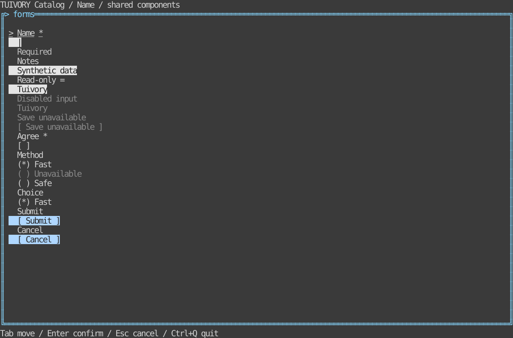

# Inputs and forms — TVR-9

[한국어 (default)](forms.md) · **English**

Public APIs: Go `NewForm`, `FormField`, `NewFormView`; Rust `forms::Form`, `FormWidget`. Kinds are text/textarea/button/checkbox/radio/select. Fields provide IDs, labels, help/errors, required flags, control states, values and validated option IDs.

Actions: next/previous, insert, left/right/home/end, backspace/delete, activate/toggle, cancel/submit. Cursors use grapheme indices, never UTF-8 bytes. Long inputs keep the presentation caret visible; vertical layout follows focus. The `|` caret is never part of the actual value. Enter submits single-line inputs and inserts a newline in textareas; Space operates checks/choices and Tab navigates.

Select separates open/pending navigation/Enter confirmation/Escape cancellation and skips disabled options. Radios commit arrow navigation. Pointer input focuses text, activates buttons/checks and selects options. Read-only/busy/disabled guards apply.

`missing` reports required/host-error IDs; submit returns invalid or submit requests. Host validators and async state connect through feedback/state setters. The host owns saving and validation functions; password editors and IME implementations remain separate. Tests cover grapheme editing, guards, pending choices, required/errors, cell widths/caret visibility, and actual localized PTY input/submit/cancel/resize.

## Run and boundaries

```sh
make run-catalog-go ARGS="--mode forms --lang ko"
make run-catalog-rust ARGS="--mode forms --lang en"
```

Hosts own data, business actions, clocks and terminal lifecycle. Public models emit requests and render literal cell-clipped rows. These APIs are included in v0.2.0. Static linking, Unicode/ASCII and color-profile requirements remain.



[Light](images/forms-light-en.svg) · [Blackwhite](images/forms-blackwhite-en.svg)

Actual Rust TestBackend 120×36 reference, not a Go capture or physical/SSH terminal result. Generate six localized references with `tools/snapshot_catalog.py BINARY --mode forms`.

[Backlog](components-backlog.en.md) · [Static distribution](static-build.en.md)
