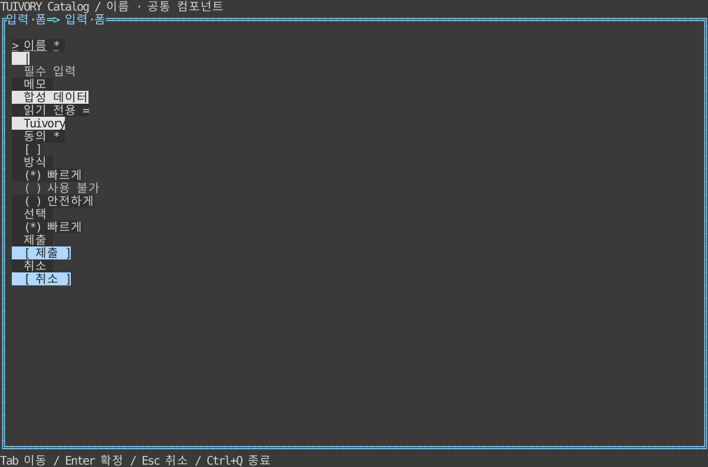

# 입력·폼 — TVR-9

**한국어 (기본)** · [English](forms.en.md)

`NewForm`, `FormField`, `NewFormView`(Go), `forms::Form`, `FormWidget`(Rust)를 제공합니다. Kind는 text/textarea/button/checkbox/radio/select입니다. 필드는 ID·라벨·도움말·오류·필수·상태·값·옵션을 받으며 ID와 옵션 ID를 검증합니다.

`Handle`/`handle`의 next/previous, insert, left/right/home/end, backspace/delete, activate/toggle, cancel/submit을 사용합니다. 커서는 UTF-8 바이트가 아닌 grapheme 인덱스입니다. 긴 입력은 커서를 포함한 가로 창으로 표시하고 폼은 포커스를 따라 세로로 이동합니다. `|`는 표시용 커서이며 값에 포함되지 않습니다. 단일 입력 Enter는 제출 요청, 여러 줄 Enter는 줄바꿈입니다. Space는 체크/선택 조작이며 Tab은 이동합니다.

선택박스는 열기→임시 이동→Enter 확정/Esc 취소를 구분하며 비활성 옵션을 건너뜁니다. 라디오는 방향키로 즉시 선택합니다. 클릭은 텍스트 포커스·버튼/체크 실행·옵션 선택을 연결합니다. 읽기 전용·busy·disabled 상태의 변경/실행 제한을 적용합니다.

`Missing`/`missing`은 필수 입력과 호스트 오류가 있는 ID를 반환하고 submit은 invalid 또는 submit 요청입니다. `SetFeedback`/`set_feedback`과 `SetState`/`set_state`로 앱 검증·비동기 상태를 연결합니다. 실제 저장·검증 함수·비밀번호 입력기·IME 구현은 호스트/후속 확장입니다. `Fields`/`fields`의 데이터를 앱이 읽고 처리합니다.

검증은 한글·ZWJ 이모지·결합 문자 삭제, 읽기 전용 보호, 선택 확정/취소·비활성 옵션, 필수/호스트 오류, 가로 셀 폭·커서 표시, 한영 PTY의 입력·선택·제출·취소·리사이즈를 포함합니다.

## 실행과 경계

```sh
make run-catalog-go ARGS="--mode forms --lang ko"
make run-catalog-rust ARGS="--mode forms --lang en"
```

호스트가 데이터·업무 동작·시간·단말 수명주기를 소유합니다. 공개 모델은 요청을 반환하고 실제 행은 셀 폭에 맞춰 문자 그대로 렌더링합니다. 0.2.0 태그에 포함합니다. 정적 링크·Unicode/ASCII·색상 프로필 조건을 유지합니다.



[Light](images/forms-light.svg) · [Blackwhite](images/forms-blackwhite.svg)

실제 Rust TestBackend 120×36 참조이며 Go 캡처나 실제 서버/SSH 단말 결과가 아닙니다. `tools/snapshot_catalog.py BINARY --mode forms`로 한영 6장을 생성합니다.

[Backlog](components-backlog.md) · [Static distribution](static-build.md)

0.4.0의 평문은 실제 surface 바탕을 따르며 입력·선택·수정 배경은 보존합니다. [공통 표면·대비 디자인 규칙](../design/surfaces.md)과 [수정 검증](../evidence/background-fix.md)을 참고하세요.

## 비활성 상태

일반 항목에는 비활성 `[-]`·`-` 표식을 자동으로 붙이지 않습니다. 체크박스·라디오·체크 메뉴의 선택 표식은 유지합니다. 비활성 라벨·값·버튼·알림 액션은 `disabled` 역할로 그리며, 활성 배경을 제거하고 전경 명암을 낮춥니다. 16색 이상은 회색, 8색은 `Dim`을 사용합니다. 클릭·마우스 포커스·키보드 실행은 차단하며 비활성 옵션 클릭으로 부모 포커스도 이동하지 않습니다. [12팔레트 비교와 제약](disabled-states.md).

0.6.0 TVR-22~25는 테두리 없는 Surface, 독립/암호 컨트롤, 텍스트 편집·뷰어와 행·열·격자·레이어 컨테이너를 제공합니다. [사용법·제공 상태·예제](controls.md).
