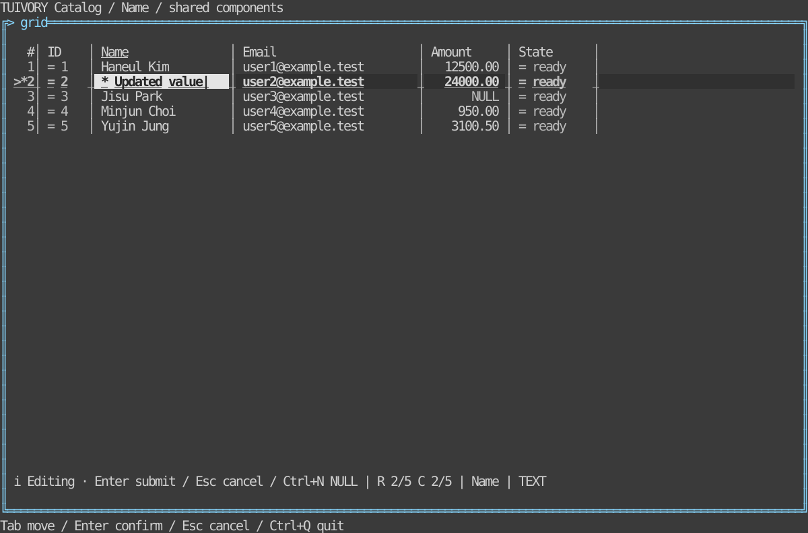

# Grid editing and data work

[한국어 (기본)](grid-workspace.md) · **English** · [Grid basics](grid.en.md)

These TVR-7 capabilities are available from **0.11.0**. They extend the existing Go `Grid / NewGridView` and Rust `grid::Grid / GridWidget`; no separate advanced grid or direct backend import is required.

## Availability

| Capability | Go | Rust |
| --- | --- | --- |
| Dirty cells and independent row markers | `GridCellInfo.State.Edited`, `SetRowEdited` | `GridCellInfo.state.edited`, `set_row_edited` |
| In-cell editing | `SetEditOptions`, `BeginEdit`, `EditInput`, `EditSession`, `ResolveEdit`, `CancelEdit` | Corresponding snake_case methods |
| Column pinning, visibility and order | `ColumnLayout`, `SetColumnLayout`, `PinColumn`, `HideColumn`, `MoveColumn` | Corresponding snake_case methods |
| Editable-cell navigation | `MoveEditable`, submit `next / previous` | `move_editable`, same actions |
| Range paste | `RequestPaste`, `PendingPaste`, `ResolvePaste`, `CancelPaste` | Corresponding snake_case methods |
| Find | `SetFind`, `FindNext`, `RequestSearch` | Corresponding snake_case methods |
| View state | `SaveViewState`, `RestoreViewState` | `save_view_state`, `restore_view_state`; serde support |
| Raw-value details | `SetDetailsEnabled`, `OpenDetails`, `CloseDetails` | `open_details`, `close_details` |
| Shared input and context changes | `Input`, `InvalidateRequests` | `input`, `invalidate_requests` |

Go uses one root import. Rust models are in `tuivory::grid`, input in `tuivory::input`, and optional renderers in `tuivory::ui::components`. This does not claim implementation in future languages.

## In-cell editing and host approval

```go
import ui "github.com/leechis7/tuivory/go"

grid.SetEditOptions(ui.GridEditOptions{
    Enabled: true, StartTyping: true, AllowNull: true,
    // Optional pure callback: cached eligibility and typed initial value.
    Prepare: func(row ui.GridRecord, col ui.GridColumn) (ui.GridValue, bool) {
        return ui.GridValue{Text: row.Cells[col.ID]}, col.Editable
    },
})
view, err := ui.NewGridView(grid, palette, func(event ui.GridEvent) {
    if event.Kind != "edit_submit" { return }
    session, ok := grid.EditSession()
    if !ok { return }
    // The host validates/approves session.Value.Text and Null.
    // Rejection keeps the buffer; a resubmission receives a new ID.
    grid.ResolveEdit(session.ID, "Check this value", nil)
    // Success: ResolveEdit(session.ID, "", updatedSource)
})
_ = view; _ = err
```

```rust
use tuivory::grid::GridEditOptions;
grid.set_edit_options(GridEditOptions {
    enabled: true, start_typing: true, allow_null: true,
    ..Default::default()
});
// Handle event.kind == "edit_submit"; the host validates and saves.
if let Some(session) = grid.edit_session().cloned() {
    grid.resolve_edit(session.id, "Check this value", None);
    // Success: grid.resolve_edit(session.id, "", Some(updated_source));
}
```

Editing UI is off by default, preserving the existing `activate → edit` request. With `Enabled`, Enter/double-click starts editing. `StartTyping` optionally replaces the original with the first typed character. `Prepare` must be pure and can also run while inspecting navigation candidates. Column `Editable`, row/cell Disabled/ReadOnly/Busy and `DisableEditing` all restrict eligibility. A separate editor remains an optional host command.

Source values and buffers are separate. `GridValue.Text / Null` distinguishes empty strings from NULL. Enter emits `edit_submit`; Esc emits `edit_cancel` without changing source values. Ctrl+N toggles NULL only when allowed. Pending approval blocks resubmission, input and clicks on another cell. Rejection retains the buffer for corrections/retry. Cancelling the UI does not undo an external DB operation already executed: hosts coordinate real cancellation and transactions.

Submission does not write the source. After asynchronous validation, call `ResolveEdit` on the UI thread. A nonempty message rejects; an empty message accepts. Optionally supply the updated source on success. Hosts updating the existing source in place may omit it while retaining stable IDs. Pass source replacements through the approval method: calling `SetSource` first invalidates the old request.

Tab/Shift+Tab opens the next/previous eligible editor only after successful approval. Pending/rejected edits stay in place. Navigation skips hidden columns, read-only cells and host-denied candidates and continues onto the next row. At the final cell editing ends rather than wrapping. The library owns internal focus, grapheme cursor, mouse positioning/selection and clipping. It uses the existing text controls' drawn `|` caret, with no forced terminal cursor escapes.

Source replacement, sort/filter/global-search requests, column layout replacement and view restoration invalidate older edits/pastes. Call `InvalidateRequests` when switching a host tab/connection/workspace without replacing its source. Request IDs belong to their grid instance. Late replies and duplicate successful replies are rejected. In-place changes to source structure/order/IDs cannot be detected automatically: call this method or `SetSource`.

## Dirty cells and row gutters

Hosts supply actual dirty cells through `GridCellInfo.State.Edited`. `GridRecord.State.Edited` now controls the **row marker**, without inheriting edited colors into other cells. Applications relying on row-wide dirty colors should supply per-cell state. `SetRowEdited` is a stable-row-ID aggregate callback; absent a callback, the row state is used. The renderer does not scan all cells to infer changes.

Background precedence: disabled → error → editing(field)/pending(loading)/edit failure(error) → edited with `PreserveEdited` → find match except dirty cells → current cell → selection/range → edited → busy → readonly → NULL → current row/stripe/base. Focus underlines remain. Dirty cells retain `*` even when selection/error/disabled overrides their background, including when `ShowCellMarkers` is off. Other state markers and selection prefixes follow their existing options. `HideMarkers` independently hides the row-gutter `*`, without clearing the cell cue.

All themes, 8/16/256/True Color and Unicode/ASCII share semantic roles. Custom `grid.*` palette overrides are preserved; applications need no copied color constants. `grid.match` derives from the existing warning role. NULL/read-only metadata is provided by the host, not inferred from business permissions.

## Columns and view state

`SetColumnLayout` must contain every column ID exactly once. `Pin` accepts empty/left/right; at least one column must remain visible. Use `PinColumn / HideColumn / MoveColumn` for individual changes. Positions are zero-based layout indices. Visual order is left-pinned → ordinary → right-pinned, retaining configured order within each group. Header dragging and keyboard reordering use the same API. Hiding retains the data; default row/range copy and paste use visible columns.

Pinned and ordinary areas do not overlap. Narrow widths clip pinned areas while reserving space for ordinary cells. When several pins overflow, the current pinned column takes priority; others can be clipped. A zero width, or a width consumed by the gutter, cannot display a cell. Titles/content follow existing grapheme-width clipping.

`GridViewState` contains column order/visibility/pins/preferred widths/options, stable current and scroll-anchor IDs, selection/range/mode, and sort/filter values. Go JSON and Rust serde can serialize it; hosts own storage. Restoration requires the same column schema and rejects invalid state atomically. Missing rows fall back safely and missing ranges are cleared. Restoring sort/filter values restores presentation state without executing queries. Edit buffers, pending requests and DB dirty state are excluded.

## Paste and find

`RequestPaste` parses quoted TSV, including embedded tabs/newlines and escaped quotes, mapping from the current cell across visible columns. It validates rectangular shape, cell limits (10,000 default, 1,000,000 maximum), 16MiB input, remaining rows/columns and each cell's eligibility. Any failure rejects the batch: no automatic truncation, read-only skipping or source writes. Empty cells are empty strings; NULL interpretation requires explicit `ParseNull + NullText`.

`GridPasteRequest` carries stable row/column IDs and values. After whole-batch approval, hosts call `ResolvePaste(id, updatedSource)` or reject with `CancelPaste`. Hosts can display errors through `GridDataStatus.Error` or notices. Actual DB transaction atomicity remains host-owned. Default input paste emits `paste_request / paste_rejected` without inferring NULL strings. Go hosts must enable `Application.EnablePaste(true)`. Wrap the backend screen with `PasteSafeScreen` before `app.SetScreen(screen)` to preserve LF/CRLF: the compatibility Application otherwise drops LF paste events. The wrapper normalizes line endings only inside bracketed paste, preserving ordinary Ctrl+J. The library does not read the OS clipboard.

`SetFind` defaults to case-insensitive raw-value matching. `UseDisplay / CaseSensitive` changes this; display mode can search NULL labels. `FindNext` moves forward/backward through matching visible cells and wraps once. Each call checks at most 100,000 cells by default. false/None means no match within the limit, not no match in the whole DB. It neither changes raw values nor clones all rows. Use `RequestSearch` for unloaded data and `Revision / ApplySource` to apply asynchronous host results.

By default the existing `details` event remains a request only. Enable built-in F12 details with `SetDetailsEnabled(true)`, or call `OpenDetails` directly (snake_case in Rust). The viewer shows raw values in a read-only scroll view, preserving long/multiline/grapheme text. Esc closes it while retaining grid focus/selection. Copy requests go to the host; clipboard I/O remains external.

## Examples and validation

```sh
make build
make build-rust
bin/go/tuivory-linux-arm64 --demo catalog --mode grid --grid-sample --grid-preset data --lang en
bin/rust/tuivory-linux-arm64 --demo catalog --mode grid --grid-sample --grid-preset data --lang en
```

Names follow the current host architecture. The example host immediately approves synthetic changes; `reject` demonstrates rejection/retry. Ctrl+Q quits; F2 changes theme; F3 changes color depth; Enter edits; Ctrl+N toggles NULL; Tab/Shift+Tab submits then moves; Ctrl+F opens find; Enter searches loaded data and Ctrl+Enter requests global search; F4/Shift+F4 moves between matches; Alt+P toggles pinning; Alt+H hides; Alt+U shows all; Ctrl+Shift+Left/Right or header dragging reorders columns; Ctrl+S stores view state in memory and Ctrl+R restores it; F12 opens details. Bindings are optional, not mandatory application-global keys.



[Light](images/grid-edit-light-en.svg) · [Monochrome](images/grid-edit-blackwhite-en.svg) · [ASCII](images/grid-edit-ascii-en.svg). These are actual Rust TestBackend outputs, not physical-terminal captures.

[Validation results](evidence/tvr7-grid-workspace-results.json). Go post-Show output and Rust TestBackend checks cover 24 theme/color/character combinations and 64 state combinations. Shared TSV cases, approval/rejection/cancellation/stale-response, column/state/narrow-screen tests and bilingual unified-executable PTYs have distinct evidence. This does not claim published tags, remote CI or actual LazyOra DB integration. No CentOS validation is performed.
