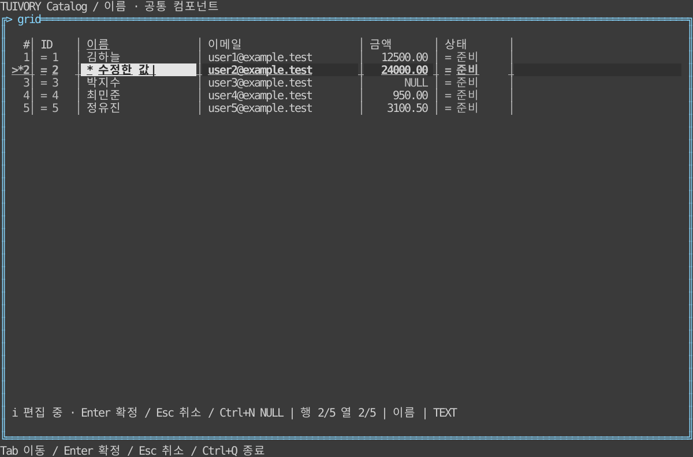

# 그리드 편집과 데이터 작업

**한국어 (기본)** · [English](grid-workspace.en.md) · [그리드 기본 사용법](grid.md)

**실제 커서는 0.11.1부터 제공합니다.** 0.11.0의 `|` 문자 표시를 대체합니다. 기존 편집 API는 유지하며 아래 Go/Rust 연결 방법을 따르세요.

TVR-7의 **0.11.0** 기능입니다. Go `Grid / NewGridView`, Rust `grid::Grid / GridWidget`에서 같은 모델을 확장합니다. 별도 고급 그리드나 backend 직접 import는 필요하지 않습니다.

현재 데이터 셀은 밑줄 없이 `grid.active` 배경으로 표시합니다. 8색은 헤더와 같은 색을 사용하며 다크·라이트는 파랑, 흑백은 밝은 회색입니다. 그 외 색상 모드는 별도의 명도를 사용합니다. 다크·라이트 8색의 범위 선택은 청록으로 표시해 파란 현재 셀과 구분합니다. 수정된 현재 셀에는 별표를 남기고, 다른 수정 셀은 기존 수정 배경색을 유지합니다.

## 제공 범위

| 기능 | Go | Rust |
| --- | --- | --- |
| 셀 변경 표시와 독립 행 표식 | `GridCellInfo.State.Edited`, `SetRowEdited` | `GridCellInfo.state.edited`, `set_row_edited` |
| 셀 내 편집 | `SetEditOptions`, `BeginEdit`, `EditInput`, `EditSession`, `ResolveEdit`, `CancelEdit` | 같은 이름의 snake_case 메서드 |
| 열 고정·숨김·순서 | `ColumnLayout`, `SetColumnLayout`, `PinColumn`, `HideColumn`, `MoveColumn` | 같은 이름의 snake_case 메서드 |
| 편집 가능한 셀 이동 | `MoveEditable`, 제출 `next / previous` | `move_editable`, 같은 동작 |
| 범위 붙여넣기 | `RequestPaste`, `PendingPaste`, `ResolvePaste`, `CancelPaste` | 같은 이름의 snake_case 메서드 |
| 찾기 | `SetFind`, `FindNext`, `RequestSearch` | 같은 이름의 snake_case 메서드 |
| 보기 상태 | `SaveViewState`, `RestoreViewState` | `save_view_state`, `restore_view_state`; serde 지원 |
| 원문 상세 | `SetDetailsEnabled`, `OpenDetails`, `CloseDetails` | `open_details`, `close_details` |
| 공통 입력·문맥 교체 | `Input`, `InvalidateRequests` | `input`, `invalidate_requests` |

Go는 루트 패키지 하나로 사용합니다. Rust 모델은 `tuivory::grid`, 입력은 `tuivory::input`, 선택적 렌더러는 `tuivory::ui::components`에서 제공합니다. 후속 언어 구현을 뜻하지 않습니다.

## 셀 내 편집과 앱 승인

```go
import ui "github.com/leechis7/tuivory/go"

grid.SetEditOptions(ui.GridEditOptions{
    Enabled: true, StartTyping: true, AllowNull: true,
    // Prepare는 선택 사항입니다. 캐시된 셀별 허용 여부·초깃값을 반환합니다.
    Prepare: func(row ui.GridRecord, col ui.GridColumn) (ui.GridValue, bool) {
        return ui.GridValue{Text: row.Cells[col.ID]}, col.Editable
    },
})
view, err := ui.NewGridView(grid, palette, func(event ui.GridEvent) {
    if event.Kind != "edit_submit" { return }
    session, ok := grid.EditSession()
    if !ok { return }
    // 호스트가 session.Value.Text / Null을 검증·승인합니다.
    // 거절: 버퍼를 유지하고 오류를 표시합니다. 새 제출에는 새 ID를 부여합니다.
    grid.ResolveEdit(session.ID, "값을 확인하세요", nil)
    // 성공 시: ResolveEdit(session.ID, "", updatedSource)
})
_ = view; _ = err
```

```rust
use tuivory::grid::GridEditOptions;
grid.set_edit_options(GridEditOptions {
    enabled: true, start_typing: true, allow_null: true,
    ..Default::default()
});
// event.kind == "edit_submit" 처리; 실제 검증/저장은 호스트가 합니다.
if let Some(session) = grid.edit_session().cloned() {
    grid.resolve_edit(session.id, "값을 확인하세요", None);
    // 성공: grid.resolve_edit(session.id, "", Some(updated_source));
}
```

기본값은 편집 UI 끄기입니다. 기존 `activate → edit` 요청을 유지합니다. `Enabled`를 켜면 Enter·더블클릭으로 시작하고 `StartTyping`을 켜면 첫 문자로 원문을 교체하며 시작합니다. `Prepare`는 순수 콜백이어야 하고 이동 후보 검사에도 호출될 수 있습니다. 열 `Editable`, 행·셀의 Disabled/ReadOnly/Busy 및 `DisableEditing`을 함께 검사합니다. 별도 편집창은 호스트 명령으로 계속 제공할 수 있습니다.

원문과 편집 버퍼는 분리합니다. `GridValue`의 `Text / Null`은 빈 문자열과 NULL을 구분합니다. Enter는 `edit_submit`, Esc는 소스를 바꾸지 않는 `edit_cancel`입니다. Ctrl+N은 허용한 경우에만 NULL을 전환합니다. 대기 중에는 재제출·입력·다른 셀 클릭을 차단합니다. 실패 시 같은 버퍼에서 수정·재제출할 수 있습니다. Esc로 UI 요청을 취소해도 이미 실행한 외부 DB 작업이 취소되는 것은 아닙니다. 실제 취소·트랜잭션 조정은 호스트가 합니다.

제출은 소스를 수정하지 않습니다. 비동기 검증 뒤 UI 스레드에서 `ResolveEdit`를 호출하세요. 오류 메시지가 비어 있지 않으면 실패이며, 성공은 빈 메시지입니다. 성공 시 새 소스를 선택적으로 함께 적용합니다. 기존 소스를 제자리에서 수정하는 호스트는 안정 ID를 유지한 뒤 소스 인자를 생략할 수 있습니다. 소스 교체가 필요하면 승인 함수에 함께 전달하세요. 먼저 `SetSource`를 호출하면 이전 편집 요청은 무효가 됩니다.

Tab/Shift+Tab은 제출 승인이 성공한 뒤 다음/이전 편집 가능 셀을 엽니다. 실패·대기 중에는 이동하지 않습니다. 숨긴 열·읽기 전용 셀·호스트가 거절한 후보를 건너뛰고 다음 행으로 이어집니다. 마지막 셀에서는 편집을 끝내며 첫 셀로 순환하지 않습니다. 편집기 내부 포커스·grapheme 커서·마우스 위치/선택·클리핑은 라이브러리가 관리합니다. 0.11.1은 그리드 셀 편집의 `|` 문자 대신 실제 backend 커서를 제공합니다. 아래 연결 방법을 따르세요.

소스 교체·정렬/필터/전체 검색 요청·열 구성 교체·보기 복원은 이전 편집/붙여넣기를 무효화합니다. 탭·접속·작업공간만 바뀌면 `InvalidateRequests`를 호출하세요. 요청 ID는 해당 그리드 인스턴스에만 유효합니다. 늦은 응답과 중복 성공 응답은 거부됩니다. 호스트가 소스의 구조/정렬/ID를 제자리에서 바꾸면 자동 감지할 수 없으므로 이 메서드 또는 `SetSource`가 필요합니다.

## 실제 터미널 커서 (0.11.1)

Go `NewGridView`는 그리기 후 실제 backend 커서를 표시하고, 포커스 해제·승인 대기·NULL·클리핑·무효화·편집 종료 때 자신이 소유한 커서를 숨깁니다. 거절 후 재시도에서는 다시 표시합니다. 빈 값은 빈 셀에 커서를 놓습니다. grapheme 경계·여백·변경 표식·고정 열·화면 크기를 반영합니다. 편집 중에는 열의 표시 정렬·가로 pan을 중복 적용하지 않고 독립된 왼쪽 정렬 뷰포트를 사용합니다. 마우스도 같은 계산을 사용합니다. 데이터에 실제로 있는 `|`는 지우지 않습니다.

```go
screen, err := ui.NewCursorScreen()
if err != nil { return err }
app.SetScreen(ui.PasteSafeScreen(screen)).EnablePaste(true)
view, err := ui.NewGridView(grid, palette, onEvent)
```

단말 설정을 유지하려면 **`NewCursorScreen`**을 사용하세요. 호환 `NewScreen`이나 Application 자동 화면은 모양을 명시하지 않아도 backend 기본 DECSCUSR(`CSI 0 q`)·terminfo 깜빡임 변경(`?12h/l`)을 보낼 수 있습니다. 새 terminfo 화면 생성기는 TTY를 `PreserveCursorTty`로 감싸 이 명령만 제거하고 위치·표시/숨김·UTF-8·나머지 출력을 유지합니다. 사용자 TTY는 기존 terminfo 화면 생성기에 `PreserveCursorTty(tty)`를 전달하면 됩니다. 화면 생성기와 뷰는 모양·깜빡임을 강제하지 않으며 실제 깜빡임은 터미널 사용자 설정을 따릅니다. 라이브러리가 깜빡임을 흉내 내지 않습니다. 네이티브 TTY가 필요하고 미지원 대상은 오류를 반환합니다. Windows에서 TERM이 비어 있으면 명시적 네이티브 TTY와 backend xterm-256color terminfo를 사용합니다.

Rust의 버퍼 전용 `Widget` trait은 실제 커서를 지정할 수 없습니다. 셀 편집 커서가 필요하면 `frame.render_widget(GridWidget { ... }, area)` 대신 추가한 **`GridWidget::render_frame`**을 사용하세요.

```rust
use tuivory::ui::components::GridWidget;
GridWidget { model: &grid, styles: &styles, focused: grid_has_focus }
    .render_frame(frame, area);
```

그리기와 `Frame::set_cursor_position` 등록을 함께 처리하고 Ratatui가 출력 버퍼 반영 후 표시합니다. 커서 소유자가 없는 프레임은 표준 동작대로 숨깁니다. 포커스가 없는 그리드는 다른 컨트롤의 커서를 덮어쓰지 않습니다. 전역 포커스·레이어 순서·실제로 보이는 레이어는 앱이 결정하고 모달 아래 그리드는 `focused = false`로 그립니다. 프레임마다 하나의 포커스 커서 소유자를 선택하며 별도 터미널 커서 우회 코드와 섞지 마세요. 기존 버퍼 전용 렌더링은 스냅샷·사용자 조합용으로 유지하되 실제 커서를 자동 등록하지 않습니다.

양 모델은 다른 어댑터용 `EditCursor(width, height)` / `edit_cursor(width, height)`를 제공합니다. `GridCursor.X/Y`(Rust `x/y`)는 **로컬 셀 좌표**, `Width/width`는 커서 아래 완전한 grapheme 폭(최소 1)입니다. 어댑터가 자신의 원점을 더하고 실제 화면 경계에서 glyph 전체를 검사합니다. 포커스는 어댑터가 소유합니다. NULL 표식·승인 대기에는 커서가 없고, NULL 해제/타이핑·제출 거절 시 복원합니다. 소스/문맥 교체·스크롤로 영역 밖 이동·0/작은 영역·편집 종료에는 오래된 좌표를 숨깁니다. 원문 변경이나 모양 escape 강제를 하지 않습니다.

제공 상태: Go 모델·RowsView·설정 보존 terminfo 생성기, Rust 코어 모델·선택적 Ratatui Frame 연결을 현재 소스에 구현했습니다. 로컬 실행은 Linux ARM64 PTY·시뮬레이션이며 Windows/macOS 외부 컴파일과 실제 콘솔/SecureCRT 실기 검증은 구분합니다. 폼·찾기 프롬프트의 기존 표시 방식은 유지하고 그리드 셀 편집만 보완합니다. SVG 참조 화면은 버퍼 텍스트이므로 깜빡임이나 backend 커서 메타데이터를 표현하지 못합니다.

[커서 회귀 검증](evidence/tvr7-grid-cursor-results.json) · [공유 좌표 사례](../design/grid-cursor-cases.json).

## 변경 셀과 행 번호 표식

실제 변경 셀은 호스트가 `GridCellInfo.State.Edited`로 공급합니다. `GridRecord.State.Edited`는 **행 표식용**이며 다른 셀로 변경색을 상속하지 않습니다. 기존 행 전체 변경색에 의존한 앱은 셀별 상태로 바꾸세요. `SetRowEdited`는 안정 행 ID에 따른 집계 콜백이며 콜백이 없으면 행 상태를 사용합니다. 화면에서 모든 셀을 스캔해 추측하지 않습니다.

배경 우선순위는 disabled → error → 편집 중(field)/승인 대기(loading)/편집 실패(error) → 현재 셀 → edited(`PreserveEdited`) → 찾기 일치(변경 셀 제외) → 선택/범위 → edited → busy → readonly → NULL → 현재 행/줄무늬/기본입니다.  변경 셀에는 `*`를 남겨 선택·오류·비활성이 배경을 덮어도 변경 여부를 식별합니다. `ShowCellMarkers`가 꺼져도 이 변경 단서는 유지합니다. 다른 상태 표식·선택 접두어와 함께 쓸 때는 기존 표시 옵션을 따릅니다. 행 번호의 `*`는 `HideMarkers`로 별도 제어하며 셀의 표식을 지우지 않습니다.

모든 테마·8/16/256/True Color와 Unicode/ASCII에서 같은 의미 역할을 사용합니다. 사용자 `grid.*` 팔레트 재정의를 보존하고 임의 앱 색값을 요구하지 않습니다. `grid.match`는 기존 warning 역할에서 파생합니다. NULL/읽기 전용 등은 업무 권한을 추론한 결과가 아닌 호스트 메타데이터입니다.

## 열과 보기 상태

`SetColumnLayout`은 모든 열 ID를 정확히 한 번 포함해야 합니다. `Pin`은 빈 값/left/right이고 하나 이상의 열을 표시해야 합니다. 부분 수정은 `PinColumn / HideColumn / MoveColumn`을 사용하세요. 위치는 0부터 시작하는 열 구성 인덱스입니다. 표시 순서는 왼쪽 고정 → 일반 → 오른쪽 고정이며 그룹 안에서는 구성 순서를 따릅니다. 드래그와 키보드 이동도 같은 API를 사용합니다. 숨김은 데이터 삭제가 아니며 기본 행/범위 복사와 붙여넣기는 표시 열을 사용합니다.

고정 영역과 일반 영역은 겹치지 않습니다. 좁아지면 고정 열 폭을 제한하고 일반 셀 공간을 남깁니다. 여러 고정 열이 넘치면 현재 고정 열을 우선하고 나머지는 잘릴 수 있습니다. 폭이 0이거나 행 번호 영역보다 작으면 셀을 표시할 수 없습니다. 제목·내용은 기존 grapheme 폭 규칙으로 자릅니다.

`GridViewState`는 열 순서/숨김/고정/선호 폭/열 옵션, 현재 행·열/스크롤 기준의 안정 ID, 선택 범위/모드, 정렬·필터 값을 담습니다. Go JSON 및 Rust serde로 저장할 수 있지만 파일 I/O는 호스트가 합니다. 동일 열 스키마에서 복원하며 잘못된 구성은 원자적으로 거부합니다. 사라진 행은 유효 위치로 대체하고 범위를 해제합니다. 정렬/필터 값 복원은 표시 상태 복원이며 실제 조회를 수행하지 않습니다. 편집 버퍼·진행 중 요청·DB 변경 상태는 저장하지 않습니다.

## 붙여넣기와 찾기

`RequestPaste`는 탭·줄바꿈·이스케이프 따옴표를 포함한 인용 TSV를 파싱합니다. 현재 셀부터 표시 열 순서로 매핑합니다. 직사각형 범위, 최대 셀 수(기본 10,000, 최대 1,000,000), 입력 16MiB, 남은 행·열과 각 셀 편집 권한을 검사합니다. 하나라도 실패하면 전체 요청을 거부하며 자동 잘라내기·읽기 전용 건너뛰기·소스 쓰기를 하지 않습니다. 빈 셀은 빈 문자열이고 `ParseNull + NullText`를 명시한 경우에만 NULL로 해석합니다.

`GridPasteRequest`는 안정 행·열 ID와 값의 목록입니다. 호스트가 전체 승인 후 `ResolvePaste(id, updatedSource)`를 호출하거나 `CancelPaste`로 거절합니다. 오류 메시지는 호스트의 `GridDataStatus.Error`·알림에 표시할 수 있습니다. 실제 DB 변경의 원자성은 호스트 책임입니다. UI 입력의 기본 붙여넣기는 NULL 문자열 추론 없이 `paste_request / paste_rejected`를 내보냅니다. Go 앱은 `Application.EnablePaste(true)`를 켜야 합니다. 호환 Application이 LF 붙여넣기 이벤트를 버리지 않도록 backend 화면을 `PasteSafeScreen`으로 감싸 `app.SetScreen(screen)`에 전달하세요. 래퍼는 bracketed paste 안의 LF/CRLF만 정규화하고 일반 Ctrl+J는 유지합니다. OS 클립보드는 읽지 않습니다.

`SetFind`는 원문 기준의 대소문자 무시 검색이 기본입니다. `UseDisplay / CaseSensitive`로 바꾸며 NULL 표시 검색도 표시값 모드에서 가능합니다. `FindNext`는 표시 열의 일치 셀로 다음/이전 이동하고 한 번 순환합니다. 한 번에 검사할 최대 셀 수는 기본 100,000입니다. 제한 내에서 없으면 false/None이며 전체 DB에 없음을 뜻하지 않습니다. 원문을 변경하거나 전체 행을 복제하지 않습니다. 로드하지 않은 데이터는 `RequestSearch`로 앱에 요청하고 `Revision / ApplySource`로 비동기 결과를 적용합니다.

기존 `details` 이벤트는 기본적으로 요청만 반환합니다. `SetDetailsEnabled(true)`로 F12의 기본 상세 보기를 켜거나 `OpenDetails`를 직접 호출합니다. 이 상세 보기는 원문을 읽기 전용 스크롤 뷰로 표시합니다. 긴 값·여러 줄·grapheme를 유지하고 Esc로 닫습니다. 그리드의 현재 셀과 범위는 보존합니다. 복사 요청은 호스트로 전달하고 실제 클립보드 I/O는 하지 않습니다.

## 예제와 검증

```sh
make build
make build-rust
bin/go/tuivory-linux-arm64 --demo catalog --mode grid --grid-sample --grid-preset data
bin/rust/tuivory-linux-arm64 --demo catalog --mode grid --grid-sample --grid-preset data --lang en
```

파일명은 현재 서버 아키텍처를 따릅니다. 예제는 합성 데이터에 대해 호스트가 즉시 승인하며 `reject` 또는 `거절` 입력은 거절/재시도를 보여줍니다. Ctrl+Q 종료, F2 테마, F3 색상 수, Enter 편집, Ctrl+N NULL, Tab/Shift+Tab 승인 후 이동, Ctrl+F 찾기, Enter 로컬 찾기/Ctrl+Enter 전체 검색 요청, F4/Shift+F4 다음/이전 일치, Alt+P 고정 전환, Alt+H 숨김, Alt+U 모두 표시, Ctrl+Shift+좌우 열 이동, 머리글 드래그 순서 변경, Ctrl+S 보기 상태 보관/Ctrl+R 복원, F12 상세 보기를 제공합니다. 키 연결은 선택 사항이며 앱 전역 키를 강제하지 않습니다.



[라이트](images/grid-edit-light.svg) · [흑백](images/grid-edit-blackwhite.svg) · [ASCII](images/grid-edit-ascii.svg). Rust TestBackend 실제 출력이며 물리 단말 캡처는 아닙니다.

[검증 결과](evidence/tvr7-grid-workspace-results.json). Go Show 이후 출력과 Rust TestBackend에서 24개 테마/색상/문자 조합 및 64개 상태 조합을 검사합니다. 공유 TSV 사례, 승인·실패·취소·오래된 응답·열/복원/좁은 화면 검사와 통합 실행파일의 한영 PTY 검증을 구분합니다. 공개 태그 배포·원격 CI·실제 LazyOra DB 연결 완료를 뜻하지 않습니다. CentOS 검증은 수행하지 않습니다.
