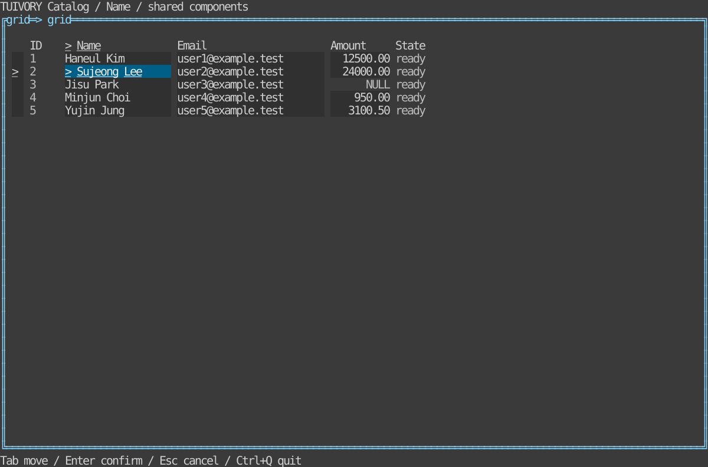
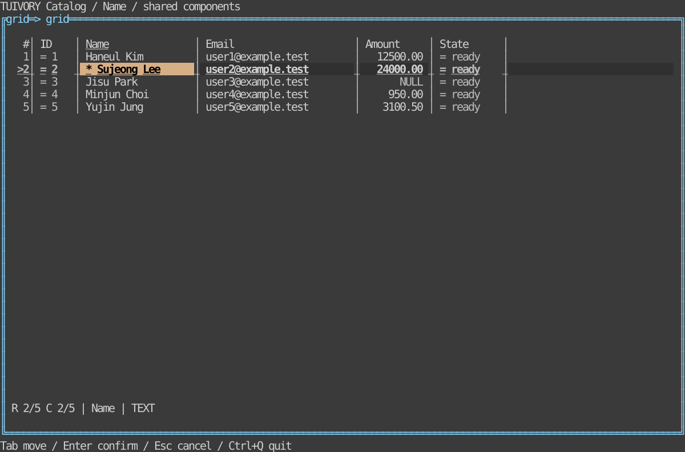

# Tables and data grid

[한국어 (default)](grid.md) · **English**

TVR-17 adds configuration to TVR-11's Go `Grid / GridSource / NewGridView` and Rust `grid::Grid / GridSource / GridWidget`. One model, input core and renderer serve both simple and richer configurations. **TVR-17 is unreleased source, absent from the v0.2.0 tags.** Actual LazyOra integration and DB editing remain separate work.

## Run and compare

```sh
make run-catalog-go ARGS="--mode grid --grid-sample --grid-preset data --lang en"
make run-catalog-rust ARGS="--mode grid --grid-sample --grid-preset simple --lang ko"
```

`--grid-sample` provides the same synthetic five rows/five columns with row 2's name selected. `--grid-preset simple|data` changes presentation on that same data. Without the sample flag, the existing 100,000-row virtual source remains. Combine `--density compact|comfortable`, `--ascii`, `--theme dark|light|blackwhite` and `--colors 8|16|256|truecolor`. Edited markers are synthetic host metadata and do not demonstrate actual saved edits.

| Simple preset | Data preset |
| --- | --- |
|  |  |

[Light](images/grid-data-light-en.svg) · [Blackwhite](images/grid-data-blackwhite-en.svg) · [ASCII](images/grid-data-ascii-en.svg)

References show the actual Rust `GridWidget` on Ratatui TestBackend at 120×36, rather than Go or SSH captures. Separate regression tests inspect Go Runes/Bytes/styles after `Show()` and Rust TestBackend output.

## Public API and options

```rust
use tuivory::grid::{grid_preset, GridColumnOptions, GridCellInfo};
let mut options = grid_preset("data")?; // "simple": default options
options.striped = true;
options.horizontal_lines = false;
grid.set_options(options)?;
grid.set_column_options("amount", GridColumnOptions {
    align: "numeric".into(), min_width: 6, max_width: 30, expand: 1,
    ..Default::default()
})?;
grid.set_cell_info(|_, column| GridCellInfo {
    numeric: column.id == "amount", metadata: "DECIMAL".into(),
    ..Default::default()
});
```

```go
opts, err := tuivory.GridPreset("data") // "simple": zero-value options
if err != nil { return err }
opts.Striped = true
opts.HorizontalLines = false
if err := grid.SetOptions(opts); err != nil { return err }
if err := grid.SetColumnOptions("amount", tuivory.GridColumnOptions{
    Align: "numeric", MinWidth: 6, MaxWidth: 30, Expand: 1,
}); err != nil { return err }
grid.SetCellInfo(func(row tuivory.GridRecord, col tuivory.GridColumn) tuivory.GridCellInfo {
    return tuivory.GridCellInfo{Numeric: col.ID == "amount", Metadata: "DECIMAL"}
})
view, err := tuivory.NewGridView(grid, palette, onEvent)
```

Complete public-import/data/input wiring: [Go catalog](../go/examples/catalog/main.go), [Go configuration](../go/examples/catalog/grid.go), [Rust catalog](../rust/examples/catalog/main.rs), [Rust configuration](../rust/examples/catalog/grid_demo.rs). Go equivalents are `GridPreset`, `GridOptions`, `GridColumnOptions`, `GridCellInfo`, `SetOptions / SetColumnOptions / SetCellInfo`, and `NewGridView(grid, palette, onEvent)`. Existing `GridColumn`, `GridRecord` and `GridEvent` fields remain compatible.

| Go field (Rust uses snake_case) | Default and meaning |
| --- | --- |
| `RowNumbers`, `HideMarkers`, `GutterWidth` | false/false/0. Automatic number gutter; current `>` and edited `*`. Explicit width is a minimum (0..128), clipped to the viewport |
| `VerticalLines`, `HorizontalLines`, `ASCII` | false. Independent separators; ASCII uses `| - +` |
| `Striped`, `UseSurface` | false. Alternating rows and surface background |
| `Padding`, `RowSpacing` | 0. Horizontal cell padding 0..8; blank rows between records 0..4 |
| `HideHeader`, `ScrollHeader` | false. Visible pinned header by default; ScrollHeader hides it after vertical scrolling |
| `HighlightCell`, `HighlightRow`, `PreserveEdited` | false. Current cell/row emphasis; edited background before selection |
| `HideSelectionMarker`, `ShowCellMarkers` | false. Selection prefix control and cell state markers; ranges retain `>` when ShowCellMarkers is enabled |
| `Selection` | Empty retains the current mode; `cell / row / range` |
| `StatusBar`, `StatusFields` | false; nil(None) means all fields, an empty list means none |
| `DisableKeyboard / Mouse / Editing / Copy / Resize / HeaderSort` | false. Restrict adapter input or the respective user request |
| `MaxCopyCells` | 0 means 10,000 cells; explicit range-copy limit 1..1,000,000 |

`data` enables row numbers, vertical lines, surface background, padding 1, status bar, current-cell/row emphasis, edited priority and cell markers, while hiding the ordinary selection prefix. `simple` uses default options. `WithDensity / with_density` preserves other options and changes padding/row spacing to compact=0/0, normal=1/0, comfortable=1/1. Theme/color capacity is independent.

`SetOptions / set_options` validates the entire bundle before replacement. Presentation changes retain data, originals, stable IDs, saved ranges, preferred column widths, stored scrolling and host edit metadata. The effective visible viewport is computed for the new size/density. Explicit Selection changes the mode while retaining the saved range. Source replacement clears ranges whose IDs disappear.

Column `Align` accepts left/center/right/numeric (empty=left); `Overflow` accepts ellipsis/clip/scroll (empty=ellipsis). `MinWidth / MaxWidth` default to 1/4096 and must describe valid bounds within 1..4096. `AutoFit` measures visible rows only; `Expand` is a spare-width weight (0..1,000,000). Neither changes saved preferred widths. Explicit `AutoFitColumn / auto_fit_column` or resizing changes the preferred width and disables that column’s automatic fit/expansion so manual sizing takes precedence. Long values support `~` ellipsis, original-value detail requests and per-column internal cell panning. Clipping respects CJK, emoji and combining clusters; display control characters become spaces.

Hosts provide `GridCellInfo` fields `HasDisplay + Display`, `Null`, `Numeric`, `State`, `Metadata`. The library does not infer business formatting or numeric types. Null displays `NULL` while preserving the original empty string. Metadata callbacks may run repeatedly during rendering/measurement: return cached data without I/O or mutation.

## State and input

Cell background precedence: disabled → invalid/error → edited(PreserveEdited) → active → selected range/cell → edited → busy → readonly → NULL → current row/stripe/base. Public `grid.base / stripe / current-row / active / range / edited / header-active / gutter / divider / status / null / readonly / loading` roles derive from the existing 16 semantic roles. Go `GridPalette` preserves overrides named with these roles. Rust `Styles::role` derives them from the common palette. Cues include focus underline, row `>`, edited `*`, error `!`, loading `~`, readonly `=`, and literal NULL. Hiding markers reduces these cues and remains a host choice.

Existing actions: up/down/left/right, first/last, page_up/page_down, select, row_mode, activate, copy, sort, widen/narrow. Added actions: extend_up/down/left/right, range_start/range_mode, cancel, copy_cell/copy_row/copy_range, autofit, details, cell_pan_left/right, load_more. `SelectRange / select_range` takes stable row/column endpoint IDs. Editing requires the column and both row/cell state to permit it.

Demo keys: arrows/Home/End/Page, Shift+arrows range, Enter edit request, Space select, Ctrl+C copy request, F5 current-filter request, F6 cell/row, F7/F8 widths, F9 sort, F10 range mode, F11 visible auto-fit, F12 details, Alt+left/right cell panning, Esc clear range. Go `GridKey` and demo keymaps are optional; no global application keymap is required. Go hosts must consume Ctrl+C in Application input capture after forwarding it to the grid to avoid tview's default quit.

`Pointer / pointer` accepts local grid coordinates and down/move/up/click/double/wheel_up/down/left/right. It supports cell clicks, Shift-click/drag ranges, header sorting and divider resizing. Hosts must forward captured move/up outside the area. Go's adapter wires this. The Rust demo also wires dragging, wheels and header sorting; hosts connect double-click editing to `double`. Adapters check DisableKeyboard/Mouse; hosts control direct model calls.

## Data, status and original values

`GridSource` Len/Row/IndexOf supplies rows on demand. Large sources should use indexed ID lookup. Layout and auto-fit access rows proportional to the viewport, without cloning all records or querying DBs. Navigation retains existing disabled-row skipping. Hosts own editing, transactions, clipboard/files, full exports, clocks and terminal lifecycle.

Range copy returns **original values**, TSV-quoted for tabs/newlines/quotes. Above MaxCopyCells it returns only `copy_request`; hosts use `SelectedRange / selected_range` to implement bulk exports. Legacy cell/row copy retains its original string/tab-join behavior. Display markers, formats and NULL never overwrite originals.

Capture `Revision / revision()` after each sort/filter/load_more request. On the UI thread, apply asynchronous results through `ApplySource / apply_source(token, source)`: older or duplicate responses are rejected. Initial data and unsolicited refreshes use `SetSource / set_source`. Tokens belong to one grid instance. Hosts update `GridDataStatus` Loading/HasMore/TotalRows/Filter/Error to match actual work. Page requests are suppressed while loading.

`StatusItems / status_items` composes with public Go `StatusView` or Rust `status_line + LineWidget`. Choose position/column/selection/sort/filter/loading/more/meta/error. Priority: error100, loading80, more50, selection40, position30, column20, metadata15, sort/filter10. The existing status layout clips/omits lower priorities with a count when narrow. Metadata joins global and active-cell metadata. Labels maps localize built-in strings.

[Validation](grid-validation.en.md) · [Static distribution](static-build.en.md) · [LazyOra v0.11.2 reference](https://github.com/leechis7/lazyora/blob/98a2f47e8621838101d5db781232a699dba382f3/internal/ui/grid.go). Presentation/interaction principles informed the design; no DB/Oracle implementation is included.
