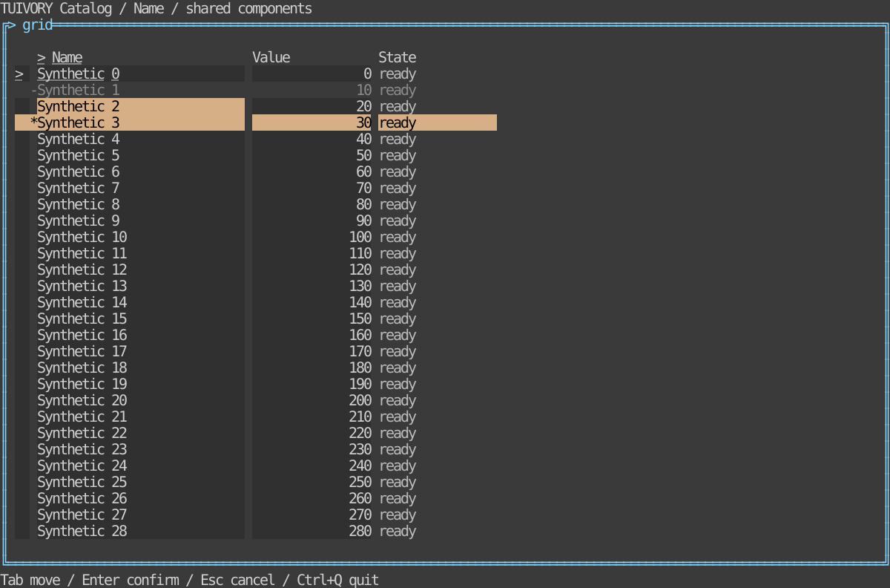

# Tables and data grid — TVR-11

[한국어 (default)](grid.md) · **English**

Public APIs: Go `GridSource`, `NewMemoryRows`, `NewGrid`, `NewGridView`; Rust `grid::{GridSource, MemoryRows, Grid}`, `GridWidget`. Implement Len/Row/IndexOf (Rust equivalents) to supply windowed data; rendering reads visible rows only. MemoryRows validates/copies IDs and records. Large sources should implement indexed ID lookup.

Columns carry stable IDs, titles, preferred widths and edit permissions; records carry IDs, string cells and ControlState. Single-cell/row selection is distinct from focus. Viewports, headers, sizing, disabled-row skipping and clipping preserve preferred widths across narrow layouts. Non-color markers/underline retain state cues.

Actions: up/down/left/right, first/last row, page_up/page_down, select, row_mode, activate, copy, sort, widen/narrow. Pointer input selects cells or requests header sorting. Edit requests require an editable column and mutable record. Copy returns original current cell/row values, without UI markers. Hosts own editing, sorting/filtering, clipboard/data I/O. Filter requests carry query text; source replacement restores focus by stable ID.

The demo supplies 100,000 synthetic rows lazily. Keys: arrows/Home/End/page, Enter edit request, Space selection, Ctrl+C copy request, F5 filter request, F6 cell/row mode, F7/F8 widths, F9 sort. Go hosts must consume Ctrl+C in Application input capture after forwarding it to the grid to avoid tview's default quit.

Tests cover bounded visible-row access, stable IDs, empty/invalid data, edit guards, original copy values, widths/spans and localized PTY movement/edit/copy/sort/header clicks/resizing. Range selection, aggregation, pivots and DB execution remain separate.

## Run and boundaries

```sh
make run-catalog-go ARGS="--mode grid --lang ko"
make run-catalog-rust ARGS="--mode grid --lang en"
```

Hosts own data, business actions, clocks and terminal lifecycle. Public models emit requests and render literal cell-clipped rows. Existing v0.1.0 tags do not include these APIs; approved changes merge into dev only. Static linking, Unicode/ASCII and color-profile requirements remain.



[Light](images/grid-light-en.svg) · [Blackwhite](images/grid-blackwhite-en.svg)

Actual Rust TestBackend 120×36 reference, not a Go capture or physical/SSH terminal result. Generate six localized references with `tools/snapshot_catalog.py BINARY --mode grid`.

[Backlog](components-backlog.en.md) · [Static distribution](static-build.en.md)
