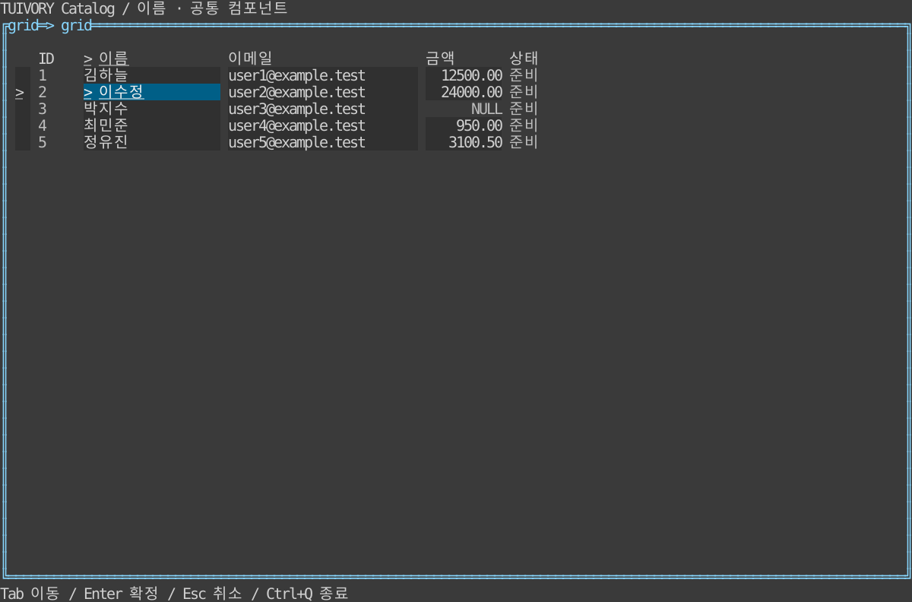
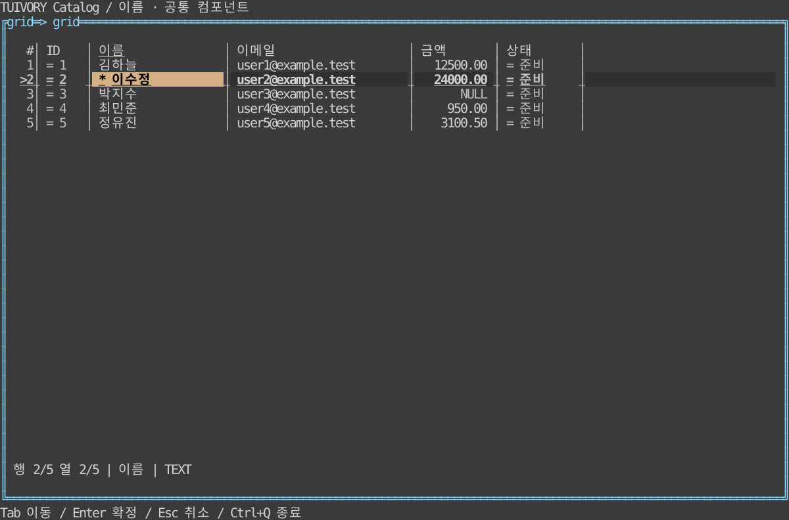

# 표·데이터 그리드

**한국어 (기본)** · [English](grid.en.md)

TVR-11의 Go `Grid / GridSource / NewGridView`와 Rust `grid::Grid / GridSource / GridWidget`에 TVR-17 구성 옵션을 추가합니다. 별도 고급 그리드 없이 같은 모델·입력·렌더러를 사용합니다. **TVR-17은 0.3.0에 포함하며 v0.2.0 태그에 없습니다.** 실제 LazyOra 연결·DB 편집 통합도 별도 작업입니다.

## 실행과 비교

```sh
make run-catalog-go ARGS="--mode grid --grid-sample --grid-preset data --lang ko"
make run-catalog-rust ARGS="--mode grid --grid-sample --grid-preset simple --lang en"
```

`--grid-sample`은 동일한 합성 데이터 5행×5열과 2번 행 이름 선택을 제공합니다. `--grid-preset simple|data`로 같은 데이터의 외형만 바꿉니다. 이 플래그가 없으면 기존 100,000행 가상 데이터를 유지합니다. `--density compact|comfortable`, `--ascii`, `--theme dark|light|blackwhite`, `--colors 8|16|256|truecolor`를 조합할 수 있습니다. 견본의 수정 표식은 앱이 제공한 합성 메타데이터이며 실제 편집 저장을 뜻하지 않습니다.

| 간결 프리셋 | 데이터 작업 프리셋 |
| --- | --- |
|  |  |

[라이트](images/grid-data-light.svg) · [흑백](images/grid-data-blackwhite.svg) · [ASCII](images/grid-data-ascii.svg)

이미지는 Rust 실제 `GridWidget`의 Ratatui TestBackend 120×36 출력입니다. Go 화면이나 SSH 터미널 캡처를 대신하지 않습니다. 별도 회귀 검사는 Go `Show()` 이후 Runes/Bytes·스타일과 Rust TestBackend 출력을 확인합니다.

## 공개 API와 옵션

```go
opts, err := tuivory.GridPreset("data") // "simple": 영값 옵션
if err != nil { return err }
opts.Striped = true
opts.HorizontalLines = false
if err := grid.SetOptions(opts); err != nil { return err }
if err := grid.SetColumnOptions("amount", tuivory.GridColumnOptions{
    Align: "numeric", MinWidth: 6, MaxWidth: 30, Expand: 1,
}); err != nil { return err }
grid.SetCellInfo(func(row tuivory.GridRecord, col tuivory.GridColumn) tuivory.GridCellInfo {
    return tuivory.GridCellInfo{Numeric: col.ID == "amount", Metadata: "DECIMAL"}
})
view, err := tuivory.NewGridView(grid, palette, onEvent)
```

```rust
use tuivory::grid::{grid_preset, GridColumnOptions, GridCellInfo};
let mut options = grid_preset("data")?; // "simple": 기본 옵션
options.striped = true;
options.horizontal_lines = false;
grid.set_options(options)?;
grid.set_column_options("amount", GridColumnOptions {
    align: "numeric".into(), min_width: 6, max_width: 30, expand: 1,
    ..Default::default()
})?;
grid.set_cell_info(|_, column| GridCellInfo {
    numeric: column.id == "amount", metadata: "DECIMAL".into(),
    ..Default::default()
});
```

실제 import·데이터·키 입력 연결은 [Go 카탈로그](../go/examples/catalog/main.go), [Go 구성](../go/examples/catalog/grid.go), [Rust 카탈로그](../rust/examples/catalog/main.rs), [Rust 구성](../rust/examples/catalog/grid_demo.rs)에 있습니다. Rust는 `grid::grid_preset`, `GridOptions`, `GridColumnOptions`, `GridCellInfo`와 `set_options / set_column_options / set_cell_info`를 사용합니다. 기존 `GridColumn`, `GridRecord`, `GridEvent` 필드는 유지합니다.

| Go 필드 (Rust는 snake_case) | 기본값·의미 |
| --- | --- |
| `RowNumbers`, `HideMarkers`, `GutterWidth` | false/false/0. 번호 영역 자동 폭, 현재 `>`·변경 `*`. 명시 폭은 최소 폭(0..128), 화면 폭으로 제한 |
| `VerticalLines`, `HorizontalLines`, `ASCII` | false. 각각 독립 구분선, ASCII는 `| - +` 사용 |
| `Striped`, `UseSurface` | false. 줄무늬·표면 배경 |
| `Padding`, `RowSpacing` | 0. 셀 좌우 여백 0..8, 행 사이 여백 0..4 |
| `HideHeader`, `ScrollHeader` | false. 기본 헤더 표시·고정. ScrollHeader는 세로 스크롤 후 헤더 숨김 |
| `HighlightCell`, `HighlightRow`, `PreserveEdited` | false. 현재 셀·행 강조, 선택보다 수정 배경 우선 |
| `HideSelectionMarker`, `ShowCellMarkers` | false. 선택 접두어 제어, 셀별 상태 표식 표시. 범위는 ShowCellMarkers일 때 `>` 유지 |
| `Selection` | 빈 문자열은 현재 모드 유지. `cell / row / range` |
| `StatusBar`, `StatusFields` | false, nil(None)은 전체 항목. 빈 목록은 모두 숨김 |
| `DisableKeyboard / Mouse / Editing / Copy / Resize / HeaderSort` | false. 어댑터 입력 또는 해당 사용자 요청을 제한 |
| `MaxCopyCells` | 0은 10,000셀. 범위 복사 상한 1..1,000,000 |

`data`는 행 번호·세로선·표면 배경·좌우 여백 1·상태줄·현재 셀/행 강조·수정 우선·셀 표식을 켜고 일반 선택 접두어를 숨기는 옵션 묶음입니다. `simple`은 영값입니다. `WithDensity / with_density`는 다른 옵션을 유지하며 compact=0/0, normal=1/0, comfortable=1/1의 여백/행 간격만 변경합니다. 옵션은 테마/색상 수와 독립적입니다.

`SetOptions`는 유효성을 모두 확인한 뒤 한 번에 교체합니다. 표시 옵션 변경은 데이터·원문·안정 ID·선택 범위·열의 선호 폭·저장된 스크롤·호스트 편집 메타데이터를 초기화하지 않습니다. 화면에 보이는 유효 뷰포트는 새 크기/밀도에 맞게 계산합니다. `Selection`을 명시하면 모드가 바뀌지만 저장한 범위는 유지합니다. 소스 교체에서 ID가 사라진 범위는 해제합니다.

열 옵션 `Align`은 left/center/right/numeric(빈 값=left), `Overflow`는 ellipsis/clip/scroll(빈 값=ellipsis)입니다. `MinWidth / MaxWidth`는 기본 1/4096이며 1..4096 안에서 유효해야 합니다. `AutoFit`은 보이는 행만 측정하고 `Expand`는 남은 폭의 가중치(0..1,000,000)입니다. 어느 쪽도 저장된 선호 폭을 바꾸지 않습니다. 명시적 `AutoFitColumn`·크기 조절만 선호 폭을 바꾸며 해당 열의 자동 맞춤/확장을 해제해 수동 폭을 우선합니다. 긴 값은 `~` 생략, 원문 상세 요청, 열별 셀 내부 가로 이동을 지원합니다. 한글·CJK·이모지·결합 문자 단위로 자르며 제어 문자는 표시에서 공백 처리합니다.

`GridCellInfo`의 `HasDisplay + Display`, `Null`, `Numeric`, `State`, `Metadata`는 앱이 제공합니다. 숫자 판별·업무상 포맷을 추측하지 않습니다. `Null`은 표시용 `NULL`이며 원문의 빈 문자열과 구분합니다. 콜백은 렌더링/측정 중 여러 번 호출될 수 있으므로 조회·변경 없이 캐시된 메타데이터만 반환해야 합니다.

## 상태와 입력

셀 배경 우선순위는 disabled → invalid/error → edited(PreserveEdited) → active → 선택 범위/셀 → edited → busy → readonly → NULL → 현재 행/줄무늬/기본입니다. `grid.base / stripe / current-row / active / range / edited / header-active / gutter / divider / status / null / readonly / loading` 역할은 기존 16개 의미 색상에서 파생합니다. Go `GridPalette`는 같은 이름의 사용자 정의 역할을 보존합니다. Rust `Styles::role`은 공통 팔레트에서 파생합니다. 포커스 밑줄, 행 `>`, 수정 `*`, 오류 `!`, 로딩 `~`, 읽기 전용 `=`, NULL 문자열을 사용합니다. 표식 숨김 옵션은 표시 단서를 줄이므로 앱에서 필요에 맞춰 선택합니다.

기본 동작: up/down/left/right, first/last, page_up/page_down, select, row_mode, activate, copy, sort, widen/narrow. 추가 동작: extend_up/down/left/right, range_start/range_mode, cancel, copy_cell/copy_row/copy_range, autofit, details, cell_pan_left/right, load_more. `SelectRange`는 양 끝의 안정 행/열 ID를 받습니다. 편집 요청은 열과 행·셀 상태가 모두 허용할 때만 반환합니다.

견본 키: 방향키/Home/End/Page, Shift+방향키 범위, Enter 편집 요청, Space 선택, Ctrl+C 복사 요청, F5 현재 필터 요청, F6 셀/행, F7/F8 폭, F9 정렬, F10 범위 모드, F11 보이는 값 자동 폭, F12 상세, Alt+좌우 셀 내부 이동, Esc 범위 해제. Go `GridKey`와 견본 키맵은 선택 사항이며 앱 전역 키를 강제하지 않습니다. Go 호스트는 Ctrl+C를 그리드에 전달한 뒤 Application input capture에서 소모해야 tview 기본 종료를 막습니다.

`Pointer / pointer`는 그리드 내부 좌표와 down/move/up/click/double/wheel_up/down/left/right를 받습니다. 본문 클릭·Shift 클릭/드래그 범위, 헤더 클릭 정렬·구분선 드래그 폭 조절을 제공합니다. 호스트는 캡처 중 move/up을 영역 밖에서도 전달해야 합니다. Go 어댑터는 이를 연결합니다. Rust 견본도 드래그·휠·헤더 정렬을 연결하며 더블 클릭 편집은 호스트가 `double`로 연결합니다. `DisableKeyboard/Mouse`는 어댑터에서 검사하며 직접 모델 API 호출은 호스트가 제어합니다.

## 데이터·상태줄·원문 경계

`GridSource`의 Len/Row/IndexOf는 필요한 행만 공급합니다. 큰 소스의 IndexOf는 전체 스캔 대신 인덱스를 사용하세요. Layout과 자동 폭은 뷰포트 행에 비례합니다. 전체 행 복제·DB 호출은 하지 않습니다. 키 이동 시 기존처럼 비활성 행을 건너뜁니다. 편집·트랜잭션·클립보드·파일·전체 내보내기·시계·단말 수명은 앱 소유입니다.

범위 복사는 탭/개행/따옴표를 TSV 인용한 **원문**을 반환합니다. 범위가 MaxCopyCells를 넘으면 `copy_request`만 반환하므로 앱이 `SelectedRange`로 대량 내보내기를 처리합니다. 기존 셀/행 복사의 원문 문자열/탭 연결 동작은 유지합니다. 화면 표식·포맷·NULL 표시로 원문을 덮어쓰지 않습니다.

정렬·필터·load_more 요청 뒤 `Revision / revision()`을 저장하세요. 비동기 응답은 UI 스레드에서 `ApplySource / apply_source(token, source)`로 적용하며 이후 요청보다 오래되었거나 중복인 응답은 거부합니다. 초기 데이터·요청 없는 갱신은 `SetSource / set_source`를 사용합니다. 토큰은 그리드 인스턴스에만 유효합니다. `GridDataStatus`의 Loading/HasMore/TotalRows/Filter/Error는 앱이 실제 작업에 맞춰 갱신합니다. 로딩 중 페이지 요청은 억제합니다.

`StatusItems / status_items`는 공개 `StatusView`(Go), `status_line + LineWidget`(Rust)과 조합할 수 있습니다. position/column/selection/sort/filter/loading/more/meta/error 항목을 선택하며 우선순위는 오류100, 로딩80, 추가50, 선택40, 위치30, 열20, 메타15, 정렬/필터10입니다. 좁으면 기존 상태줄 규칙대로 생략·개수 표시합니다. Metadata는 전역 메타와 현재 셀 메타를 합칩니다. Labels 맵으로 문구를 번역합니다.

[검증 기록](grid-validation.md) · [정적 배포](static-build.md) · [출처 LazyOra v0.11.2](https://github.com/leechis7/lazyora/blob/98a2f47e8621838101d5db781232a699dba382f3/internal/ui/grid.go). 외형·조작 원칙을 참고했으며 DB·Oracle 구현은 포함하지 않습니다.

NewGridView는 RowsView.PreserveBackgrounds를 켜며 Rust GridWidget도 같은 보존 경로를 사용합니다. 직접 그리드 행을 그릴 때는 RowsWidget.preserve_backgrounds()를 사용합니다. simple/data 배경 옵션과 사용자 grid.* 역할은 그대로 유지합니다. 0.4.0의 평문은 실제 surface 바탕을 따르며 입력·선택·수정 배경은 보존합니다. [공통 표면·대비 디자인 규칙](../design/surfaces.md)과 [수정 검증](../evidence/background-fix.md)을 참고하세요.

0.5.0의 Deprecated API와 전환 코드는 [지원 상태 안내](api-lifecycle.md)를 참고하세요. 기존 태그의 API는 바꾸지 않으며 호환 경로는 유지합니다.
