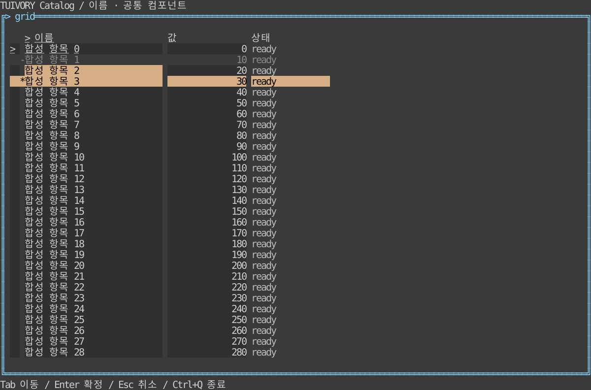

# 표·데이터 그리드 — TVR-11

**한국어 (기본)** · [English](grid.en.md)

Go `GridSource`/`NewMemoryRows`/`NewGrid`/`NewGridView`, Rust `grid::{GridSource, MemoryRows, Grid}`/`GridWidget`을 제공합니다. 행 소스의 Len/Row/IndexOf(또는 Rust 대응)를 앱이 구현하면 보이는 행만 읽습니다. 내장 MemoryRows는 ID를 검증해 메모리에 보관하고 반환값을 복제합니다. 대규모 소스의 ID 조회는 앱이 인덱스로 구현합니다.

열 ID·제목·선호 너비·편집 가능 여부와 행 ID·셀 문자열·ControlState를 받습니다. 선택은 단일 셀/행 모드를 지원하고 포커스와 분리됩니다. 가로/세로 뷰포트·헤더·열 너비·비활성 행 건너뛰기·클리핑을 처리하며 원래 너비를 좁은 화면 배치로 덮어쓰지 않습니다. 선택/포커스는 색 외에 표식과 밑줄로 표시합니다.

Handle/handle은 up/down/left/right, first/last(첫/끝 행), page_up/page_down, select, row_mode, activate, copy, sort, widen/narrow를 처리합니다. 클릭은 셀 선택 또는 헤더 정렬 요청입니다. 편집 가능한 열과 수정 가능한 행에서만 edit 요청을 내보냅니다. copy의 Text는 표시용 표식이 없는 현재 셀 또는 현재 행의 원래 값입니다. 실제 편집·정렬·필터·클립보드 I/O·데이터 조회는 앱이 처리합니다. RequestFilter/request_filter는 질의 요청만 반환합니다. SetSource/set_source는 ID로 포커스를 복구합니다.

예제는 10만 행을 즉석 제공하며 화살표·Home/End·PageUp/Down, Enter 편집 요청, Space 선택, Ctrl+C 복사 요청, F5 필터 요청, F6 셀/행 모드, F7/F8 열 너비, F9 정렬을 지원합니다. Go 호스트는 Ctrl+C를 Application 입력 캡처에서 GridKey/뷰에 전달하고 이벤트를 소비해 tview 기본 종료와 충돌하지 않게 합니다.

검증은 실제 행 접근 수의 뷰포트 상한, 안정 ID 재정렬·빈 표·중복 ID·읽기 전용/편집 가능 여부·원본 복사·열 크기·가로 셀 범위와 한영 PTY의 이동/편집/복사/정렬/헤더 클릭/리사이즈를 포함합니다. 범위 선택·집계·피벗·직접 DB 조회는 이번 범위가 아닙니다.

## 실행과 경계

```sh
make run-catalog-go ARGS="--mode grid --lang ko"
make run-catalog-rust ARGS="--mode grid --lang en"
```

호스트가 데이터·업무 동작·시간·단말 수명주기를 소유합니다. 공개 모델은 요청을 반환하고 실제 행은 셀 폭에 맞춰 문자 그대로 렌더링합니다. 0.2.0 태그에 포함합니다. 정적 링크·Unicode/ASCII·색상 프로필 조건을 유지합니다.



[Light](images/grid-light.svg) · [Blackwhite](images/grid-blackwhite.svg)

실제 Rust TestBackend 120×36 참조이며 Go 캡처나 실제 서버/SSH 단말 결과가 아닙니다. `tools/snapshot_catalog.py BINARY --mode grid`로 한영 6장을 생성합니다.

[Backlog](components-backlog.md) · [Static distribution](static-build.md)
