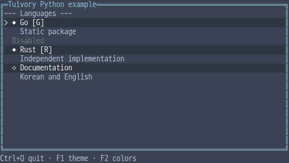
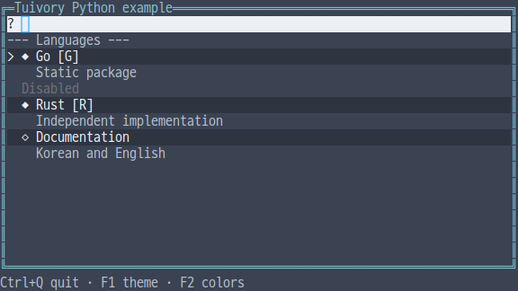
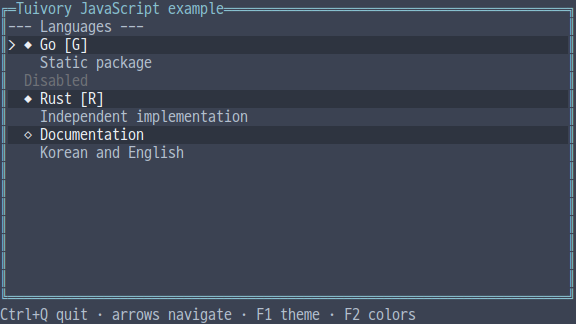
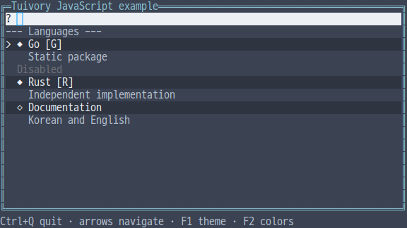
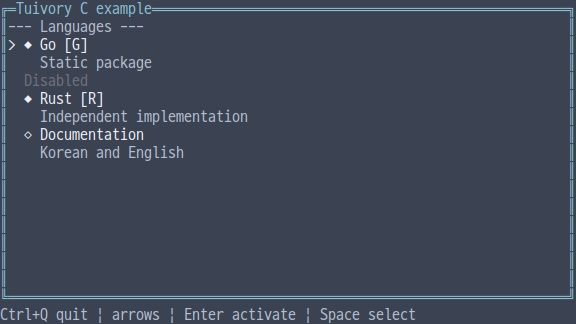
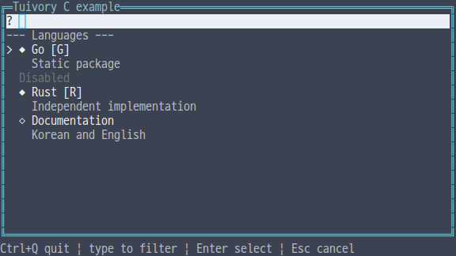
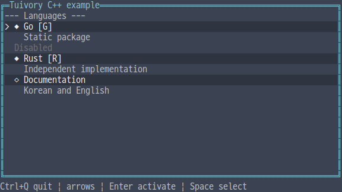
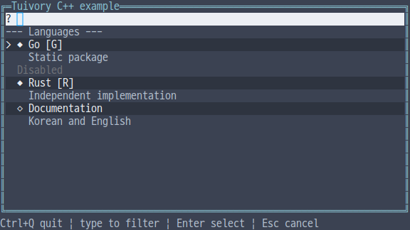
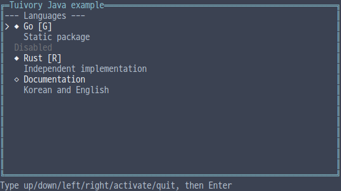
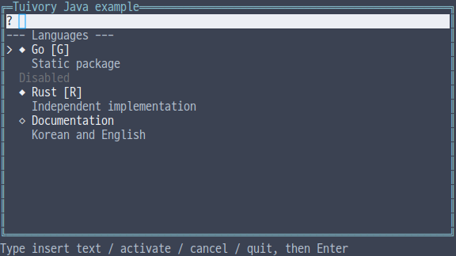

# Independent language list and search picker API

[한국어 (기본)](language-collections.md) · **English**

This TVR-15/16/30/31/32 milestone provides independent lists, search pickers and Unicode search keys in all five languages. It calls no other Tuivory engine or shared runtime. Available in 0.12.0.

## API

| Feature | Python | TS/JS | C | C++ | Java |
| --- | --- | --- | --- | --- | --- |
| Item | `Item` | `Item` | `TuiItem` | `Item` | `Item` |
| List | `List(items)` | `new List(items)` | `tui_list_new` | `List(items)` | `new ListModel(items)` |
| Replace items | `set_items` | `setItems` | `tui_list_set_items` | `set_items` | `setItems` |
| Query | `set_query` | `setQuery` | `tui_list_set_query` | `set_query` | `setQuery` |
| Actions | `handle/focus/click_id/click` | `handle/focus/clickId/click` | `tui_list_handle/focus/click_id/click` | Python names | TS names |
| Output | `layout/draw` | same | `tui_list_layout/draw` | same | same |
| Search picker | `SearchPicker(items)` | `new SearchPicker(items)` | `tui_picker_new` | `SearchPicker(items)` | `new SearchPicker(items)` |
| Picker actions | `handle/click_id/click` | `handle/clickId/click` | `tui_picker_handle/click_id/click` | Python names | TS names |
| Search key | `fold(text)` | `fold(text)` | `tui_casefold(text)` | `fold(text)` | `fold(text)` |

Items have unique nonempty `id`, `label/secondary/shortcut/icon/ascii_icon`, and `disabled/separator`. Java names its ASCII icon `asciiIcon`. Secondary descriptions occupy a separate row; shortcuts appear in brackets. Unicode/ASCII icons are selected explicitly and require no special icon font. `CollectionRow/TuiCollectionRow` contains stable ID, text, semantic role and focus state.

## Lists and filtering

`focused` is the navigation candidate; `selected` is the committed selection ID. Navigation does not change selection. Actions include `next/previous/first/last/page_down/page_up`, with aliases `down/up/home/end`. Movement emits `focus`; `select/activate` emit their respective events and IDs. Disabled items and separators are skipped by navigation and ignored by clicks.

`setItems` copies source items and preserves focus/selection by stable ID. Removed selection IDs are cleared; filtered selections remain selected while present in the source. Invalid duplicate/empty-ID updates preserve the list. Filtering matches primary and secondary text and hides separators. No results produce the configurable `empty` message (`tui_list_empty` in C).

Queries remove C0/C1 controls. A `query` event returns the new query in Python/TS/C++/Java `text` or C `query`. It reports local filter state without external search/network I/O; hosts may connect remote search.

Case-insensitive filtering embeds the same [Unicode17 default full C+F mappings](../design/casefold.json) in every language, independent of runtime Unicode versions. `Straße`/`STRASSE` and Greek Sigma variants share search keys. Turkic overrides and Unicode normalization are excluded. Original text, stable IDs and selected values remain unchanged. Search mapping versions are separate from the existing Unicode18 width/grapheme data. Every package includes [Unicode License V3](../design/casefold.LICENSE).

## Search pickers

The picker's `list` is the same list model. Its `open` state is separate from committed `value`. Opening clears the query and focuses the current selection. `insert/backspace` edit the query, with Backspace removing one grapheme. Filtering/navigation leave `value` unchanged. Activation or clicking an open item commits and emits `change`. `cancel` closes while preserving the prior value. Activating/clicking a closed picker opens it first.

The query row provides a real cursor and horizontal scrolling without a fake `|` character. Common palettes represent selection, disabled states and secondary text. `click` uses the latest layout/draw rows and width, rejects outside/disabled hits and maps secondary rows to their item IDs. Hosts compose external focus, popup placement, close approval and data connections using [Focus](language-focus.en.md) and layout tools. This milestone's picker example is an inline composition.

## Ownership and call order

Python/TS lists use `list.handle(action,height,text)`, while pickers use `picker.handle(action,text,height)`. C++/Java lists use `handle(action,height)` and pickers use `handle(action,text,height)`. C uses the functions in the table. Unified examples contain the actual host routing for these differences.

C uses `tui_list_free/tui_picker_free`; release `tui_casefold` results with `tui_string_free`. The picker owns the list returned by `tui_picker_list`; do not free it separately. IDs, queries, items, rows and events are borrowed until the relevant change/layout or destruction. C construction returns `NULL` on failure; operations report `TuiResult`. C permits up to 65,536 items. C++ uses values/RAII and other languages follow runtime ownership. Replace source data through `set_items/setItems`.

## Examples and validation

Choose `--demo list` or `--demo picker` in each unified example, with the common `--lang ko|en --theme dark|light|blackwhite --colors 8|16|256|truecolor --ascii` options. Lists use arrows/Enter/Space. Pickers accept query text/Backspace, Enter to commit and Escape to cancel. Java's line-input example accepts commands such as `insert Rust`, `activate`, `cancel`, `down`, and `quit`, followed by Enter.

Checks cover [shared cases](../design/collections-cases.json), all 1,585 case mappings, stable-ID updates and commit/cancel, C/C++ memory checks/static consumers, JAR/wheel/npm consumers, narrow rendering across 12 palettes, and actual PTYs. [Evidence](evidence/language-collections-results.json) separates local validation, CI, dev integration and product publication. Physical font/blink behavior remains separate.

| Language | List | Search picker |
| --- | --- | --- |
| Python |  |  |
| JavaScript |  |  |
| C |  |  |
| C++ |  |  |
| Java |  |  |

[Independent languages](languages.en.md) · [API](api/README.en.md)
