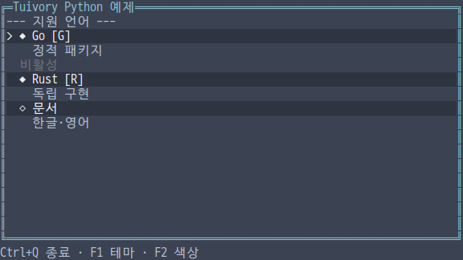
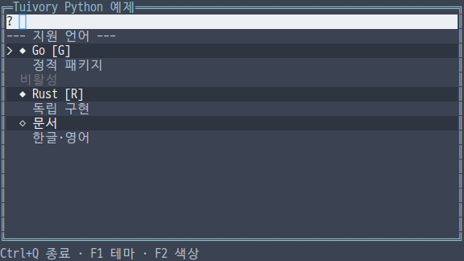
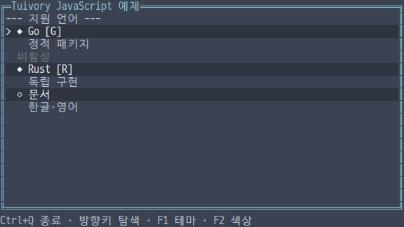
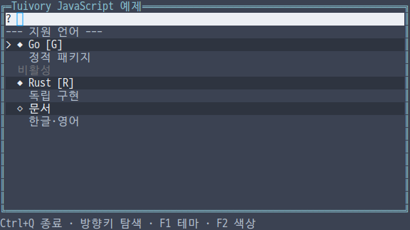
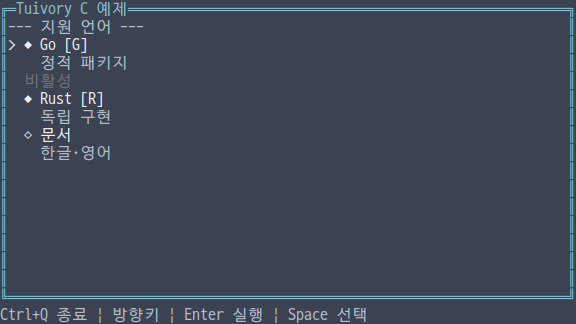
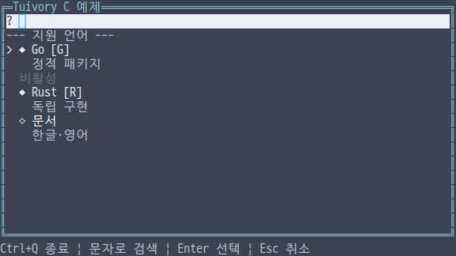
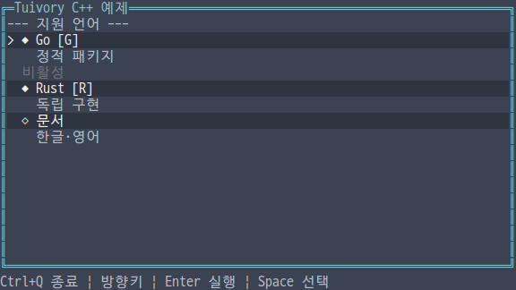
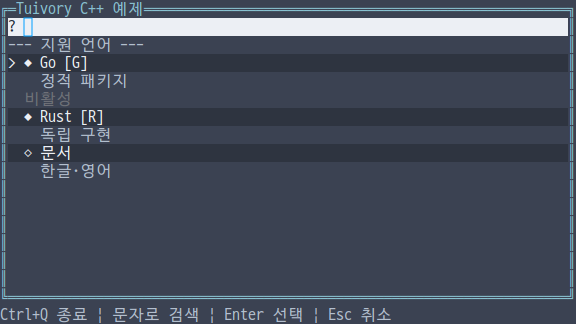
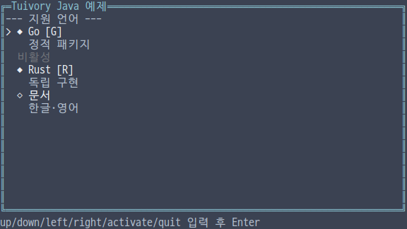
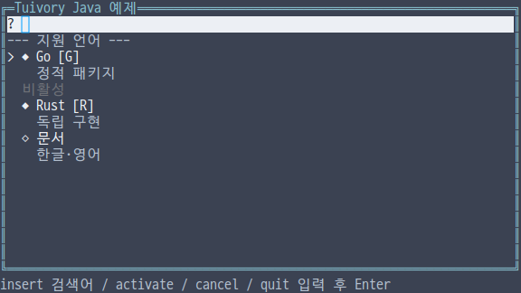

# 독립 언어 목록·검색 선택기 API

**한국어 (기본)** · [English](language-collections.en.md)

TVR-15·16·30·31·32의 미배포 단계입니다. 다섯 언어가 자체 목록·검색 선택기·Unicode 검색 키를 제공합니다. 다른 Tuivory 언어 코어나 공유 런타임을 호출하지 않습니다. 공개 0.11.1에는 포함되지 않습니다.

## API

| 기능 | Python | TS/JS | C | C++ | Java |
| --- | --- | --- | --- | --- | --- |
| 항목 | `Item` | `Item` | `TuiItem` | `Item` | `Item` |
| 목록 | `List(items)` | `new List(items)` | `tui_list_new` | `List(items)` | `new ListModel(items)` |
| 원본 갱신 | `set_items` | `setItems` | `tui_list_set_items` | `set_items` | `setItems` |
| 검색어 | `set_query` | `setQuery` | `tui_list_set_query` | `set_query` | `setQuery` |
| 조작 | `handle/focus/click_id/click` | `handle/focus/clickId/click` | `tui_list_handle/focus/click_id/click` | Python과 같은 이름 | TS와 같은 이름 |
| 출력 | `layout/draw` | 동일 | `tui_list_layout/draw` | 동일 | 동일 |
| 검색 선택기 | `SearchPicker(items)` | `new SearchPicker(items)` | `tui_picker_new` | `SearchPicker(items)` | `new SearchPicker(items)` |
| 선택기 조작 | `handle/click_id/click` | `handle/clickId/click` | `tui_picker_handle/click_id/click` | Python과 같은 이름 | TS와 같은 이름 |
| 검색 키 | `fold(text)` | `fold(text)` | `tui_casefold(text)` | `fold(text)` | `fold(text)` |

항목은 고유하고 비어 있지 않은 `id`, `label/secondary/shortcut/icon/ascii_icon`, `disabled/separator`를 가집니다. Java의 ASCII 아이콘 이름은 `asciiIcon`입니다. 보조 설명은 별도 행으로, 단축키는 대괄호로 표시합니다. Unicode와 ASCII 아이콘은 각각 선택하며 일반 폰트를 전제로 합니다. `CollectionRow/TuiCollectionRow`는 안정 ID·문자열·role·포커스 상태를 제공합니다.

## 목록과 검색

`focused`는 현재 탐색 후보, `selected`는 확정된 선택 ID입니다. 탐색만으로 선택값을 바꾸지 않습니다. `next/previous/first/last/page_down/page_up`를 지원하고 `down/up/home/end`도 같은 동작입니다. 이동은 `focus`, `select/activate`는 해당 이벤트와 ID를 반환합니다. 비활성·구분선은 키보드 탐색과 클릭에서 건너뜁니다.

`set_items`는 원본을 복사하고 안정 ID로 포커스와 선택을 유지합니다. 선택 ID가 사라지면 비웁니다. 검색어로 숨겨진 선택은 원본에 남아 있으면 유지합니다. 잘못된 중복/빈 ID 갱신은 기존 목록을 보존합니다. 검색은 주 텍스트와 보조 설명을 대상으로 하며 필터가 있으면 구분선을 숨깁니다. 결과가 없으면 `empty` 안내를 표시합니다. C의 안내 설정은 `tui_list_empty`입니다.

검색어는 C0/C1 제어 문자를 제거하며, `query` 이벤트의 Python/TS/C++/Java `text` 또는 C `query`에 새 검색어를 반환합니다. 이 이벤트는 로컬 필터 상태를 알리며 외부 검색·네트워크 I/O는 하지 않습니다. 앱이 원격 검색을 연결할 수 있습니다.

대소문자를 무시하는 검색은 런타임의 Unicode 버전에 기대지 않고 [Unicode17 기본 full C+F 데이터](../design/casefold.json)를 다섯 언어에 내장합니다. `Straße`와 `STRASSE`, 그리스어 Sigma 변형도 같은 검색 키로 비교합니다. Turkic 예외와 Unicode 정규화는 적용하지 않습니다. 원문·안정 ID·선택값을 검색 키로 바꾸지는 않습니다. 폭·grapheme의 기존 Unicode18 데이터와 검색 매핑의 버전은 별도입니다. [Unicode License V3](../design/casefold.LICENSE)를 각 패키지에 포함합니다.

## 검색 선택기

선택기의 `list`는 같은 목록 모델입니다. `open`과 확정된 `value`를 구분합니다. `open` 조작은 검색어를 비우고 기존 선택으로 포커스를 맞춥니다. `insert/backspace`는 검색어를 편집하며 Backspace는 grapheme 하나를 지웁니다. 필터·이동 중에는 `value`를 바꾸지 않습니다. `activate`나 열린 목록 항목 클릭이 `change` 이벤트를 반환하고 선택을 확정합니다. `cancel`은 이전 값을 보존하며 닫습니다. 닫힌 선택기의 활성화/클릭은 먼저 목록을 엽니다.

검색어 줄은 실제 커서·수평 스크롤을 제공하고 가짜 `|` 문자를 넣지 않습니다. 색상·선택·비활성·보조 설명을 공통 팔레트로 그립니다. `click`은 최신 layout/draw의 행과 폭을 사용하므로 범위 밖 클릭과 비활성 항목을 차단하며 보조 설명 행도 해당 ID로 연결합니다. 외부 포커스·팝업 위치·닫기 승인·데이터 연결은 앱이 [Focus](language-focus.md)와 배치 도구로 조합합니다. 이 단계의 picker 예제는 인라인 조합입니다.

## 소유권과 호출 순서

Python/TS는 `list.handle(action,height,text)`, 선택기는 `picker.handle(action,text,height)`를 사용합니다. C++/Java 목록은 `handle(action,height)`이며 선택기는 같은 `handle(action,text,height)`입니다. C는 위 표의 함수 인수를 사용합니다. 모든 언어의 통합 예제는 이 차이를 연결한 실제 호스트 코드입니다.

C는 `tui_list_free/tui_picker_free`로 해제하고 `tui_casefold` 반환 문자열은 `tui_string_free`로 해제합니다. `tui_picker_list`는 선택기가 소유한 목록이므로 따로 해제하지 않습니다. ID·검색어·항목·행·이벤트는 빌린 값으로 다음 관련 변경/layout 또는 해제 전에만 사용합니다. C 생성 실패는 `NULL`, 조작 실패는 이벤트/반환값의 `TuiResult`입니다. C 원본은 최대 65,536항목입니다. C++는 값과 RAII, 나머지는 해당 런타임의 소유권을 따릅니다. 프로그램에서 원본을 바꿀 때는 `set_items/setItems`를 사용합니다.

## 예제·검증

언어별 통합 예제의 `--demo list`와 `--demo picker`를 사용합니다. `--lang ko|en --theme dark|light|blackwhite --colors 8|16|256|truecolor --ascii`는 동일합니다. 목록은 방향키·Enter·Space, 선택기는 검색어 입력·Backspace·Enter 확정·Escape 취소를 제공합니다. Java 줄 입력 예제는 `insert Rust`, `activate`, `cancel`, `down`, `quit` 등을 Enter로 실행합니다.

[공유 사례](../design/collections-cases.json), 1,585개 대소문자 매핑 전수 검사, 안정 ID 갱신과 선택 확정/취소, C/C++ 메모리 검사·정적 외부 적용 앱·JAR·wheel/npm, 12팔레트 좁은 화면과 실제 PTY를 검사합니다. [검증 기록](evidence/language-collections-results.json)에 로컬·CI·dev 통합·제품 게시 상태를 구분합니다. 물리 터미널 글꼴·깜빡임 검증은 별도입니다.

| 언어 | 목록 | 검색 선택기 |
| --- | --- | --- |
| Python |  |  |
| JavaScript |  |  |
| C |  |  |
| C++ |  |  |
| Java |  |  |

[독립 언어 지원](languages.md) · [API](api/README.md)
