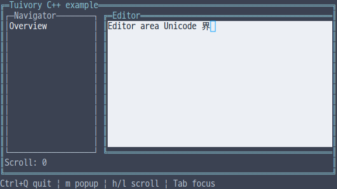
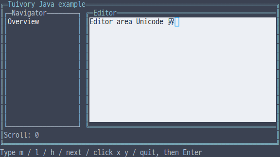

# Independent-language containers and cell copying

[한국어 (기본)](language-containers.md) · **English**

This unreleased TVR-15/16/30/31/32 milestone implements row/column/grid/layer layouts, container-local focus/pointer routing, virtual areas and clipped child painting independently in Python, TS/JS, C, C++ and Java. No other Tuivory language implementation is called. Published product 0.11.1 stays unchanged.

## API

| Feature | Python | TS/JS | C | C++ | Java |
| --- | --- | --- | --- | --- | --- |
| Configuration | `Track`, `LayoutItem`, `ContainerOptions` | Same | `TuiTrack`, `TuiLayoutItem`, `TuiContainerOptions` | Same as Python | Same as Python |
| Geometry | `compute_container` | `computeContainer` | `tui_compute_container` | `compute_container` | `computeContainer` |
| Local interaction | `ContainerState` | `ContainerState` | `TuiContainerState`, `tui_container_*` | `ContainerState` | `ContainerState` |
| Execution | `Container` | `Container` | `TuiContainer`, `tui_container_*` | `Container` | `Container` |
| Copy | `Canvas.blit(source,region,x,y)` | Same | `tui_canvas_blit` | Same | Same |
| Hide cursor | `clear_cursor([rect])` | `clearCursor([rect])` | `tui_canvas_clear_cursor` | `clear_cursor([rect])` | `clearCursor()` / `clearCursor(rect)` |

Use one public import/include. TS/Java use `rowSpan`, `columnSpan`, `virtualWidth`, `virtualHeight`; Python/C/C++ use snake_case. A NULL C options pointer/kind and default options elsewhere select row. Java uses `new LayoutItem(id)` and mutable fields on new options/Track objects. C++ uses values.

```python
import tuivory as ui
layout = ui.Container([
    ui.LayoutItem('nav', track=ui.Track(fixed=20)),
    ui.LayoutItem('editor'),
], ui.ContainerOptions(kind='row', gap=1, virtual_width=96))
layout.state.move_focus(layout.items)
def paint(id, child, focused):
    # Each child's origin is (0,0); drawing is limited to its own size.
    child.panel(ui.Rect(0,0,child.width,child.height),id,focused)
layout.draw(canvas,ui.Rect(1,1,70,14),paint)
```

```typescript
import { Container, rect } from 'tuivory';
const layout = new Container([
  { id: 'nav', track: { fixed: 20 } }, { id: 'editor' }
], { kind: 'row', gap: 1, virtualWidth: 96 });
layout.draw(canvas, rect(1,1,70,14), (id, child, focused) => {
  child.panel(rect(0,0,child.width,child.height),id,focused);
});
```

## Geometry rules

`Track(min,max,fixed,weight)` specifies minimum, maximum, fixed size and weight. An all-zero Track gets weight 1. max=0 means unlimited; fixed=0 means flexible. Minima/fixed sizes are allocated first, then remaining cells by weight and maximum. Under pressure gaps disappear and earlier items receive available space first. Input preferences stay unchanged.

`LayoutItem` has stable ID, track, row/column, row_span/column_span, hidden/disabled, drawer, modal, centered and area. Rows/columns follow visible item order; grid uses row/column Tracks and spans; layers overlap in item order. Span zero means one. Hidden items are excluded; disabled items are painted but excluded from interaction. Area size zero uses remaining space. centered centers an item; drawer=left/right aligns it to an edge. These flags cannot be combined; drawers require layers.

Options provide kind=row/column/grid/layers, gap, padding, rows/columns and virtual_width/virtual_height. Geometry returns visible `NamedRect(id,rect)` values. C returns an owned `TuiLayoutResult`, released by `tui_layout_free`. Visible zero-sized items remain in the result. The C result's hidden list contains these zero-sized items, distinct from configuration entries with hidden=true.

Coordinates, dimensions and Track values are 0..1,000,000; gap/padding are 0..1,024; at most 1,024 items and row/column Tracks each are allowed. Empty/duplicate IDs, out-of-range spans, invalid maxima, negatives and drawer combinations are rejected. Tiny allocations keep rectangles within the parent.

## Painting and cursors

Container copies configuration/IDs, and returned configuration snapshots are separate values. `set_items/setItems` validates before replacing; rejection preserves the old configuration. Success cancels old hit regions and pointer capture; the next draw creates current geometry. C copies items/strings/options/Track arrays. Its latest layout is borrowed until the next draw/update/free.

`draw(canvas,bounds,painter)` gives each child a Canvas of its own size with origin (0,0). Writes outside that child are clipped and cannot overwrite neighboring components. Layers copy the underlay, paint the child and composite its opaque rectangle. The library does not automatically create application screens or business integration.

Virtual dimensions are the maximum of viewport and requested virtual size, capped at 1,000,000 cells. Positive `scroll_x/scroll_y` (TS/Java `scrollX/scrollY`) clamp to available space during draw; C uses `tui_container_scroll`. A failing child painter leaves the destination Canvas unchanged; C callbacks report failures through `TuiResult`.

`blit` copies text, styles and the cursor and supports overlapping self-copy. It clips both source and destination boundaries, replaces partial wide glyphs with blanks and repairs both edges of existing destination wide glyphs while retaining styles outside the copy. A real cursor is projected only when its entire glyph width remains visible. Copy coordinates are ±10⁹; width/height are 0..10⁹.

Existing write/fill/panel operations also hide a cursor whose glyph they overwrite. **Paint the component before registering its actual cursor.** Repainting the same buffer after focus loss or overlay no longer retains an old cursor. Containers suppress unfocused children's cursors. Cursor shape/blink are not forced.

## Interaction and host responsibility

ContainerState's eligible/reconcile/move_focus/hit/pointer apply only inside this configuration. Interaction is limited to enabled visible entries from the last visible modal onward. Closing modals restores previous focus through stable IDs and clears removed/unavailable captures. Pointer press sets local focus/capture; release clears capture. Captured moves can continue outside the area using the same ID.

Container.pointer translates screen coordinates through current bounds and scroll into virtual coordinates. Hosts nesting containers translate once more to the returned child's origin; the example demonstrates this. **Hosts choose full screens, focus order between components, global Tab/shortcuts, menu/help contents and business actions.** Painter callbacks and returned IDs are connection tools without business logic.

C State exposes `tui_container_state_new/free`, reconcile/move_focus/state_pointer and focused/captured queries. Hit IDs borrow the layout; pointer IDs borrow State. Container exposes `tui_container_new/free/set_items/state/scroll/draw/layout/pointer`. Use `tui_canvas_bounds` for callback dimensions. Never retain or free a callback's borrowed Canvas.

## Examples and validation

Run integrated `--demo container`: m toggles a popup, h/l scroll, and Tab follows the host's chosen local focus movement. Java line input accepts m/l/h/next/click x y/cancel/quit followed by Enter. Java click simulates input; this fixed-size line example is not an actual resize test.

Validation uses [shared layouts](../design/controls-cases.json), [cell-copy cases](../design/canvas-copy-cases.json) and the [evidence record](evidence/language-containers-results.json). Four raw examples exercise actual 40-column resizing; narrow Java geometry is checked through the API. [Actual Surface styles](language-surfaces.en.md) are now available. See the [current catalog table](languages.en.md) for available terminal, dialog, grid, document, shadow and drag APIs.

| Language | English screen |
| --- | --- |
| Python |  |
| JavaScript |  |
| C |  |
| C++ |  |
| Java |  |

[Independent languages](languages.en.md) · [Spacing and supporting components](language-layout.en.md) · [API](api/README.en.md) · [Examples](examples.en.md)
