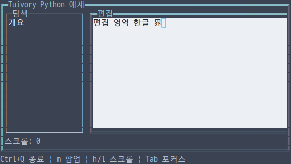
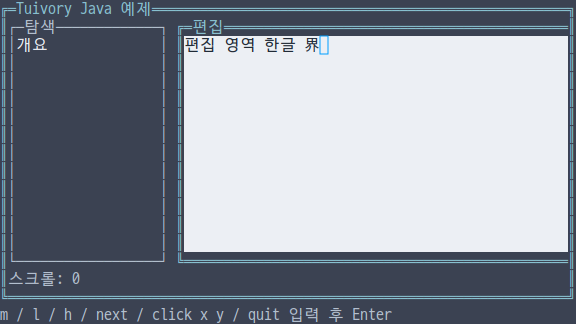

# 독립 언어 컨테이너와 셀 복사

**한국어 (기본)** · [English](language-containers.en.md)

TVR-15/16/30/31/32의 미배포 단계입니다. Python·TS/JS·C·C++·Java 각각의 구현으로 행·열·그리드·겹침 배치, 컨테이너 내부 포커스·포인터 전달, 가상 영역과 잘린 자식 그리기를 제공합니다. 다른 Tuivory 언어를 호출하지 않습니다. 공개 제품 0.11.1은 변경하지 않습니다.

## API

| 기능 | Python | TS/JS | C | C++ | Java |
| --- | --- | --- | --- | --- | --- |
| 구성 | `Track`, `LayoutItem`, `ContainerOptions` | 동일 | `TuiTrack`, `TuiLayoutItem`, `TuiContainerOptions` | Python과 동일 | Python과 동일 |
| 배치 계산 | `compute_container` | `computeContainer` | `tui_compute_container` | `compute_container` | `computeContainer` |
| 내부 조작 | `ContainerState` | `ContainerState` | `TuiContainerState`, `tui_container_*` | `ContainerState` | `ContainerState` |
| 실행 | `Container` | `Container` | `TuiContainer`, `tui_container_*` | `Container` | `Container` |
| 복사 | `Canvas.blit(source,region,x,y)` | 동일 | `tui_canvas_blit` | 동일 | 동일 |
| 커서 숨김 | `clear_cursor([rect])` | `clearCursor([rect])` | `tui_canvas_clear_cursor` | `clear_cursor([rect])` | `clearCursor()` / `clearCursor(rect)` |

한 번의 공개 import/include로 사용합니다. TS/Java의 필드는 `rowSpan`, `columnSpan`, `virtualWidth`, `virtualHeight`이며 Python/C/C++는 snake_case입니다. C의 `kind=NULL` 또는 옵션 포인터 NULL, 다른 언어의 기본 옵션은 row입니다. Java는 `new LayoutItem(id)`, 기본 생성한 옵션·Track의 필드를 설정합니다. C++는 값 형식입니다.

```python
import tuivory as ui
layout = ui.Container([
    ui.LayoutItem('nav', track=ui.Track(fixed=20)),
    ui.LayoutItem('editor'),
], ui.ContainerOptions(kind='row', gap=1, virtual_width=96))
layout.state.move_focus(layout.items)
def paint(id, child, focused):
    # child의 원점은 (0,0)이며 자신의 크기 밖에는 그릴 수 없습니다.
    child.panel(ui.Rect(0,0,child.width,child.height),id,focused)
layout.draw(canvas,ui.Rect(1,1,70,14),paint)
```

```typescript
import { Container, rect } from 'tuivory';
const layout = new Container([
  { id: 'nav', track: { fixed: 20 } }, { id: 'editor' }
], { kind: 'row', gap: 1, virtualWidth: 96 });
layout.draw(canvas, rect(1,1,70,14), (id, child, focused) => {
  child.panel(rect(0,0,child.width,child.height),id,focused);
});
```

## 배치 규칙

`Track(min,max,fixed,weight)`는 최솟값·최댓값·고정값·가중치입니다. 모두 0이면 가중치 1로 처리합니다. max=0은 상한 없음, fixed=0은 고정하지 않음을 뜻합니다. 최솟값과 고정값을 먼저 확보하고, 남은 공간을 가중치와 상한에 따라 배분합니다. 좁으면 간격을 없애고 앞 항목부터 가능한 공간을 줍니다. 원본 선호값을 변경하지 않습니다.

`LayoutItem`은 안정 ID, track, row/column, row_span/column_span, hidden/disabled, drawer, modal, centered, area를 가집니다. 행·열은 표시 항목 순서, grid는 행·열 Track과 span, layers는 항목 순서의 겹침을 사용합니다. span=0은 1칸입니다. hidden 항목은 결과에서 제외하고 disabled 항목은 그리되 조작에서 제외합니다. area의 크기 0은 남은 영역을 사용합니다. centered는 가운데 배치, drawer=left/right는 좌우 가장자리 배치이며 두 옵션을 함께 쓰지 않습니다. drawer는 layers에서만 허용합니다.

옵션은 kind=row/column/grid/layers, gap, padding, rows/columns, virtual_width/virtual_height입니다. 배치 계산은 표시 항목의 `NamedRect(id,rect)`를 반환합니다. C는 소유하는 `TuiLayoutResult`를 반환하며 `tui_layout_free`로 해제합니다. 공간이 없어 크기가 0인 표시 항목도 결과에 남습니다. C 결과의 hidden 목록은 이러한 0 크기 항목입니다. hidden=true인 구성 항목과 구분합니다.

좌표·크기·Track 값은 0..1,000,000, 간격·여백은 0..1,024, 항목·행·열 Track은 각각 최대 1,024개입니다. 중복/빈 ID, 범위를 벗어난 span, 잘못된 상한·음수·drawer 조합을 거부합니다. 작은 영역에서도 결과 사각형은 부모 안에 머뭅니다.

## 그리기와 커서

Container는 구성과 ID를 복사하며 조회한 구성도 별도 값입니다. `set_items/setItems`는 새 구성을 검사한 뒤 반영하며 실패하면 기존 구성을 유지합니다. 성공하면 이전 히트 영역과 포인터 캡처를 취소하고 다음 draw에서 새 영역을 만듭니다. C는 생성·갱신 시 항목/문자열/옵션/Track 배열을 복사하고 조회한 layout은 다음 draw·갱신·해제까지 빌린 값입니다.

`draw(canvas,bounds,painter)`는 각 자식을 해당 크기의 Canvas에 그리게 합니다. 콜백의 원점은 자식 내부 (0,0)입니다. 자식 Canvas 밖의 쓰기는 잘려 이웃 컴포넌트를 덮지 않습니다. layers는 아래 내용을 복사한 뒤 자식을 그리고 그 사각형을 불투명하게 합성합니다. 숨겨진 전체 앱 화면이나 업무 연결을 라이브러리가 자동으로 만들지는 않습니다.

가상 영역은 뷰포트와 요청한 virtual 크기 중 큰 값을 사용합니다. 최대 1,000,000셀입니다. `scroll_x/scroll_y`(TS/Java `scrollX/scrollY`)는 양수 스크롤이며 draw 시 가능한 범위로 줄어듭니다. C는 `tui_container_scroll`을 사용합니다. 자식 그리기 실패 시 최종 대상 Canvas를 변경하지 않습니다. C 콜백은 오류를 `TuiResult`로 반환합니다.

`blit`는 셀의 글자·스타일과 커서를 복사하며 자기 자신을 겹쳐 복사할 수도 있습니다. 영역·대상 경계를 함께 자르고, 일부만 보이는 두 칸 문자는 공백으로 처리합니다. 대상 경계에 걸린 기존 두 칸 문자도 양쪽을 수리하며 영역 밖 스타일은 보존합니다. 원본 전체 글자 폭이 보일 때만 실제 커서를 옮깁니다. 복사 좌표는 ±10⁹, 폭·높이는 0..10⁹입니다.

기존 write/fill/panel도 덮어쓴 글자의 커서를 숨깁니다. **컴포넌트를 그린 다음 실제 커서를 등록합니다.** 같은 버퍼를 다시 그려 포커스를 잃거나 팝업이 덮으면 과거 커서가 남지 않습니다. 컨테이너는 포커스 없는 자식의 커서를 전달하지 않습니다. 커서 모양·점멸은 강제하지 않습니다.

## 조작과 앱의 책임

ContainerState의 eligible/reconcile/move_focus/hit/pointer는 이 구성 내부에서만 사용합니다. 마지막 표시 modal부터 뒤의 표시·활성 항목으로 조작을 제한합니다. modal을 닫으면 안정 ID로 이전 포커스를 복원하고 사라지거나 사용할 수 없는 캡처를 해제합니다. pointer는 누를 때 내부 포커스·캡처를 정하고, 놓을 때 해제합니다. 캡처 중에는 영역 밖 움직임도 같은 ID로 전달할 수 있습니다.

Container.pointer는 화면 좌표를 현재 bounds·스크롤에 맞춰 가상 좌표로 바꿉니다. 중첩 컨테이너를 사용하는 앱은 반환한 자식 ID에 맞춰 좌표를 한 번 더 자식 원점으로 옮깁니다. 예제가 이를 보여줍니다. **앱은 전체 화면·컴포넌트 사이 포커스 순서·전역 Tab/단축키·메뉴/도움말 내용·업무 동작을 결정합니다.** draw 콜백과 pointer 반환 ID는 연결 도구이며 업무 로직을 포함하지 않습니다.

C의 State는 `tui_container_state_new/free`, reconcile/move_focus/state_pointer와 focused/captured 조회를 제공합니다. hit의 ID는 layout, pointer 결과 ID는 State에서 빌린 값입니다. Container는 `tui_container_new/free/set_items/state/scroll/draw/layout/pointer`입니다. `tui_canvas_bounds`로 콜백의 크기를 읽습니다. 콜백은 Canvas를 보관하거나 해제하지 않습니다.

## 예제와 검증

통합 예제 `--demo container`에서 m은 팝업 열기/닫기, h/l은 스크롤, Tab은 앱이 정한 내부 포커스 이동입니다. Java 줄 입력에서는 m/l/h/next/click x y/cancel/quit 뒤 Enter를 누릅니다. Java click은 입력 모의이며 고정 크기 줄 입력 예제를 실제 resize 검증으로 간주하지 않습니다.

[공유 배치 사례](../design/controls-cases.json), [셀 복사 사례](../design/canvas-copy-cases.json), [검증 기록](evidence/language-containers-results.json)을 사용합니다. 네 raw 예제는 실제 40열 resize, Java 좁은 배치는 API로 검사합니다. 일반 TTY 어댑터·사용자 지정 Surface 스타일·대화상자·전체 Grid/문서 편집·그림자·드래그 앤 드롭은 후속 단계입니다.

| 언어 | 한글 화면 |
| --- | --- |
| Python |  |
| JavaScript |  |
| C |  |
| C++ |  |
| Java |  |

[독립 언어](languages.md) · [배치·보조 컴포넌트](language-layout.md) · [API](api/README.md) · [예제](examples.md)
