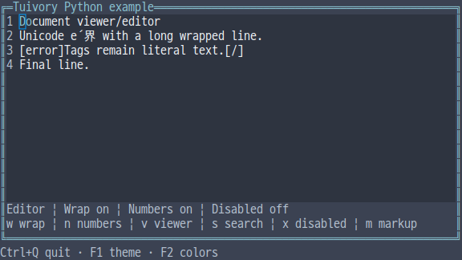
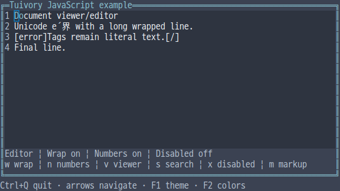
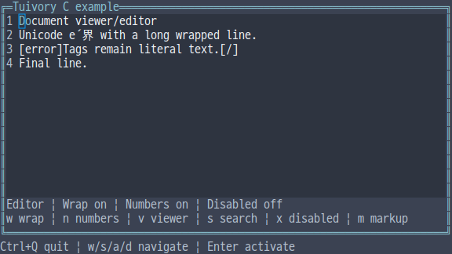
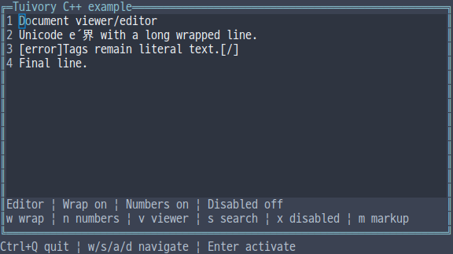
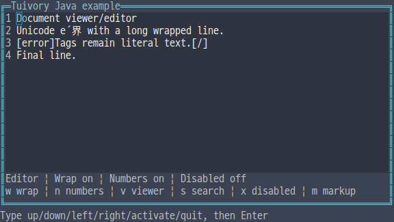

# Independent-language document viewing and editing APIs

[한국어 (기본)](language-documents.md) · **English**

This is TVR-15/16/30/31/32 work. Each TextDocument uses its own language's Text buffer without calling another Tuivory implementation. Use Text for simple input and TextDocument for wrapping, line numbers, scrolling and styled source ranges. Available in 0.12.0.

| Feature | Python | TS/JS | C | C++ | Java |
| --- | --- | --- | --- | --- | --- |
| Document | `TextDocument.editor/viewer` | `TextDocument.editor/viewer` | `tui_document_new(text,read_only)` | `TextDocument::editor/viewer` | `TextDocument.editor/viewer` |
| Source buffer | `buffer` | `buffer` | `tui_document_buffer` | `buffer` | `buffer` |
| Source ranges | `DocumentRange`, `DocumentSpan` | Types with these names | `TuiDocumentRange/Span` | `DocumentRange/Span` | `DocumentRange/Span` records |
| Explicit markup | `parse_markup`, `set_markup` | `parseMarkup`, `setMarkup` | `tui_parse_markup`, `tui_document_set_markup` | `parse_markup`, `set_markup` | `parseMarkup`, `setMarkup` |
| Drawing/pointer | `draw`, `click` | `draw`, `click` | `tui_document_draw/click` | `draw`, `click` | `draw`, `click` |

Use one public import/include. editor starts with line numbers enabled; viewer starts read-only with line numbers off. wrap defaults to false. Python/C++ use line_numbers, scroll_x/y, set_text, set_syntax, set_byte_syntax, set_search_matches and reveal_cursor. TS/Java use corresponding camelCase names. C queries options and calls tui_document_configure for wrap/line_numbers/scroll_x/y, tui_document_set_* for updates and tui_document_reveal_cursor.

```python
import tuivory as ui

doc = ui.TextDocument.editor('Unicode é\r\nOriginal source is preserved.')
doc.wrap = True
doc.buffer.select(0, 0)
doc.set_syntax([ui.DocumentSpan(0, 2, 'info')])
doc.set_search_matches([ui.DocumentRange(3, 4)])
doc.draw(canvas, ui.Rect(1, 1, 40, 10))
# Pointer coordinates are local to the document's allocated area.
doc.click(2, 0, 40, 10)
```

Source is limited to1,000,000 UTF-8 bytes and preserves CR/LF/CRLF. Controls display as blanks; edit input uses existing Text sanitization. Ordinary contents display tags such as [error] literally. Only explicit set_markup/setMarkup interprets [role]text[/], with [[ escaping [. Nested tags are supported. Unknown roles/unbalanced tags preserve source and selection on failure. A style change within a combining grapheme uses its starting style. Copy/cut returns logical plain source after markup removal; apps transport clipboard contents.

DocumentSpan/DocumentRange use half-open **original grapheme indices**, distinct from screen cells, code points and UTF-16 positions. set_byte_syntax converts original UTF-8 byte offsets at exact grapheme boundaries. Offsets splitting a CJK encoding or the base/combining-accent boundary fail without replacing previous styles. Overlapping spans are allowed; later spans win. Display priority is syntax → app-supplied search (edited) → selection → disabled. Changing source expires styles/search ranges associated with the previous source.

Roles are body/hint/info/success/warning/error/header/field/selection/button/disabled/edited and syntax.keyword/function/type/string/number/comment/parameter. Syntax families use info/success/header/warning/edited/hint/error colors respectively, bound to document backgrounds. Explicit selection/search backgrounds remain intact. This milestone provides range rendering, not automatic analysis.

layout(width,height) returns DocumentLine(number,prefix,glyphs,hits). Each DocumentGlyph has x/text/index/width/role/cursor; hits map screen x to source index. Python/TS/C++ use pairs for hits, Java DocumentHit records. Wrapped rows repeat their logical line number. Wide glyphs are clipped whole; scrolling into a glyph leaves blank cells to preserve columns. An end cursor filling the width receives an extra wrapped row when needed. Hardware cursors are registered after painting, never represented with a pipe character.

handle supports existing Text editing/selection/copy requests and page_up/down, scroll_up/down/left/right. Up/down navigate logical lines. Document scrolling is separate from buffer editing. reveal_cursor reveals the cursor on the next layout. click uses local coordinates/current allocation; both cells of a wide glyph select that grapheme. extend=true preserves the selection anchor.

Viewers follow the actual Canvas surface; editors use editor backgrounds. Read-only/disabled documents show no hardware cursor; disabled documents accept no input/click. Secret buffers mask every grapheme, including breaks, with one *, restrict styles/search/copy and hide raw source in Python repr, JS JSON/inspection and Java toString. Explicit raw getters remain an app responsibility.

Dimensions and scroll_x/y are0..1,000,000; drawing origins0..1,000,000,000. At most1,000,000 ranges are accepted. Invalid Unicode/ranges/options are rejected. Setting new source resets edit history and previous ranges. Oversized edit requests are rejected before modifying source, selection or history. Apps own screens, cross-component focus/global keys, search execution, clipboard/file I/O and business actions.

C distinguishes model/layout/markup ownership. Free models with tui_document_free and layouts with tui_document_layout_free. tui_document_line_count/at returns borrowed rows/text/glyphs/hits owned by that layout, which remain valid after freeing the model. tui_document_buffer borrows the model's Text: reacquire it after set_text/set_markup and never use it after model destruction. Free tui_parse_markup source with tui_string_free and spans with tui_document_spans_free. C strings are NUL-terminated. TextEvent.text follows existing Text borrowed-event lifetimes.

Integrated --demo document shows localized contents, wrapping/numbers, viewer/disabled modes, host-provided search and explicit markup. w/n/v/x/s/m are example global keys and trigger demo actions instead of inserting those letters. Four raw examples support mouse/actual resize. Java uses fixed-size line input and click x y; narrow document geometry is checked through APIs separately.

[Shared cases](../design/document-cases.json) · [Evidence](evidence/language-documents-results.json)

| Language | Actual screen |
| --- | --- |
| Python |  |
| JS |  |
| C |  |
| C++ |  |
| Java |  |

[Support](languages.en.md) · [API](api/README.en.md) · [Examples](examples.en.md)
