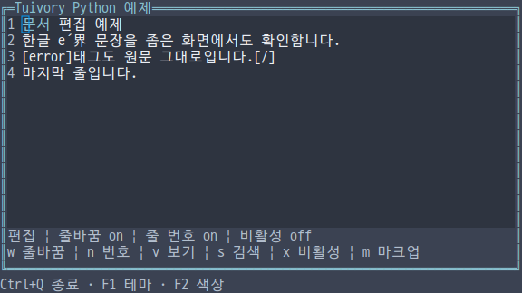
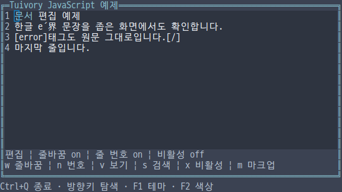
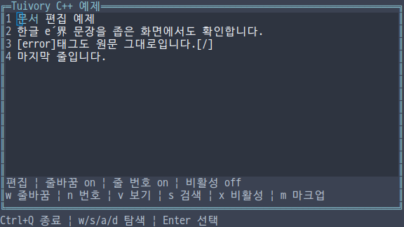
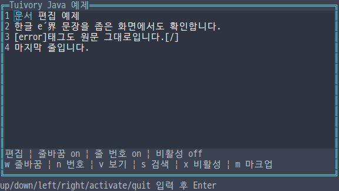

# 독립 언어의 문서 보기·편집 API

**한국어 (기본)** · [English](language-documents.en.md)

TVR-15·16·30·31·32의 기능이다. 다섯 언어의 `TextDocument`는 각 언어의 `Text` 버퍼를 사용하며 다른 Tuivory 구현을 호출하지 않는다. 기존 `Text`는 간단한 입력, `TextDocument`는 줄바꿈·줄 번호·스크롤·스타일 범위가 필요한 문서에 사용한다. 0.12.0에서 제공합니다.

| 기능 | Python | TS/JS | C | C++ | Java |
| --- | --- | --- | --- | --- | --- |
| 문서 | `TextDocument.editor/viewer` | `TextDocument.editor/viewer` | `tui_document_new(text,read_only)` | `TextDocument::editor/viewer` | `TextDocument.editor/viewer` |
| 원문 버퍼 | `buffer` | `buffer` | `tui_document_buffer` | `buffer` | `buffer` |
| 문자 범위 | `DocumentRange`, `DocumentSpan` | 같은 이름의 타입 | `TuiDocumentRange/Span` | `DocumentRange/Span` | `DocumentRange/Span` record |
| 명시적 마크업 | `parse_markup`, `set_markup` | `parseMarkup`, `setMarkup` | `tui_parse_markup`, `tui_document_set_markup` | `parse_markup`, `set_markup` | `parseMarkup`, `setMarkup` |
| 그리기·클릭 | `draw`, `click` | `draw`, `click` | `tui_document_draw/click` | `draw`, `click` | `draw`, `click` |

하나의 공개 import/include로 사용한다. editor는 줄 번호를 켜고, viewer는 읽기 전용·줄 번호 끄기로 시작한다. wrap의 기본값은 false다. Python/C++는 `line_numbers`, `scroll_x/y`, `set_text`, `set_syntax`, `set_byte_syntax`, `set_search_matches`, `reveal_cursor`를 사용한다. TS/Java는 같은 이름의 camelCase를 사용한다. C는 options 조회와 `tui_document_configure`로 wrap·line_numbers·scroll_x/y를 설정하고, `tui_document_set_*`, `tui_document_reveal_cursor`를 호출한다.

```python
import tuivory as ui

doc = ui.TextDocument.editor('한글 é\r\n원문은 그대로 보존합니다.')
doc.wrap = True
doc.buffer.select(0, 0)
doc.set_syntax([ui.DocumentSpan(0, 2, 'info')])
doc.set_search_matches([ui.DocumentRange(3, 4)])
doc.draw(canvas, ui.Rect(1, 1, 40, 10))
# 클릭 좌표는 이 문서 영역의 원점을 뺀 지역 좌표다.
doc.click(2, 0, 40, 10)
```

원문은 UTF-8 1,000,000바이트까지이며 CR·LF·CRLF를 보존한다. 제어 문자는 화면에서 공백으로 표시하고, 편집 입력 정리는 기존 Text의 규칙을 따른다. 일반 문서 내용은 `[error]` 같은 태그도 원문 그대로 표시한다. `set_markup`/`setMarkup`을 명시적으로 호출했을 때만 `[role]문구[/]`를 해석하며 `[[`는 `[`로 이스케이프한다. 중첩 태그를 지원하고, 잘못된 역할·닫히지 않은 태그는 원문·선택을 바꾸지 않고 거부한다. 태그가 결합 문자 안에서 바뀌면 해당 grapheme 시작 위치의 스타일을 사용한다. 복사·잘라내기는 표시용 태그가 제거된 논리적 원문을 반환하며 실제 클립보드 전송은 앱의 책임이다.

DocumentSpan·DocumentRange는 반열림 **원문 grapheme 인덱스**다. 화면 셀·Unicode 코드 포인트·UTF-16 인덱스와 다르다. `set_byte_syntax`는 원래 UTF-8 바이트 오프셋을 정확한 grapheme 경계로 변환한다. 한글의 중간 바이트나 e+결합 악센트 사이를 자르면 이전 스타일을 유지하고 실패한다. 스타일 범위는 겹칠 수 있으며 뒤의 범위가 우선한다. 전체 표시 우선순위는 문법 스타일 → 앱 제공 검색 강조(edited) → 선택(selection) → 비활성이다. 원문이 변경되면 이전 원문에 붙은 스타일·검색 범위를 버린다.

지원 역할은 body/hint/info/success/warning/error/header/field/selection/button/disabled/edited 및 syntax.keyword/function/type/string/number/comment/parameter다. syntax 역할은 각각 info/success/header/warning/edited/hint/error 색상 계열을 사용하며 문서 바탕에 결합한다. 선택·검색 등의 명시적 강조 배경은 보존한다. 이 단계는 범위 표시 API이며 자동 분석기를 포함한다는 뜻은 아니다.

`layout(width,height)`는 `DocumentLine(number,prefix,glyphs,hits)` 목록을 반환한다. 각 DocumentGlyph는 x·text·index·width·role·cursor, 각 hit는 화면 x와 원문 인덱스를 담는다. Python/TS/C++의 hit는 쌍이며 Java는 DocumentHit record다. 줄바꿈된 연속 행에도 같은 논리 줄 번호를 표시한다. 두 칸 문자는 통째로 클리핑하고, 가로 스크롤이 글자 중간을 자르면 빈 칸을 남겨 열 위치를 유지한다. 너비를 꽉 채운 끝 위치에는 필요하면 추가 행을 만들어 실제 커서를 표시한다. 커서는 그리기가 끝난 뒤 등록하며 문자 `|`로 흉내 내지 않는다.

`handle`은 기존 Text 편집·선택·복사 요청과 page_up/down·scroll_up/down/left/right를 처리한다. 상하 방향키는 논리 줄을 기준으로 이동한다. 문서 스크롤과 버퍼 편집은 별개다. `reveal_cursor`는 다음 배치에서 커서 위치를 보이게 한다. 클릭은 지역 좌표와 현재 너비·높이로 원문 위치를 계산하며 두 칸 문자의 뒤쪽 칸도 같은 grapheme을 선택한다. extend=true면 기존 선택 앵커를 유지한다.

읽기 전용 문서는 현재 Canvas 바탕을 따르고 편집 문서는 editor 배경을 사용한다. 읽기 전용·비활성 문서는 하드웨어 커서를 표시하지 않으며 비활성 문서는 입력·클릭을 받지 않는다. secret 버퍼는 줄바꿈까지 grapheme 하나당 `*` 하나로 가리고 스타일·검색·복사를 제한한다. Python repr, JS JSON/검사, Java toString에서도 원문을 출력하지 않는다. 명시적으로 요청하는 원문 getter는 앱의 책임이다.

너비·높이·scroll_x/y는 0..1,000,000, 그리기 원점은 0..1,000,000,000이다. 범위 수는 최대 1,000,000이다. 잘못된 Unicode·범위·옵션을 거부한다. 새 원문 설정은 편집 기록과 이전 범위를 초기화한다. 편집으로 크기 제한을 넘으면 원문·선택·기록을 바꾸기 전에 거부한다. 실제 화면 배치·다른 컴포넌트로의 포커스 이동·전역 키·검색 실행·클립보드·파일 I/O·업무 실행은 앱이 정한다.

C의 문서·배치·마크업 결과는 소유권을 구분한다. 문서는 `tui_document_free`, 배치는 `tui_document_layout_free`로 해제한다. `tui_document_line_count/at`가 반환하는 줄·문구·glyph·hit는 해당 배치의 빌린 값이며 문서를 해제한 후에도 배치를 해제하기 전까지 유효하다. `tui_document_buffer`는 문서의 빌린 Text로, set_text/set_markup 또는 문서 해제 후 다시 얻어야 한다. `tui_parse_markup`의 source는 `tui_string_free`, spans는 `tui_document_spans_free`로 해제한다. C 문자열은 NUL로 종료한다. TextEvent의 text는 기존 Text의 빌린 이벤트 수명을 따른다.

통합 `--demo document`는 한영 내용과 줄바꿈·줄 번호·보기 전환·비활성·앱 제공 검색·명시적 마크업을 보여준다. w/n/v/x/s/m은 견본 앱의 전역 키이므로 해당 문자는 편집 입력 대신 예제 동작에 사용된다. 네 raw 예제는 마우스와 실제 리사이즈를 사용한다. Java는 고정 크기 줄 입력과 `click x y`를 사용하며 좁은 문서는 API 검사로 구분한다.

[공통 사례](../design/document-cases.json) · [검증 근거](evidence/language-documents-results.json)

| 언어 | 실제 화면 |
| --- | --- |
| Python |  |
| JS |  |
| C |  |
| C++ |  |
| Java |  |

[지원 범위](languages.md) · [API](api/README.md) · [예제](examples.md)
