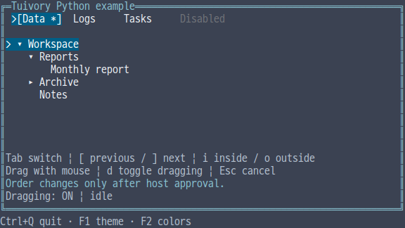
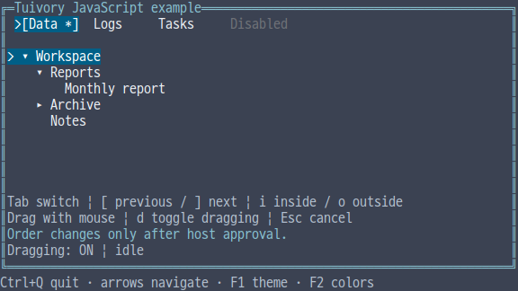
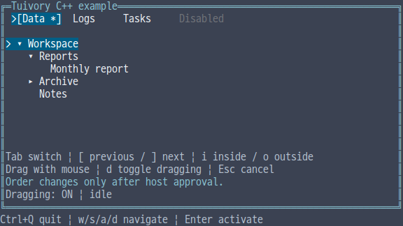

# Drag and drop APIs in independent language ports

[한국어 (기본)](language-drag.md) · **English**

Python, TypeScript/JavaScript, C, C++ and Java independently implement tree/tab move requests and drag previews. They never call another Tuivory language engine. This unreleased TVR-15/16/30/31/32 work is absent from public 0.11.1.

| Purpose | Python | TS/JS · Java | C++ | C |
| --- | --- | --- | --- | --- |
| Pointer state | DragState | DragState | DragState | TuiDragState |
| Input/options/preview | DragPointer/Options/Layout | Equivalent value types | Same names | TuiDragPointer/Options/Layout |
| Move request | DropRequest | DropRequest | DropRequest | TuiDropRequest |
| Model request/apply | request_drop, apply_drop, keyboard_drop | requestDrop, applyDrop, keyboardDrop | request_drop, apply_drop, keyboard_drop | tui_tree/tabs_request_drop, apply_drop, keyboard_drop |
| Data revision | drag_revision | dragRevision | drag_revision | tui_tree/tabs_drag_revision |

Use the existing single public import/include. Requests contain source ID, target ID, before/after/inside position and a 16-digit lowercase hexadecimal revision, avoiding JS integer precision loss. The revision detects structure/metadata changes; it is not a security signature.

## Preserve the source and obtain host approval

Request validates a move and produces a request only. Apply returns a new model without changing source data, selection, focus, scroll or expansion. The replacement carries existing state by stable ID. Tabs support before/after and reject disabled sources/targets. Trees move entire subtrees; inside appends the last child. Cycles, self moves, missing IDs, moving inside a leaf, depth above 128 and unchanged moves are rejected. Locked IDs and a host policy can further restrict requests.

Hosts recheck final permissions/business persistence and install the replacement returned by apply. Hosts own pending approval UI, approve/reject keys and global focus order. Applying an old data revision fails as stale. Hosts also recheck any business permissions changed before approval. The library never performs database/file/OS drag and drop or clipboard I/O.

    import tuivory as ui
    tabs = ui.Tabs([ui.Tab('a', 'Data'), ui.Tab('b', 'Logs')])
    request = tabs.request_drop('a', 'b', 'after')
    # Install after the host verifies permissions and persistence.
    tabs = tabs.apply_drop(request)

Keyboard previous/next targets adjacent tabs or sibling nodes. Tree inside targets the previous sibling branch, and outside moves after the parent. Hosts choose key bindings.

## Pointer routing and rendering

DragState defaults to disabled. Explicitly enable it, then pass component-local down/move/up/cancel coordinates and current width/height to pointer. Threshold zero selects the default two cells. Dragging begins when the larger horizontal/vertical displacement reaches the threshold. A sub-threshold up returns no request and an empty result so the host handles one normal click. A dragging up yields drop or reject and must not also click.

Route captured move/up events outside the component to the same state. Cancel when hidden, capture is lost or application focus changes. Draw cancels stale gestures after data/selection/layout/palette/surface/glyph changes; an unfocused draw cancels. Custom renderers use preview_layout/previewLayout and render_key/renderKey with the same invalidation rules. C exposes tui_drag_*_preview, tui_drag_render_key and view.

Auto scroll advances one item per edge move. Hover expansion previews only an allowed inside target. There are no internal timers/threads. Preview expansion and scrolling never change the source. Feedback preserves the actual background and uses bold/underline: │ for tabs, ↑/↓/↳ for trees, ! for rejection; ASCII uses |/^/v/+/!. Canvas copying/drawing repairs wide-glyph boundaries. Drag feedback never shows an editing cursor.

Policies are synchronous and may run repeatedly on move/up. Do not mutate or free the source model/DragState during a policy. Reentrant state API changes raise an exception or return TUI_INVALID. Coordinates are within ±1,000,000,000; width is 0–65,535 and height 0–4096, subject to the existing 1,000,000-cell Canvas limit. Threshold is at most 1,000,000 and locked IDs at most 65,536.

## C ownership and the integrated example

C requests, replacement models and previews require tui_drop_request_free, tui_tree/tabs_free and tui_drag_layout_free respectively. Preview tree/tabs belong to the preview; do not free/install them separately. Model metadata getters and view strings are borrowed: copy needed values before mutation/destruction. Reason is a static error code. Hosts own policy contexts. Pointer output is an owned approval request or NULL; free the request.

Python’s optional POSIX Terminal(mouse_motion=True) enables button-motion events and restores the mode on exit. Other models do not require this option.

Select --demo drag in each integrated example. Tab switches the target; [ / ] request previous/next moves, i/o move inside/outside, d toggles dragging and Esc cancels. Drag with the mouse, then y approves or r rejects. Java currently uses portable line commands followed by Enter: next, ], y, or pointer down/move/up x y. Coordinates are zero-based screen positions. Terminal adapter expansion is separate follow-up work.

Validation covers 22 shared movement cases, exact revisions, keyboard/capture, policy rechecks, stale contexts and independent previews. External C/C++ SDK consumers run ASan/UBSan and static linking; external Java17 JAR consumers inspect 24 actual ANSI feedback frames each. Bilingual theme/color/glyph PTY and installed-package evidence distinguishes local checks, CI and publication in [evidence](evidence/).

