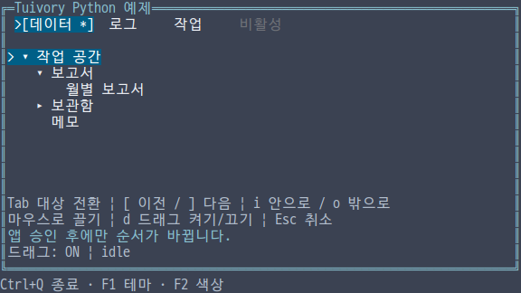
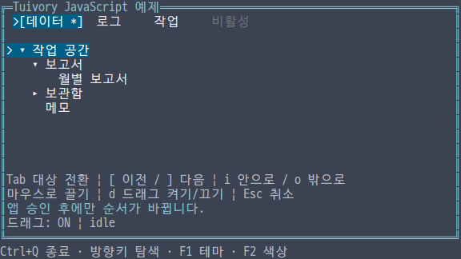
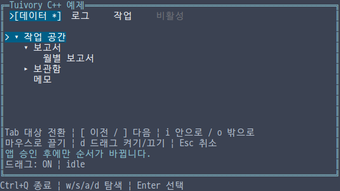
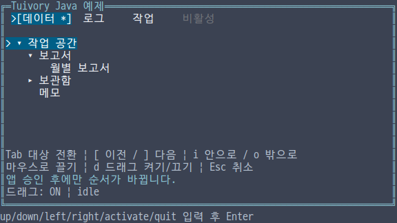

# 독립 언어의 드래그앤드롭 API

**한국어 (기본)** · [English](language-drag.en.md)

Python·TypeScript/JavaScript·C·C++·Java가 각각 트리·탭 이동 요청과 드래그 미리보기를 구현한다. 다른 언어의 Tuivory 엔진을 호출하지 않는다. TVR-15·16·30·31·32의 미배포 기능이며 공개 0.11.1에는 포함되지 않는다.

| 용도 | Python | TS/JS·Java | C++ | C |
| --- | --- | --- | --- | --- |
| 포인터 상태 | DragState | DragState | DragState | TuiDragState |
| 입력·설정·미리보기 | DragPointer/Options/Layout | 같은 이름의 값 타입 | 같은 이름 | TuiDragPointer/Options/Layout |
| 이동 요청 | DropRequest | DropRequest | DropRequest | TuiDropRequest |
| 모델 요청·적용 | request_drop, apply_drop, keyboard_drop | requestDrop, applyDrop, keyboardDrop | request_drop, apply_drop, keyboard_drop | tui_tree/tabs_request_drop, apply_drop, keyboard_drop |
| 데이터 버전 | drag_revision | dragRevision | drag_revision | tui_tree/tabs_drag_revision |

기존 공개 import/include 하나로 사용한다. 이동 요청은 source ID, target ID, before/after/inside 위치와 16자리 소문자 16진수 revision을 보관한다. JS의 정수 정밀도에 영향을 받지 않는다. 이 revision은 구조·메타데이터 변경 감지용이며 보안 서명이 아니다.

## 원본 유지와 앱 승인

request는 이동 가능 여부를 검사하고 요청만 만든다. apply는 새 모델을 반환하며 원본 데이터·선택·포커스·스크롤·펼침 상태를 변경하지 않는다. 새 모델은 안정 ID로 기존 상태를 이어받는다. 탭은 before/after를 지원하며 비활성 탭에서 시작하거나 해당 탭으로 이동할 수 없다. 트리는 하위 트리를 통째로 옮기며 inside는 대상 가지의 마지막 자식 위치다. 순환, 자기 자신, 없는 ID, 말단 노드 안으로 이동, 깊이 128 초과와 실제 변경 없는 이동을 거부한다. locked ID와 앱 정책을 추가할 수 있다.

앱은 최종 권한·업무 저장 결과를 확인하고 apply가 반환한 모델을 설치한다. 승인 대기 화면·승인/거절 키·전역 포커스 순서는 앱 책임이다. 이전 데이터 revision으로 apply하면 stale 오류를 반환한다. 승인 시 바뀐 업무 권한도 앱이 다시 검사한다. 라이브러리는 DB·파일·OS 드래그앤드롭이나 클립보드를 실행하지 않는다.

    import tuivory as ui
    tabs = ui.Tabs([ui.Tab('a', '데이터'), ui.Tab('b', '로그')])
    request = tabs.request_drop('a', 'b', 'after')
    # 앱이 권한과 저장 결과를 확인한 뒤 설치한다.
    tabs = tabs.apply_drop(request)

keyboard_drop의 previous/next는 이웃 탭·형제 노드로 이동한다. 트리의 inside는 앞 형제 가지 안으로, outside는 부모 뒤로 이동한다. 키 바인딩은 앱이 정한다.

## 포인터와 그리기

DragState는 기본 비활성이다. 명시적으로 활성화하고 pointer에 컴포넌트 내부 좌표와 down/move/up/cancel, 현재 너비·높이를 전달한다. 임계값 0은 기본 2셀이다. 가로·세로 이동 중 큰 값이 임계값 이상일 때 시작한다. 작은 클릭 후 up은 요청을 반환하지 않으며 result가 비어 있으므로 앱이 일반 클릭을 한 번 처리한다. dragging 후 up은 drop 또는 reject이며 일반 클릭을 추가하지 않는다.

캡처 중 경계 밖 move/up도 같은 상태로 전달한다. 컴포넌트 숨김·캡처 상실·앱 포커스 변경 시 cancel한다. draw는 데이터·선택 상태·배치·팔레트·바탕·문자 표시 변경을 감지하면 stale로 취소한다. 포커스가 없는 draw는 cancel한다. 사용자 정의 렌더러는 preview_layout/previewLayout과 render_key/renderKey를 사용해 같은 무효화 원칙을 적용한다. C는 tui_drag_*_preview, tui_drag_render_key와 view를 사용한다.

auto_scroll은 가장자리 move 한 번에 한 항목, hover_expand는 허용된 inside 대상만 미리 펼친다. 자체 타이머나 스레드는 만들지 않는다. 미리보기의 펼침·스크롤은 원본에 반영하지 않는다. draw는 실제 바탕색을 유지한 굵은 글씨·밑줄의 이동 표식을 그린다. 탭은 │, 트리는 ↑/↓/↳, 거부는 !이며 ASCII는 |/^/v/+/!이다. 넓은 문자의 셀 경계는 Canvas의 공통 복사·그리기로 보정한다. 편집 커서를 표시하지 않는다.

정책은 동기식이며 move와 up에 반복 호출될 수 있다. 호출 중 소스 모델·DragState를 변경하거나 해제하지 않는다. 상태 API의 재진입 변경은 예외 또는 TUI_INVALID로 거부한다. 포인터 좌표는 ±1,000,000,000, 너비 0~65,535, 높이 0~4096이며 캔버스의 기존 1,000,000셀 한계를 따른다. threshold 상한은 1,000,000, locked ID 상한은 65,536이다.

## C 소유권과 실행 예제

C의 요청·적용 모델·미리보기에는 각각 tui_drop_request_free, tui_tree/tabs_free, tui_drag_layout_free를 사용한다. 미리보기 안의 tree/tabs는 미리보기가 소유하므로 별도로 해제하거나 설치하지 않는다. 원본 모델의 metadata getter와 view의 문자열은 빌린 값이며 변경·해제 전에 필요한 내용을 복사한다. reason은 정적 오류 코드다. 정책의 컨텍스트는 앱이 관리한다. pointer의 output은 소유한 승인 요청 또는 NULL이며 해당 요청을 해제한다.

Python의 선택적 POSIX Terminal(mouse_motion=True)은 버튼을 누른 이동 이벤트를 켜고 종료 시 복원한다. 다른 모델은 이 옵션을 요구하지 않는다.

각 언어의 통합 예제에서 --demo drag를 선택한다. Tab은 대상 전환, [ / ]는 이전/다음 이동 요청, i/o는 안/밖 이동, d는 드래그 활성 전환, Esc는 취소다. 마우스로 끈 뒤 y는 앱 승인, r은 거절이다. Java의 현재 휴대용 줄 입력은 next, ], y 또는 pointer down/move/up x y 명령 뒤 Enter를 사용한다. 좌표는 화면 기준 0부터 시작한다. [선택적 raw 세션](language-terminal.md)은 별도로 제공하며 예제의 줄 입력과 구분한다.

공통 이동 사례 22개와 정확한 revision, 키보드·캡처·정책 재검사·이전 상태·미리보기 독립성을 검사한다. C/C++는 외부 SDK의 ASan/UBSan·정적 링크, Java는 외부 Java17 JAR에서 각 24개 실제 ANSI 프레임을 검사한다. 한영·테마·색상·문자 표시별 PTY와 설치한 패키지 검증 결과는 [검증 자료](evidence/)에서 로컬·CI·게시 상태를 구분한다.

