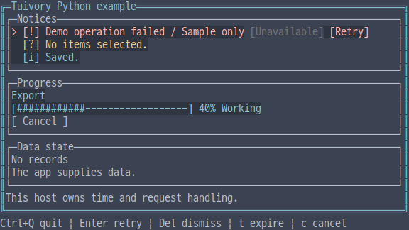
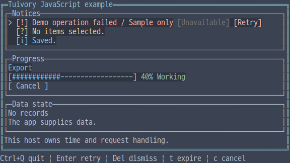
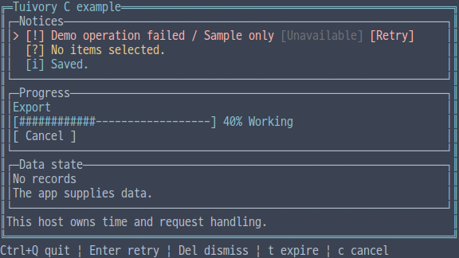
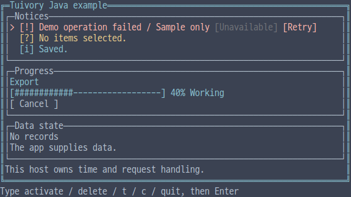

# Independent-language notices, progress and data states

[한국어 (기본)](language-feedback.md) · **English**

This TVR-15/16/30/31/32 milestone provides independent models and painting in five languages, without calling another Tuivory implementation. The unpublished Python/TS `Notices` prototype is replaced by `NoticeQueue`; public Go/Rust APIs remain unchanged. Available in 0.12.0.

## Public API

| Feature | Python | TS/JS | C | C++ | Java |
| --- | --- | --- | --- | --- | --- |
| Notice/action | `Notice/NoticeAction` | same | `TuiNotice/TuiNoticeAction` | same | same |
| Queue | `NoticeQueue(capacity=10)` | `new NoticeQueue(capacity)` | `tui_notice_queue_new` | `NoticeQueue(capacity)` | `new NoticeQueue(capacity)` |
| Source/visible | `items/visible(now)` | same | `tui_notice_queue_items/visible` | `items()/visible(now)` | same |
| Insert/replace | `push(notice)` | same | `tui_notice_queue_push` | same | same |
| Explicit dismissal/expiry | `dismiss/expire` | same | `tui_notice_queue_dismiss/expire` | same | same |
| Requests | `handle/request_action/click` | `handle/requestAction/click` | `tui_notice_queue_handle/request_action/click` | Python names | TS names |
| Rows/painting | `layout/draw` | same | `tui_notice_queue_layout/draw` | same | same |
| Progress | `Progress` | `new Progress(options)` | `TuiProgress`, `tui_progress_*` | `Progress` | `new Progress()` |
| Cancel request | `request_cancel()` | `requestCancel()` | `tui_progress_request_cancel` | Python name | TS name |
| Data state | `DataState(kind,text,detail)` | `new DataState(...)` | `TuiDataState`, `tui_data_state_*` | `DataState` | `new DataState(...)` |

Notices have a unique `id`, `text/detail`, `severity` (info/success/warning/error), `priority`, `expires_at`, `persistent` and `actions`. Actions have nonempty unique IDs, labels and disabled flags. TS/Java spell the timestamp `expiresAt`; C takes `actions/action_count`. Queue capacity is 1..65,536, with at most 1,024 actions per notice. Clocks, frames and progress quantities use **integers 0..2⁵³−1**, exactly representable in every language. Priorities are signed 32-bit integers.

## Lifetimes, requests and ownership

The queue copies notices/actions. Pushing an existing ID replaces it in place; invalid input, duplicate action IDs and rejected overflow preserve existing notices. Presentation sorts by descending severity/priority and keeps insertion order for ties. Errors, persistent notices and notices with actions cannot expire or be evicted automatically. At capacity, the least important ordinary notice may be evicted, but a more important notice cannot be displaced by a less important incoming one. Rejection raises an exception in Python/TS/C++/Java and returns `TUI_INVALID` in C.

`visible(now)` returns a filtered display snapshot without removing queue entries. `expire(now)` removes expired ordinary notices and returns `expired` events. Expiry zero means indefinite. Hosts supply monotonic timestamps in one consistent unit; the model creates no timer/thread.

`handle(action,now,height)` navigates visible candidates with `next/previous` (down/up aliases). `activate` returns a request for the first enabled action; `dismiss` returns a dismissal request. Hosts perform actual retries or call `dismiss(id)`. Direct action requests use `request_action(id,action,now)`. Events contain `kind/id/action`.

`click(x,y,now)` uses the latest layout/draw bounds. Disabled actions cannot change the parent candidate. Expired, outside and omission-summary rows cannot execute. Long rows use `~` ellipsis and action styling/hit ranges stay inside painted cells. A single row prioritizes the most important notice; additional space can show `+N`. `[!]/[?]/[+]/[i]` distinguish meaning alongside color.

Python/TS/Java source/visible results are copies; C++ `items()` is a const reference and `visible()` returns values. C item/visible arrays and queue layout rows are borrowed until the relevant mutation, next corresponding query/layout or destruction. Operation-event IDs/actions last until the relevant source mutation. Free queues with `tui_notice_queue_free`. C expiry results independently own `TuiNoticeEvents`, survive queue destruction, and use `tui_notice_events_count/at/free`.

## Progress and data states

Progress accepts `id/label/status/message/cancel_label/current/total/cancellable`; TS/Java spell `cancelLabel`. The default is loading; ready/empty/error/success/cancelled are supported. Known quantities clamp to 0..100% with a bar of at most 30 cells. Total zero uses the host's `frame` to choose one of four spinner glyphs. Cancellation requests require an ID and loading/cancellable state; they change neither work nor state. Hosts localize labels/messages and compose the screen.

`DataState(kind,text,detail)` maps ready/body, loading/info, empty/hint and error/unknown states/error. Detail uses hint. It performs no data query. `layout(width[,frame])` returns `FeedbackRow/FeedbackSpan` text, semantic roles and action ranges; `draw` paints inside the assigned area without registering a hardware cursor.

C progress/data layouts return owned `TuiFeedbackView` values, accessed/freed with `tui_feedback_count/row/draw/free`. These differ from borrowed queue-layout rows. Constructors fail with NULL; functions use `TuiResult` or event `result`. C++ uses RAII; other languages use their runtime lifetimes.

## Examples and validation

Run `--demo feedback` in each integrated example. Locale, 12-palette and Unicode/ASCII options are shared. Arrows move candidates, Enter requests retry, Delete requests dismissal, `t` advances host time by 10 units and `c` asks the host to handle cancellation. Disabled actions, retry and cancellation labels can be clicked. Java uses **line commands** `down`, `activate`, `delete`, `t`, `c`, `click x y`, `quit`, followed by Enter. Its `click` command simulates host input and is not claimed as raw mouse support.

Checks cover [shared cases](../design/feedback-cases.json), important-notice retention, overflow, expiry, request immutability, copied sources, C expiry-result lifetime, disabled clicks, grapheme action boundaries, progress/states, external SDK/JAR/wheel/npm consumers and actual PTYs. [Evidence](evidence/language-feedback-results.json) separates local checks, CI, dev and product publication.

| Language | English screen |
| --- | --- |
| Python |  |
| JavaScript |  |
| C |  |
| C++ |  |
| Java |  |

[Independent languages](languages.en.md) · [API](api/README.en.md) · [Examples](examples.en.md)
