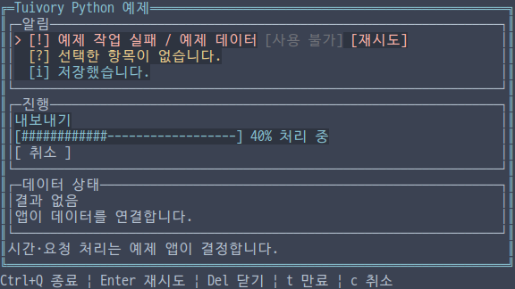
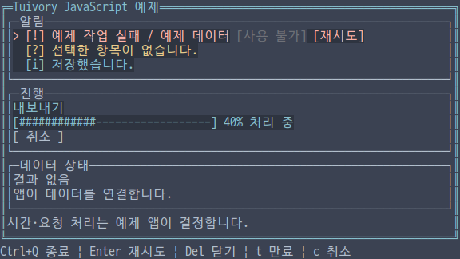
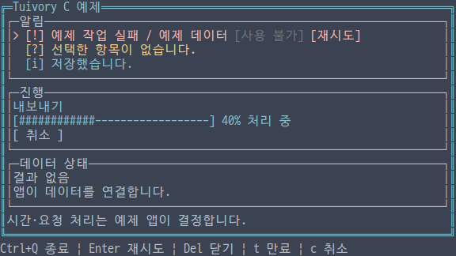
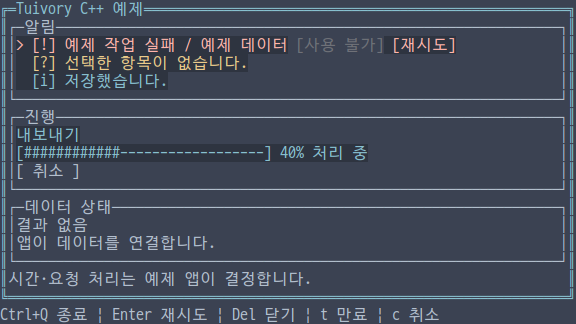
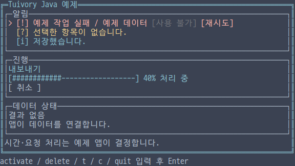

# 독립 언어 알림·진행·데이터 상태 API

**한국어 (기본)** · [English](language-feedback.en.md)

TVR-15·16·30·31·32의 미배포 구현입니다. 다섯 언어가 자체 모델·그리기를 제공하며 다른 Tuivory 언어 구현을 호출하지 않습니다. 기존 공개 0.11.1에는 포함되지 않습니다. Python/TS의 미배포 `Notices` 초안을 `NoticeQueue`로 교체하며 공개 Go/Rust API는 유지합니다.

## 공개 API

| 기능 | Python | TS/JS | C | C++ | Java |
| --- | --- | --- | --- | --- | --- |
| 알림·액션 | `Notice/NoticeAction` | 동일 | `TuiNotice/TuiNoticeAction` | 동일 | 동일 |
| 큐 | `NoticeQueue(capacity=10)` | `new NoticeQueue(capacity)` | `tui_notice_queue_new` | `NoticeQueue(capacity)` | `new NoticeQueue(capacity)` |
| 원본·표시값 | `items/visible(now)` | 동일 | `tui_notice_queue_items/visible` | `items()/visible(now)` | 동일 |
| 추가·갱신 | `push(notice)` | 동일 | `tui_notice_queue_push` | 동일 | 동일 |
| 명시적 제거·만료 | `dismiss/expire` | 동일 | `tui_notice_queue_dismiss/expire` | 동일 | 동일 |
| 요청 | `handle/request_action/click` | `handle/requestAction/click` | `tui_notice_queue_handle/request_action/click` | Python 이름 | TS 이름 |
| 행·그리기 | `layout/draw` | 동일 | `tui_notice_queue_layout/draw` | 동일 | 동일 |
| 진행 | `Progress` | `new Progress(options)` | `TuiProgress`, `tui_progress_*` | `Progress` | `new Progress()` |
| 취소 요청 | `request_cancel()` | `requestCancel()` | `tui_progress_request_cancel` | Python 이름 | TS 이름 |
| 데이터 상태 | `DataState(kind,text,detail)` | `new DataState(...)` | `TuiDataState`, `tui_data_state_*` | `DataState` | `new DataState(...)` |

알림은 고유한 `id`, `text/detail`, `severity`(info/success/warning/error), `priority`, `expires_at`, `persistent`, `actions`를 가집니다. 액션은 비어 있지 않은 고유 ID·라벨·비활성 여부입니다. TS/Java는 `expiresAt`를 사용하며 C는 `actions/action_count`를 받습니다. 큐는 1~65,536항목, 알림별 액션은 최대 1,024개입니다. 시각·프레임·진행 수량은 다섯 언어에서 정확하게 표현할 수 있는 **0~2⁵³−1의 정수**를 사용합니다. 우선순위는 부호 있는 32비트 정수입니다.

## 수명·요청·소유권

큐는 원본과 액션을 복사합니다. 같은 ID를 넣으면 제자리 갱신하며 잘못된 원본·중복 액션 ID·포화 거부는 기존 알림을 보존합니다. severity·우선순위 내림차순으로 표시하고 같은 값은 삽입 순서를 유지합니다. 오류·persistent·액션이 있는 알림은 자동 만료나 용량 확보를 위해 제거하지 않습니다. 용량이 부족하면 중요도가 가장 낮은 일반 알림부터 검토하되, 새 알림보다 중요한 알림은 밀어내지 않습니다. 거부 시 Python/TS/C++/Java는 예외, C는 `TUI_INVALID`를 반환합니다.

`visible(now)`는 만료를 적용한 표시 복사본이며 큐를 제거하지 않습니다. `expire(now)`가 만료한 일반 알림을 제거하고 `expired` 이벤트들을 반환합니다. 만료 시각 0은 무기한입니다. 앱이 같은 단위의 단조 시각을 전달하며 모델은 타이머·스레드를 만들지 않습니다.

`handle(action,now,height)`의 `next/previous`(down/up 별칭)는 표시 가능한 후보 내에서 이동합니다. `activate`는 첫 활성 액션의 `action` 요청, `dismiss`는 닫기 요청만 반환합니다. 앱이 실제 재시도나 `dismiss(id)`를 처리합니다. 직접 액션 요청은 `request_action(id,action,now)`입니다. 이벤트는 `kind/id/action`을 가집니다.

최신 `layout/draw`의 범위로 `click(x,y,now)`을 판정하며 비활성 액션은 부모 후보도 바꾸지 않습니다. 현재 시각에 만료한 행과 영역 밖·생략 안내 행도 실행하지 않습니다. 긴 행은 `~`로 생략하고 액션 스타일/클릭 범위를 실제 표시 셀 안으로 제한합니다. 높이 한 줄은 가장 중요한 알림을 우선하고 공간이 더 있으면 `+N`을 표시합니다. 색상 외에도 `[!]/[?]/[+]/[i]`로 의미를 구분합니다.

Python/TS/Java의 원본·표시값은 복사본이며 C++ `items()`는 읽기 전용 참조, `visible()`은 값 복사본입니다. C의 항목·visible 배열·큐 layout 행은 빌린 값으로 관련 변경·다음 해당 조회/배치·해제 전에만 사용합니다. 조작 이벤트의 ID/액션도 관련 원본 변경 전까지만 유효합니다. 큐는 `tui_notice_queue_free`로 해제합니다. C 만료 결과는 별도로 소유하는 `TuiNoticeEvents`이며 큐를 해제한 뒤에도 유효하고 `tui_notice_events_count/at/free`로 다룹니다.

## 진행과 데이터 상태

진행은 `id/label/status/message/cancel_label/current/total/cancellable`을 받습니다. TS/Java는 `cancelLabel`입니다. 기본 상태는 loading이며 ready/empty/error/success/cancelled를 표현합니다. 수량을 알면 0~100%로 제한하고 최대 30칸 막대를 그립니다. 전체 수량 0이면 앱의 `frame`으로 네 가지 회전 기호를 선택합니다. 취소는 ID가 있고 loading·cancellable인 경우에만 요청을 반환하며 실제 작업이나 상태를 바꾸지 않습니다. 메시지·라벨·앱 화면은 앱이 현지화합니다.

`DataState(kind,text,detail)`는 ready/body, loading/info, empty/hint, 오류·알 수 없는 상태/error를 표현하고 상세 줄은 hint로 그립니다. 데이터 조회는 하지 않습니다. `layout(width[,frame])`의 `FeedbackRow/FeedbackSpan`은 텍스트·의미별 역할·액션 위치를 제공하며 `draw`는 할당 영역 안에 출력합니다. 하드웨어 커서를 등록하지 않습니다.

C의 진행·데이터 layout은 소유하는 `TuiFeedbackView`를 반환합니다. `tui_feedback_count/row/draw/free`로 사용하고 해제합니다. 큐 layout의 빌린 행과 구분하세요. 생성 실패는 NULL, 함수 실패는 `TuiResult` 또는 이벤트 `result`로 확인합니다. C++는 RAII, 나머지는 해당 런타임의 수명을 따릅니다.

## 예제와 검증

언어별 통합 예제의 `--demo feedback`를 사용합니다. 한영·12팔레트·Unicode/ASCII 옵션은 같습니다. 방향키는 후보 이동, Enter는 재시도 요청, Delete는 명시적 닫기 요청, `t`는 앱 시각을 10단위 앞으로 이동, `c`는 앱이 취소 요청을 처리합니다. 비활성 액션·재시도·취소 라벨을 클릭할 수 있습니다. Java는 `down`, `activate`, `delete`, `t`, `c`, `click x y`, `quit`을 Enter로 실행하는 **줄 입력** 예제입니다. `click` 명령은 호스트 입력 모의이며 raw 마우스 지원을 의미하지 않습니다.

[공유 사례](../design/feedback-cases.json), 중요한 알림 유지·포화·만료·요청 불변성·원본 소유권·C 만료 결과 수명·비활성 클릭·grapheme 액션 경계·진행/상태·외부 SDK/JAR/wheel/npm과 실제 PTY를 검사합니다. [검증 기록](evidence/language-feedback-results.json)은 로컬·CI·dev·제품 게시를 구분합니다.

| 언어 | 한글 화면 |
| --- | --- |
| Python |  |
| JavaScript |  |
| C |  |
| C++ |  |
| Java |  |

[독립 언어](languages.md) · [API](api/README.md) · [예제](examples.md)
