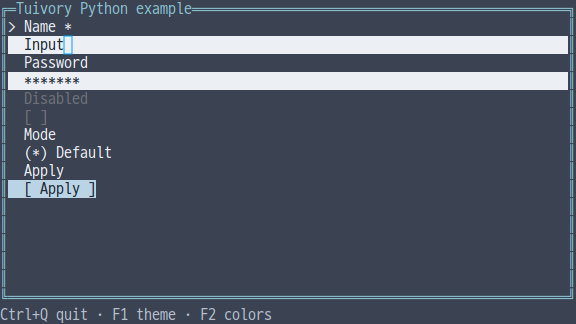
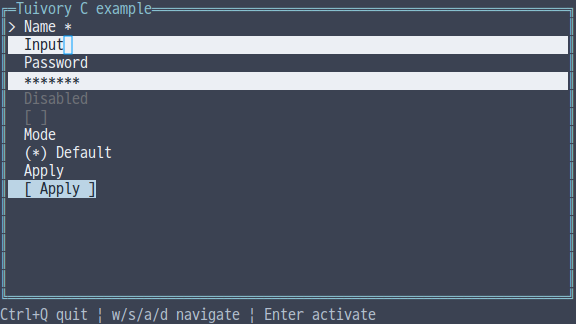
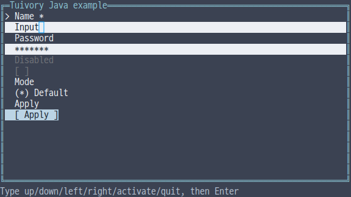

# Independent language form and control API

[한국어 (기본)](language-forms.md) · **English**

This TVR-15/16/30/31/32 milestone provides independent `Form` and `Control` models in all five languages: text, textarea, password, checkbox, radio, select, and button. No other Tuivory language engine or business runtime is required. Available in 0.12.0.

## API

| Feature | Python | TS/JS | C | C++ | Java |
| --- | --- | --- | --- | --- | --- |
| Fields/options | `Field/FormOption` | `Field/FormOption` | `TuiField/TuiFormOption` | `Field/FormOption` | `Field/FormOption` |
| Form | `Form(fields)` | `new Form(fields)` | `tui_form_new(fields,count)` | `Form(fields)` | `new Form(fields)` |
| Standalone control | `Control(field)` | `new Control(field)` | `tui_control_new(field)` | `Control(field)` | `new Control(field)` |
| Actions | `handle/click_field/click` | `handle/clickField/click` | `tui_form_handle/click_field/click` | Python names | TS names |
| Focus | `focus/at_tab_boundary` | `focus/atTabBoundary` | `tui_form_focus/at_tab_boundary` | Python names | TS names |
| State/feedback | `set_state/set_feedback` | `setState/setFeedback` | `tui_form_set_state/set_feedback` | Python names | TS names |
| Value/selection | `value/select_text` | `value/selectText` | `tui_form_value/select_text` | Python names | TS names |
| Drawing/metadata | `draw/layout` | same | `tui_form_draw/layout` | same | same |

Field `kind` is `text/textarea/password/checkbox/radio/select/button`. IDs must be nonempty and unique. Configure `label/value/help/error`, `required/checked`, `choice/options`, button `action`, and control `state`. Option IDs must also be nonempty and unique; initial `choice` must identify an actual option. Initially open selects are rejected. `textarea.height` defaults to three rows.

## Interaction and validation

`next/previous` cycle internal focus and skip disabled fields. They emit empty events; hosts use `focused` and `at_tab_boundary` to connect their own global focus order. Moving focus closes an open select. The host decides application-wide Tab behavior.

Text fields reuse [Text](language-text.en.md) selection, clipboard requests, editing and Undo/Redo. Read-only permits selection/copy, disabled blocks keyboard/pointer input, and busy blocks activation/editing. Password display is masked and events never include its raw value. Hosts explicitly call `value(id)` when submitting it. Public field `value` contains display text; radio/select IDs are in `choice`.

Checkboxes toggle with `activate/toggle`. Radio navigation skips disabled options. Selects open with `activate`; arrows change only `pending`. A second activation commits `choice`, while `cancel` preserves the previous value. `clickField(id, option)` also blocks disabled entries and follows the same rules. Coordinate `click` uses the latest layout/draw bounds and rows, ignores outside clicks, and maps input clicks to grapheme cursor positions.

Buttons return `activate` requests, or the corresponding request when `action='submit'/'cancel'`. Enter submits text fields and inserts a newline in textareas. `submit` checks required text, checkboxes and choice IDs, plus host-provided `error/invalid`, excluding disabled fields. Strings containing only Unicode whitespace count as empty. Events are `submit` or `invalid`, with missing IDs in Python/TS `data`, C `missing/missing_count`, and C++/Java `missing`. Hosts perform validation, persistence and network work and pass messages back using `setFeedback`.

## Ownership and drawing

Construction copies fields and options. C forms and standalone controls use `tui_form_free`. Field/value/event/layout pointers are borrowed until the relevant change, next layout, or destruction. Check C event `result` for errors. C++ uses values/RAII; other languages use their runtime's ownership.

`layout` provides stable field IDs, display text, semantic roles, option IDs and input-row metadata. `draw` scrolls focused fields into view and connects a real input cursor. Common palettes represent disabled color/Dim, selection, edits and errors. Text fields and buttons receive no extra disabled action marker; checkbox/radio interaction marks remain. Input text backgrounds match field surfaces. No fake cursor character is inserted.

## Examples and validation

Choose `--demo form` in each unified example. The same bilingual UI, three themes, 8/16/256/True Color and ASCII options apply. Python/JS/C/C++ use Tab, Enter and arrows; Ctrl+A and typing replace values. The Java line-input example accepts `select_all`, `insert text`, `tab`, `activate`, `down`, and `quit`, followed by Enter.

[Shared scenarios](../design/forms-cases.json) cover validation, editing, read-only, select commit/cancel, passwords, busy/disabled states, and Unicode whitespace. [Evidence](evidence/language-forms-results.json) separates external SDK/JAR/wheel/npm consumers, C/C++ ASan/UBSan, narrow rendering across 12 palettes, and actual PTY input. Physical terminal font/blink testing and product releases are separate.

[Independent languages](languages.en.md) · [API](api/README.en.md)
