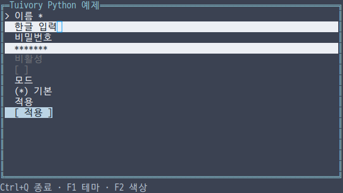
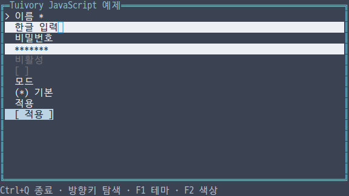
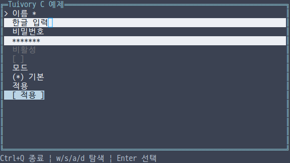
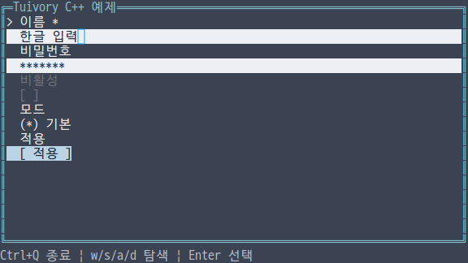
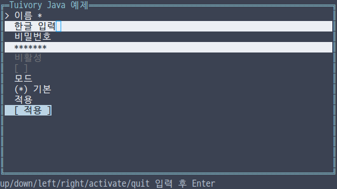

# 독립 언어 폼·컨트롤 API

**한국어 (기본)** · [English](language-forms.en.md)

TVR-15·16·30·31·32의 단계입니다. 다섯 언어가 자체 `Form`·`Control` 모델로 입력, 여러 줄 입력, 비밀번호, 체크박스, 라디오, 선택 목록과 버튼을 제공합니다. 다른 Tuivory 언어 코어나 업무 런타임에 의존하지 않습니다. 0.12.0에서 제공합니다.

## API

| 기능 | Python | TS/JS | C | C++ | Java |
| --- | --- | --- | --- | --- | --- |
| 필드·선택지 | `Field/FormOption` | `Field/FormOption` | `TuiField/TuiFormOption` | `Field/FormOption` | `Field/FormOption` |
| 폼 | `Form(fields)` | `new Form(fields)` | `tui_form_new(fields,count)` | `Form(fields)` | `new Form(fields)` |
| 독립 컨트롤 | `Control(field)` | `new Control(field)` | `tui_control_new(field)` | `Control(field)` | `new Control(field)` |
| 조작 | `handle/click_field/click` | `handle/clickField/click` | `tui_form_handle/click_field/click` | Python과 같은 이름 | TS와 같은 이름 |
| 포커스 | `focus/at_tab_boundary` | `focus/atTabBoundary` | `tui_form_focus/at_tab_boundary` | Python과 같은 이름 | TS와 같은 이름 |
| 상태·피드백 | `set_state/set_feedback` | `setState/setFeedback` | `tui_form_set_state/set_feedback` | Python과 같은 이름 | TS와 같은 이름 |
| 값·선택 | `value/select_text` | `value/selectText` | `tui_form_value/select_text` | Python과 같은 이름 | TS와 같은 이름 |
| 출력·메타데이터 | `draw/layout` | 동일 | `tui_form_draw/layout` | 동일 | 동일 |

필드의 `kind`는 `text/textarea/password/checkbox/radio/select/button`입니다. `id`는 비어 있거나 중복될 수 없습니다. `label/value/help/error`, `required/checked`, `choice/options`, 버튼 `action`, 컨트롤 `state`를 설정합니다. 선택지도 고유하고 비어 있지 않은 ID가 필요하며 초기 `choice`는 실제 선택지여야 합니다. 생성 시 열린 선택 목록은 허용하지 않습니다. `textarea.height`의 기본값은 3행입니다.

## 조작과 검증

`next/previous`는 비활성을 건너뛰며 폼 내부 포커스를 순환합니다. 이벤트는 비워 두고 `focused`와 `at_tab_boundary`로 앱의 전역 포커스 순서에 연결합니다. 포커스 이동은 열려 있는 선택 목록을 닫습니다. 앱 전체의 Tab 순서는 앱이 정합니다.

문자 필드는 [Text](language-text.md)의 선택·복사·편집·Undo/Redo를 사용합니다. 읽기 전용은 복사·선택을 허용하고, 비활성은 키·마우스, busy는 활성화·편집을 막습니다. 비밀번호 표시값은 마스킹하며 이벤트에 원문을 넣지 않습니다. 앱이 비밀번호를 제출할 때 명시적으로 `value(id)`를 호출합니다. 공개 필드의 `value`는 표시값이며 라디오/선택 목록의 선택 ID는 `choice`입니다.

체크박스는 `activate/toggle`로 바꿉니다. 라디오는 방향키로 비활성 선택지를 건너뜁니다. 선택 목록은 `activate`로 열고 방향키로 `pending`만 이동합니다. 다시 `activate`하면 `choice`에 반영하며 `cancel`은 기존 값을 보존합니다. `click_field(id, option)`도 비활성 항목을 차단하고 같은 선택 규칙을 적용합니다. 좌표 `click`은 최신 `layout/draw`의 범위와 행을 사용하며 범위 밖 클릭을 무시합니다. 입력 영역 클릭은 grapheme 커서 위치로 연결합니다.

버튼은 `activate` 요청을 반환합니다. `action='submit'/'cancel'`이면 해당 요청을 반환합니다. 문자 필드 Enter는 제출, 여러 줄 필드 Enter는 개행입니다. `submit`은 비활성을 제외하고 필수값·체크 여부·선택 ID와 앱이 설정한 `error/invalid`를 확인합니다. 필수 문자값의 Unicode 공백만 있는 문자열도 비어 있는 값으로 취급합니다. 결과는 `submit` 또는 `invalid`이며 누락 ID 목록을 제공합니다. Python/TS는 이벤트 `data`, C는 `missing/missing_count`, C++/Java는 `missing`을 사용합니다. 앱은 실제 검증·저장·네트워크 작업을 연결하고 `set_feedback`으로 오류와 도움말을 전달합니다.

## 소유권·그리기

생성자는 필드와 선택지를 복사합니다. C는 `tui_form_free`로 해제하며 standalone control도 같은 함수로 해제합니다. 필드·값·이벤트·layout 행의 포인터는 빌린 값이며 관련 변경/다음 layout 또는 해제 전에만 사용합니다. C 이벤트 `result`로 오류를 확인합니다. C++는 값과 RAII, 다른 언어는 해당 런타임의 소유권을 따릅니다.

`layout`은 안정 필드 ID, 표시 문자열, 의미별 role, 선택지 ID와 입력 행 메타데이터를 제공합니다. `draw`는 작은 화면에서 포커스 필드를 보이게 스크롤하고 실제 입력 커서를 연결합니다. 비활성 색상과 Dim, 선택·수정·오류 상태를 공통 팔레트로 표현합니다. 비활성을 위한 별도 행동 표식은 텍스트와 버튼에 붙이지 않습니다. 체크박스와 라디오는 원래의 조작 표식을 유지합니다. 입력 셀의 바탕은 필드 바탕과 맞추며 가짜 커서 문자를 넣지 않습니다.

## 예제·검증

언어별 통합 예제에서 `--demo form`을 선택합니다. 한영 UI, 세 테마, 8/16/256/True Color와 ASCII 옵션을 동일하게 제공합니다. Python/JS/C/C++는 Tab으로 필드를 옮기고 Enter와 방향키로 선택합니다. Ctrl+A와 문자 입력으로 값을 바꿀 수 있습니다. Java 줄 입력 예제는 `select_all`, `insert text`, `tab`, `activate`, `down`, `quit` 명령을 Enter로 실행합니다.

[공유 사례](../design/forms-cases.json)는 검증·편집·읽기 전용·선택 목록 확정/취소·비밀번호·busy/비활성·Unicode 공백을 검사합니다. 외부 SDK/JAR/wheel/npm 사용 앱, C/C++ ASan/UBSan, 12팔레트의 좁은 영역, 실제 PTY 입력을 [검증 기록](evidence/language-forms-results.json)에 구분해 남깁니다. 물리 터미널 글꼴·깜빡임 검증과 제품 릴리스는 별도입니다.

[독립 언어 지원](languages.md) · [API](api/README.md)
