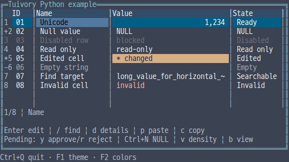
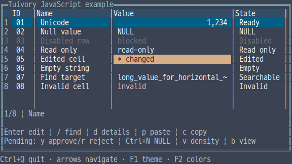
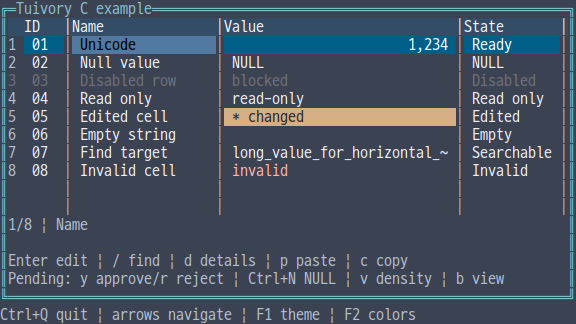
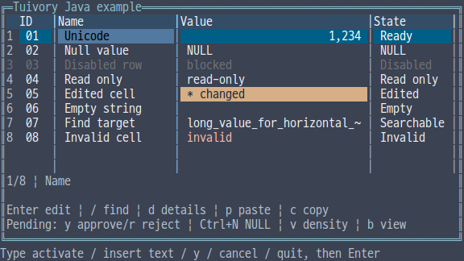

# Independent data grid APIs

[한국어 (기본)](language-grid.md) · **English**

This is unreleased work under TVR-15, TVR-16, TVR-30, TVR-31 and TVR-32. Python, TypeScript/JavaScript, C, C++ and Java each implement their own state and drawing. They never call another Tuivory language implementation. These additions are absent from public 0.11.1.

| Purpose | Python | TS/JS | C | C++ | Java |
| --- | --- | --- | --- | --- | --- |
| Model, columns, rows | Grid, Column, Record | Same names | TuiGrid, TuiGridColumn/Record/Cell | Grid, GridColumn/Record | Grid, GridColumn/Record |
| Owned memory data | MemoryRows | MemoryRows | tui_grid_new/set_rows | MemoryRows | MemoryRows |
| Virtual source | GridSource len/row/index_of | length/row/indexOf | TuiGridSource callbacks | GridSource size/row/index_of | GridSource size/row/indexOf |
| Presentation | GridOptions, GridColumnOptions | Same names | TuiGridOptions/ColumnOptions | Same names | Same names |
| Cell display/state | GridCellInfo | GridCellInfo | TuiGridCellInfo | GridCellInfo | GridCellInfo |
| Display labels | GridLabels | GridLabels | TuiGridLabels | GridLabels | GridLabels |
| Selection range | GridRange | GridRange | TuiGridRange | GridRange | GridRange |
| Edit options/value | GridEditOptions, GridValue | Same names as value types | TuiGridEditOptions/Value | Same names | Same names |

Use the existing single public import/include alongside the collections, documents and palette. No additional framework or foreign-language engine is needed. TypeScript produces JavaScript and declarations together.

## Data and host responsibilities

Column IDs and row IDs must each be nonempty and unique. Memory sources copy their inputs: changing an original list or map does not alter grid data. Virtual sources provide a count, an indexed row and reverse ID lookup. The grid reads the needed rows and checks that returned IDs and reverse indices agree. Valid current cells and range selections survive source replacement by stable ID.

Python uses strings or None; TS/JS and Java use strings or null; C++ uses optional<string>; C uses text plus is_null. This distinguishes NULL from an empty string. GridCellInfo supplies display text, numeric alignment and NULL presentation without changing raw data or approval payloads. Row, cell and provider states combine: an empty cell state cannot clear a disabled or read-only row. Disabled rows reject navigation, clicks and editing; read-only rows still allow selection, copying and details.

Source, display and preparation callbacks are synchronous and may run repeatedly. Return consistent data and do not mutate or free the grid inside a callback. Reentrant mutation raises an exception or returns TUI_INVALID. C callback contexts remain host-owned until replacement/free. C++ retains a shared_ptr<const GridSource>. Returned rows, display information and prepared values are copied before subsequent callbacks. Notify the grid through set_rows/set_source equivalents when source order or count changes.

The host owns sorting, filtering, server search, paging, database writes, clipboard transport and application-wide focus order. The library provides requests, internal navigation/drawing and search over loaded cells. A click on an old virtual-source frame is rejected if the row ID now differs from the ID actually drawn there.

## Host-approved editing

    import tuivory as ui
    grid = ui.Grid(
        [ui.Column('name', 'Name', 18, True)],
        [ui.Record('r1', {'name': 'Original'})])
    grid.set_edit_options(ui.GridEditOptions(
        enabled=True, start_typing=True, allow_null=True))
    grid.begin_edit()
    grid.handle('select_all')
    grid.handle('insert', text='New value')
    request = grid.handle('submit')
    # The host checks permissions and persistence, then supplies approved data.
    grid.resolve_edit(request.data['id'],
        rows=[ui.Record('r1', {'name': 'New value'})])

begin_edit/beginEdit opens an internal Text buffer. prepare receives a row and column and returns a prepared GridValue or denies editing. Python/TS also accept the bool callbacks from their unpublished prototypes; new code should return a value or None/null. First-character replacement, NULL toggling, movement, selection, copy/cut and undo/redo use Text behavior. Next/previous submissions move to another editable cell after approval.

submit/activate/next/previous issue a fresh request ID and enter pending state. The source remains unchanged until the host supplies approved data. Pending edits block further changes and hide the actual terminal cursor. Rejecting with an error retains the buffer, and retry gets a different request ID. Old IDs, responses predating source replacement and responses with changed permissions are rejected. Invalid replacement sources preserve pending work.

Python uses Event.data and resolve_edit(id, error=..., rows=...); TS uses Event.data and resolveEdit(id, error, rows). C++/Java use GridEvent and resolve_edit/resolveEdit. C uses tui_grid_handle, tui_grid_edit_session, tui_grid_edit_buffer and tui_grid_resolve_edit. Optional C/C++/Java approval sources are checked before installation. Successful approval without replacement data simply ends the request.

The hardware cursor is registered after final cell painting. It is absent for non-editable, pending, NULL, unfocused or clipped editors. CJK, emoji and combining clusters scroll as complete graphemes. No fake | cursor is inserted; a literal | remains ordinary source text.

## Paste, copy, search and details

parse_grid_tsv/parseGridTSV and C tui_grid_parse_tsv parse quoted TSV. Quoted tabs/newlines, doubled quotes, CRLF and empty cells survive. Blank physical rows are skipped. Unclosed quotes, text after a closing quote and ragged rows are rejected. A standalone CR remains raw text.

Python/TS paste, C++/Java request_paste/requestPaste and C tui_grid_request_paste validate the entire target rectangle, edit permissions and preparation callbacks before requesting changes. The default limit is 10,000 cells, with a maximum of 1,000,000 cells and 16MiB input. One failure rejects the complete batch; approval rechecks permissions. NULL marker conversion is explicit. No database transaction runs inside the library: the host approves persistence and supplies new data.

GridRange holds anchor/end row and column IDs. Copy a cell, row or rectangle as quoted TSV with a configurable cell limit and a 16MiB total raw-text budget. Default copying uses raw values; display selects formatted values. The NULL transport string is a separate argument. The OS clipboard is never modified automatically.

find searches loaded, visible columns circularly after the current cell. Reverse direction, case sensitivity and display-value matching are optional. It examines up to 100,000 cells by default, capped at 1,000,000. Case-insensitive search uses fixed Unicode17 full case folding. details returns the current raw value in a read-only TextDocument; the host decides its panel/popup placement and dismissal.

request with sort/filter/search/next/previous returns a revision. apply_source/applySource accepts the latest response once and rejects stale search/page results. Rendered sort state is set through C tui_grid_set_sort or the other models' sort fields.

## Layout, state and ownership

The simple/data presets support compact/normal/comfortable density. Configure row numbers, separators, stripes, headers/status rows, cell/row highlighting, edited markers and input-path restrictions. Disabled cells retain Dim across all themes/color depths and block their actions.

Columns support pinning, hiding, ordering, min/max widths, alignment, automatic fitting, expansion weights and ellipsis/clipping/horizontal scrolling. Automatic fitting samples at most 256 visible rows and 100,000 cells without modifying configured widths or pending edits. Explicit auto_fit_column/autoFitColumn and resize_column/resizeColumn are also available. geometry returns actual column allocations used for painting and hit testing.

GridLabels configures NULL/loading/empty/range/more text. Examples provide localized Korean and English UI. Labels and values stay literal and never become markup. Status rows prioritize errors and allow the remaining fields to be reordered.

save_view/saveView and restore_view/restoreView preserve column order/width/pin/visibility/options, current/scroll IDs, sort/filter and range selection. Invalid restoration preserves state and pending edits. File formats and persistence belong to the host. C TuiGridViewState and TuiGridGeometry are independently owned snapshots with matching free functions. C sessions, pending requests, events, options and labels are borrowed from the grid; copy needed IDs/values before mutation. The caller frees details documents and copied strings.

Limits: 65,536 columns; widths 1–4096; up to 1,000,000,000 rows; layout width 0–65535 and height 0–4096. Canvas retains its 1,000,000-cell allocation limit. IDs/labels allow up to 1,000,000 UTF-8 bytes and raw cell values up to 16MiB. Internal searches for enabled rows or the next editable cell inspect at most 100,000 candidates.

## Integrated examples and verification

Choose --demo grid in each language's single integrated example. Enter edits, / opens search, d shows raw details, p requests quoted TSV, c copies, v changes density and b saves/restores a view. After submission, y approves through the host, r rejects and Esc cancels. Ctrl+N toggles NULL. Java line mode accepts commands such as activate, insert text, null, y and cancel followed by Enter. F1/F2 and terminal lifetime are controlled by each example host.

Verification covers 14 shared TSV cases, 11 cursor cases, approval/permission checks, callback reentry, stale clicks/responses, virtual sources and view state. External C/C++ SDKs pass ASan/UBSan and static linking; the external Java17 JAR checks 23 actual ANSI frames. Theme/color/glyph PTY checks and package results are recorded in [evidence](evidence/) and [examples](examples.en.md). Local checks are distinguished from GitHub CI and publication.

## Actual example screens

