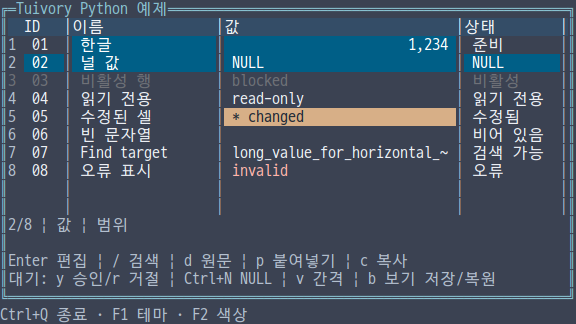
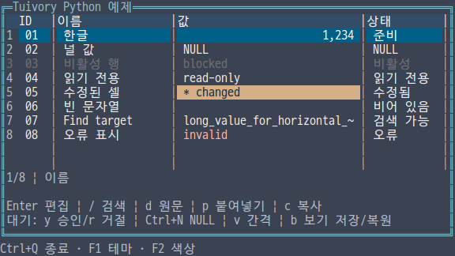
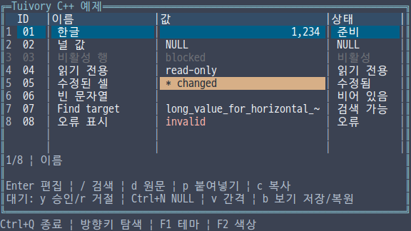
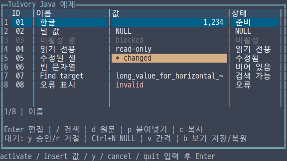

# 독립 언어의 데이터 그리드 API

**한국어 (기본)** · [English](language-grid.en.md)

TVR-15·16·30·31·32의 기능이다. Python·TypeScript/JavaScript·C·C++·Java가 각자 데이터를 처리하고 그린다. 다른 Tuivory 언어 구현을 호출하지 않는다. 0.12.0에서 제공합니다.

| 용도 | Python | TS/JS | C | C++ | Java |
| --- | --- | --- | --- | --- | --- |
| 모델·열·행 | Grid, Column, Record | 같은 이름 | TuiGrid, TuiGridColumn/Record/Cell | Grid, GridColumn/Record | Grid, GridColumn/Record |
| 복사한 메모리 데이터 | MemoryRows | MemoryRows | tui_grid_new/set_rows | MemoryRows | MemoryRows |
| 가상 데이터 | GridSource의 len/row/index_of | length/row/indexOf | TuiGridSource 콜백 | GridSource의 size/row/index_of | GridSource의 size/row/indexOf |
| 표현 설정 | GridOptions, GridColumnOptions | 같은 이름 | TuiGridOptions/ColumnOptions | 같은 이름 | 같은 이름 |
| 셀 표시·상태 | GridCellInfo | GridCellInfo | TuiGridCellInfo | GridCellInfo | GridCellInfo |
| 표시 문구 | GridLabels | GridLabels | TuiGridLabels | GridLabels | GridLabels |
| 선택 범위 | GridRange | GridRange | TuiGridRange | GridRange | GridRange |
| 편집 설정·값 | GridEditOptions, GridValue | 같은 이름의 값 타입 | TuiGridEditOptions/Value | 같은 이름 | 같은 이름 |

모두 기존의 공개 import/include 하나로 사용한다. 컬렉션·문서·팔레트와 함께 가져오며 별도 프레임워크나 다른 언어 엔진을 설치하지 않는다. TS에서 JavaScript와 타입 선언을 함께 생성한다.

그리드 헤더는 구분선과 빈칸까지 행 전체에 `grid.header`를 적용합니다. 다크 테마는 청회색, 라이트 테마는 옅은 청색, 흑백은 반전으로 구분합니다. 다크·라이트의 8·16색에서는 보라색을 사용합니다. 본문 행의 선택·편집 스타일은 그대로 사용합니다.

## 데이터와 앱의 책임

열·행 ID는 비어 있지 않고 각각 고유해야 한다. 메모리 데이터는 입력을 복사하므로 원래 목록·맵을 바꿔도 그리드 데이터가 바뀌지 않는다. 가상 데이터는 개수, 인덱스의 행, ID의 인덱스를 제공한다. 그리드는 필요한 행을 읽으며 반환 ID와 역방향 인덱스가 일치하는지 검사한다. 데이터 교체 후에도 현재 행·열과 유효한 범위 선택은 ID로 유지한다.

Python은 문자열 또는 None, TS/JS와 Java는 문자열 또는 null, C++는 optional<string>, C는 text와 is_null로 NULL과 빈 문자열을 구분한다. 표시용 문자열·숫자 정렬·NULL 표시는 GridCellInfo로 추가한다. 표시 포맷은 원본 값과 승인 요청을 바꾸지 않는다. 행 상태·셀 상태·표시 콜백의 상태를 합치므로 셀에서 빈 상태를 반환해도 행의 비활성·읽기 전용을 해제할 수 없다. 비활성 행은 탐색·클릭·편집에서 제외하고, 읽기 전용 행은 선택·복사·상세 보기를 허용한다.

가상 데이터와 표시·편집 준비 콜백은 동기식이며 반복 호출될 수 있다. 콜백은 일관된 데이터를 반환하고 호출 중 그리드를 변경하거나 해제하지 않는다. 재진입 변경은 예외 또는 TUI_INVALID로 거부한다. C의 콜백 컨텍스트는 교체·해제까지 앱이 보관한다. C++는 shared_ptr<const GridSource>로 소스 수명을 유지한다. 반환 행·표시·준비 값은 다음 콜백 전에 복사한다. 데이터 순서나 개수가 바뀌면 set_rows/set_source 계열로 알린다.

정렬·필터·서버 검색·페이지 이동·DB 저장·클립보드 전달·앱의 전체 포커스 순서는 앱 책임이다. 라이브러리는 요청, 그리드 내부 탐색·그리기와 로드된 셀 검색을 제공한다. 변경된 가상 데이터의 이전 화면을 클릭하면 당시 그린 행 ID와 현재 ID가 다른 위치는 거부한다.

## 포인터와 범위 선택

Python·TS/JS·C++·Java는 `pointer(action, x, y, width, height, extend)`, C는 `tui_grid_pointer`를 사용한다. 좌표는 마지막으로 그린 그리드의 왼쪽 위 기준이다. `down`, `move`, `up`, `cancel`을 전달하고, `pointer_captured` / `pointerCaptured` / `tui_grid_pointer_captured`가 참이면 영역 밖의 이동과 놓기도 그리드에 전달한다. 호스트에서 대화상자를 열거나 입력 대상을 바꿀 때는 `cancel`로 캡처를 해제한다. 이전 위치나 데이터에 해당하는 입력은 적용하지 않는다.

- 셀 드래그는 사각 범위를, 행 번호 영역의 드래그는 전체 행을 선택한다. `extend`와 `select_up/down/left/right/home/end/page_up/page_down`은 기존 선택 기준점을 유지한다.
- 표시된 헤더 구분선 드래그는 설정된 최소·최대 안에서 열 너비를 조절한다. 헤더 본문 드래그는 같은 고정 영역 안에서 순서를 바꾼다. 이동하지 않은 헤더는 놓을 때 `sort_request`를 한 번 보낸다. `down`과 `up` 뒤에 별도 `click`을 중복 전달하지 않는다.
- 직접 `click`, `double`, `wheel_up/down/left/right`도 지원한다. 편집기에서 포인터로 선택할 때 넓은 문자와 결합 문자를 통째로 선택하며 하드웨어 커서는 그대로 사용한다. 비활성 셀과 승인 대기 중인 편집기는 조작하지 않는다.

C의 `tui_grid_selection`과 `tui_grid_columns`는 그리드가 소유한 값이다. 상태를 바꾸기 전에 필요한 값을 복사한다. 기존 `click` 메서드는 그대로 사용할 수 있다.

## 앱 승인형 편집

    import tuivory as ui
    grid = ui.Grid(
        [ui.Column('name', '이름', 18, True)],
        [ui.Record('r1', {'name': '한글'})])
    grid.set_edit_options(ui.GridEditOptions(
        enabled=True, start_typing=True, allow_null=True))
    grid.begin_edit()
    grid.handle('select_all')
    grid.handle('insert', text='새 값')
    request = grid.handle('submit')
    # 앱이 권한·저장 결과를 확인한 뒤 새 데이터로 승인한다.
    grid.resolve_edit(request.data['id'],
        rows=[ui.Record('r1', {'name': '새 값'})])

begin_edit/beginEdit는 내부 Text 버퍼를 연다. prepare는 원본 행·열을 받아 준비한 GridValue를 반환하거나 편집을 거절한다. Python/TS의 미배포 초안에서 사용한 bool 콜백도 허용하지만 새 코드에서는 값 또는 None/null을 사용한다. 첫 입력 교체, NULL 전환, 이동·선택·복사·잘라내기·실행 취소·다시 실행은 기존 Text 동작을 사용한다. 다음/이전 셀 제출은 승인 후 편집 가능한 셀로 이동한다.

submit/activate/next/previous는 새 요청 번호를 발급하고 pending으로 전환한다. 승인 전에는 소스 데이터를 변경하지 않는다. pending 중 추가 편집을 막고 실제 터미널 커서를 숨긴다. 오류 메시지로 거절하면 편집 버퍼를 유지하며, 재제출에는 다른 요청 번호를 쓴다. 이전 번호·데이터 교체 전 번호·변경된 권한에 대한 응답은 거부한다. 새 소스가 잘못된 경우에도 대기 중 요청을 보존한다.

Python은 handle의 Event.data와 resolve_edit(id, error=..., rows=...), TS는 handle의 Event.data와 resolveEdit(id, error, rows), C++·Java는 GridEvent와 resolve_edit/resolveEdit를 사용한다. C는 tui_grid_handle, tui_grid_edit_session, tui_grid_edit_buffer, tui_grid_resolve_edit를 사용한다. C++·Java·C의 선택적 승인 소스는 먼저 검사한 뒤 반영한다. 오류 없는 승인에 새 데이터가 없으면 요청만 끝낸다.

실제 커서는 최종 셀 그리기 뒤 등록한다. 편집할 수 없는 셀, pending, NULL, 포커스 없음·잘린 영역에는 커서를 표시하지 않는다. 한글·CJK·이모지·결합 문자를 통째로 스크롤하며 화면에 | 같은 가짜 커서를 삽입하지 않는다. 원문에 있는 |는 일반 문자다.

## 붙여넣기·복사·검색·상세 보기

parse_grid_tsv/parseGridTSV와 C의 tui_grid_parse_tsv는 인용 TSV를 처리한다. 탭·줄바꿈을 포함한 인용 셀, 두 번 쓴 따옴표, CRLF와 빈 셀을 보존한다. 빈 물리적 줄은 건너뛰고, 불완전한 따옴표·인용 뒤의 문자·들쭉날쭉한 행은 거부한다. 단독 CR은 원문으로 유지한다.

Python/TS의 paste, C++·Java의 request_paste/requestPaste, C의 tui_grid_request_paste는 모든 대상의 범위·수정 가능 상태·prepare를 검사하고 변경 목록을 요청한다. 기본 10,000셀, 최대 1,000,000셀·입력 16MiB다. 한 셀이라도 실패하면 전체를 거부하며 승인 시 권한을 다시 검사한다. NULL 표식 해석은 명시적으로 켠다. 이 요청은 DB 트랜잭션을 실행하지 않는다. 앱이 저장을 승인한 새 데이터를 제공한다.

GridRange는 앵커·끝의 행/열 ID를 가진다. 셀·행·사각 범위를 인용 TSV로 복사하며 복사 셀 수와 원문 합계 16MiB를 제한한다. 기본 복사는 원본, display 선택은 표시 값을 사용한다. NULL 전송 문자열은 별도 인자로 정한다. OS 클립보드를 자동 변경하지 않는다.

find는 로드된 보이는 열을 현재 셀 다음부터 순환 검색한다. 역방향, 대소문자 구분과 표시 값 검색을 선택한다. 기본 최대 100,000셀, 상한 1,000,000셀이다. 대소문자를 구분하지 않으면 고정 Unicode17 전체 case folding을 사용한다. details는 현재 원문을 읽기 전용 TextDocument로 반환한다. 앱이 상세 패널·팝업의 배치와 닫기를 정한다.

request의 sort/filter/search/next/previous는 요청 revision을 반환한다. apply_source/applySource는 최신 요청 결과를 한 번만 반영하고 이전 검색·페이지 응답을 거부한다. 보이는 정렬 상태는 C의 tui_grid_set_sort 또는 다른 언어 모델의 sort 필드로 설정한다.

## 배치·상태·수명

simple/data 프리셋과 compact/normal/comfortable 간격을 제공한다. 행 번호, 구분선, 줄무늬, 헤더·상태줄, 셀·행 선택, 수정 표식·각 입력 경로 차단을 설정한다. 비활성 스타일은 모든 테마·색상 수에서 Dim을 유지하고 해당 셀의 액션을 막는다.

열은 고정·숨김·순서·최소/최대 너비·정렬·자동 너비·확장 비율·말줄임/클리핑/가로 스크롤을 설정한다. 자동 너비는 현재 창의 최대 256행·100,000셀을 샘플링하며 원래 설정 너비나 편집 요청을 바꾸지 않는다. 명시적 auto_fit_column/autoFitColumn과 resize_column/resizeColumn도 제공한다. geometry는 배치와 클릭에 사용하는 실제 열 위치를 반환한다.

GridLabels로 NULL·로딩·빈 데이터·범위·추가 데이터 문구를 설정한다. 예제는 한영 UI를 각각 제공한다. 문구·셀 값은 리터럴이며 마크업으로 해석하지 않는다. 상태줄은 오류를 우선하고 나머지 항목의 순서를 설정한다.

save_view/saveView와 restore_view/restoreView는 열 순서·너비·고정·숨김·열 옵션, 현재/스크롤 ID, 정렬·필터·범위 선택을 보관·복원한다. 잘못된 복원은 기존 상태와 편집 요청을 보존한다. 파일 형식과 영속 저장은 앱이 정한다. C의 TuiGridViewState와 TuiGridGeometry는 별도로 소유한 스냅샷이며 해당 free로 해제한다. C의 세션·대기 요청·이벤트·설정·라벨은 그리드가 보관하는 빌린 값이다. 변경 전에 필요한 ID·값을 복사한다. details와 copy 문자열은 호출자가 해제한다.

열 최대 65,536개, 열 너비 1~4096, 행 개수 최대 1,000,000,000, 배치 너비 0~65535·높이 0~4096이다. 캔버스는 기존 1,000,000셀 한계를 따른다. ID·레이블은 UTF-8 최대 1,000,000바이트, 셀 원문은 최대 16MiB다. 비활성 행·다음 편집 셀을 찾는 내부 탐색은 최대 100,000개 후보로 제한한다.

## 실행 예제와 검증

언어별 통합 예제에서 --demo grid를 선택한다. Enter 편집, / 검색, d 원문, p 인용 TSV, c 복사, v 간격, b 보기 저장/복원을 제공한다. 제출 후 y는 앱 승인, r은 거절, Esc는 취소다. Ctrl+N은 NULL 전환이다. Java 줄 입력에서는 activate, insert 값, null, y, cancel 같은 명령 후 Enter를 사용한다. F1·F2와 앱 수명은 각 예제 호스트의 조작이다.

공통 TSV 14개와 커서 11개 사례, 승인·권한·콜백 재진입·이전 클릭·이전 응답·가상 데이터·보기 상태를 검사한다. C/C++ 외부 SDK의 ASan/UBSan·정적 링크와 Java17 외부 JAR에서 실제 ANSI 23개 프레임을 확인한다. 테마·색상·표시별 PTY 검증과 패키지 결과는 [검증 자료](evidence/)와 [예제](examples.md)에 기록한다. 로컬 검사와 GitHub CI·게시 상태를 구분한다.

셀이나 행 번호를 드래그해 범위를 선택하고 Shift+방향키로 늘린다. 헤더 구분선과 제목도 각각 드래그해 볼 수 있다. Java 예제는 그리드 안의 0부터 시작하는 좌표로 `pointer down|move|up X Y [extend]`를 입력하거나 `select_down` 등 선택 명령을 사용한다. PTY에서 범위 선택과 영역 밖 놓기, 열 크기·순서 변경, 정렬 요청을 검사한다. SDK에서는 만료된 캡처와 실제 ANSI 선택색·커서 위치도 확인한다.

[그리드 포인터 로컬 검증 기록](evidence/language-grid-pointer-results.json)에 240개 터미널 조합과 격리 패키지 검증을 남겼다.

## 실제 예제 화면

