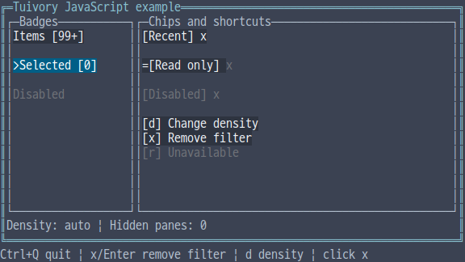
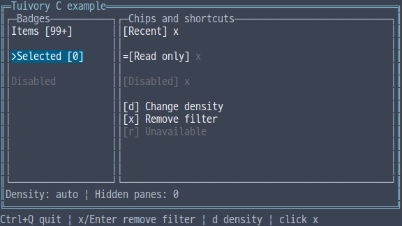
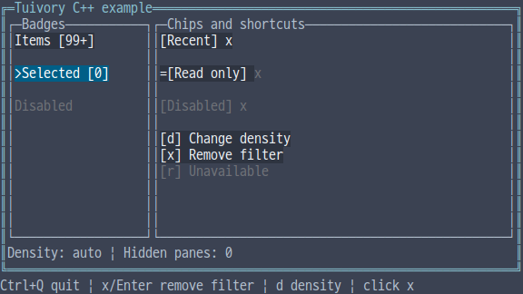
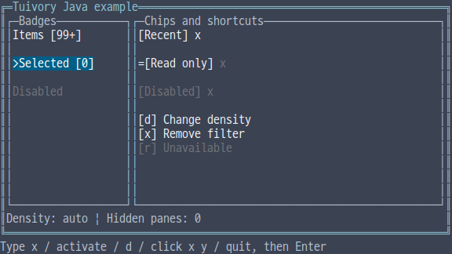

# Independent-language spacing, stacks, badges, chips and shortcut hints

[한국어 (기본)](language-layout.md) · **English**

This unreleased TVR-15/16/30/31/32 milestone implements the same cell-layout principles and supporting components in five independent languages, without calling another Tuivory implementation. Published 0.11.1 stays unchanged. This step covers **stacks/drawer placement and badges/chips/hints**. Full row/column/grid/layer execution, virtual viewports and popup/dialog composition remain later milestones.

## API

| Feature | Python | TS/JS | C | C++ | Java |
| --- | --- | --- | --- | --- | --- |
| Spacing | `SpacingTokens.for_width` | `SpacingTokens.forWidth` | `tui_spacing_tokens` | `SpacingTokens::for_width` | `SpacingTokens.forWidth` |
| Inset | `inset_rect` | `insetRect` | `tui_rect_inset` | `inset_rect` | `insetRect` |
| Stack | `StackItem`, `stack_layout` | `StackItem`, `stackLayout` | `TuiStackItem`, `tui_stack_layout` | `StackItem`, `stack_layout` | `StackItem`, `stackLayout` |
| Rectangles | `stack_rects` | `stackRects` | `tui_stack_rects` | `stack_rects` | `stackRects` |
| Drawer placement | `drawer_layout` | `drawerLayout` | `tui_drawer_layout` | `drawer_layout` | `drawerLayout` |
| Badge | `Badge` | `new Badge(options)` | `TuiBadge`, `tui_badge_*` | `Badge` | `new Badge()` |
| Chip | `Chip` | `new Chip(options)` | `TuiChip`, `tui_chip_*` | `Chip` | `new Chip()` |
| Removal request | `request_remove` | `requestRemove` | `tui_chip_request_remove` | `request_remove` | `requestRemove` |
| Hints | `Shortcut`, `Help(items)` | `Shortcut`, `new Help(items)` | `TuiShortcut`, `tui_help_new` | `Shortcut`, `Help(items)` | `Shortcut`, `new Help(items)` |

## Spacing and geometry

`for_width(density,columns)` accepts auto/compact/comfortable. Auto chooses compact below 80 columns. Compact uses gap 0, padding 0, control_gap 1; comfortable uses 2, 1, 2. Values match the [shared data](../design/layout-tokens.json). TS/Java spell `controlGap/compactBelow`. The host chooses which allocation width to use.

`StackItem` has a nonempty unique `id`, positive `min`, `preferred` and `weight`. Stacks allocate minima, satisfy preferred sizes in order and distribute remaining cells by weight. Integer remainders go from the front. Under pressure, gaps disappear first and the first item may shrink. Later items whose minima do not fit are hidden, while smaller following items can still fit. Preferred input sizes are preserved.

`StackResult` returns every ID's `slots(id,start,size)`, `hidden` IDs and actual `gap`. Hidden slots have size zero. `stack_rects(parent,items,tokens,vertical)` returns `LayoutResult(rects,hidden)`. `NamedRect` has `id/rect`; horizontal/vertical allocation applies padding first. Python makes vertical keyword-only. `inset_rect` avoids negative sizes in tiny allocations.

Coordinates, dimensions and total stack extent are 0..10⁹; gap/padding are 0..1,024; at most 1,024 items are allowed. Minima, preferences and weights are at most 10⁶. Invalid IDs, negatives, duplicates and excessive values are rejected. `drawer_layout(parent,preferred,min_content)` returns a parent-clamped rect and `overlay`: true when the requested drawer plus minimum content cannot fit. Hosts own actual drawer content, visibility and focus.

## Supporting components

Badges accept `id/label/count/limit/state`. Missing count differs from zero: zero displays `[0]`. Counts above the limit display `[99+]`; limit zero uses the default 99. Count/limit are integers 0..2⁵³−1. C uses `has_count`. State uses existing `ControlState`, C `TuiState` or C++/Java `State`.

Chips accept label/state/`removable`. `line(width)` clips `[label] x` by cell width and exposes a removal range only when x is painted. Disabled, read-only and busy states block removal requests and style that x as disabled. `request_remove()` returns only `remove` plus ID; it changes neither the component nor the application's list. No automatic disabled `-` marker is added.

`Help` copies literal key labels, descriptions, priorities and disabled flags. Highest priority comes first; spare space can show `+N` omissions. One row prioritizes the most important hint. Empty/duplicate keys are rejected using whitespace trimming and shared Unicode17 full case folding, without character normalization. **Hosts own actual bindings, global keys and context-dependent hint contents.** Painting a disabled hint does not modify the host's key handling.

Badge/chip `line` and Help `layout` use shared `FeedbackRow/FeedbackSpan` values. `draw` paints those rows without registering a hardware cursor. Selected/edited backgrounds remain explicit; unavailable actions use the disabled role.

## Ownership and examples

Geometry functions preserve their sources. C stack results use `tui_stack_slot_count/at`, `tui_stack_hidden_count/at`, `tui_stack_gap/free`. Rectangle results use `tui_layout_rect_count/at`, `tui_layout_hidden_count/at/free` and own their IDs. Badge/chip lines and Help layouts own `TuiFeedbackView` objects freed with `tui_feedback_free`. Free Help with `tui_help_free`. Chip-request IDs are borrowed for the source lifetime. Functions report `TuiResult`; constructors fail with NULL. C++ uses values/RAII; other languages use runtime lifetimes.

Run integrated `--demo layout`. The host handles `d` density changes and removal through `x`/Enter or an enabled x click. Disabled/read-only x targets do nothing. Java uses line commands `d`, `x`, `activate`, `click x y`, `quit`, followed by Enter; `click` simulates host input. Four raw examples are checked after actual 40-column resizing; Java narrow bounds are checked through the geometry API. The Java line example has fixed dimensions; a general TTY adapter is a later milestone.

Checks cover [shared cases](../design/layout-cases.json), weighted remainders, skipped middle items, tiny bounds, source retention, Unicode hint keys, states, host-handled removal, external SDK/JAR/wheel/npm consumers and actual PTYs. [Evidence](evidence/language-layout-results.json) separates local checks, CI, dev and product publication.

| Language | English screen |
| --- | --- |
| Python |  |
| JavaScript |  |
| C |  |
| C++ |  |
| Java |  |

[Independent languages](languages.en.md) · [API](api/README.en.md) · [Examples](examples.en.md)
