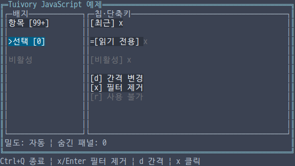
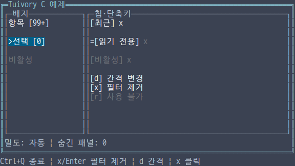
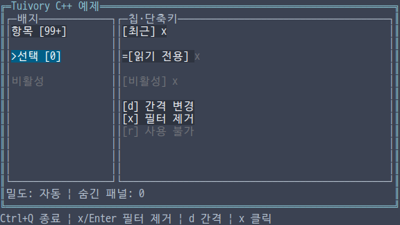
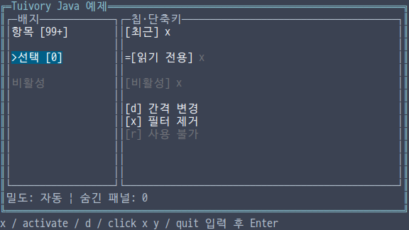

# 독립 언어 간격·스택 배치·배지·칩·단축키 안내

**한국어 (기본)** · [English](language-layout.en.md)

TVR-15·16·30·31·32의 미배포 구현입니다. 다섯 언어가 같은 셀 단위 배치 원칙과 보조 컴포넌트를 직접 구현합니다. 다른 Tuivory 언어 구현을 호출하지 않으며 공개 0.11.1은 유지합니다. 이 단계는 **스택·서랍 위치 계산과 배지·칩·안내**입니다. [행·열·그리드·겹침 실행과 잘린 가상 뷰포트](language-containers.md)는 다음 단계에서 구현했습니다. [실제 Surface 스타일](language-surfaces.md)을 제공합니다. 대화상자는 후속 범위입니다.

## API

| 기능 | Python | TS/JS | C | C++ | Java |
| --- | --- | --- | --- | --- | --- |
| 간격 | `SpacingTokens.for_width` | `SpacingTokens.forWidth` | `tui_spacing_tokens` | `SpacingTokens::for_width` | `SpacingTokens.forWidth` |
| 안쪽 영역 | `inset_rect` | `insetRect` | `tui_rect_inset` | `inset_rect` | `insetRect` |
| 스택 | `StackItem`, `stack_layout` | `StackItem`, `stackLayout` | `TuiStackItem`, `tui_stack_layout` | `StackItem`, `stack_layout` | `StackItem`, `stackLayout` |
| 사각형 배치 | `stack_rects` | `stackRects` | `tui_stack_rects` | `stack_rects` | `stackRects` |
| 서랍 위치 | `drawer_layout` | `drawerLayout` | `tui_drawer_layout` | `drawer_layout` | `drawerLayout` |
| 배지 | `Badge` | `new Badge(options)` | `TuiBadge`, `tui_badge_*` | `Badge` | `new Badge()` |
| 칩 | `Chip` | `new Chip(options)` | `TuiChip`, `tui_chip_*` | `Chip` | `new Chip()` |
| 제거 요청 | `request_remove` | `requestRemove` | `tui_chip_request_remove` | `request_remove` | `requestRemove` |
| 안내 | `Shortcut`, `Help(items)` | `Shortcut`, `new Help(items)` | `TuiShortcut`, `tui_help_new` | `Shortcut`, `Help(items)` | `Shortcut`, `new Help(items)` |

## 간격과 배치

`for_width(density,columns)`는 auto/compact/comfortable을 받습니다. auto는 80열 미만에서 compact입니다. compact는 gap 0·padding 0·control_gap 1, comfortable은 2·1·2입니다. 기준값은 [공통 데이터](../design/layout-tokens.json)와 같습니다. TS/Java 필드는 `controlGap/compactBelow`입니다. 앱이 어느 영역의 폭으로 선택할지 결정합니다.

`StackItem`은 고유하고 비어 있지 않은 `id`, 양수 `min`, `preferred`, `weight`입니다. 스택은 최소 크기를 배분하고 선호 크기를 순서대로 확보한 뒤 남은 공간을 가중치로 나눕니다. 정수 나머지는 앞쪽부터 배분합니다. 공간이 부족하면 간격을 먼저 없애고 첫 항목을 축소합니다. 이후 최소 크기가 맞지 않는 항목은 숨기며 뒤의 더 작은 항목은 여전히 배치할 수 있습니다. 입력의 선호 크기는 바꾸지 않습니다.

`StackResult`는 모든 ID의 `slots(id,start,size)`, `hidden`, 실제 `gap`을 반환합니다. 숨긴 슬롯은 size 0입니다. `stack_rects(parent,items,tokens,vertical)`는 `LayoutResult(rects,hidden)`을 반환합니다. `NamedRect`는 `id/rect`이며 가로·세로 배치를 지원하고 padding을 먼저 적용합니다. Python은 vertical을 키워드 인수로 받습니다. `inset_rect`는 작은 영역에서도 음수 크기를 만들지 않습니다.

좌표·크기·스택 전체 길이는 0~10⁹, gap/padding은 0~1,024, 항목은 최대 1,024개입니다. 최소 크기·선호 크기·가중치는 최대 10⁶이며 잘못된 ID·음수·중복·범위 초과는 거부합니다. `drawer_layout(parent,preferred,min_content)`는 부모 안에 폭을 제한한 rect와 `overlay`를 반환합니다. 원래 폭으로 서랍과 최소 본문이 함께 들어가지 않으면 overlay입니다. 앱이 실제 서랍 내용·열림·포커스를 연결합니다.

## 보조 컴포넌트

배지는 `id/label/count/limit/state`를 받습니다. count 없음과 0을 구분하며 0도 `[0]`으로 표시합니다. 한계를 넘으면 `[99+]`처럼 표시하고 limit 0은 기본 99입니다. count/limit은 0~2⁵³−1의 정수입니다. C는 `has_count`로 유무를 지정합니다. 상태는 기존 `ControlState`/C `TuiState`/C++·Java `State`를 사용합니다.

칩은 라벨·상태·`removable`을 받습니다. `line(width)`는 `[라벨] x`를 셀 폭에 맞춰 생략하고 x가 실제 표시될 때만 제거 액션의 위치를 제공합니다. 비활성·읽기 전용·busy는 제거 요청을 차단하고 해당 x를 비활성 역할로 표시합니다. `request_remove()`는 `remove`와 ID만 반환하며 컴포넌트나 앱 목록을 변경하지 않습니다. 비활성 표식 `-`를 자동으로 붙이지 않습니다.

`Help`는 키 라벨·설명·우선순위·비활성 여부를 복사해 표시합니다. 높은 우선순위를 먼저 표시하고 공간이 있으면 `+N`으로 생략 개수를 보여줍니다. 높이 한 줄이면 가장 중요한 안내를 우선합니다. 빈 키와 중복 키는 거부하며 공백 정리와 공통 Unicode17 full casefold로 비교합니다. 원문 문자 정규화는 하지 않습니다. **실제 키 바인딩·전역 키·문맥별 안내 내용은 앱이 결정합니다.** 비활성 안내를 그리는 것만으로 앱의 키 처리를 변경하지 않습니다.

배지·칩의 `line`, 안내의 `layout`은 공통 `FeedbackRow/FeedbackSpan` 형식입니다. `draw`는 해당 행을 그리며 하드웨어 커서를 등록하지 않습니다. 선택·수정 배경은 유지하고 비활성 액션은 비활성 역할을 사용합니다.

## 소유권과 예제

배치 함수는 원본을 수정하지 않고 결과를 만듭니다. C 스택 결과는 `tui_stack_slot_count/at`, `tui_stack_hidden_count/at`, `tui_stack_gap/free`로 사용합니다. 사각형 결과는 `tui_layout_rect_count/at`, `tui_layout_hidden_count/at/free`로 사용하며 각 ID를 소유합니다. 배지/칩 line과 도움말 layout은 소유하는 `TuiFeedbackView`이며 `tui_feedback_free`로 해제합니다. Help는 `tui_help_free`로 해제합니다. 칩 요청 ID는 원본 수명까지 빌린 값입니다. 함수 오류는 `TuiResult`, 생성 실패는 NULL입니다. C++는 값/RAII, 나머지는 해당 런타임을 사용합니다.

통합 예제 `--demo layout`에서 `d`는 앱이 density를 바꾸고 `x`/Enter 또는 활성 x 클릭은 앱이 필터 제거를 처리합니다. 비활성·읽기 전용 x는 동작하지 않습니다. Java는 `d`, `x`, `activate`, `click x y`, `quit`을 Enter로 실행하는 줄 입력 방식입니다. `click`은 호스트 입력 모의입니다. 네 개 raw 예제의 실제 40열 재배치를 확인하고 Java의 좁은 영역은 배치 API로 검사합니다. Java 줄 입력 예제의 크기는 고정이며 일반 TTY 어댑터는 후속 작업입니다.

[공유 사례](../design/layout-cases.json), 가중치 나머지·숨긴 중간 항목·작은 영역·원본 보존·Unicode 안내 키·상태·앱 처리형 제거, 외부 SDK/JAR/wheel/npm와 실제 PTY를 검사합니다. [검증 기록](evidence/language-layout-results.json)은 로컬·CI·dev·제품 게시 상태를 구분합니다.

| 언어 | 한글 화면 |
| --- | --- |
| Python |  |
| JavaScript |  |
| C |  |
| C++ |  |
| Java |  |

[독립 언어](languages.md) · [API](api/README.md) · [예제](examples.md)
