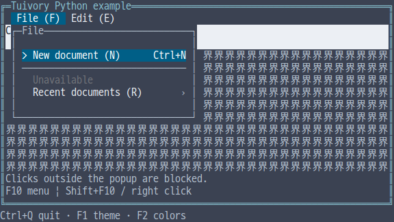
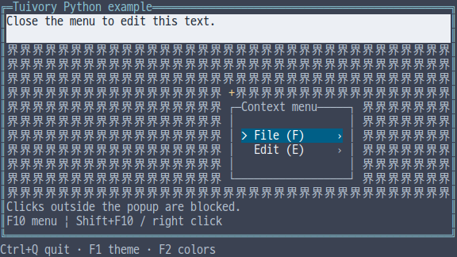
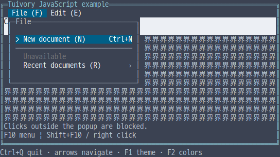
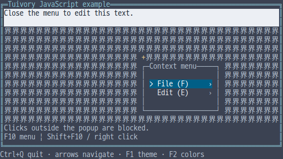
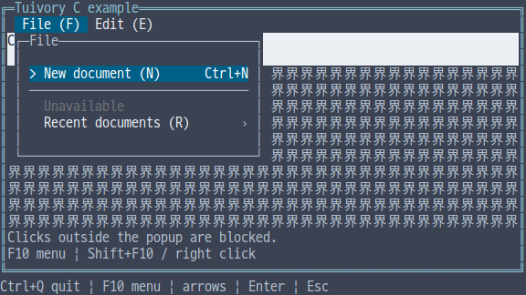
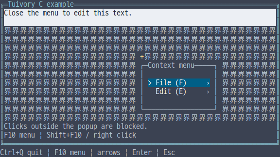
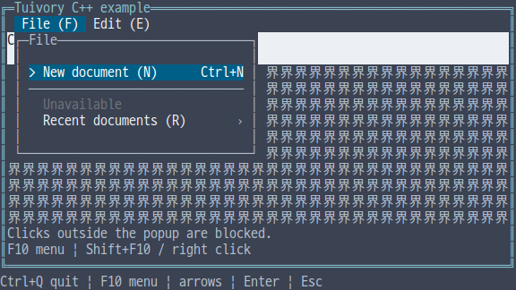
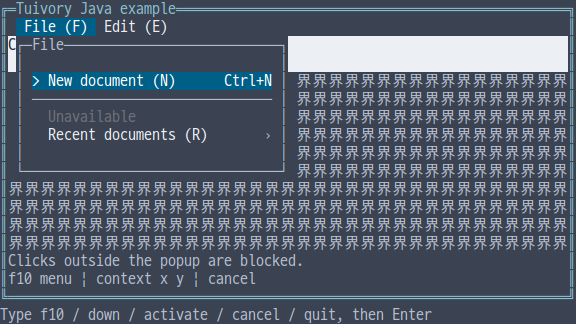
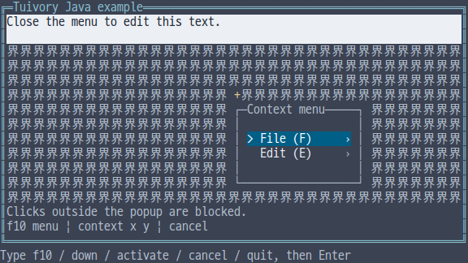

# Independent-language menus and context menus

[한국어 (기본)](language-menu.md) · **English**

This is unreleased work for TVR-15/16/30/31/32. Python, TS/JS, C, C++ and Java implement menus independently, without another Tuivory implementation, FFI/JNI or a subprocess engine. It is absent from published 0.11.1.

## API and ownership

| Feature | Python | TS/JS | C | C++ | Java |
| --- | --- | --- | --- | --- | --- |
| Item/model | `MenuItem`, `Menu` | same | `TuiMenuItem`, `tui_menu_new` | `MenuItem`, `Menu` | `MenuItem`, `Menu` |
| Replace source | `set_items` | `setItems` | `tui_menu_set_items` | `set_items` | `setItems` |
| Open/close | `open/close/back` | same | `tui_menu_open/close/back` | same | same |
| Actions/hits | `handle/click/click_id` | `handle/click/clickId` | `tui_menu_handle/click/click_id` | Python names | TS names |
| Rows/painting | `layout/draw` | same | `tui_menu_layout/draw` | same | same |
| Menu bar | `bar_layout/handle_bar/bar_click/draw_bar` | `barLayout/handleBar/barClick/drawBar` | `tui_menu_bar_layout/handle_bar/bar_click/draw_bar` | Python names | TS names |
| Popup painting | `draw_popup` | `drawPopup` | `tui_menu_draw_popup` | `draw_popup` | `drawPopup` |
| Placement | `menu_placement` | `menuPlacement` | `tui_menu_placement` | `menu_placement` | `menuPlacement` |

Items have `id/parent/label/secondary/shortcut/mnemonic/icon/ascii_icon/disabled/separator`; Java spells the ASCII icon `asciiIcon`. Sources are copied. Replacement preserves the open path and navigation candidates by stable ID. Removing, reparenting, disabling or removing the children of an open ancestor returns `close`. Invalid replacement preserves the existing model.

IDs must be nonempty, unique and cannot start with `@`. Missing parents, cycles, children of separators and duplicate sibling mnemonics are rejected. Mnemonics are one ASCII letter/digit, compared case-insensitively. Limits are 10,000 items and 32 levels.

Free C models with `tui_menu_free`; free `tui_menu_title` strings with `tui_string_free`. Item, row and event strings are borrowed until the relevant mutation, next layout or destruction. Constructors fail with `NULL`; other failures use `TuiResult` or event `result`. C++ uses values/RAII; other languages use their runtime ownership.

## Interaction and host responsibilities

`open(id, return_id)` opens a menu-bar branch; an empty ID opens the context-menu root. TS/Java spell the argument `returnId`. `handle(action, text, height)` accepts `next/previous/first/last/page_down/page_up`, arrow/Home/End aliases, `activate/right`, `back/left/cancel` and `mnemonic`. Disabled items and separators cannot navigate, click or execute. Submenus include a Back row.

Menus show **selection and open state**, without an additional focus highlight, underline or hardware cursor. Menu-bar actions and clicks return `open_request`; the host calls `open` with the actual return target. Activation returns `activate`, item ID and return ID, and closes the menu. Hosts connect business callbacks and [Focus](language-focus.en.md) scopes. Hosts own global F10/Escape policy, the overall screen, menu contents and approval for outside-click dismissal.

`draw_popup(canvas, rect, title, padding, ascii)` paints a single border and padding in a host-assigned rectangle, returning the **content rectangle for item hit testing**. Python makes `padding/ascii` keyword-only; C uses a final `content` output argument. Padding defaults to one cell and shrinks in small allocations; C/Java require an explicit padding argument. Shadows are a later milestone.

Placement prefers below the anchor, flips above when needed and clamps to the viewport. After resizing, use the latest returned content rectangle for hits. Long labels use `~` ellipsis; shortcuts and submenu indicators align right. The menu bar provides overflow arrows and keeps its candidate visible.

## Examples and validation

Use `--demo menu` or `--demo context-menu` in each integrated example. Shared options are `--lang ko|en --theme dark|light|blackwhite --colors 8|16|256|truecolor --ascii`. Python/JS/C/C++ hosts connect F10 toggle, Shift+F10, a context popup at the right-click position, arrows, Enter and Escape. Java uses ordinary JVM line commands: `down`, `activate`, `cancel`, `f10`, `context 52 14`, `insert Z`, `quit`, followed by Enter. Java line input is not claimed as raw mouse support.

The `+` marks the popup anchor. While open, the host blocks background editor input/clicks; closing restores its real cursor. Wide-character background text is database-free fixture data that exercises both popup edges.

Validation covers [shared cases](../design/menu-cases.json), atomic invalid updates, narrow rows/bars/placement, 12 palettes, C/C++ memory checks, isolated static SDK/JAR/wheel/npm consumers and actual PTY output. [Evidence](evidence/language-menu-results.json) distinguishes local checks, CI, dev merges and product publication.

| Language | Menu bar and popup | Context menu |
| --- | --- | --- |
| Python |  |  |
| JavaScript |  |  |
| C |  |  |
| C++ |  |  |
| Java |  |  |

[Independent languages](languages.en.md) · [API](api/README.en.md) · [Examples](examples.en.md)
