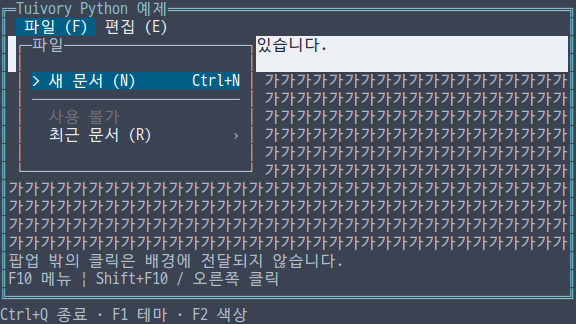
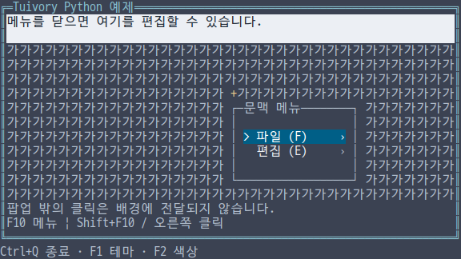
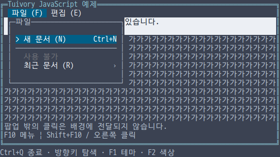
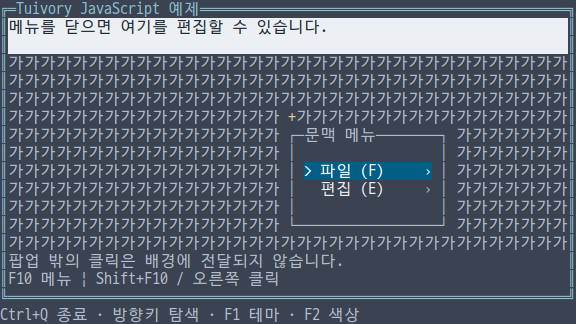
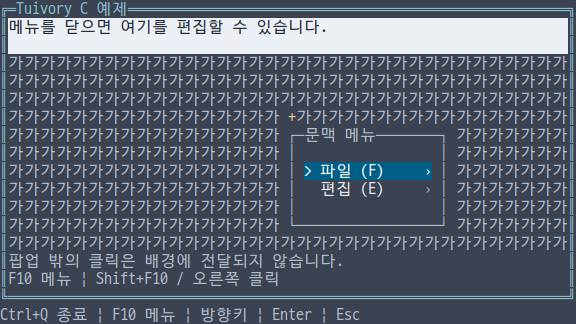
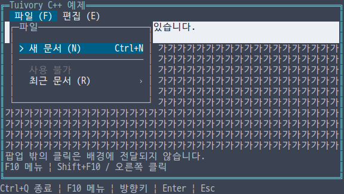
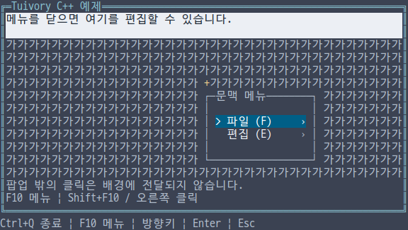
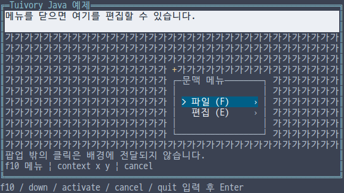

# 독립 언어 메뉴·문맥 메뉴 API

**한국어 (기본)** · [English](language-menu.en.md)

TVR-15·16·30·31·32의 미배포 구현입니다. Python·TS/JS·C·C++·Java가 각 언어의 메뉴를 직접 구현합니다. 다른 Tuivory 구현·FFI/JNI·서브프로세스 엔진을 호출하지 않으며 기존 공개 0.11.1에는 포함되지 않습니다.

## API와 소유권

| 기능 | Python | TS/JS | C | C++ | Java |
| --- | --- | --- | --- | --- | --- |
| 항목·모델 | `MenuItem`, `Menu` | 동일 | `TuiMenuItem`, `tui_menu_new` | `MenuItem`, `Menu` | `MenuItem`, `Menu` |
| 원본 갱신 | `set_items` | `setItems` | `tui_menu_set_items` | `set_items` | `setItems` |
| 열기·닫기 | `open/close/back` | 동일 | `tui_menu_open/close/back` | 동일 | 동일 |
| 조작·클릭 | `handle/click/click_id` | `handle/click/clickId` | `tui_menu_handle/click/click_id` | Python과 동일 | TS와 동일 |
| 행·출력 | `layout/draw` | 동일 | `tui_menu_layout/draw` | 동일 | 동일 |
| 메뉴바 | `bar_layout/handle_bar/bar_click/draw_bar` | `barLayout/handleBar/barClick/drawBar` | `tui_menu_bar_layout/handle_bar/bar_click/draw_bar` | Python과 동일 | TS와 동일 |
| 팝업 출력 | `draw_popup` | `drawPopup` | `tui_menu_draw_popup` | `draw_popup` | `drawPopup` |
| 위치 계산 | `menu_placement` | `menuPlacement` | `tui_menu_placement` | `menu_placement` | `menuPlacement` |

`MenuItem`은 `id/parent/label/secondary/shortcut/mnemonic/icon/ascii_icon/disabled/separator`를 가집니다. Java의 ASCII 아이콘은 `asciiIcon`입니다. 원본은 복사하며 갱신은 안정 ID를 기준으로 현재 경로와 탐색 후보를 보존합니다. 열린 상위 항목이 삭제·재배치·비활성화되거나 자식을 잃으면 `close` 이벤트를 반환합니다. 잘못된 갱신은 기존 상태를 보존합니다.

ID는 비어 있지 않고 고유해야 하며 `@`로 시작할 수 없습니다. 부모 누락·순환·구분선의 자식·형제 사이 중복 단축 문자는 거부합니다. 단축 문자는 ASCII 영문/숫자 하나이며 대소문자를 구분하지 않습니다. 최대 10,000항목·32단계입니다.

C는 `tui_menu_free`로 해제합니다. `tui_menu_title`의 문자열은 `tui_string_free`로 해제합니다. 항목·행·이벤트의 문자열은 메뉴가 소유하며 관련 변경/다음 layout/해제 전에만 사용합니다. 실패는 생성 시 `NULL`, 나머지는 `TuiResult` 또는 이벤트의 `result`로 확인합니다. C++는 값과 RAII, 나머지는 해당 런타임의 소유권을 따릅니다.

## 조작과 앱의 책임

`open(id, return_id)`로 메뉴바의 가지를 열고, 빈 ID로 문맥 메뉴의 최상위를 엽니다. TS/Java의 인수 이름은 `returnId`입니다. `handle(action, text, height)`는 `next/previous/first/last/page_down/page_up`, 방향키·Home/End 별칭, `activate/right`, `back/left/cancel`, `mnemonic`을 받습니다. 비활성 항목과 구분선은 이동·클릭·실행에서 제외합니다. 하위 메뉴에는 뒤로 행을 제공합니다.

메뉴는 **선택·열림 상태**로 표현하며 별도 포커스 강조·밑줄·하드웨어 커서를 그리지 않습니다. 메뉴바 탐색과 클릭은 `open_request`를 반환하며, 앱이 실제 호출 위치를 넣어 `open`합니다. 실행은 `activate`와 항목 ID·복귀 ID를 반환하고 메뉴를 닫습니다. 앱이 업무 동작과 [Focus](language-focus.md) 범위의 열기/닫기를 연결합니다. 전역 F10·Escape 정책, 화면 전체, 메뉴 내용, 외부 클릭의 닫기 승인도 앱이 결정합니다.

`draw_popup(canvas, rect, title, padding, ascii)`는 앱이 준 사각형에 단일 테두리와 여백을 그린 뒤 **항목 클릭에 사용할 내용 영역**을 반환합니다. Python은 `padding/ascii`가 키워드 인수이며 C는 마지막 `content` 출력 인수를 사용합니다. 기본 여백은 1칸이고 작은 영역에서는 줄입니다. C/Java는 여백 인수를 명시합니다. [선택적 팝업 그림자](language-popups.md)도 제공합니다.

위치 계산은 anchor 아래를 우선하고 공간이 부족하면 위로 뒤집은 뒤 viewport 안으로 제한합니다. 크기를 다시 계산하면 최신 반환 영역으로 클릭 좌표도 갱신해야 합니다. 긴 항목은 `~`로 생략하고 단축키·하위 메뉴 표시는 오른쪽에 배치합니다. 메뉴바는 넘침 화살표와 선택 항목 가시성을 제공합니다.

## 실행 예제와 검증

언어별 통합 예제에서 `--demo menu` 또는 `--demo context-menu`를 선택합니다. `--lang ko|en --theme dark|light|blackwhite --colors 8|16|256|truecolor --ascii`를 공통으로 제공합니다. Python·JS·C·C++ 예제는 F10 토글·Shift+F10·우클릭 위치의 문맥 메뉴·방향키·Enter·Escape를 연결합니다. Java는 일반 JVM 줄 입력으로 `down`, `activate`, `cancel`, `f10`, `context 52 14`, `insert Z`, `quit`을 Enter로 실행합니다. Java 줄 입력을 raw 마우스 지원으로 표현하지 않습니다.

예제의 `+`는 팝업 호출 위치입니다. 열린 동안 배경 편집기에 입력/클릭을 전달하지 않으며 닫으면 편집기의 실제 커서를 복원합니다. 팝업 아래 두 칸 문자 배경은 테두리 양쪽 클리핑을 검사하기 위한 DB 없는 데이터입니다.

[공유 메뉴 사례](../design/menu-cases.json), 잘못된 원본의 원자성, 좁은 행·메뉴바·위치, 12팔레트, C/C++ 메모리 검사·정적 외부 적용 앱·JAR·wheel/npm과 실제 PTY 출력을 검사합니다. [검증 기록](evidence/language-menu-results.json)은 로컬·CI·dev 병합·제품 게시를 구분합니다.

| 언어 | 메뉴바·팝업 | 문맥 메뉴 |
| --- | --- | --- |
| Python |  |  |
| JavaScript |  |  |
| C |  |  |
| C++ |  |  |
| Java |  |  |

[독립 언어 지원](languages.md) · [API](api/README.md) · [예제](examples.md)
