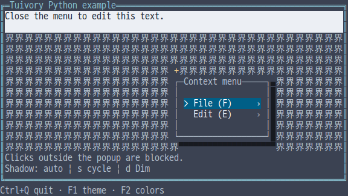
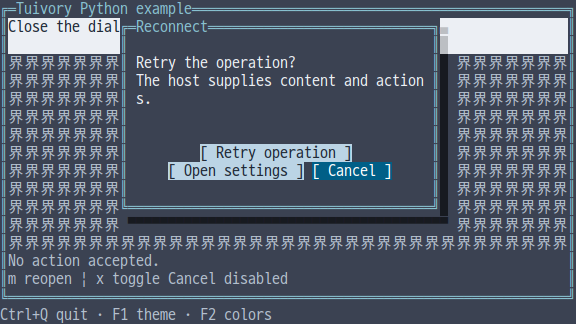
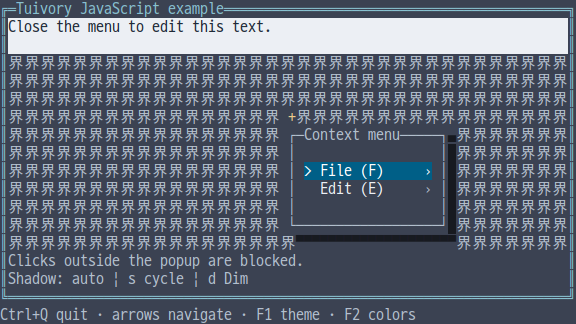
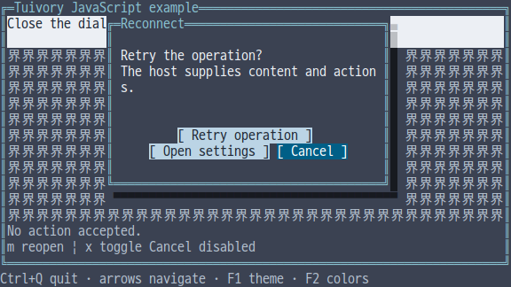
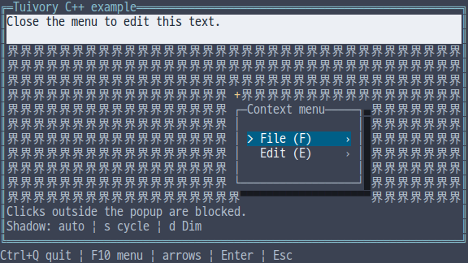
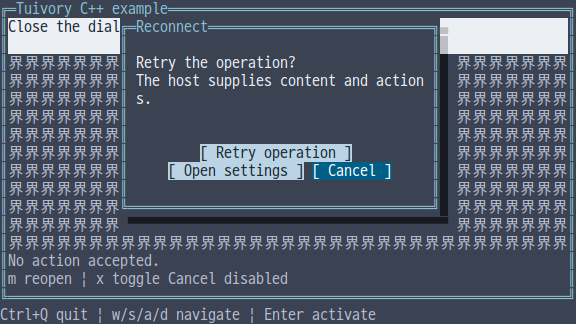
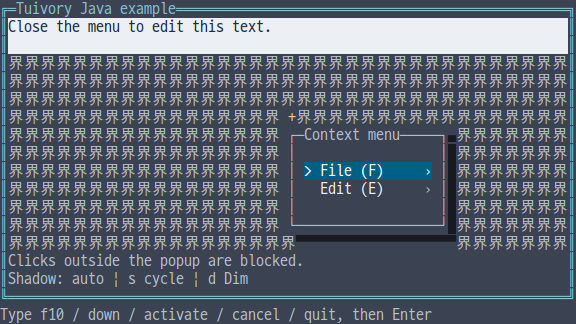
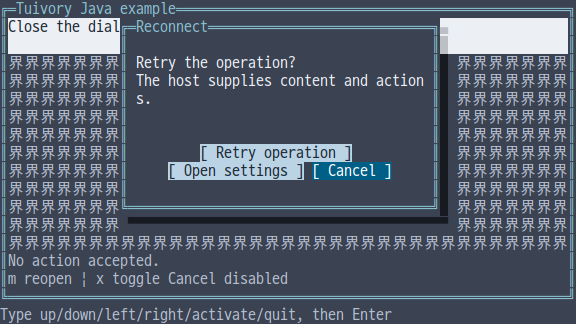

# Independent-language popup shadows and dialogs

[한국어 (기본)](language-popups.md) · **English**

This is TVR-15/16/30/31/32 work. Python, TypeScript/JavaScript, C, C++ and Java implement behavior independently without calling another Tuivory implementation. Available in 0.12.0.

| Feature | Python | TS/JS | C | C++ | Java |
| --- | --- | --- | --- | --- | --- |
| Shadow options | `ShadowOptions` | `ShadowOptions` | `TuiShadowOptions` | `ShadowOptions` | `ShadowOptions` |
| Popup placement | `popup_placement` | `popupPlacement` | `tui_popup_placement` | `popup_placement` | `popupPlacement` |
| Card/shadow geometry | `PopupLayout` | `PopupLayout` | `TuiPopupLayout` | `PopupLayout` | `PopupLayout` |
| Composition | `Shadow.draw` | `Shadow.draw` | `tui_shadow_draw` | `Shadow::draw` | `Shadow.draw` |
| Dialog | `Dialog`, `DialogButton` | `Dialog`, `DialogButton` type | `TuiDialog`, `TuiDialogButton` | `Dialog`, `DialogButton` | `Dialog`, `DialogButton` |

After wrapping, each button row is centered in the content width. Odd extra space goes on the right. Drawing and mouse input share the same clipped button rectangles. [Shared dialog rules and Go/Rust APIs](modals.en.md)

Use one public import/include. ShadowOptions defaults to off. auto adjusts shading to the actual background; solid uses black. Default auto/solid shadows extend one cell right and half a row below, using Unicode half blocks or ASCII dots. dim preserves underlying text and colors with the Dim attribute for compatibility. Terminal palette and Dim overrides can change physical appearance.

`options.layout(bounds)` allocates card and shadow inside the entire bounds. Enabled options with both offsets zero use (1,1). `popup_placement(anchor,viewport,width,height,options)` flips/clamps the whole footprint, including the shadow, into the viewport. `hit(x,y)` includes only the card. `shadow_regions()`/`shadowRegions()` returns disjoint right/bottom regions. Shadows are not input targets.

Painters receive a card Canvas with origin (0,0). Hosts subtract layout.card's origin from global pointer coordinates. Wide characters crossing either card/shadow boundary are repaired while preserving outside styles. Covered cursors are hidden; child cursors propagate only when fully visible. A failing painter leaves the destination unchanged. Hosts repaint the background before composing each popup frame.

```python
import tuivory as ui
confirm = ui.Dialog('Reconnect', 'Retry the operation?', [
    ui.DialogButton('retry', 'Retry'),
    ui.DialogButton('cancel', 'Cancel')], 'cancel')
layout = ui.Shadow(ui.ShadowOptions('auto')).draw(
    canvas, ui.Rect(2, 2, 40, 10),
    lambda child: confirm.draw(child, ui.Rect(0, 0, child.width, child.height)))
request = confirm.handle('activate')  # Default Cancel request; does not close itself
```

`Dialog(title,message,buttons,cancel_id)` initially selects the specified enabled Cancel button. handle returns activate/cancel requests or focus changes. next/previous, arrows and home/end navigate enabled buttons. Disabled buttons accept no click, activation or cancellation request. click uses actual coordinates from the latest draw. Model/focus updates invalidate stale hit regions. set_buttons/setButtons copies inputs and atomically rejects duplicate/empty IDs or unknown cancel IDs. set_text/setText updates content.

Body wrapping follows literal graphemes and never interprets markup. Buttons wrap across rows, retaining the selected row in view. Narrow labels are clipped; DialogLayout.hidden_buttons/hiddenButtons and body_truncated/bodyTruncated report omitted content. Drawing registers no hardware cursor. Apps own titles/content, screen composition, global keys, visibility lifetime, request acceptance, business execution and focus restoration after dismissal.

C provides tui_dialog_new/free, set_text/set_buttons, focus/handle/click and layout/draw. Free owned layout snapshots with tui_dialog_layout_free. Body/button cells have count/at accessors; snapshots survive model destruction. Model getters/event ID strings are borrowed; copy them before replacing buttons or freeing the model. C shadow painters receive a callback-lifetime borrowed Canvas and return TuiResult. Draw's layout output is optional. C++ uses value snapshots, Java records, and Python/TS copied buttons.

Offsets/requested dimensions are 0..1,000,000; original coordinates are 0..1,000,000,000. Canvas cell-count limits also apply. Dialogs allow at most 1,024 buttons, 1,024-byte IDs, 4,096-byte titles/labels and 1,000,000-byte UTF-8 bodies. Invalid Unicode is rejected.

The unreleased Python/TS bool-based popup-placement draft was replaced with this structured API; this does not retire a published API. Python's public __all__ also includes Container/Surface and the new popup APIs.

`--demo shadow` applies shadows to a context menu: s cycles auto/solid/off, d selects Dim. `--demo dialog` shows default Cancel, long buttons, disabled Cancel and dismissal requests. m reopens it; x toggles Cancel disabled. Four raw examples use actual mouse/resize input; Java uses fixed-size line input and click x y. Narrow Java geometry is checked through the API separately.

[Shared placement cases](../design/popup-shadow-cases.json) · [Shadow output cases](../design/popup-shadow-render-cases.json) · [Dialog cases](../design/dialog-cases.json)

| Language | Shadow | Dialog |
| --- | --- | --- |
| Python |  |  |
| JS |  |  |
| C |  |  |
| C++ |  |  |
| Java |  |  |

[Support](languages.en.md) · [API](api/README.en.md) · [Examples](examples.en.md) · [Evidence](evidence/language-popups-results.json)
