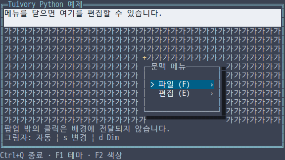
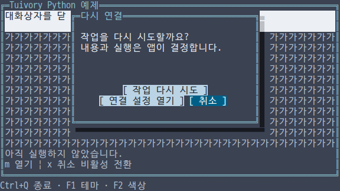
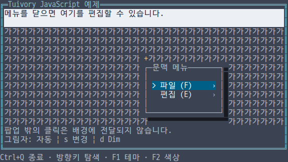
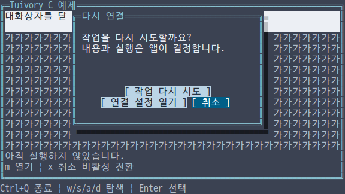
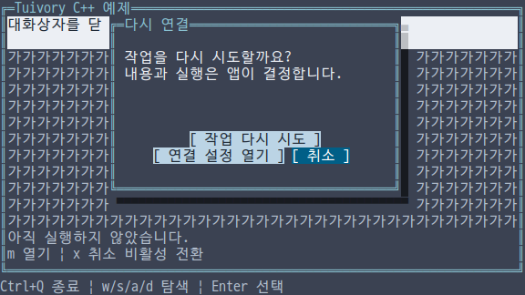
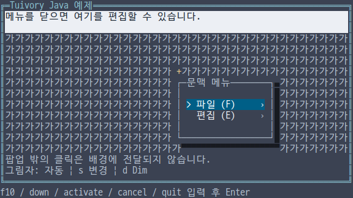
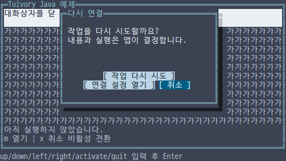

# 독립 언어의 팝업 그림자와 대화상자

**한국어 (기본)** · [English](language-popups.en.md)

TVR-15·16·30·31·32의 구현이다. Python·TypeScript/JavaScript·C·C++·Java는 각 언어에서 직접 구현하며 다른 Tuivory 구현을 호출하지 않는다. 0.12.0에서 제공합니다.

| 기능 | Python | TS/JS | C | C++ | Java |
| --- | --- | --- | --- | --- | --- |
| 그림자 설정 | `ShadowOptions` | `ShadowOptions` | `TuiShadowOptions` | `ShadowOptions` | `ShadowOptions` |
| 팝업 위치 | `popup_placement` | `popupPlacement` | `tui_popup_placement` | `popup_placement` | `popupPlacement` |
| 카드·그림자 배치 | `PopupLayout` | `PopupLayout` | `TuiPopupLayout` | `PopupLayout` | `PopupLayout` |
| 합성 | `Shadow.draw` | `Shadow.draw` | `tui_shadow_draw` | `Shadow::draw` | `Shadow.draw` |
| 대화상자 | `Dialog`, `DialogButton` | `Dialog`, `DialogButton` 타입 | `TuiDialog`, `TuiDialogButton` | `Dialog`, `DialogButton` | `Dialog`, `DialogButton` |

줄바꿈 후 내용 너비를 기준으로 각 버튼 행을 가운데 정렬한다. 남는 칸이 홀수면 오른쪽에 한 칸 더 둔다. 그리기와 클릭 판정에는 같은 사각형을 사용한다. [공통 확인창 규칙과 Go·Rust API](modals.md)

하나의 공개 import/include로 사용한다. `ShadowOptions`의 기본 모드는 off다. auto는 실제 배경에 맞춰 명암을 조정하고, solid는 검정을 사용한다. auto/solid의 기본 여백은 오른쪽 한 칸과 아래 반 줄이다. Unicode는 반 블록, ASCII는 점으로 대체한다. dim은 기존 문자의 색과 내용을 유지하고 Dim 속성을 적용하는 호환 모드다. 터미널이 색 팔레트나 Dim 표시를 재정의하면 실제 외관은 달라질 수 있다.

`options.layout(bounds)`는 전체 bounds 안에 card와 shadow를 배치한다. enabled 상태의 두 offset이 모두 0이면 (1,1)을 사용한다. `popup_placement(anchor,viewport,width,height,options)`는 그림자를 포함한 전체 영역이 viewport 안에 들어가도록 위치를 뒤집거나 제한한다. `hit(x,y)`는 카드만 포함한다. `shadow_regions()`/`shadowRegions()`는 겹치지 않는 오른쪽·아래 영역을 반환한다. 그림자는 입력 대상이 아니다.

그리기 콜백은 원점 (0,0)의 카드 Canvas를 받는다. 호스트가 전역 포인터 좌표에서 `layout.card`의 원점을 빼서 자식에 전달한다. 카드와 그림자 양쪽 경계에 걸친 두 칸 문자는 온전한 칸으로 복구하고 외부 칸의 스타일을 보존한다. 덮인 커서는 숨기고 카드가 만든 커서는 보이는 범위만 전달한다. 콜백 실패 시 대상 버퍼는 변경하지 않는다. 호스트는 프레임마다 배경을 다시 그리고 팝업을 합성한다.

```python
import tuivory as ui
confirm = ui.Dialog('다시 연결', '작업을 다시 시도할까요?', [
    ui.DialogButton('retry', '다시 시도'),
    ui.DialogButton('cancel', '취소')], 'cancel')
layout = ui.Shadow(ui.ShadowOptions('auto')).draw(
    canvas, ui.Rect(2, 2, 40, 10),
    lambda child: confirm.draw(child, ui.Rect(0, 0, child.width, child.height)))
request = confirm.handle('activate')  # 기본 취소 요청, 창을 자동으로 닫지 않음
```

`Dialog(title,message,buttons,cancel_id)`는 지정된 활성 취소 버튼을 기본 선택한다. `handle`은 activate/cancel 요청이나 focus 변경을 반환한다. next/previous·방향키·home/end는 활성 버튼 사이를 이동한다. 비활성 버튼은 클릭·활성화·취소 요청을 받지 않는다. `click`은 마지막 draw의 실제 좌표를 사용한다. 모델이나 포커스 변경 후 오래된 클릭 영역은 무효다. `set_buttons`/`setButtons`는 입력을 복사하고 중복·빈 ID나 존재하지 않는 취소 ID를 원자적으로 거부한다. `set_text`/`setText`는 내용을 갱신한다.

본문은 마크업을 해석하지 않는 문자 단위 줄바꿈을 사용한다. 버튼은 여러 줄로 배치하며 선택된 버튼 줄을 보이게 유지한다. 너무 좁으면 라벨을 생략하고 공간 부족은 `DialogLayout.hidden_buttons`/`hiddenButtons`, `body_truncated`/`bodyTruncated`로 알린다. 그리기는 하드웨어 커서를 등록하지 않는다. 제목·내용·전체 화면·전역 키·표시 수명·요청 수락·업무 실행·닫은 뒤 포커스 복원은 앱이 결정한다.

C는 `tui_dialog_new/free`, `set_text/set_buttons`, `focus/handle/click`, `layout/draw`를 제공한다. `tui_dialog_layout_free`로 소유한 배치 스냅샷을 해제한다. 본문과 버튼 셀은 count/at 접근자로 조회하며 스냅샷은 모델 해제 후에도 유효하다. 모델 getter와 이벤트의 ID 문자열은 빌린 값이다. 버튼 교체·모델 해제 전에 복사한다. C 그림자 painter는 콜백 동안만 유효한 Canvas를 받고 `TuiResult`를 반환한다. draw의 배치 출력은 선택 사항이다. C++는 값 스냅샷, Java는 record, Python/TS는 복사된 버튼을 사용한다.

설정 offset·요청 크기는 0..1,000,000, 원래 위치 좌표는 0..1,000,000,000이다. Canvas의 셀 수 제한을 함께 적용한다. 대화상자는 최대 1,024버튼, ID 1,024바이트, 제목·라벨 4,096바이트, 본문 1,000,000 UTF-8바이트를 허용한다. 잘못된 Unicode를 거부한다.

미배포 Python/TS 초안의 bool 기반 팝업 위치 함수는 이 구조화된 API로 교체했다. 공개 릴리스의 API 폐기가 아니다. Python의 공개 `__all__`에 Container·Surface와 새 팝업 API도 반영했다.

`--demo shadow`는 문맥 메뉴에 그림자를 적용하며 s로 auto/solid/off를 전환하고 d로 Dim을 선택한다. `--demo dialog`는 기본 취소·긴 버튼·비활성 취소·닫기 요청을 보여준다. m으로 다시 열고 x로 취소 비활성을 전환한다. 네 raw 예제는 실제 마우스·리사이즈를 사용하고 Java는 고정 크기 줄 입력과 `click x y`를 사용한다. Java의 좁은 창은 API 검사로 구분한다.

[공통 배치 사례](../design/popup-shadow-cases.json) · [그림자 출력 사례](../design/popup-shadow-render-cases.json) · [대화상자 사례](../design/dialog-cases.json)

| 언어 | 그림자 | 대화상자 |
| --- | --- | --- |
| Python |  |  |
| JS |  |  |
| C |  |  |
| C++ |  |  |
| Java |  |  |

[지원 범위](languages.md) · [API](api/README.md) · [예제](examples.md) · [검증 근거](evidence/language-popups-results.json)
