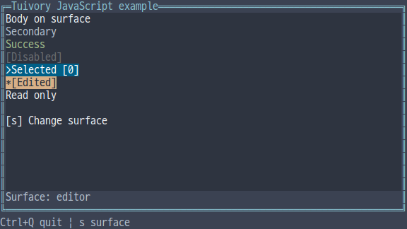
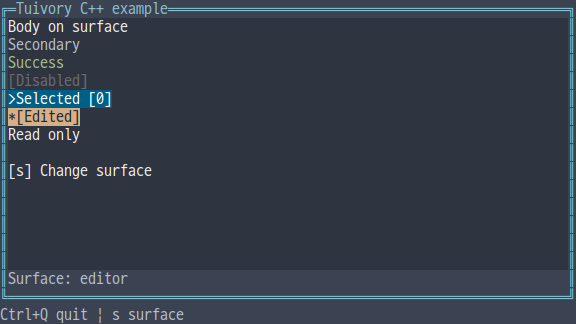
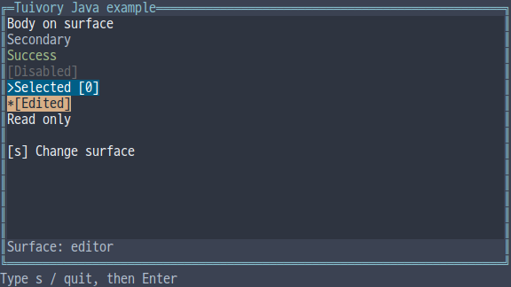

# Independent-language Surface and actual backgrounds

[한국어 (기본)](language-surfaces.md) · **English**

This TVR-15/16/30/31/32 milestone provides borderless opaque surfaces and text styles bound to actual backgrounds through five independent implementations. It follows the [shared design rules](../design/surfaces.en.md) without calling another Tuivory language. Available in 0.12.0.

| Feature | Python | TS/JS | C | C++ | Java |
| --- | --- | --- | --- | --- | --- |
| Plain text style | `Palette.text_on_surface(role,surface)` | `textOnSurface` | `tui_text_on_surface` | `Palette::text_on_surface` | `Palette.textOnSurface` |
| Control style | `Palette.control_on_surface(state,surface,focused=...)` | `controlOnSurface(state,surface,focused)` | `tui_control_on_surface` | `Palette::control_on_surface` | `Palette.controlOnSurface` |
| Borderless surface | `Surface(role).draw(canvas,bounds,painter)` | `new Surface(role).draw(...)` | `TuiSurface`, `tui_surface_draw` | `Surface{role}.draw(...)` | `new Surface(role).draw(...)` |
| Exact style painting | `Canvas.write_style` | `Canvas.writeStyle` | `tui_canvas_write_style` | `Canvas::write_style` | `Canvas.writeStyle` |

Use one public import/include. The default Surface role is surface. Painters receive one child Canvas with origin (0,0); writes outside its allocation are clipped. A failing callback leaves the destination Canvas unchanged. Surface does not automatically add borders, text, focus order, keys or business behavior.

```python
import tuivory as ui

def paint(child):
    child.write(0,0,'Note','hint')
    ui.Badge(label='Selected',state=ui.ControlState(selected=True)).draw(
        child,ui.Rect(0,1,20,1))
ui.Surface('editor').draw(canvas,ui.Rect(1,1,30,8),paint)
```

```typescript
import { Surface, Badge, rect } from 'tuivory';
new Surface('editor').draw(canvas,rect(1,1,30,8),child => {
  child.write(0,0,'Note','hint');
  new Badge({label:'Selected',state:{selected:true}}).draw(child,rect(0,1,20,1));
});
```

## Backgrounds and contrast

body/hint/disabled/info/success/warning/error are plain text roles. Ordinary write operations and library components bind them to the actual Surface background. Panel borders use their panel's background, and nested container children inherit the surface role. Read-only Text follows the actual background as plain text; editable input uses field backgrounds.

Explicit field, selection, edited, header, editor, button/button.focus role backgrounds are preserved, including selected/edited control states. Original `Palette.style` / C `tui_style` returns the original role style. Python/TS/C++ retain their existing background-preservation argument for low-level raw-role calls. `write_style/writeStyle` paints exactly the supplied foreground/background/attributes without contrast inference.

Binding plain text targets reference ANSI/xterm RGB contrast of 4.5:1 normally and 2.0:1 for disabled text. When the original foreground falls below its target and the surface foreground is better, the latter is used. Disabled text retains Dim and normal weight and receives no focus underline. For example, light/16 success text on surface uses black instead of green. Selected/edited states retain their explicit backgrounds rather than being flattened by this correction.

ANSI indices are not converted to RGB output; only calculations use reference RGB. A user terminal can redefine its palette, changing physical contrast. If the surface's own foreground is unsuitable, this correction cannot guarantee the target. It builds styles for the chosen background without modifying theme data.

## Canvas and C lifetimes

Canvas also accepts a surface role as its fourth constructor argument. Python/C++ use surface/surface_role; TS/Java use surfaceRole. C uses `tui_canvas_surface` to set the background for subsequent painting and `tui_canvas_surface_role` to query it. Already painted cells are not recolored automatically; hosts repaint components after theme/surface changes.

A NULL `TuiSurface.role` selects surface. C `TuiSurfacePainter(context,child)` returns `TuiResult`; child is borrowed only during the callback and must not be retained/freed. `tui_text_on_surface` accepts theme/profile/role/surface/focused/out; `tui_control_on_surface` accepts theme/profile/state/surface/focused/out. `tui_canvas_write_style(canvas,x,y,text,style,width)` paints an exact style. Other languages use their own value/runtime lifetimes. Surface coordinates/dimensions are 0..1,000,000 and child buffers are capped at 1,000,000 cells.

## Examples and validation

Integrated `--demo surface` cycles panel/editor/field/focused button backgrounds with s. It shows ordinary/secondary/success/disabled text, selected/edited states and a read-only value. This example compares styles; hosts connect input editing and focus order separately. Java uses fixed-size line input with s/quit followed by Enter.

[Shared cases](../design/surface-cases.json) cover known contrast corrections, disabled cues and original-style preservation. C/C++ and Java read actual ANSI cell buffers for 12 palettes×4 surfaces to check text, borders, nested containers and exact raw backgrounds. The [evidence record](evidence/language-surfaces-results.json) distinguishes local checks, GitHub CI, dev and product publication. Actual 40-column resizing in four raw examples is distinguished from narrow Java API checks.

| Language | English screen |
| --- | --- |
| Python |  |
| JavaScript |  |
| C |  |
| C++ |  |
| Java |  |

[Independent languages](languages.en.md) · [Containers](language-containers.en.md) · [API](api/README.en.md) · [Examples](examples.en.md)

Actual-output checks parse a frame only after receiving its final Canvas reset. Regression cases cover split UTF-8/SGR, subsequent incomplete frames and line-input prompts.
