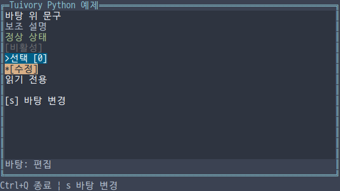
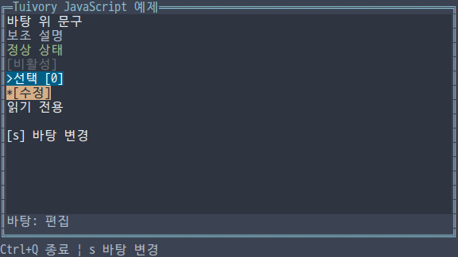
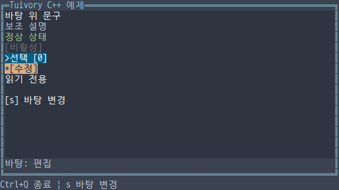
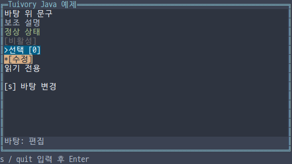

# 독립 언어 Surface와 실제 바탕색

**한국어 (기본)** · [English](language-surfaces.en.md)

TVR-15/16/30/31/32의 단계입니다. 다섯 언어가 자체 구현으로 테두리 없는 불투명 Surface와 실제 바탕에 맞춘 글자 스타일을 제공합니다. [공통 디자인 규칙](../design/surfaces.md)을 따르며 다른 Tuivory 언어를 호출하지 않습니다. 0.12.0에서 제공합니다.

| 기능 | Python | TS/JS | C | C++ | Java |
| --- | --- | --- | --- | --- | --- |
| 평문 스타일 | `Palette.text_on_surface(role,surface)` | `textOnSurface` | `tui_text_on_surface` | `Palette::text_on_surface` | `Palette.textOnSurface` |
| 컨트롤 스타일 | `Palette.control_on_surface(state,surface,focused=...)` | `controlOnSurface(state,surface,focused)` | `tui_control_on_surface` | `Palette::control_on_surface` | `Palette.controlOnSurface` |
| 테두리 없는 표면 | `Surface(role).draw(canvas,bounds,painter)` | `new Surface(role).draw(...)` | `TuiSurface`, `tui_surface_draw` | `Surface{role}.draw(...)` | `new Surface(role).draw(...)` |
| 정확한 스타일 그리기 | `Canvas.write_style` | `Canvas.writeStyle` | `tui_canvas_write_style` | `Canvas::write_style` | `Canvas.writeStyle` |

한 번의 공개 import/include로 사용합니다. Surface의 기본 역할은 surface입니다. 콜백은 자식 Canvas 하나를 받고 그 원점은 (0,0)입니다. 자신에게 주어진 크기 밖으로 쓰면 잘립니다. 콜백 실패 시 최종 Canvas를 바꾸지 않습니다. Surface는 테두리·글자·포커스 순서·키·업무 동작을 자동으로 추가하지 않습니다.

```python
import tuivory as ui

def paint(child):
    child.write(0,0,'안내','hint')
    ui.Badge(label='선택',state=ui.ControlState(selected=True)).draw(
        child,ui.Rect(0,1,20,1))
ui.Surface('editor').draw(canvas,ui.Rect(1,1,30,8),paint)
```

```typescript
import { Surface, Badge, rect } from 'tuivory';
new Surface('editor').draw(canvas,rect(1,1,30,8),child => {
  child.write(0,0,'Note','hint');
  new Badge({label:'Selected',state:{selected:true}}).draw(child,rect(0,1,20,1));
});
```

## 배경과 대비

body/hint/disabled/info/success/warning/error는 평문 역할입니다. 일반 write와 라이브러리 컴포넌트는 실제 Surface 배경을 사용합니다. 패널의 테두리도 그 패널 바탕을 사용합니다. 중첩 컨테이너의 자식에도 바탕 역할을 전달합니다. readonly Text는 읽기 전용 문구로서 실제 바탕을 따르며, 편집 가능한 입력 영역은 field 배경을 사용합니다.

field, selection, edited, header, editor, button/button.focus의 명시적 역할 배경은 보존합니다. 선택·수정 상태에 의한 배경도 유지합니다. 원본 `Palette.style` / C `tui_style`은 역할의 원래 스타일을 반환합니다. Python/TS/C++의 기존 배경 보존 인수는 역할 그대로 그리는 저수준 호출에 사용할 수 있습니다. `write_style/writeStyle`은 전달받은 글자·배경·속성을 정확히 그리며 대비를 추정하지 않습니다.

평문을 바탕에 연결할 때 전경 대비 목표는 ANSI/xterm 참조 RGB 기준 일반 4.5:1, 비활성 2.0:1입니다. 원래 전경이 목표에 부족하고 표면 전경이 더 잘 보이면 표면 전경을 사용합니다. 비활성은 Dim과 일반 굵기를 유지하며 포커스 밑줄을 붙이지 않습니다. 예를 들어 light/16의 success를 surface에 올리면 녹색 대신 검정 전경을 사용합니다. 선택·수정 상태에 같은 보정을 적용해 상태 배경을 지우지 않습니다.

ANSI 인덱스를 실제 RGB 출력으로 바꾸지 않습니다. 계산만 참조 RGB를 사용합니다. 사용자 터미널이 팔레트를 바꾸면 실제 대비가 다를 수 있으며, 표면 자체의 전경까지 부적절하면 이 보정이 목표 대비를 보장하지 않습니다. 테마 원본을 수정하지 않고 사용할 바탕에 맞춘 스타일을 만듭니다.

## Canvas와 C 수명

Canvas 생성자의 네 번째 인수로 바탕 역할을 지정할 수도 있습니다. Python/C++는 surface/surface_role, TS/Java는 surfaceRole입니다. C는 `tui_canvas_surface`로 이후 그리기의 바탕을 지정하고 `tui_canvas_surface_role`로 읽습니다. 이미 그린 셀을 자동으로 다시 칠하지 않습니다. 앱은 테마·바탕 변경 후 컴포넌트를 다시 그립니다.

C의 `TuiSurface.role=NULL`은 surface입니다. `TuiSurfacePainter(context,child)`는 `TuiResult`를 반환하며 child는 콜백 동안만 빌립니다. 앱이 보관하거나 해제하지 않습니다. `tui_text_on_surface`는 theme/profile/role/surface/focused/out, `tui_control_on_surface`는 theme/profile/state/surface/focused/out을 받습니다. `tui_canvas_write_style(canvas,x,y,text,style,width)`은 정확한 스타일을 사용합니다. 다른 언어는 자기 값·런타임 수명을 따릅니다. Surface 좌표·크기는 0..1,000,000이며 자식은 최대 1,000,000셀입니다.

## 예제와 검증

통합 `--demo surface`는 s로 panel/editor/field/focused button 바탕을 순환합니다. 일반·보조·정상·비활성 문구, 선택·수정 상태와 읽기 전용 값이 각 바탕에서 어떻게 그려지는지 보여줍니다. 이 예제는 스타일 비교용이며 입력 편집·포커스 순서는 앱이 별도로 연결합니다. Java는 s/quit 뒤 Enter를 누르는 고정 크기 줄 입력 예제입니다.

[공유 사례](../design/surface-cases.json)는 알려진 대비 보정, 비활성 표시와 원본 스타일 보존을 다룹니다. C/C++·Java는 12팔레트×4표면의 실제 ANSI 셀 버퍼를 읽어 문구·테두리·중첩 컨테이너·정확한 원본 스타일 배경을 검사합니다. [검증 기록](evidence/language-surfaces-results.json)은 로컬 검사·GitHub CI·dev·제품 게시 상태를 구분합니다. 네 raw 예제의 실제 40열 resize와 Java API의 좁은 영역 검사를 구분합니다.

| 언어 | 한글 화면 |
| --- | --- |
| Python |  |
| JavaScript |  |
| C |  |
| C++ |  |
| Java |  |

[독립 언어](languages.md) · [컨테이너](language-containers.md) · [API](api/README.md) · [예제](examples.md)

실제 출력 검사는 마지막 Canvas 종료 명령을 받은 뒤 프레임을 해석합니다. 분할된 UTF-8/SGR과 다음 프레임·줄 입력 프롬프트가 섞이는 상황도 검사합니다.
